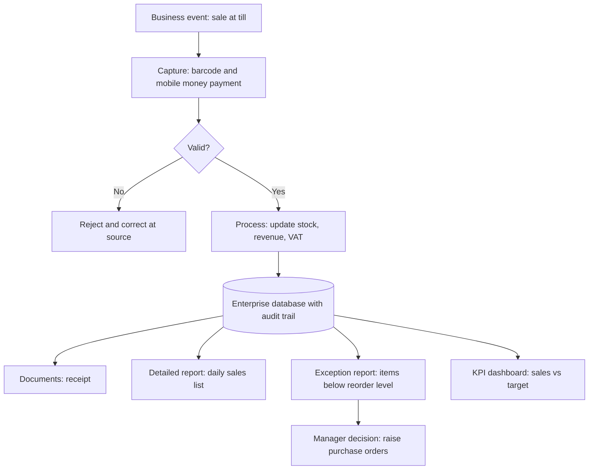

## Introduction

Every business event leaves an information trail. When a patient registers at a hospital, a customer pays for groceries with mobile money, or a lorry leaves a depot in Kumasi, something must be recorded, checked, passed on and eventually summarised for someone who has to make a decision. If those flows are slow, incomplete or distorted, managers make decisions on stale or wrong information, and front-line staff spend their time chasing paperwork rather than serving customers.

This lesson examines **organisational information flows**: the movement of data between people, functions and levels of management. You will study the transaction processing cycle that captures operational events, the ways transactional data is summarised into management reports, and the design principles that make a report useful rather than merely long. These ideas underpin enterprise systems, because an ERP is essentially a machine for capturing transactions once and routing the resulting information to everyone who needs it.

## Learning Objectives

- Describe vertical, horizontal and external information flows and give examples of each.
- Explain the stages of the transaction processing cycle and the controls applied at each stage.
- Compare batch and real-time (online) transaction processing and justify the choice for a given business situation.
- Design a management report that distinguishes detailed, summary, exception and key-indicator information.
- Evaluate how integrated enterprise systems change the speed and quality of information flows.

## Prerequisite Knowledge

- The previous lesson, *Enterprise Systems and Business Information Systems*, particularly the classification of TPS, MIS and DSS.
- A general understanding of common business documents such as purchase orders, invoices and receipts.

## Key Terminology

- **Information flow**: The movement of data or information between people, functions, systems or organisations, in a particular direction and at a particular frequency.
- **Vertical flow**: Information moving up (reports, requests) or down (instructions, targets, policies) the management hierarchy.
- **Horizontal flow**: Information moving between functions at the same level, such as from sales to the warehouse.
- **Transaction**: A business event with economic or operational significance that must be recorded, such as a sale, payment, receipt or admission.
- **Transaction processing system (TPS)**: A system that records, validates, processes and stores routine business transactions and produces the documents and records that operations depend upon.
- **Batch processing**: Collecting transactions over a period and processing them together at a scheduled time.
- **Real-time (online) processing**: Processing each transaction as it occurs, so records are updated immediately.
- **Exception report**: A report that shows only items that fall outside defined limits, such as stock below reorder level.
- **Key performance indicator (KPI)**: A measure chosen to show progress towards an important organisational objective.

## Detailed Explanation

### Directions of information flow

Information in an organisation moves in three broad directions.

- **Vertical flows** connect operational staff, middle managers and senior executives. Upward flows carry performance data, exceptions and requests for decisions; downward flows carry plans, budgets, targets and policies. A common pathology is *filtering*: as information moves upward, each layer summarises and sometimes softens bad news, so executives see an unrealistically positive picture.
- **Horizontal flows** connect functions at the same level. They are the lifeblood of cross-functional processes: a sales order must reach the warehouse, the delivery note must reach accounts, and the invoice must reach the customer. Horizontal flows are where functional silos do most damage, because each hand-off is a chance for delay or error.
- **External flows** connect the organisation to customers, suppliers, banks, regulators and partners: orders, invoices, payment confirmations, tax returns and delivery tracking information.

Information flows can also be characterised by **frequency** (continuous, daily, monthly), **formality** (system records versus informal conversation) and **medium** (paper, e-mail, system transaction, messaging app). In many Ghanaian SMEs, a large share of operational information travels through informal channels such as phone calls and messaging apps. These are fast and flexible but leave no reliable audit trail.

### The transaction processing cycle

Transaction processing follows a recognisable cycle regardless of industry.

1. **Data capture**: the event is recorded at source, ideally once and electronically (barcode scanning, card or mobile money terminal, form entry).
2. **Validation and editing**: the system checks that data is complete, correctly formatted, within reasonable limits and consistent with master data (for example, the product code exists and the customer is not over credit limit).
3. **Processing**: calculations and updates are performed, such as computing VAT, reducing stock and increasing receivables.
4. **Storage**: the updated records are written to the database, together with an audit trail of who did what and when.
5. **Output and document production**: receipts, invoices, picking lists and confirmations are produced and sent.
6. **Inquiry and reporting**: authorised users can query transactions, and transaction data is summarised for management reports.

Controls are embedded throughout: input controls (validation, mandatory fields), processing controls (totals, sequence checks), output controls (distribution lists) and access controls (who may enter or approve which transactions). Good transaction processing is the foundation of reliable management information; no dashboard can compensate for poorly captured transactions.

### Batch versus real-time processing

| Aspect | Batch processing | Real-time processing |
|---|---|---|
| Timing | Periodic (e.g. nightly) | Immediate, per transaction |
| Currency of data | Records are out of date between runs | Records are current |
| Cost and complexity | Lower; simpler recovery | Higher; needs reliable connectivity |
| Typical uses | Payroll, end-of-day bank file uploads, monthly billing | Point-of-sale, stock reservation, airline seat booking, mobile money |

The choice is a business decision. A supermarket needs real-time stock reduction at the till if it offers online ordering from the same inventory, but monthly staff payroll is naturally a batch process. Where connectivity is unreliable, a hybrid approach is common: transactions are captured locally and synchronised when the network is available, which requires careful handling of conflicts.

### From transactions to management reporting

Management reports transform transaction data into information for planning and control. Four classic report types can be distinguished:

- **Detailed reports** list individual transactions (every sale today). They support operational checking but overwhelm managers.
- **Summary reports** aggregate data by period, branch, product or customer (sales by branch this week).
- **Exception reports** show only items requiring attention (overdue invoices beyond 60 days; drugs expiring within 90 days).
- **Key-indicator reports and dashboards** present a small set of KPIs with trends and targets.

A useful report is *relevant* to a decision, *timely*, *accurate*, *at the right level of detail*, and *actionable*: the reader should know what to do next. Managers frequently ask for "everything" and then use very little; a skilled analyst asks "What decision will this report support?" before designing it.

## Theories, Frameworks and Models

### Anthony's levels of management activity

Robert Anthony's classic distinction between **strategic planning**, **management control** and **operational control** is still a helpful way to match information to decisions. Operational control needs detailed, frequent, internal and highly accurate information. Management control needs summarised and exception information over weeks or months. Strategic planning needs aggregated, forward-looking information that often comes from outside the organisation and is inherently less precise.

| Characteristic | Operational | Management control | Strategic |
|---|---|---|---|
| Time horizon | Hours to days | Weeks to months | Years |
| Detail | Very detailed | Summarised | Highly aggregated |
| Source | Mostly internal | Internal | Internal and external |
| Frequency | Continuous | Periodic | Ad hoc |

### The information value chain

A simple model links the stages: **data** (raw recorded facts) becomes **information** when it is organised and given context, and becomes **knowledge and action** when a decision-maker interprets it and acts. Errors at the data stage propagate through every later stage, which is why transaction capture quality matters so much.

## Worked Example

**Illustrative scenario.** *Korle Family Supermarket* is a hypothetical three-branch supermarket in Accra. The operations manager wants to reduce stock-outs of fast-moving items.

**Step 1 – Identify the decision.** "Which items should be reordered today, and in what quantity, for each branch?"

**Step 2 – Identify the transactions that feed it.** Point-of-sale sales lines, goods received notes, inter-branch transfers and stock adjustments (damage, theft, expiry).

**Step 3 – Define the calculation.** For each item and branch: `available stock = opening stock + receipts + transfers in − sales − transfers out − adjustments`. Flag the item if `available stock < reorder level`, where `reorder level = average daily sales × supplier lead time (days) + safety stock`.

For example, sugar 1 kg at the Osu branch: average daily sales 40 units, lead time 3 days, safety stock 30 units, so reorder level = 40 × 3 + 30 = 150 units. If available stock is 120, the item appears on the exception report with a suggested order to bring stock back to an agreed maximum.

**Step 4 – Design the report.** An exception report listing only flagged items, sorted by days of cover remaining, with columns for item, branch, available stock, reorder level, suggested order quantity and preferred supplier.

**Step 5 – Check the information flow.** If tills upload sales only at night (batch), the report reflects yesterday's position; if they post in real time, the report can be refreshed at midday. The manager decides that a nightly batch is adequate for most lines but that fresh produce needs intraday visibility.

## International Case Study

### The first barcode scan at a supermarket checkout

A widely recorded milestone in transaction capture occurred in June 1974, when a pack of Wrigley's chewing gum became the first product sold using a scanned Universal Product Code (UPC) barcode, at a Marsh supermarket in Troy, Ohio, in the United States. The significance for this lesson is not the gum but the change in information flow. Before scanning, prices were keyed manually, so detailed item-level sales data was hard to capture reliably. Scanning meant that each sale was captured once, accurately, at the point of sale, creating the item-level transaction data on which modern stock replenishment, supplier collaboration and retail analytics depend. The case illustrates the principle that better *capture* at the source transforms everything downstream.

## Diagram

## Common Misconceptions

- **"Management reporting is separate from transaction processing."** Management reports are built from transaction data; weak capture produces unreliable reports however sophisticated the reporting tool.
- **"Real-time processing is always better than batch."** Real-time processing costs more and is not needed for inherently periodic processes such as payroll; the right choice follows the decision's time requirement.
- **"More detail makes a report more useful."** Managers need the level of detail appropriate to their decision; exception and summary reports are usually more actionable.
- **"Informal flows such as phone calls do not matter."** Informal flows often carry critical information; process analysis should capture them, and system design should replace them where an audit trail is needed.

## Common Examination Mistakes

- Describing the TPS cycle without mentioning validation and controls.
- Confusing exception reports with summary reports.
- Failing to link the type of information to the level of management that uses it.
- Asserting that real-time processing should be used everywhere without considering cost, connectivity and need.
- Giving generic answers when the question supplies a scenario with specific decisions and data.

## Critical Thinking Questions

1. Upward information filtering can give executives an overly positive picture. How can enterprise systems and dashboards reduce filtering, and could they introduce new distortions?
2. In an organisation where many orders arrive through messaging apps, what are the risks of leaving these informal flows outside the enterprise system, and how might they be captured without losing their convenience?
3. Under what circumstances could a nightly batch process be a better design choice than real-time processing for a Ghanaian retailer?
4. If a KPI dashboard shows only five indicators, who should decide which five, and what are the dangers of choosing the wrong ones?

## Practical Exercises

1. **Map the flows.** For a process you know (for example, outpatient registration to payment at a clinic), list every information flow, its direction (vertical, horizontal, external), medium and frequency. *Expected output:* a table with at least eight flows and a note identifying the two most error-prone hand-offs.
2. **Design a TPS validation set.** For a mobile money payment recorded at a pharmacy till, specify at least six validation rules. *Expected output:* a list of rules (for example, transaction reference is unique, amount equals invoice total) with the error each prevents.
3. **Reorder exception report.** Using the formula in the worked example, calculate reorder levels for five products with your own plausible data and decide which need reordering. *Expected output:* a small table and a one-paragraph justification.
4. **Explore an integrated order flow.** Using SAP Learning (<https://learning.sap.com/>), find an introductory learning journey covering a sales or procurement process in SAP S/4HANA. *Expected output:* a sequence of the main documents created in the process and the functions each one informs.

## Key Takeaways

- Information flows vertically, horizontally and externally; horizontal hand-offs are where silos cause most delay and error.
- The transaction processing cycle (capture, validate, process, store, output, report) is the foundation of all management information.
- Batch and real-time processing each have legitimate uses; the choice follows the decision's timing needs and the cost of currency.
- Effective reports are designed around decisions and use the right type: detailed, summary, exception or KPI.
- Anthony's levels of management activity help match information characteristics to decision-makers.

## Further Reading

- Monk, E., & Wagner, B. (2013). *Concepts in enterprise resource planning* (4th ed.). Cengage Learning.
- Davenport, T. H. (1998). Putting the enterprise into the enterprise system. *Harvard Business Review, 76*(4), 121–131.
- Dumas, M., La Rosa, M., Mendling, J., & Reijers, H. A. (2018). *Fundamentals of business process management* (2nd ed.). Springer.

## Video Resources

- [SAP Learning](https://learning.sap.com/) — SAP. Learning journeys that walk through integrated sales, procurement and finance flows in SAP S/4HANA.
- [What is ERP? (IBM Think)](https://www.ibm.com/think/topics/enterprise-resource-planning) — IBM. Explains how ERP captures transactions once and shares them across business functions.

## Revision Summary

Organisational information flows run vertically (reports up, instructions down), horizontally (between functions) and externally (with customers, suppliers and regulators). The transaction processing cycle captures, validates, processes, stores and outputs routine business events, and every management report depends on its quality. Batch and real-time processing suit different needs. Reports should be designed around decisions and matched to Anthony's levels of management activity.

- Horizontal hand-offs are the main source of delay and error in cross-functional processes.
- TPS cycle: capture → validate → process → store → output → report.
- Capture data once, at source, electronically (the 1974 barcode milestone).
- Report types: detailed, summary, exception, KPI.
- Operational, management control and strategic decisions need different information.
