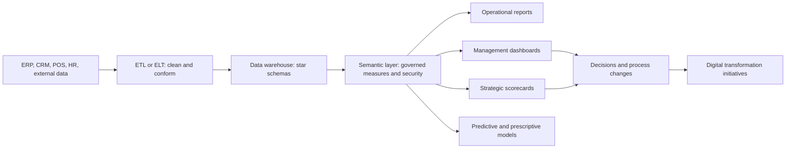

## Introduction

Enterprise systems capture an enormous volume of transactions: every sale, receipt, payment and stock movement. Yet many organisations that run an ERP still make decisions from exported spreadsheets assembled by hand at month-end. Business intelligence (BI) closes that gap by turning transactional data into timely, consistent information for managers. Done well, it gives a single version of the truth; done badly, it produces dashboards full of numbers nobody trusts.

BI is also one of the foundations of **digital transformation**, the broader use of digital technology to change how an organisation serves customers, runs operations and creates value. This lesson moves from the technical (BI architecture and dimensional models) through the managerial (KPI design and reporting levels) to the strategic (digital transformation frameworks), with a worked KPI calculation and a landmark African case.

## Learning Objectives

- Explain the components of a business intelligence architecture built on enterprise systems.
- Distinguish operational, management and strategic reporting, and descriptive, diagnostic, predictive and prescriptive analytics.
- Apply a dimensional model and KPI formulas to calculate and interpret gross margin, stock turnover and days of inventory.
- Design KPIs that are specific, measurable and linked to objectives, with clear definitions and owners.
- Evaluate a digital transformation initiative using the distinction between digitisation, digitalisation and digital transformation.

## Prerequisite Knowledge

- Enterprise databases, master data and enterprise analytics (Enterprise Applications module).
- Basic understanding of ERP transactional data (sales, purchases, inventory).
- Simple arithmetic with percentages and ratios.

## Key Terminology

- **Business intelligence (BI)**: The technologies, processes and practices used to collect, integrate, analyse and present business data to support decisions.
- **Data warehouse**: A subject-oriented, integrated store of historical data designed for analysis rather than transaction processing.
- **Star schema**: A dimensional model with a central fact table of measurements surrounded by dimension tables describing the context, such as date, product, branch and customer (Kimball & Ross, 2013).
- **Semantic layer**: A business-friendly layer that defines measures and hierarchies once, so that every report calculates "gross margin" the same way.
- **Key performance indicator (KPI)**: A measure, linked to an objective, that indicates how well an organisation is performing on something that matters.
- **Self-service BI**: Tools that allow business users to build their own analyses on governed data without writing code.
- **Digitisation**: Converting analogue information into digital form, such as scanning paper forms.
- **Digitalisation**: Using digital technologies to change existing processes, such as moving approvals into a workflow system.
- **Digital transformation**: Fundamental change in customer experience, operations or business model enabled by digital technology.

## BI Architecture

A typical BI architecture on top of enterprise systems has five layers:

1. **Sources**: ERP, CRM, point of sale, HR, spreadsheets and external data such as exchange rates.
2. **Integration**: extract, transform and load (or extract, load, transform) processes that clean, conform and schedule data movement.
3. **Storage**: a data warehouse, often organised as star schemas; increasingly a cloud data platform or "lakehouse" that also stores semi-structured data.
4. **Semantic layer**: governed definitions of measures, hierarchies (branch to region to country) and security rules.
5. **Presentation**: reports, dashboards, ad hoc analysis and alerts, delivered on desktop and mobile.

Why not report directly from the ERP? Operational reporting from the ERP is appropriate for current, detailed lists such as today's open orders. But analytical queries across years of data can slow transaction processing, ERP data structures are designed for recording rather than analysis, and many decisions need data from several systems. A warehouse separates the workloads and integrates the sources.

### Reporting levels

| Level | Users | Typical content | Frequency |
|---|---|---|---|
| Operational | Supervisors, clerks | Open orders, today's deliveries, stock below reorder point | Real time to daily |
| Management (tactical) | Department and branch managers | Weekly sales by branch, supplier performance, overtime | Weekly to monthly |
| Strategic | Executives, board | Market share trends, profitability by segment, strategic KPIs | Monthly to annually |

### Analytics maturity

Davenport and Harris (2007) popularised the idea of competing on analytics. A common progression is **descriptive** (what happened?), **diagnostic** (why did it happen?), **predictive** (what is likely to happen?) and **prescriptive** (what should we do?). Most value in early BI programmes comes from reliable descriptive and diagnostic reporting; predictive models built on untrusted data rarely succeed.

## Designing KPIs

Good KPIs are tied to objectives, few in number and precisely defined. For each KPI, a **KPI definition card** should record:

- Name and objective it supports.
- Formula, including data sources and inclusion rules (for example, whether returns are deducted from sales).
- Unit, frequency and level of detail (branch, product category).
- Target and thresholds (green, amber, red).
- Owner accountable for performance and steward accountable for data quality.

Balanced sets mix **lagging** indicators (outcomes such as profit) with **leading** indicators that predict them (such as stock availability or on-time supplier delivery).

## Worked Example: Retail KPIs from a Star Schema

*Illustrative scenario.* A supermarket group in Ghana loads its POS and ERP data into a star schema with a sales fact table (quantity, revenue, cost of goods sold) and dimensions for date, product, branch and customer. For the last financial year, two branches show:

| Branch | Revenue (GHS) | Cost of goods sold (GHS) | Average inventory at cost (GHS) |
|---|---|---|---|
| Branch A (Accra) | 1,200,000 | 900,000 | 150,000 |
| Branch B (Kumasi) | 800,000 | 560,000 | 140,000 |

**Gross margin %** = `(revenue − COGS) / revenue`.

- A: `(1,200,000 − 900,000) / 1,200,000 = 300,000 / 1,200,000 = 25%`
- B: `(800,000 − 560,000) / 800,000 = 240,000 / 800,000 = 30%`

**Stock turnover** = `COGS / average inventory`.

- A: `900,000 / 150,000 = 6.0 times per year`
- B: `560,000 / 140,000 = 4.0 times per year`

**Days of inventory** = `365 / stock turnover`.

- A: `365 / 6.0 ≈ 61 days`
- B: `365 / 4.0 ≈ 91 days`

**Interpretation.** Branch B earns a higher margin on each sale but holds stock for about a month longer than Branch A. Diagnostic analysis, drilling down by product category through the product dimension, might show that Branch B's margin comes from slow-moving premium lines, while Branch A sells more fast-moving staples at lower margin. A manager should not simply rank one branch above the other: combining the two measures (for example, gross margin return on inventory, calculated as gross profit divided by average inventory, giving `300,000 / 150,000 = 2.0` for A and `240,000 / 140,000 ≈ 1.71` for B) shows that A generates more gross profit per cedi of stock. This is the analytical habit BI should build: no single KPI tells the whole story.

## Digital Transformation

### From digitisation to transformation

The three terms describe increasing depth of change. **Digitisation** converts information (scanning prescriptions). **Digitalisation** changes processes using digital tools (electronic prescriptions routed to the dispensary). **Digital transformation** changes the organisation's value proposition or model (a pharmacy offering online consultations, home delivery and subscription refills). Many initiatives described as transformation are in fact digitalisation, which is valuable but narrower.

### Frameworks

Westerman, Bonnet and McAfee (2014) argue that successful digital transformation combines **digital capabilities** (what technology enables, in customer experience, operational processes and business models) with **leadership capabilities** (vision, engagement, governance and technology-business relationships). Their emphasis on leadership echoes Kotter (1996): technology without a guiding coalition and a shared vision rarely changes behaviour.

Enterprise systems are the backbone of transformation. Integrated, trustworthy data in the ERP makes it possible to offer customers real-time stock availability, to automate processes end to end, and to launch platform or subscription models. Conversely, fragmented legacy systems often block transformation because new digital channels cannot rely on the data underneath them.

### Evaluating an initiative

Useful evaluation questions include: Which objective does it serve (customer, operations or business model)? What process changes, not just technology, does it require? Is the underlying data trustworthy? Which KPIs will show success, and are baselines available? What capabilities and governance are needed to sustain it?

## Ghanaian Business Application

*Illustrative scenario.* A Ghanaian general insurer wants to "go digital". An honest assessment shows three levels of ambition. Digitisation: scanning paper claim forms. Digitalisation: a claims workflow with mobile photo upload, automated routing to assessors and mobile money settlement. Transformation: usage-based motor insurance sold through a mobile app with premiums adjusted from driving data, which changes the product and the business model. The insurer chooses to complete digitalisation first, because its policy and claims data are fragmented across systems. It builds a data warehouse fed by the policy administration system and claims workflow, with KPIs such as claims cycle time, claims settled within target, and loss ratio by product, each with a defined owner. Only when these measures are trusted does it pilot the new product, using the BI platform to monitor uptake and risk.

## International Case Study: M-Pesa in Kenya

M-Pesa, the mobile money service launched by Safaricom in Kenya in 2007, is one of the most widely studied examples of digital transformation in Africa. Using basic mobile phones and a network of agents, it enabled people to store value and send money by text-based menus, without a bank account. It grew into a platform supporting bill payments, merchant payments, savings and credit products offered with partners.

For enterprise systems students, M-Pesa illustrates several points. The service transformed the operator's business model, from voice and data towards financial services, rather than merely digitising an existing process. Its success depended on operational processes and controls (agent liquidity management, reconciliation, compliance) supported by robust transaction systems and reporting. And it shows how a digital platform can reshape a whole ecosystem: businesses across the region, including in Ghana with its own mobile money services, now design processes and enterprise system integrations around mobile payments.

## Diagram

## Common Misconceptions

- "Buying a BI tool gives us business intelligence." Correction: value depends on trusted data, agreed KPI definitions, governance and people who act on insight.
- "More KPIs give a better view of performance." Correction: too many KPIs dilute attention; a small, balanced set linked to objectives is more effective.
- "Digital transformation means putting processes online." Correction: that is usually digitalisation; transformation changes customer value, operations or the business model.
- "Predictive analytics should be the first BI priority." Correction: prediction built on unreliable descriptive data produces unreliable forecasts; foundations come first.

## Common Examination Mistakes

- Describing dashboards without explaining the underlying architecture or data governance.
- Calculating KPIs without interpreting them or considering how measures interact.
- Proposing KPIs without formulas, targets or owners.
- Using "digitisation", "digitalisation" and "digital transformation" interchangeably.
- Presenting case facts or statistics that cannot be verified.

## Critical Thinking Questions

1. When is it acceptable to report directly from the ERP rather than from a data warehouse?
2. How can self-service BI be encouraged without creating conflicting versions of the truth?
3. Is digital transformation primarily a technology challenge or a leadership challenge? Justify your answer with reference to a framework.
4. What risks arise when KPIs are tied to individual performance bonuses?

## Practical Exercises

1. **KPI definition cards.** Write definition cards for five KPIs for a hospital pharmacy (for example, stock-out rate, expired stock value, prescription turnaround time). Expected output: five cards each with objective, formula, data source, frequency, target thresholds, owner and steward.
2. **Star schema design.** Sketch a star schema for restaurant sales with a fact table and at least four dimensions. Expected output: a diagram or table listing fact measures and dimension attributes, with the grain of the fact table stated.
3. **KPI calculation.** Add a Branch C with revenue GHS 950,000, COGS GHS 700,000 and average inventory GHS 100,000 to the worked example. Expected output: gross margin, stock turnover, days of inventory and gross margin return on inventory for C, with a short comparison.
4. **BPMN for a reporting process.** In Camunda Modeler or Bizagi Modeler, model the month-end management reporting process, from data extraction to board pack approval, as-is and then redesigned with automated data loads. Expected output: two BPMN diagrams and a list of the steps removed.
5. **SAP Learning activity.** On SAP Learning, review free introductory material on SAP analytics offerings. Expected output: a 200-word note on how embedded analytics in an ERP differs from a separate data warehouse.

## Key Takeaways

- BI architecture flows from sources through integration and storage to a semantic layer and presentation.
- Separate operational, management and strategic reporting; build descriptive and diagnostic foundations before prediction.
- Define KPIs precisely with formulas, targets, owners and stewards; interpret them together, not alone.
- Digitisation, digitalisation and digital transformation describe increasing depth of change.
- Transformation requires leadership capabilities as well as digital capabilities, and rests on trustworthy enterprise data.

## Further Reading

- Kimball, R., & Ross, M. (2013). *The data warehouse toolkit: The definitive guide to dimensional modeling* (3rd ed.). Wiley.
- Davenport, T. H., & Harris, J. G. (2007). *Competing on analytics: The new science of winning*. Harvard Business School Press.
- Westerman, G., Bonnet, D., & McAfee, A. (2014). *Leading digital: Turning technology into business transformation*. Harvard Business Review Press.
- Kotter, J. P. (1996). *Leading change*. Harvard Business School Press.
- van der Aalst, W. M. P. (2016). *Process mining: Data science in action* (2nd ed.). Springer.

## Video Resources

- [Microsoft Learn: Power BI documentation](https://learn.microsoft.com/power-bi/): Microsoft. Official guidance and tutorials on building data models, reports and dashboards.
- [SAP Learning](https://learning.sap.com/): SAP. Free learning journeys including introductions to SAP analytics and embedded reporting.
- [Oracle University](https://education.oracle.com/): Oracle. Official training portal with material on analytics and cloud applications.

## Revision Summary

Business intelligence turns enterprise transaction data into trusted information through an architecture of sources, integration, a data warehouse (often star schemas), a semantic layer and presentation. Reporting serves operational, management and strategic levels, and analytics matures from descriptive and diagnostic to predictive and prescriptive. KPIs must be precisely defined, owned and interpreted together. Digital transformation goes beyond digitisation and digitalisation to change customer experience, operations or business models, and depends on leadership as much as technology.

- Gross margin % = (revenue − COGS) / revenue.
- Stock turnover = COGS / average inventory; days of inventory = 365 / turnover.
- A semantic layer gives one definition of each measure.
- Balance leading and lagging indicators.
- Westerman et al.: digital capabilities plus leadership capabilities.
- M-Pesa (2007): business model transformation through a mobile platform.
