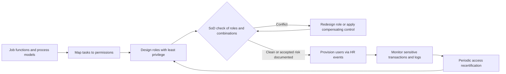

## Introduction

Integration is the great strength of enterprise systems, and it is also their greatest security exposure. When purchasing, inventory, payables and the general ledger share one database, a single user with too much access can create a fictitious supplier, raise an order, confirm receipt of goods that never arrived and release payment, all without anyone else touching the transaction. In a fragmented paper-based world, those steps would naturally pass through several hands; in an ERP, they are a few menu options apart.

Enterprise security therefore covers more than firewalls and passwords. It includes the design of roles, the enforcement of segregation of duties, the management of privileged access, periodic access reviews and audit logging. This lesson explains these controls, shows how to construct and use a segregation of duties matrix, and examines a famous collapse in which the absence of segregation was central.

## Learning Objectives

- Explain the layers of enterprise systems security and how the confidentiality, integrity and availability of data are protected in each.
- Apply role-based access control and the principle of least privilege to design ERP roles.
- Construct a segregation of duties conflict matrix for a business process and use it to detect conflicting access.
- Evaluate remediation options, including role redesign and compensating controls, for access conflicts.
- Analyse a real control failure in terms of segregation of duties and oversight.

## Prerequisite Knowledge

- Knowledge of ERP modules and procure-to-pay and order-to-cash processes.
- Basic understanding of information security concepts such as authentication and encryption.
- Awareness of internal control in accounting.

## Key Terminology

- **CIA triad**: The three core security objectives of confidentiality (only authorised access), integrity (accurate, unaltered data) and availability (systems usable when needed).
- **Role-based access control (RBAC)**: Granting permissions to roles that reflect job functions, then assigning users to roles, rather than granting permissions to individuals directly (Sandhu et al., 1996).
- **Least privilege**: Giving each user only the access needed to perform their job, and no more.
- **Segregation of duties (SoD)**: Dividing the key steps of a transaction (authorisation, custody, recording and reconciliation) between different people so that no individual can both commit and conceal an error or fraud.
- **SoD conflict matrix**: A table listing sensitive functions on both axes and marking combinations that must not be held by the same user.
- **Compensating control**: An alternative control, such as an independent review of a report, used to reduce risk where a conflict cannot practically be removed.
- **Privileged (emergency) access**: Temporary elevated access for urgent fixes, granted under strict approval, logging and after-the-event review; sometimes called "firefighter" access.
- **User access review (recertification)**: A periodic exercise in which managers confirm that each user's access is still appropriate.
- **Audit trail**: A tamper-resistant record of who did what, when, and from where in a system.

## Layers of Enterprise Security

Enterprise systems are secured in layers, so that a failure in one is caught by another (defence in depth).

| Layer | Typical controls | Main CIA objective |
|---|---|---|
| Network and infrastructure | Firewalls, network segmentation, encrypted connections, patching, backups | Availability, confidentiality |
| Identity and authentication | Unique user IDs, strong passwords, multi-factor authentication, single sign-on, prompt removal of leavers | Confidentiality |
| Application authorisation | Roles, transaction and field-level permissions, organisational restrictions (for example by branch) | Integrity, confidentiality |
| Business process controls | Approval workflows, tolerance limits, three-way match, SoD | Integrity |
| Data protection | Encryption at rest, masking of sensitive fields, data retention rules | Confidentiality |
| Monitoring and audit | Logs, alerts on sensitive transactions, periodic access reviews | Integrity, accountability |

Standards and frameworks help structure these controls. ISO/IEC 27001 specifies requirements for an information security management system, and the COSO internal control framework is widely used to design and assess controls over financial reporting. In Ghana, organisations that process personal data must also consider their obligations under the Data Protection Act, 2012 (Act 843).

## Role-Based Access Control and Least Privilege

In RBAC, permissions (for example, "create purchase order for branch 03") are grouped into roles that mirror job functions (for example, "branch buyer"). Users receive roles, not individual permissions. This has three advantages: access is easier to understand and review; new staff can be provisioned consistently; and SoD can be checked at role design time, before any user is assigned.

### Designing roles: a procedure

1. **Inventory job functions** from the organisation chart and process models (who performs which tasks).
2. **Map tasks to system permissions**, including organisational restrictions such as company code, plant or branch.
3. **Build roles at the right granularity.** Too coarse ("finance user") gives excessive access; too fine creates hundreds of roles nobody can manage.
4. **Check every role against the SoD matrix** so that no single role contains a conflict.
5. **Check role combinations**, because a user holding two clean roles can still have a conflict.
6. **Define provisioning, change and removal procedures**, linked to HR events such as joining, transfer and leaving.
7. **Schedule periodic recertification** by business managers, not only IT.

## Segregation of Duties

The classic SoD principle separates four kinds of activity for a transaction: **authorising** it, having **custody** of the asset, **recording** it, and **reconciling** or reviewing it. In an ERP these map onto specific functions.

### A procure-to-pay conflict matrix

The matrix below shows which pairs of functions should not be held by the same user. "X" marks a conflict.

| Function | Maintain supplier master | Create purchase order | Approve purchase order | Record goods receipt | Post supplier invoice | Release payment |
|---|---|---|---|---|---|---|
| Maintain supplier master | — | X | | | X | X |
| Create purchase order | X | — | X | X | | X |
| Approve purchase order | | X | — | | | |
| Record goods receipt | | X | | — | X | |
| Post supplier invoice | X | | | X | — | X |
| Release payment | X | X | | | X | — |

The reasoning behind key conflicts:

- **Supplier master and payment**: a user could create or alter a supplier's bank details and then pay that "supplier".
- **Create and approve purchase order**: authorisation becomes meaningless if the requester approves their own order.
- **Create purchase order and record goods receipt**: the buyer could order goods and confirm their arrival without independent evidence.
- **Goods receipt and supplier invoice**: the three-way match (order, receipt, invoice) relies on receipt and invoice being recorded independently.

## Worked Example: Detecting and Remediating Conflicts

*Illustrative scenario.* A pharmacy chain's ERP has the following user-role assignments in its procurement team.

| User | Roles held | Functions included |
|---|---|---|
| Ama | Buyer; Supplier maintenance | Create purchase order; maintain supplier master |
| Kwesi | Stores clerk | Record goods receipt |
| Efua | Accounts payable; Treasury | Post supplier invoice; release payment |
| Yaw | Procurement manager | Approve purchase order |

**Step 1: check each user against the matrix.**

- Ama holds *create purchase order* and *maintain supplier master*: conflict (X).
- Kwesi holds a single function: no conflict.
- Efua holds *post supplier invoice* and *release payment*: conflict (X).
- Yaw holds a single function: no conflict.

**Step 2: assess the risk.** Ama could create a fictitious supplier and raise orders to it; however, she cannot receive goods or pay, so the fraud would require collusion or another weakness. Efua could post a fictitious invoice and pay it; this is higher risk because it touches cash directly.

**Step 3: remediate.**

- **Remove the conflict where practical.** Move supplier master maintenance from Ama to a separate master data officer in finance, with changes to supplier bank details requiring approval by a second person.
- **Use a compensating control where staffing is too thin.** If the chain cannot yet separate invoice posting and payment, require that every payment run is reviewed and approved in the system by the finance manager against a report of invoices paid, and that any payment to a supplier whose bank details changed recently is flagged for review.
- **Monitor.** Configure alerts on sensitive transactions (for example, changes to supplier bank details) and review them weekly.

**Step 4: document and recertify.** Record each accepted residual risk with its compensating control, owner and review date, and include it in quarterly access recertification.

The general lesson is that SoD is risk management, not an absolute rule. Small organisations may not be able to separate every function, but they must know where conflicts exist and must compensate deliberately.

## Ghanaian Business Application

*Illustrative scenario.* A savings and loans company with fifteen branches across southern Ghana moves to a cloud core banking and ERP platform. Its security design includes multi-factor authentication for all staff, branch-level data restrictions so that tellers see only their branch's customers, and an SoD matrix covering loan origination, loan approval, disbursement and repayment posting. Because some branches have only three or four staff, full separation is impossible; compensating controls include system-enforced approval by the regional manager for disbursements above a threshold, daily exception reports on reversed transactions reviewed at head office, and mandatory leave periods during which another officer covers the role. Mobile money integration credentials are stored in a secrets vault rather than in scripts, and access to customer personal data is logged to support the company's data protection obligations.

## International Case Study: The Collapse of Barings Bank (1995)

Barings, a long-established British merchant bank, collapsed in February 1995 after losses from unauthorised derivatives trading by Nick Leeson, who worked at its Singapore futures subsidiary. Leeson was responsible for trading and also had control over the settlement (back-office) operations that recorded and reconciled those trades. This combination allowed him to conceal mounting losses in an error account, widely reported as account 88888, while reporting profits. Subsequent official investigations criticised failures of management oversight and internal control. Barings was subsequently acquired by the Dutch financial group ING.

The case is a textbook illustration of why custody or execution must be separated from recording and reconciliation. In modern ERP terms, a single user with authority to execute transactions and to post, adjust and reconcile them is exactly the conflict an SoD matrix is designed to detect. It also shows that controls on paper are insufficient without monitoring: unusual profits and funding requests should themselves have triggered independent review.

## Diagram

## Common Misconceptions

- "Security is the IT department's responsibility." Correction: business managers own access decisions and recertification; IT implements them.
- "If each role is conflict-free, users are conflict-free." Correction: combinations of individually clean roles can create conflicts, so user-level analysis is needed.
- "Small firms cannot apply segregation of duties." Correction: they may not achieve full separation, but compensating controls such as independent review, approval thresholds and exception reports manage the risk.
- "Administrators need permanent full access." Correction: privileged access should be temporary, approved, logged and reviewed.

## Common Examination Mistakes

- Defining SoD without explaining which activities are separated and why.
- Producing a conflict matrix without justifying the conflicts marked.
- Proposing only technical controls (firewalls, encryption) for what is a business-control problem.
- Ignoring leavers and role changes when discussing access management.
- Using the Barings case without linking it to the specific conflict between trading and settlement.

## Critical Thinking Questions

1. How would you balance the cost of additional staff against the risk of an SoD conflict in a small branch?
2. What are the limits of compensating controls that rely on managers reviewing reports?
3. How does moving to cloud ERP change, and not change, an organisation's responsibilities for access control?
4. Should RPA bots have their own user accounts and roles? What SoD issues might bots create?

## Practical Exercises

1. **Order-to-cash SoD matrix.** Build a conflict matrix for order-to-cash covering customer master maintenance, credit limit changes, sales order entry, delivery, invoicing, cash receipt posting and credit notes. Expected output: a matrix with conflicts marked and a one-line justification for each.
2. **Role design.** For a supermarket branch with a manager, two cashiers, a stores clerk and a supervisor, design roles and assign users, then test them against your matrix. Expected output: a role-permission table, a user-role table and a list of conflicts with remediation.
3. **BPMN control points.** In Bizagi Modeler, model the "change supplier bank details" process with a second-person approval, a notification to the supplier through a known contact, and an audit log step. Expected output: a BPMN diagram with lanes and at least one exclusive gateway, annotated with the control objective at each control point.
4. **SAP Learning activity.** On SAP Learning, find free introductory material on authorisations or governance, risk and compliance in SAP systems. Expected output: a 250-word note explaining how the vendor supports role design and SoD analysis.

## Key Takeaways

- Enterprise security is layered: infrastructure, identity, authorisation, process controls, data protection and monitoring.
- RBAC with least privilege makes access consistent, reviewable and checkable for SoD at design time.
- SoD separates authorisation, custody, recording and reconciliation; the conflict matrix operationalises it.
- Where conflicts cannot be removed, compensating controls must be designed, documented and monitored.
- Access is a life cycle: provisioning, change, removal, monitoring and periodic recertification.

## Further Reading

- Sandhu, R. S., Coyne, E. J., Feinstein, H. L., & Youman, C. E. (1996). Role-based access control models. *Computer, 29*(2), 38–47.
- Committee of Sponsoring Organizations of the Treadway Commission. (2013). *Internal control: Integrated framework*. COSO.
- International Organization for Standardization. (2022). *Information security, cybersecurity and privacy protection: Information security management systems: Requirements* (ISO/IEC 27001:2022). ISO.
- Monk, E., & Wagner, B. (2013). *Concepts in enterprise resource planning* (4th ed.). Cengage Learning.

## Video Resources

- [SAP Learning](https://learning.sap.com/) — SAP. Free learning journeys including introductions to authorisation concepts and governance, risk and compliance.
- [Microsoft Learn training](https://learn.microsoft.com/training/) — Microsoft. Self-paced modules on identity, access management and role-based access control.
- [ISO/IEC 27001 information security management](https://www.iso.org/standard/27001) — ISO. Official overview of the international standard for information security management systems.

## Revision Summary

Enterprise systems concentrate data and functions, so a single over-privileged user can commit and conceal fraud. Security is layered, from infrastructure and identity through application authorisation, process controls and data protection to monitoring. RBAC with least privilege provides consistent, reviewable access, and SoD separates authorisation, custody, recording and reconciliation. A conflict matrix identifies incompatible functions; conflicts are removed by role redesign or managed by documented compensating controls, with periodic recertification.

- CIA: confidentiality, integrity, availability.
- Check roles and role combinations against the SoD matrix.
- Key P2P conflicts: supplier master with payment; create with approve PO; goods receipt with invoice.
- Compensating controls: independent review, thresholds, exception reports.
- Privileged access: temporary, approved, logged, reviewed.
- Barings (1995): trading and settlement in one person's hands.
