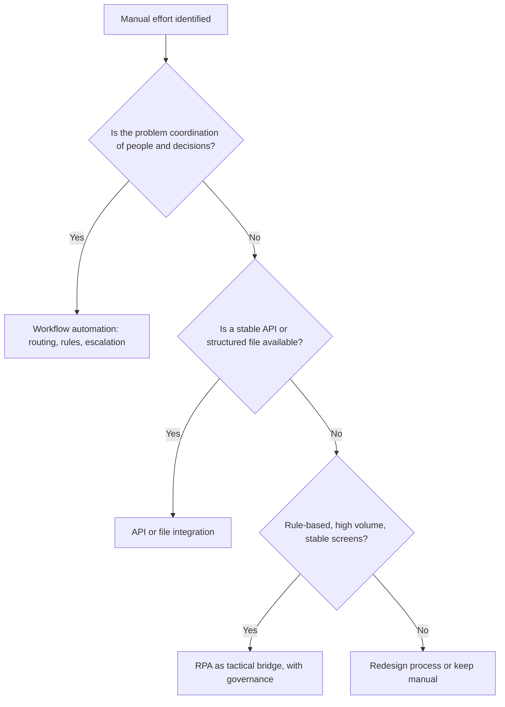

## Introduction

Once core processes run on an enterprise system, organisations look for ways to remove the remaining manual effort: approvals chased by email, data re-keyed from one screen into another, spreadsheets reconciled by hand at month-end. Three families of technology compete for this work. **Workflow automation** routes tasks and decisions between people and systems according to a process model. **Robotic process automation (RPA)** uses software "bots" that mimic a person operating existing user interfaces. **API integration** connects systems directly, so no human or bot needs to move data at all.

At the same time, the platform underneath enterprise systems is shifting from on-premise servers to the cloud. Cloud ERP changes cost structures, upgrade cycles, customisation options and dependence on connectivity. This lesson explains these technologies, shows how to decide which is appropriate for a given problem, and works through an automation business case that tests whether automation actually pays.

## Learning Objectives

- Explain how workflow engines execute process models, including approvals, escalations and business rules.
- Distinguish workflow automation, RPA and API integration and justify which is appropriate for a given problem.
- Apply suitability criteria and a simple cost-benefit model to evaluate an RPA candidate.
- Compare cloud ERP deployment models (public multi-tenant SaaS, private or single-tenant cloud, hosted, on-premise) on cost, control, customisation and risk.
- Evaluate the organisational implications of continuous vendor upgrades in cloud ERP.

## Prerequisite Knowledge

- BPMN 2.0 modelling (Business Process Management module).
- Integration patterns and APIs (Data Migration and System Integration lesson).
- Total cost of ownership (Vendor Selection lesson).

## Key Terminology

- **Workflow automation**: Using software to route work items, tasks and decisions between people and systems according to a defined process model and rules.
- **Workflow engine**: Software that executes a process model, creating tasks, tracking state, enforcing deadlines and recording an audit trail.
- **Robotic process automation (RPA)**: Software bots that perform rule-based tasks by operating applications through their user interfaces, as a person would.
- **Attended bot**: An RPA bot triggered by and working alongside a user on their desktop.
- **Unattended bot**: An RPA bot that runs on a server on a schedule or trigger without human involvement.
- **Straight-through processing**: The proportion of cases completed end to end without human intervention.
- **Software as a service (SaaS)**: A cloud model in which the vendor runs the application and customers use it via subscription (Mell & Grance, 2011).
- **Multi-tenancy**: An architecture in which one instance of the software serves many customers, with their data logically separated.
- **Two-tier ERP**: Running a large ERP at corporate level and a simpler, often cloud-based ERP at subsidiaries or branches, integrated with the corporate system.

## Workflow Automation

A workflow engine turns a process model into running work. When a purchase requisition is submitted, the engine creates an approval task for the right manager, applies rules ("requisitions above GHS 50,000 also need the finance director"), sends reminders, escalates overdue tasks, and records who did what and when. Many ERP packages include workflow for standard documents such as purchase orders and leave requests; standalone platforms such as Camunda execute BPMN models directly, and low-code tools such as Microsoft Power Automate connect cloud services with simple flows.

Key design elements are:

- **Routing rules**: who receives each task, often based on role, amount, department or location rather than named individuals.
- **Business rules**: decision logic separated from the flow, sometimes expressed as decision tables, so that thresholds can change without redesigning the process.
- **Service levels and escalation**: timers that remind, escalate or reassign overdue tasks.
- **Delegation**: rules for absence, so approvals do not stall when a manager is on leave.
- **Audit trail**: an immutable record of each step, essential for control and for process mining later.

Workflow automation delivers most when the underlying process has been redesigned first. Automating a poorly designed approval chain merely makes waste run faster, which echoes Hammer's (1990) warning against paving the cow paths.

## Robotic Process Automation

RPA bots work at the presentation layer. They log into applications, read screens, copy values, fill forms, open spreadsheets and send emails. Because they use existing interfaces, they can be deployed without changing underlying systems, which makes them attractive where legacy applications have no APIs or where IT change capacity is scarce.

### Suitability criteria

A process is a good RPA candidate when it is:

1. **Rule-based**, with little judgement.
2. **High volume or frequent**, so savings accumulate.
3. **Stable**, with screens and rules that rarely change, because interface changes break bots.
4. **Based on structured digital inputs**, such as system fields or standard files, rather than handwriting or free-text emails (although intelligent document processing extends this).
5. **Mature and documented**, with known exceptions.

### Choosing between workflow, RPA and APIs

| Question | Workflow automation | RPA | API integration |
|---|---|---|---|
| What does it automate? | Coordination of people and decisions | Repetitive keyboard-and-screen work | System-to-system data exchange |
| Changes to underlying systems? | Usually none | None | Requires available or built APIs |
| Robustness | High | Fragile when screens change | High when APIs are versioned |
| Speed to deploy | Medium | Fast | Medium to slow |
| Long-term cost | Moderate | Bot licences plus maintenance | Development plus API governance |
| Best use | Approvals, case handling, hand-offs | Bridging legacy systems; tactical relief | Strategic, high-volume integration |

RPA is often described as a tactical bridge: valuable now, but where a stable API exists or can be built, direct integration is normally more robust.

## Worked Example: An RPA Business Case

*Illustrative scenario.* A microfinance company in Accra reconciles mobile money collections against loan repayment schedules. Each month about 2,400 transactions are matched manually, taking around 3 minutes each.

**Current effort:** `2,400 × 3 = 7,200 minutes = 120 hours per month`.

**With a bot:** the bot matches 85% automatically (straight-through processing). The remaining 15%, or 360 exceptions, still need a person, and take longer because they are the hard cases: `360 × 4 = 1,440 minutes = 24 hours`.

**Hours saved:** `120 − 24 = 96 hours per month`, or `96 × 12 = 1,152 hours per year`.

**Value of time saved** at an illustrative fully loaded staff cost of GHS 60 per hour: `1,152 × 60 = GHS 69,120 per year`.

**Costs (illustrative):** bot development GHS 50,000 one-off; licences GHS 40,000 per year; maintenance and monitoring GHS 15,000 per year.

| Year | Benefit | Cost | Net | Cumulative |
|---|---|---|---|---|
| 1 | 69,120 | 105,000 | −35,880 | −35,880 |
| 2 | 69,120 | 55,000 | 14,120 | −21,760 |
| 3 | 69,120 | 55,000 | 14,120 | −7,640 |
| 4 | 69,120 | 55,000 | 14,120 | 6,480 |

**Interpretation.** Payback arrives only in year four, and the case is fragile: if the aggregator changes its portal and the bot needs rework, or if straight-through processing is lower than 85%, payback recedes further. Two alternatives deserve evaluation. First, the aggregator may offer an API or a structured settlement file, allowing direct integration that is more robust than screen automation. Second, saved hours are only a benefit if staff are redeployed to valuable work such as arrears follow-up; otherwise the saving is notional. Non-financial benefits, including faster posting of repayments and fewer matching errors, may still justify the project, but they should be stated explicitly.

## Cloud ERP

### Deployment models

| Model | Description | Strengths | Limitations |
|---|---|---|---|
| Public multi-tenant SaaS | Vendor runs one code line for many customers | Low upfront cost, rapid deployment, vendor-managed upgrades and infrastructure | Limited deep customisation; mandatory upgrade cycles; dependence on connectivity and vendor |
| Private or single-tenant cloud | Dedicated instance managed by vendor or partner | More configuration freedom, controlled upgrade timing | Higher cost than multi-tenant; still vendor-dependent |
| Hosted (infrastructure as a service) | Customer's licensed ERP runs on rented cloud infrastructure | Full control of software, flexible capacity | Customer still manages application, upgrades and security configuration |
| On-premise | Customer owns and runs hardware and software | Maximum control, works without internet access to vendor | High capital cost, in-house skills, slower upgrades |

### Trade-offs to evaluate

- **Cost profile.** SaaS converts capital expenditure into operating expenditure, but long-horizon TCO must be compared, including currency exposure for foreign-priced subscriptions.
- **Customisation.** Multi-tenant SaaS encourages a "clean core": configuration and extensions through published APIs rather than modifying vendor code. This preserves upgradability but demands more process adoption.
- **Upgrades.** Vendors release updates on fixed cycles. Customers gain new functions continuously but must regression-test each release, ideally with automated tests.
- **Connectivity and resilience.** Every site needs reliable internet access, backup links and, for point of sale, offline modes.
- **Security and data location.** Responsibility is shared: the vendor secures the platform, while the customer remains responsible for user access, roles and data governance. Data residency and contractual protections must be checked against legal obligations, including the Data Protection Act, 2012 (Act 843) in Ghana.
- **Exit.** Contracts should guarantee data export in usable formats at the end of the relationship.

## Ghanaian Business Application

*Illustrative scenario.* A Ghanaian group with a manufacturing subsidiary in Tema and distribution companies in three neighbouring countries runs an established on-premise ERP at head office. Rather than extend it to the small subsidiaries, it adopts a **two-tier ERP** model: each subsidiary uses a multi-tenant cloud ERP configured to a standard template, integrated with the corporate ledger through the cloud vendor's APIs for monthly consolidation and intercompany trading. Workflow automation handles intercompany purchase approvals across countries, and an RPA bot is used temporarily to extract data from a legacy payroll system in one subsidiary until it is replaced. The group mitigates connectivity risk with dual internet providers at each site and evaluates subscription pricing under different exchange-rate scenarios.

## International Case Study: RPA at Telefónica O2

Lacity and Willcocks (2016) published a case study of the UK mobile operator Telefónica O2's adoption of RPA for back-office processes, and it has become one of the most frequently cited early accounts of enterprise RPA. Their account describes the operator automating high-volume, rule-based back-office tasks with software robots and building an internal capability to identify, develop and manage automations, working with its IT function rather than around it.

The case is valuable for its management lessons rather than for any particular figure: choose processes that meet suitability criteria; build governance so that bots are documented, monitored and maintained like other production systems; involve IT early so that automations respect security and architecture standards; and treat RPA as one tool in a broader automation strategy rather than as a substitute for process redesign or proper integration.

## Diagram

## Common Misconceptions

- "RPA is a form of artificial intelligence." Correction: basic RPA follows explicit rules on screens; intelligence comes only when it is combined with techniques such as document recognition or machine learning.
- "Automating a process always improves it." Correction: automating a poorly designed process can lock in waste; redesign should come first.
- "Cloud ERP means the vendor is responsible for security." Correction: security is shared; customers remain responsible for user access, roles, configuration and data governance.
- "RPA is cheaper than integration." Correction: RPA is often faster to deploy, but licences and maintenance when screens change can make it costlier over time than a robust API.

## Common Examination Mistakes

- Treating workflow automation, RPA and API integration as interchangeable.
- Claiming RPA savings without accounting for exceptions, licences and maintenance.
- Listing cloud ERP advantages without discussing customisation limits, upgrade cycles, connectivity and exit.
- Ignoring whether saved staff time is actually redeployed.
- Confusing hosted ERP (IaaS) with true multi-tenant SaaS.

## Critical Thinking Questions

1. Under what circumstances is RPA a sensible long-term solution rather than a tactical bridge?
2. How might mandatory, frequent cloud upgrades affect an organisation that relies on extensive custom reports?
3. Does a "clean core" cloud strategy reduce an organisation's ability to differentiate its processes? Justify your answer.
4. Who should own bots in an organisation: business units, IT, or a centre of excellence? What are the risks of each?

## Practical Exercises

1. **Executable approval workflow.** In Camunda Modeler, model a purchase requisition approval with a business rule (amount threshold), a boundary timer that escalates after 48 hours and a delegation path. Expected output: a BPMN diagram with a decision task or exclusive gateway, timer event and at least three lanes, with a short explanation of how a workflow engine would execute it.
2. **RPA candidate assessment.** Choose three processes in an organisation you know and score each from 1 to 5 against the five suitability criteria. Expected output: a scoring table and a recommendation of the best candidate, noting whether an API alternative exists.
3. **Business case sensitivity.** Recalculate the worked example assuming straight-through processing of 70% rather than 85%. Expected output: revised hours saved, annual benefit, cumulative table and a statement of the new payback year.
4. **SAP Learning activity.** On SAP Learning, explore free material on SAP's cloud ERP and its approach to extensions. Expected output: a 250-word note explaining the "clean core" idea and its implications for customisation.

## Key Takeaways

- Workflow automates coordination; RPA automates screen-level tasks; APIs connect systems directly.
- RPA suits rule-based, high-volume, stable processes with structured inputs, and needs governance like any production system.
- Automation business cases must account for exceptions, licences, maintenance and redeployment of saved time.
- Cloud ERP models differ in control, customisation, cost and upgrade obligations; security is a shared responsibility.
- Redesign before you automate.

## Further Reading

- Lacity, M. C., & Willcocks, L. P. (2016). Robotic process automation at Telefónica O2. *MIS Quarterly Executive, 15*(1).
- Mell, P., & Grance, T. (2011). *The NIST definition of cloud computing* (NIST Special Publication 800-145). National Institute of Standards and Technology. <https://doi.org/10.6028/NIST.SP.800-145>
- Hammer, M. (1990). Reengineering work: Don't automate, obliterate. *Harvard Business Review, 68*(4), 104-112.
- Dumas, M., La Rosa, M., Mendling, J., & Reijers, H. A. (2018). *Fundamentals of business process management* (2nd ed.). Springer.
- Monk, E., & Wagner, B. (2013). *Concepts in enterprise resource planning* (4th ed.). Cengage Learning.

## Video Resources

- [Camunda documentation](https://docs.camunda.io/): Camunda. Official guides to modelling and executing BPMN workflows and decision tables.
- [Microsoft Learn: Power Automate documentation](https://learn.microsoft.com/power-automate/): Microsoft. Official documentation on cloud flows, desktop flows (RPA) and connectors.
- [UiPath Academy](https://academy.uipath.com/): UiPath. Free official courses introducing robotic process automation concepts and tools.
- [SAP Learning](https://learning.sap.com/): SAP. Free learning journeys on SAP's cloud ERP and business process automation.

## Revision Summary

Workflow automation executes process models that coordinate people and decisions; RPA uses bots to operate existing screens; API integration links systems directly. Choose by the nature of the problem, the availability of APIs and the stability of the process, and justify automation with a business case that includes exceptions, licences, maintenance and redeployment of time. Cloud ERP shifts costs to subscriptions and upgrades to the vendor, but limits deep customisation, imposes release cycles and depends on connectivity; security remains shared.

- RPA suitability: rule-based, high volume, stable, structured inputs, documented.
- Prefer APIs over bots where stable APIs exist.
- Straight-through processing rate drives RPA benefits.
- Clean core: extend through APIs, do not modify vendor code.
- Two-tier ERP suits small subsidiaries of larger groups.
- Redesign before automating.
