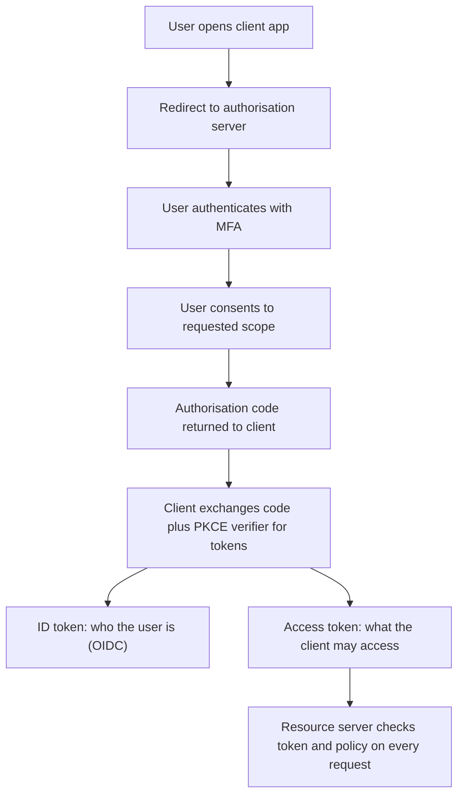

## Introduction

Almost every security decision an application makes reduces to two questions: *who is this?* and *what are they allowed to do?* The first is authentication; the second is authorisation. When either fails, the consequences are severe. Stolen or guessed credentials remain one of the most common initial routes into organisations, and broken access control sits at the top of the OWASP Top 10:2021.

This lesson treats identity as a chain. A user proves who they are using one or more factors, the system issues a session or token that represents that proof, and every later request is checked against an access-control policy. A weakness at any link (a reused password, a missing second factor, a predictable session identifier, or a missing permission check on one API endpoint) breaks the chain. You will learn to evaluate each link and to recommend proportionate controls for Ghanaian businesses, where mobile phones are central to both customer identity and fraud.

## Learning Objectives

- Distinguish identification, authentication, authorisation and accountability, and explain why each is needed.
- Evaluate knowledge, possession and inherence factors and compare MFA methods by phishing resistance.
- Apply the main password recommendations of NIST SP 800-63B to critique an organisational password policy.
- Explain the roles of OAuth 2.0 and OpenID Connect and why OAuth alone is not an authentication protocol.
- Compare role-based and attribute-based access control and recommend one for a given business context.
- Design session management controls that resist hijacking and fixation.

## Prerequisite Knowledge

- Access control and least privilege concepts from the operating system security lesson.
- Hashing and password hashing from the cryptography module.
- Basic understanding of HTTP cookies and HTTPS.

## Key Terminology

- **Authentication**: The process of verifying a claimed identity using one or more authenticators.
- **Authorisation**: The decision about whether an authenticated subject may perform a specific action on a specific resource.
- **Multi-factor authentication (MFA)**: Authentication that requires factors from at least two different categories: something you know, something you have and something you are.
- **Phishing-resistant authenticator**: An authenticator, such as a FIDO2/WebAuthn security key or passkey, that cryptographically binds the login to the genuine website so a fake site cannot relay it.
- **OAuth 2.0**: An authorisation framework (RFC 6749) that lets an application obtain limited, delegated access to a resource on a user's behalf using access tokens.
- **OpenID Connect (OIDC)**: An identity layer built on OAuth 2.0 that returns a signed ID token describing the authenticated user, enabling single sign-on.
- **Role-based access control (RBAC)**: Permissions are assigned to roles and users acquire permissions by being assigned roles.
- **Attribute-based access control (ABAC)**: Access decisions evaluate attributes of the subject, resource, action and environment against policy rules.
- **Session fixation**: An attack in which the attacker causes a victim to use a session identifier known to the attacker, which then becomes authenticated when the victim logs in.

## Detailed Explanation

### The identity chain

*Identification* is the claim ("I am kofi.mensah"). *Authentication* tests the claim. *Authorisation* decides what the authenticated identity may do. *Accountability* records what was done, so actions can be attributed later. Many breaches occur because organisations invest in strong authentication but neglect authorisation checks on individual functions, a pattern known as broken object-level authorisation in APIs: the user is genuinely logged in but can fetch another user's record by changing an identifier.

### Authentication factors and MFA

Factors fall into three categories. *Knowledge* factors (passwords, PINs) are cheap but can be guessed, phished or reused. *Possession* factors (a phone receiving an SMS code, an authenticator app generating time-based one-time passwords, a hardware key) prove control of a device. *Inherence* factors (fingerprint, face) are convenient but cannot be changed if compromised, so they are normally used to unlock a local authenticator rather than being sent to a server.

MFA combines categories; two passwords are not MFA. MFA methods differ greatly in strength:

| Method | Main weakness | Phishing resistance |
|---|---|---|
| SMS one-time code | SIM swap, interception, real-time phishing relay | Low |
| Authenticator app code (TOTP) | Real-time phishing relay | Low to moderate |
| Push approval | "MFA fatigue" from repeated prompts | Moderate if number matching is used |
| FIDO2/WebAuthn key or passkey | Device loss (needs recovery process) | High |

Phishing-resistant methods work because the authenticator signs a challenge that includes the website's origin; a look-alike domain receives a signature it cannot use.

### Password policy according to NIST SP 800-63B

NIST Special Publication 800-63B reshaped password guidance by focusing on what actually reduces compromise rather than on complexity rituals. At a high level it recommends that verifiers:

- require a reasonable minimum length and permit long passphrases (at least 64 characters), with all printable characters and spaces allowed;
- check new passwords against lists of commonly used, expected or previously breached values and reject matches;
- **not** impose arbitrary composition rules (such as "one uppercase, one symbol"), which push users towards predictable patterns;
- **not** force periodic password changes, but require a change when there is evidence of compromise;
- avoid knowledge-based "security questions" and password hints;
- allow paste so that password managers work, and limit failed attempts through rate limiting.

Passwords must be stored using a salted, deliberately slow password-hashing function. NIST has continued to revise the 800-63 suite, so practitioners should check the current revision for exact thresholds.

### Session management

After login, the server usually issues a session identifier in a cookie or a signed token. Good practice includes generating identifiers with a cryptographically secure random generator, **regenerating the session identifier at login** to defeat fixation, setting cookie flags `Secure`, `HttpOnly` and `SameSite`, enforcing idle and absolute timeouts, invalidating sessions on logout and password change, and re-authenticating users before high-risk actions such as changing a payout account.

## Theories, Frameworks and Models

### OAuth 2.0 and OpenID Connect

OAuth 2.0 solves *delegated authorisation*. Suppose a budgeting app wants read-only access to your transaction history held by a bank API. Rather than giving the app your banking password, you are redirected to the bank's authorisation server, log in there, and consent to a limited *scope*. The app receives an *access token* it presents to the bank's resource server. Four roles appear: resource owner (you), client (the app), authorisation server and resource server. For browser and mobile clients the recommended flow is the authorisation code flow with PKCE (Proof Key for Code Exchange), which protects the code from interception.

An access token tells a resource server that *access was granted*; it is not a reliable statement of *who the user is* to the client. OpenID Connect adds that missing piece: an *ID token*, a signed JSON Web Token containing claims such as the issuer, the subject identifier and the audience. Clients must validate the signature, issuer, audience and expiry. OIDC is what sits behind "Sign in with..." buttons and enterprise single sign-on.

### RBAC versus ABAC

| Aspect | RBAC | ABAC |
|---|---|---|
| Decision basis | User's role(s) | Attributes of user, resource, action and context |
| Example rule | "Loan officers can view loan files." | "Loan officers can view loan files for their own branch, during working hours, from managed devices." |
| Strengths | Simple to understand, audit and certify | Fine-grained, adapts to context, fewer roles needed |
| Weaknesses | Role explosion when exceptions multiply | Policies harder to test and explain; needs reliable attribute data |

Many organisations use a hybrid: RBAC for coarse entitlements, with attribute conditions for sensitive data. Whatever the model, enforcement must happen on the server for every request, with deny-by-default.

## Worked Example

**Illustrative scenario.** *KenteCart* (a fictional Kumasi-based online marketplace) has the following policy: passwords of at least eight characters with an uppercase letter, a digit and a symbol; mandatory changes every 60 days; SMS codes for all customers; and a single "admin" role shared by twelve staff.

A structured critique against good practice:

1. **Composition and expiry rules**: These contradict NIST SP 800-63B. Replace them with a longer minimum length, support for passphrases, a breached-password check and change-on-compromise.
2. **SMS for everyone**: Acceptable as a baseline for low-risk customers, but staff and sellers who handle payouts should use phishing-resistant authenticators. Number-matching push or passkeys reduce fatigue and relay attacks.
3. **Shared admin role**: Violates least privilege and accountability. Split into roles such as `catalogue-editor`, `refund-approver` and `platform-admin`; require individual accounts; and add an ABAC condition that refunds above a threshold need a second approver.
4. **Sessions**: Ensure session regeneration at login, `HttpOnly` and `Secure` cookies, a short idle timeout for staff consoles, and re-authentication before changing a seller's mobile money payout number.

The output is a prioritised list: the admin role split and staff MFA first (highest likelihood and impact), then password policy changes, then session hardening.

## Diagram

## Ghanaian Business Application

Ghana's digital economy relies heavily on the mobile phone as an identity anchor. Mobile money wallets, bank alerts and many one-time codes are tied to a SIM card, and SIM registration has been linked to the Ghana Card. This makes possession of a phone number valuable to fraudsters: SIM-swap fraud and social engineering of customer-care agents directly undermine SMS-based authentication. Organisations should therefore treat SMS codes as a baseline rather than a strong control, apply additional checks (for example, a waiting period or extra verification after a recent SIM change, where telecom partners provide that signal) before high-value actions, and train staff to resist pressure to reset credentials without proper verification.

For internal staff, the Cybersecurity Act, 2020 (Act 1038) gives the Cyber Security Authority responsibilities for protecting Critical Information Infrastructure, and sector regulators such as the Bank of Ghana expect strong access controls in financial institutions. Practically, privileged accounts for core banking, payment switches and cloud consoles should use phishing-resistant MFA, individual named accounts, and periodic access reviews.

## International Case Study

**Colonial Pipeline (United States), 2021.** In May 2021 Colonial Pipeline, which operates a major fuel pipeline on the US East Coast, was hit by ransomware attributed to the DarkSide group. The company shut down pipeline operations as a precaution, causing fuel supply disruption and public concern. In testimony to the US Congress, the company's chief executive stated that the attackers had gained access through a legacy virtual private network (VPN) account that was no longer in active use but had not been deactivated, and that the account did not require multi-factor authentication. The password had reportedly appeared in a set of leaked credentials. The company paid a ransom, part of which the US Department of Justice later announced it had recovered.

The case illustrates three links in the identity chain failing together: account lifecycle management (a dormant account remained active), authentication strength (single-factor remote access) and credential hygiene (a reused or leaked password). None of these are exotic controls; they are basic identity governance. It also shows how an IT authentication failure can force a business-level operational decision.

## Common Misconceptions

- **"Complex passwords that change often are the most secure."** NIST SP 800-63B finds that forced complexity and frequent expiry lead to predictable patterns; length, breached-password checks and change-on-compromise are more effective.
- **"Any MFA stops phishing."** SMS and TOTP codes can be relayed in real time by a phishing proxy; only origin-bound methods such as FIDO2/WebAuthn are phishing resistant.
- **"OAuth is a login protocol."** OAuth 2.0 delegates authorisation; OpenID Connect adds authentication through the ID token.
- **"If the user is logged in, the request is authorised."** Authentication does not imply permission; each request must check the user's rights to the specific object.

## Common Examination Mistakes

- Using "authentication" and "authorisation" interchangeably.
- Listing MFA methods without comparing their resistance to phishing, SIM swap and fatigue attacks.
- Quoting outdated password advice (mandatory 30- or 90-day changes) as current best practice without qualification.
- Describing RBAC and ABAC without giving a concrete example rule for each.
- Forgetting session management entirely when asked to secure a login process.

## Critical Thinking Questions

1. A Ghanaian bank argues that SMS one-time codes are the only practical MFA for its rural customers. How would you balance accessibility, cost and security in your recommendation?
2. When does the complexity of ABAC become a security risk in its own right?
3. Should organisations remove passwords entirely in favour of passkeys? What new risks would account recovery introduce?

## Practical Exercises

1. **Policy critique.** Obtain the password policy of an organisation you belong to (or a published example) and compare it with the NIST SP 800-63B recommendations in this lesson. *Expected output:* a table of each policy clause, whether it aligns, and a recommended change.
2. **PortSwigger Web Security Academy labs.** Complete the introductory authentication and access control learning materials. *Expected output:* a short note for each lab describing the flawed check and the server-side fix.
3. **RBAC and ABAC design.** For a small clinic's patient records system, design four roles and two ABAC conditions. *Expected output:* a role–permission matrix and two policy rules written in plain English.
4. **Session review.** Using your browser's developer tools on your *own* test application (or OWASP Juice Shop run locally), inspect session cookie attributes. *Expected output:* a list of flags present and missing, and the risk of each missing flag.

## Key Takeaways

- Authentication proves identity; authorisation decides permitted actions; both must be enforced on every request.
- MFA requires different factor categories, and methods vary widely in phishing resistance.
- NIST SP 800-63B favours length, breached-password screening and change-on-compromise over composition rules and forced expiry.
- OAuth 2.0 delegates access; OpenID Connect adds a verifiable statement of identity.
- RBAC is simpler to govern; ABAC is more expressive; hybrids are common.
- Secure sessions need random identifiers, regeneration at login, secure cookie flags and timeouts.

## Further Reading

- National Institute of Standards and Technology. (2017). *Digital identity guidelines: Authentication and lifecycle management* (NIST Special Publication 800-63B). National Institute of Standards and Technology. <https://pages.nist.gov/800-63-3/sp800-63b.html>
- Hardt, D. (Ed.). (2012). *The OAuth 2.0 authorization framework* (RFC 6749). Internet Engineering Task Force. <https://www.rfc-editor.org/rfc/rfc6749>
- Hu, V. C., Ferraiolo, D., Kuhn, R., Schnitzer, A., Sandlin, K., Miller, R., & Scarfone, K. (2014). *Guide to attribute based access control (ABAC) definition and considerations* (NIST Special Publication 800-162). National Institute of Standards and Technology.
- Stallings, W., & Brown, L. (2018). *Computer security: Principles and practice* (4th ed.). Pearson.

## Video Resources

- [PortSwigger Web Security Academy](https://portswigger.net/web-security) — PortSwigger. Official free learning portal with topics and labs on authentication, access control and OAuth vulnerabilities.
- [OpenID Foundation](https://openid.net/) — OpenID Foundation. Official site for OpenID Connect specifications and explanatory material.
- [Cisco Skills for All](https://skillsforall.com/) — Cisco Networking Academy. Official learning portal with free introductory cybersecurity courses covering identity and access concepts.

## Revision Summary

Identity is a chain: identification, authentication, authorisation and accountability. MFA combines different factor categories, with FIDO2/WebAuthn offering phishing resistance that SMS and TOTP lack. NIST SP 800-63B recommends length, breached-password checks and change-on-compromise rather than complexity rules and forced expiry.

- OAuth 2.0 = delegated authorisation (access token); OIDC = authentication (ID token).
- Use authorisation code flow with PKCE for browser and mobile clients.
- RBAC: permissions via roles; ABAC: policy over subject, resource, action and environment attributes.
- Enforce access control server-side, deny by default, on every request and object.
- Sessions: secure random IDs, regenerate at login, `Secure`/`HttpOnly`/`SameSite`, timeouts, re-authentication for risky actions.
- Colonial Pipeline (2021): dormant VPN account, no MFA, leaked password.
