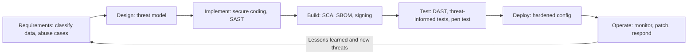

## Introduction

The previous two lessons examined specific flaws: injection, cross-site scripting and broken authentication. Fixing flaws one at a time after release is expensive and never-ending. The more strategic question is how an organisation can build software that has fewer flaws in the first place and can detect the remainder before attackers do. That is the purpose of a secure software development lifecycle (secure SDLC).

Software also exists to process data, and the most valuable data usually sits in databases. Even well-written applications can be bypassed: an attacker may steal a backup, compromise a database administrator's laptop or abuse an over-privileged service account. Database protection therefore needs its own layered controls. This lesson connects both themes: building security into development, and protecting the data store as the final line of defence.

## Learning Objectives

- Explain the phases of a secure SDLC and the security activities appropriate to each phase.
- Compare SAST, DAST, software composition analysis and penetration testing by what they detect and when they are used.
- Apply threat-informed testing by deriving test cases from a threat model and known attack patterns.
- Design database protection controls covering least privilege, encryption, auditing and row-level security.
- Evaluate the Equifax 2017 breach as a failure of patch and component management within the lifecycle.

## Prerequisite Knowledge

- SQL injection, XSS and access control concepts from earlier lessons in this module.
- Symmetric encryption and key management from the cryptography module.
- General understanding of how software projects move from requirements to deployment.

## Key Terminology

- **Secure SDLC**: A software development lifecycle in which security requirements, design review, secure coding, testing and operational monitoring are integrated into every phase.
- **SAST (static application security testing)**: Analysis of source code, bytecode or binaries without running them, to find insecure patterns such as concatenated SQL.
- **DAST (dynamic application security testing)**: Testing a running application from the outside by sending crafted requests and observing responses.
- **Software composition analysis (SCA)**: Identifying third-party and open-source components in a product and matching them against known vulnerabilities and licences.
- **Software bill of materials (SBOM)**: A formal inventory of the components and dependencies that make up a piece of software.
- **Transparent data encryption (TDE)**: Database-level encryption of data files and backups at rest, handled by the database engine without application changes.
- **Row-level security (RLS)**: A database feature that filters which rows a given user or session may read or modify, based on a policy.
- **Database activity monitoring**: Recording and analysing database queries and administrative actions to detect misuse and support investigations.

## Detailed Explanation

### Why "shift left" matters

Defects found during design or coding are far cheaper to fix than those found in production, because late fixes require re-testing, redeployment and sometimes incident response. "Shifting left" means moving security activities earlier. It does not mean abandoning late-stage testing; it means each phase has security work appropriate to it.

### Security activities by phase

| Phase | Security activities | Example output |
|---|---|---|
| Requirements | Identify data classification, regulatory duties (for example Ghana's Data Protection Act, 2012 (Act 843)), abuse cases | Security requirements in user stories |
| Design | Threat modelling (for example STRIDE), secure architecture review | Threat model and mitigations |
| Implementation | Secure coding standards, peer code review, SAST in the developer's editor and pipeline | Merge requests blocked on high-severity findings |
| Build | SCA, SBOM generation, signing of build artefacts, secrets scanning | Dependency report, signed releases |
| Test | DAST, threat-informed test cases, penetration testing for high-risk releases | Test report with severity ratings |
| Deploy | Hardened configuration, infrastructure-as-code scanning, change approval | Approved, reproducible deployment |
| Operate | Logging, monitoring, vulnerability and patch management, incident response | Alerts, patch records, lessons learned |

Two public frameworks are useful anchors. Microsoft's Security Development Lifecycle, described by Howard and Lipner (2006), popularised mandatory security activities in each phase. NIST's Secure Software Development Framework (SP 800-218) organises practices into four groups: prepare the organisation, protect the software, produce well-secured software and respond to vulnerabilities. The OWASP Application Security Verification Standard (ASVS) provides testable requirements that can be written into contracts.

### Comparing testing techniques

- **SAST** sees the whole codebase, finds issues early and points to the exact line, but produces false positives and cannot see runtime configuration.
- **DAST** tests the deployed application as an attacker would, finding configuration and runtime issues, but has limited code coverage and finds issues late.
- **SCA** answers "are we using a component with a known vulnerability?" which neither SAST nor DAST reliably answers. Given how much modern software is assembled from open-source libraries, SCA is essential.
- **Penetration testing** applies human creativity to chain weaknesses together, especially business-logic flaws that tools miss. It is periodic and should be scoped and authorised in writing.

### Threat-informed testing

Testing is most valuable when it is driven by realistic threats rather than generic checklists. A threat-informed approach takes the application's threat model, the OWASP Top 10 categories most relevant to it and publicly documented attacker techniques, and converts them into specific test cases. For a mobile money merchant API, that might mean: "a merchant cannot read another merchant's transactions by changing the merchant ID" (access control), "replaying a payment request with the same reference is rejected" (integrity), and "rate limiting stops automated PIN guessing" (authentication). Each test case links back to a threat, so coverage can be explained to management.

## Theories, Frameworks and Models

### Layered database protection

Database security applies defence in depth around the data itself:

1. **Least privilege**: separate accounts for each application and administrator; application accounts limited to the tables, views or stored procedures they need; no shared `sa` or `root` use; administrative access through named accounts with MFA.
2. **Network isolation**: databases on private network segments, reachable only from application servers and management hosts, never directly from the internet.
3. **Encryption in transit**: TLS between application and database.
4. **Encryption at rest**: TDE or storage encryption protects stolen disks and backups; column-level or application-level encryption protects especially sensitive fields (for example national ID numbers) even from some administrators. Keys must be stored separately, ideally in a key management service or hardware security module.
5. **Auditing and monitoring**: logging of logins, privilege changes, schema changes and access to sensitive tables, with logs forwarded to a system that database administrators cannot alter.
6. **Row-level security and masking**: restricting which rows a session can see and masking sensitive columns for support staff.
7. **Patching and secure configuration**: removing default accounts and sample databases, applying vendor patches promptly.

### Row-level security in practice

Several database systems support RLS. The PostgreSQL example below ensures that branch staff only see loan records for their own branch, enforced inside the database rather than relying on every application query to include the right filter.

```sql
ALTER TABLE loans ENABLE ROW LEVEL SECURITY;

CREATE POLICY branch_isolation ON loans
  USING (branch_id = current_setting('app.branch_id')::int);

-- Application role gets only what it needs.
GRANT SELECT, INSERT, UPDATE ON loans TO loan_app;
REVOKE DELETE ON loans FROM loan_app;
```

The application sets `app.branch_id` from the authenticated user's attributes at the start of each session. A coding mistake that omits a `WHERE branch_id = ...` clause no longer exposes other branches' data.

## Worked Example

**Illustrative scenario.** *Sika Health* (a fictional Tamale-based health-technology start-up) is building a patient appointment and records system. The team of six developers releases weekly. Management asks for a pragmatic secure SDLC that does not slow delivery excessively.

**Step 1: Requirements.** Classify patient health data as *restricted*. Record the duty under the Data Protection Act, 2012 (Act 843) to protect personal data and identify abuse cases: a receptionist browsing records of a celebrity patient; an attacker scraping the booking API.

**Step 2: Design.** Run a one-hour STRIDE session on the data flow diagram for each major feature. Decide on server-side authorisation checks and RLS by clinic.

**Step 3: Implementation and build.** Add SAST and SCA to the continuous integration pipeline; block merges on critical findings; add secrets scanning so database passwords are never committed.

**Step 4: Test.** Run DAST against the staging environment nightly. Write threat-informed test cases for the top risks. Commission an authorised penetration test before launch.

**Step 5: Database.** Create a dedicated application role with no `DROP` or `DELETE` rights on clinical tables; enable TDE and encrypt national ID numbers at column level; send audit logs of record access to a separate logging platform; review access to celebrity-flagged records weekly.

**Step 6: Operate.** Subscribe to security advisories for every component in the SBOM and agree patch timelines (for example, critical internet-facing vulnerabilities within days rather than weeks).

The result is proportionate: most controls are automated in the pipeline, and human effort concentrates on threat modelling and high-risk testing.

## Diagram



## Ghanaian Business Application

Many Ghanaian organisations, from fintech start-ups in Accra to public agencies digitising services, depend on outsourced development or off-the-shelf systems customised by vendors. A secure SDLC therefore has a procurement dimension. Contracts should require secure coding standards, evidence of SAST and SCA, remediation of critical findings before acceptance, an SBOM, and access to independent penetration test results. Acceptance testing should include security test cases, not only functional ones.

Where a system processes personal data, the organisation (as data controller) remains responsible under Act 843 even if a vendor built it. Where systems are designated as Critical Information Infrastructure under the Cybersecurity Act, 2020 (Act 1038), additional obligations to the Cyber Security Authority apply. Database protection is particularly important in contexts such as hospital records, payroll systems and mobile money transaction stores, where a single over-privileged account can expose large volumes of sensitive data.

## International Case Study

**Equifax (United States), 2017.** In 2017 the credit reporting agency Equifax suffered a breach exposing personal information of around 147 million people, according to widely reported figures. Attackers exploited a known vulnerability in the Apache Struts web framework (CVE-2017-5638) in an online dispute portal. A patch for the vulnerability had been published in March 2017, but the affected system was not updated, and the attackers gained access from mid-May. Investigations by US authorities, including a report by the US Government Accountability Office, described failures in identifying vulnerable systems, in network segmentation and in monitoring; an expired digital certificate on a traffic inspection device meant that malicious traffic was not being inspected for a period. Equifax later agreed a settlement with US regulators.

From a secure SDLC perspective, Equifax is a lesson in the *operate* phase and in component management. The organisation needed an accurate inventory of where Struts was used (what an SBOM and SCA provide), a process that turned an advisory into a tracked patch with a deadline, and monitoring that would detect large-scale data extraction from databases. Database-side controls such as limiting what the portal's credentials could query, and alerting on unusual volumes, could have reduced the impact.

## Common Misconceptions

- **"Secure SDLC means buying a scanning tool."** Tools support the lifecycle, but requirements, threat modelling, code review, training and patch processes are equally important.
- **"SAST and DAST find the same issues."** They have different blind spots; SAST misses runtime and configuration issues, DAST misses unexercised code paths, and neither reliably finds vulnerable dependencies.
- **"Encrypting the database stops SQL injection data theft."** TDE protects data at rest from stolen files; data queried through the application is decrypted automatically, so injection still exposes it.
- **"The application checks permissions, so the database does not need to."** Defence in depth means the database should also enforce least privilege and, where appropriate, row-level policies.

## Common Examination Mistakes

- Describing the SDLC phases without stating a concrete security activity for each.
- Treating penetration testing as a substitute for secure development rather than one assurance activity among many.
- Ignoring third-party components and patching when discussing secure development.
- Recommending "encrypt the database" without specifying at rest, in transit or column level, or how keys are managed.
- Omitting auditing and monitoring from database protection answers.

## Critical Thinking Questions

1. How would you persuade a start-up founder, who measures success by release speed, to invest in a secure SDLC?
2. Under what circumstances is application-level encryption of a field preferable to database TDE, and what does it cost in functionality?
3. Who should be accountable when a vendor-built system processing personal data is breached through a vulnerability introduced by the vendor?

## Practical Exercises

1. **Pipeline design.** For an open-source project you own (or a personal practice repository), enable a free SAST and dependency scanning tool offered by your code hosting platform. *Expected output:* a screenshot or summary of findings, with your triage decision (fix, accept, false positive) for each.
2. **Threat-informed test cases.** Choose one feature of OWASP Juice Shop running locally and write five test cases, each linked to a named threat. *Expected output:* a table of threat, test case, expected secure result and observed result.
3. **Row-level security lab.** In a local PostgreSQL instance, create a `loans` table, apply the RLS policy shown in this lesson and test it with two sessions using different branch settings. *Expected output:* query results showing each session sees only its branch's rows.

## Key Takeaways

- A secure SDLC embeds security activities in every phase, from requirements to operations.
- SAST, DAST, SCA and penetration testing are complementary; each has blind spots.
- Threat-informed testing links test cases to realistic threats so coverage is meaningful.
- Database protection layers least privilege, isolation, encryption, auditing and row-level security.
- Equifax (2017) shows that unpatched components and weak monitoring can turn a known vulnerability into a major breach.

## Further Reading

- Howard, M., & Lipner, S. (2006). *The security development lifecycle*. Microsoft Press.
- Souppaya, M., Scarfone, K., & Dodson, D. (2022). *Secure software development framework (SSDF) version 1.1: Recommendations for mitigating the risk of software vulnerabilities* (NIST Special Publication 800-218). National Institute of Standards and Technology. <https://csrc.nist.gov/pubs/sp/800/218/final>
- OWASP Foundation. (n.d.). *Application Security Verification Standard*. <https://owasp.org/www-project-application-security-verification-standard/>
- Stallings, W., & Brown, L. (2018). *Computer security: Principles and practice* (4th ed.). Pearson.

## Video Resources

- [OWASP Juice Shop](https://owasp.org/www-project-juice-shop/): OWASP Foundation. Official project page for a locally run, deliberately insecure application useful for practising SAST, DAST and threat-informed testing.
- [NIST Secure Software Development Framework](https://csrc.nist.gov/projects/ssdf): National Institute of Standards and Technology. Official project page for the SSDF with publications and supporting material.
- [PostgreSQL Documentation](https://www.postgresql.org/docs/): PostgreSQL Global Development Group. Official documentation, including row security policies and role privileges.

## Revision Summary

A secure SDLC integrates security into requirements, design, implementation, build, test, deployment and operations. Testing techniques are complementary, and threat-informed tests tie assurance to real risks. Databases need their own layered defences because applications can be bypassed.

- SAST: code, early, false positives; DAST: running app, late, runtime issues.
- SCA and SBOM: find known-vulnerable components; vital for patching.
- Frameworks: Microsoft SDL, NIST SSDF (SP 800-218), OWASP ASVS.
- Database: least privilege, network isolation, TLS, TDE or column encryption, auditing, RLS.
- TDE protects files and backups, not data queried through a compromised application.
- Equifax (2017): unpatched Apache Struts, weak inventory and monitoring.
