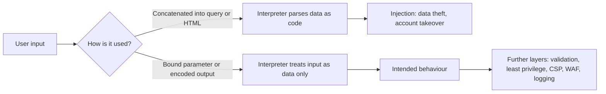

## Introduction

Most organisations now meet their customers through a web browser or a mobile application that talks to web APIs. A Ghanaian microfinance company's loan portal, a hospital's appointment system and a retailer's online shop all expose code to anyone on the internet. Unlike a firewall rule, which either allows or blocks traffic, a web application must accept untrusted input by design: names, search terms, file uploads and JSON payloads. Every one of those inputs is a potential route for an attacker to change what the application does.

This lesson introduces the OWASP Top 10 and then studies SQL injection (SQLi) and cross-site scripting (XSS) in depth. Both share one root cause: attacker-supplied *data* is interpreted as *code* by an interpreter (the database engine or the browser). Understand that, and the defences become a design principle rather than a list. Perform any demonstration only in legal training labs or on systems you own or are authorised to test.

## Learning Objectives

- Explain the purpose and structure of the OWASP Top 10:2021 and identify each of its ten risk categories.
- Analyse why SQL injection occurs and compare a vulnerable string-concatenated query with a parameterised query.
- Distinguish stored, reflected and DOM-based cross-site scripting by data flow and sink.
- Apply context-aware output encoding and a Content Security Policy as complementary XSS defences.
- Evaluate the role of input validation, least privilege and web application firewalls as secondary, not primary, controls.

## Prerequisite Knowledge

- Basic understanding of how HTTP requests and responses work (methods, headers, parameters, cookies).
- Introductory SQL (`SELECT`, `WHERE`, `INSERT`) and an awareness of HTML and JavaScript.
- The CIA triad and the threat, vulnerability and risk vocabulary from Module 1.

## Key Terminology

- **OWASP Top 10**: An awareness document published by the Open Worldwide Application Security Project that ranks broad categories of web application security risk, based on contributed data and community survey.
- **Injection**: A class of flaw in which untrusted data is sent to an interpreter as part of a command or query, so that the interpreter executes attacker-controlled instructions.
- **SQL injection (SQLi)**: Injection into a database query, allowing an attacker to read, modify or delete data, or bypass authentication logic.
- **Parameterised query (prepared statement)**: A query in which the SQL structure is fixed in advance and user values are passed separately as bound parameters, so they can never change the query's grammar.
- **Cross-site scripting (XSS)**: A flaw that lets an attacker cause a victim's browser to run attacker-controlled script in the security context of a trusted site.
- **Output encoding**: Converting characters that have special meaning in a given output context (HTML body, HTML attribute, JavaScript, URL) into a safe representation before inserting data into that context.
- **Content Security Policy (CSP)**: An HTTP response header that tells the browser which sources of script, style and other content are permitted, limiting the damage an injected script can do.
- **Sink**: A function or property (for example `innerHTML` or `eval`) where data is interpreted as code or markup; dangerous sinks are central to DOM-based XSS.

## Detailed Explanation

### The OWASP Top 10:2021

The OWASP Top 10 is not a standard or a complete checklist; it is a consensus awareness document intended to focus developers and managers on the most significant categories of risk. The 2021 edition, still widely referenced in teaching and procurement, contains the following categories:

| Code | Category | Core idea |
|---|---|---|
| A01 | Broken Access Control | Users can act outside their intended permissions (for example viewing another customer's account by changing an ID in the URL). |
| A02 | Cryptographic Failures | Sensitive data is exposed because encryption is missing, weak or wrongly implemented. |
| A03 | Injection | Untrusted data reaches an interpreter; SQLi and XSS both sit here in the 2021 edition. |
| A04 | Insecure Design | Flaws in the design itself, which no amount of perfect coding can fix. |
| A05 | Security Misconfiguration | Default accounts, verbose errors, unnecessary features or missing hardening. |
| A06 | Vulnerable and Outdated Components | Libraries, frameworks and platforms with known, unpatched vulnerabilities. |
| A07 | Identification and Authentication Failures | Weak login, session or credential handling. |
| A08 | Software and Data Integrity Failures | Trusting updates, plugins or serialised data without verifying integrity. |
| A09 | Security Logging and Monitoring Failures | Attacks are not detected or investigated because events are not logged or reviewed. |
| A10 | Server-Side Request Forgery (SSRF) | The server can be tricked into making requests to internal or unintended destinations. |

Two observations matter for analysis. First, Broken Access Control rose to first place in 2021, reflecting how often applications fail to check *whether this user may do this to this object*. Second, the edition merged cross-site scripting into Injection, which reinforces the common-root-cause view taken in this lesson. OWASP revises the list periodically, so always check the project site for the current edition before quoting it in professional work.

### SQL injection: the root cause

Consider a login or search feature that builds SQL by gluing strings together. If a developer writes code that inserts the user's input directly between quotation marks, the database cannot tell which characters came from the developer and which came from the user. A single quotation mark in the input ends the developer's string early, and anything after it is parsed as SQL. The attacker is now co-authoring the query.

The consequences depend on what the database account can do and what the query is for. Typical impacts include bypassing a password check, extracting entire tables (customer records, password hashes), altering balances, or, on badly configured systems, executing operating-system commands. SQLi therefore threatens all three CIA properties.

The definitive fix is to keep code and data separate at the interface to the interpreter. With a parameterised query the SQL text is sent to the database with placeholders, the database parses and plans it, and only then are the user's values bound to those placeholders as pure data. No value, however many quotation marks it contains, can alter the parsed structure.

### Cross-site scripting: the same pattern in the browser

XSS repeats the pattern with a different interpreter: the victim's browser. If an application places user-controlled text into a page without encoding it, characters such as `<`, `>` and `"` can open a `<script>` element or an event-handler attribute. Because the script appears to come from the trusted site, it can read the page, act as the logged-in user, capture keystrokes or silently submit requests. Three variants are recognised:

- **Stored (persistent) XSS**: the payload is saved by the server (in a comment, profile field or support ticket) and delivered to every user who views it. It is often the most damaging because it needs no further interaction and can reach administrators.
- **Reflected XSS**: the payload travels in the request (often a URL parameter) and is immediately echoed back in the response. The attacker must persuade a victim to follow a crafted link, frequently via phishing.
- **DOM-based XSS**: the vulnerability lives entirely in client-side JavaScript, which reads attacker-influenced data (for example `location.hash`) and writes it to a dangerous sink such as `innerHTML`. The server may never see the payload, so server-side filtering cannot detect it.

## Theories, Frameworks and Models

### Data–code separation as a design principle

The most useful model for injection is the *confused interpreter*: any time an application builds a string that another component will parse (SQL, HTML, shell commands, LDAP filters, XML), there is a risk that data will be parsed as instructions. The robust defences are therefore those that use an API in which structure and data are passed separately: prepared statements for SQL, templating engines with automatic contextual escaping for HTML, argument arrays rather than shell strings for operating-system calls.

### Defence in depth for web applications

No single control is sufficient, so mature teams layer them:

1. **Primary control at the interpreter boundary**: parameterised queries; context-aware output encoding through a framework that escapes by default.
2. **Input validation**: allow-listing expected formats (a Ghana Card number pattern, a date, a numeric amount). Validation reduces attack surface and improves data quality but is *not* a substitute for parameterisation or encoding, because many legitimate values (such as the surname O'Brien) contain special characters.
3. **Least privilege**: the application's database account should hold only the permissions the feature needs. A read-only reporting page should not connect as a database owner.
4. **Browser-enforced policy**: a Content Security Policy that blocks inline scripts and restricts script sources, plus cookie flags such as `HttpOnly`, `Secure` and `SameSite`.
5. **Detection and shielding**: a web application firewall (WAF) and logging that alerts on injection patterns. A WAF buys time but can be bypassed and must not be treated as the fix.

### Context-aware output encoding

Encoding must match the context in which data is placed. HTML-body encoding converts `<` to `&lt;`; attribute encoding must also handle quotation marks; JavaScript string contexts and URL parameters need their own encoders. Placing untrusted data directly inside a `<script>` block or an event handler is high risk even with encoding, so good designs avoid those contexts altogether and pass data through safe mechanisms such as `data-` attributes read with `textContent`.

## Worked Example

The following comparison uses Python with a database driver that supports placeholders. The purpose is defensive: to recognise the vulnerable pattern in code review and replace it.

```python
# VULNERABLE: user input is concatenated into the SQL text.
def find_customer_unsafe(conn, phone):
    sql = "SELECT id, name FROM customers WHERE phone = '" + phone + "'"
    return conn.execute(sql).fetchall()

# SAFE: the SQL structure is fixed; the value is bound as a parameter.
def find_customer_safe(conn, phone):
    sql = "SELECT id, name FROM customers WHERE phone = ?"
    return conn.execute(sql, (phone,)).fetchall()
```

In the unsafe version, an input containing a quotation mark followed by SQL syntax changes the `WHERE` clause, for instance into a condition that is always true, so the query returns every customer. In the safe version the database receives the statement `... WHERE phone = ?` and treats the entire input as one literal value to compare against the `phone` column; the attempted payload simply matches no rows. The same principle applies in Java (`PreparedStatement`), PHP (PDO) and most object-relational mappers, provided developers avoid raw-query escape hatches. Stored procedures are safe only if they do not themselves build dynamic SQL from their arguments.

For DOM-based XSS, compare two ways of displaying a search term taken from the URL:

```javascript
// VULNERABLE: interprets the value as HTML.
results.innerHTML = "You searched for: " + term;

// SAFE: inserts the value as plain text; markup is not parsed.
results.textContent = "You searched for: " + term;
```

A layered response adds a CSP header such as:

```text
Content-Security-Policy: default-src 'self'; script-src 'self'; object-src 'none'; base-uri 'self'; frame-ancestors 'none'
```

This policy forbids inline scripts and scripts from other origins, so even if an encoding mistake slips through, an injected `<script>` element or inline event handler will be refused by modern browsers. Rolling out CSP first in `Content-Security-Policy-Report-Only` mode lets a team discover legitimate inline scripts that need refactoring before enforcement.

## Diagram



## Ghanaian Business Application

**Illustrative scenario.** *Adom Savings and Loans* (a fictional Accra-based microfinance institution) launches a customer portal where borrowers can check balances using their phone number and a PIN, and a "message us" form that staff read in an internal dashboard. A routine authorised assessment finds two issues: the balance lookup concatenates the phone number into SQL, and the message form stores text that is later rendered unencoded in the staff dashboard, a classic stored XSS that could let a malicious "customer" run script in a loan officer's browser and act with staff privileges.

The remediation plan the security team presents to management illustrates proportionate, layered thinking: replace every concatenated query with parameterised statements and add a code-review rule that rejects new ones; switch the dashboard to a templating engine that encodes by default; introduce a CSP; reduce the portal's database account to `SELECT` on the specific views it needs; and log failed and anomalous queries to the security monitoring platform.

There is also a regulatory dimension. Borrowers' personal data falls under Ghana's Data Protection Act, 2012 (Act 843), which requires appropriate security measures, and financial institutions are subject to Bank of Ghana cyber and information security requirements. If the institution were designated as operating Critical Information Infrastructure under the Cybersecurity Act, 2020 (Act 1038), it would also have obligations to the Cyber Security Authority, including incident reporting. Consult the primary texts for exact obligations.

## International Case Study

**TalkTalk (United Kingdom), 2015.** In October 2015 the UK telecommunications provider TalkTalk suffered a breach in which attackers used SQL injection against legacy web pages that the company had inherited when it acquired another business's operations. Personal data of around 157,000 customers was accessed, including bank details for a subset. The UK Information Commissioner's Office fined the company £400,000 in 2016, concluding that it had failed to implement basic security measures: the vulnerable pages were old, the vulnerability class was well known, and a patch for the underlying database software had been available for years.

Three lessons follow. *Asset inventory matters*: forgotten legacy pages remained internet-facing. *Known vulnerability classes are not exotic*, and regulators treat failure to prevent them as a lack of basic care. *Accountability is organisational*: the penalty fell on the company, so senior managers must ensure secure development and testing are resourced.

## Common Misconceptions

- **"Input validation alone prevents SQL injection."** Validation narrows what reaches the database but cannot safely handle every legitimate value; parameterised queries are the primary defence and validation is a supporting layer.
- **"Escaping quotation marks by hand is as good as prepared statements."** Manual escaping is error-prone, depends on character sets and database dialect, and is easily forgotten; prepared statements remove the problem structurally.
- **"XSS only matters if the site has a login."** Even public pages can be used to deliver malware, deface content or steal data entered into forms, and stored XSS in an admin view can compromise the whole site.
- **"A Content Security Policy fixes XSS."** CSP limits the impact of injected script; the underlying encoding flaw still needs to be fixed, and weak policies (for example allowing `'unsafe-inline'`) provide little protection.

## Common Examination Mistakes

- Listing the OWASP Top 10 categories without explaining the underlying risk or giving an example of each.
- Describing SQLi defences as "use a firewall" or "sanitise input" without mentioning parameterised queries.
- Confusing reflected and DOM-based XSS; the key distinction is whether the vulnerable code runs on the server or entirely in client-side JavaScript.
- Writing offensive step-by-step payloads instead of explaining mechanisms and defences, which misreads what a postgraduate security question rewards.
- Forgetting the business and regulatory consequences (data protection obligations, reputational loss, regulatory penalties) when evaluating impact.

## Critical Thinking Questions

1. Why might the OWASP Top 10 be a poor choice as the *sole* acceptance criterion in a software procurement contract, and what would you add?
2. If a legacy application cannot be rewritten to use parameterised queries in the short term, which compensating controls would you prioritise and how would you justify the residual risk to management?
3. Should a regulator treat a breach caused by a well-known flaw such as SQLi differently from one caused by a previously unknown vulnerability? Justify your view.

## Practical Exercises

1. **PortSwigger Web Security Academy (free, legal lab).** Register and complete the introductory SQL injection and cross-site scripting learning materials and their apprentice-level labs. *Expected output:* a one-page reflection describing, for each lab, the root cause in plain language and the specific code-level fix you would recommend.
2. **OWASP Juice Shop, run locally.** Install Juice Shop on your own computer (for example using the official container image) and use its score board to find one injection and one XSS challenge. *Expected output:* a short defect report for each, written as a developer would receive it: affected feature, root cause, risk rating, recommended fix and how to verify the fix.
3. **Code review exercise.** Write a small function in a language of your choice that searches a local test database by customer name using string concatenation, then refactor it to use a parameterised query. *Expected output:* both versions side by side with a commented explanation of why the second cannot be injected.
4. **CSP design.** For a simple static website you own, draft a Content Security Policy and deploy it in report-only mode. *Expected output:* the header, the reported violations and what you would refactor before enforcing.

## Key Takeaways

- The OWASP Top 10:2021 is an awareness tool covering ten risk categories, with Broken Access Control first and XSS now grouped under Injection.
- SQL injection and XSS share one root cause: untrusted data being interpreted as code by an interpreter.
- Parameterised queries are the primary SQLi defence; context-aware output encoding is the primary XSS defence.
- Input validation, least-privilege database accounts, CSP, secure cookie flags and WAFs are valuable supporting layers, not replacements.
- Breaches through well-known flaws are a governance failure, not just a technical one.

## Further Reading

- OWASP Foundation. (2021). *OWASP Top 10:2021*. <https://owasp.org/Top10/>
- OWASP Foundation. (n.d.). *OWASP Cheat Sheet Series* (see the SQL Injection Prevention and Cross Site Scripting Prevention cheat sheets). <https://cheatsheetseries.owasp.org/>
- Stallings, W., & Brown, L. (2018). *Computer security: Principles and practice* (4th ed.). Pearson.
- Anderson, R. (2020). *Security engineering: A guide to building dependable distributed systems* (3rd ed.). Wiley.
- Republic of Ghana. (2012). *Data Protection Act, 2012 (Act 843)*.

## Video Resources

- [PortSwigger Web Security Academy](https://portswigger.net/web-security) — PortSwigger. Free official learning portal with explanations and legal hands-on labs for SQL injection, XSS and other web vulnerabilities.
- [OWASP Juice Shop](https://owasp.org/www-project-juice-shop/) — OWASP Foundation. Official project page for a deliberately insecure training application you can run locally, with links to its companion guide.
- [OWASP Top 10](https://owasp.org/Top10/) — OWASP Foundation. Official pages describing each risk category with examples and prevention guidance.

## Revision Summary

The OWASP Top 10:2021 groups web risks into ten categories (A01 Broken Access Control to A10 SSRF) and is an awareness tool, not a full standard. SQLi and XSS both arise when an interpreter (database or browser) receives data mixed with code.

- SQLi: use parameterised queries or prepared statements; never concatenate input into SQL.
- XSS types: stored (saved and served), reflected (echoed from the request), DOM-based (client-side sink such as `innerHTML`).
- XSS defence: context-aware output encoding, safe sinks such as `textContent`, frameworks that escape by default.
- CSP limits injected script; deploy in report-only mode first and avoid `'unsafe-inline'`.
- Supporting layers: allow-list validation, least-privilege database accounts, cookie flags, WAF, logging.
- Real breaches such as TalkTalk (2015) show that regulators treat failure to prevent known flaws as a governance failure.
