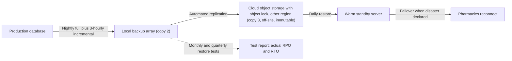

## Introduction

Every organisation will eventually lose data or systems. Disks fail, staff delete the wrong folder, floods damage server rooms, power surges destroy equipment and, increasingly, ransomware encrypts everything an attacker can reach, including backups that were left online. Prevention reduces how often this happens; backup and disaster recovery determine whether the organisation survives when it does.

This lesson treats recovery as an engineering problem with measurable targets. You will learn the 3-2-1 rule and its modern extensions, how to design backups that ransomware cannot easily destroy, and how to use recovery point objective (RPO) and recovery time objective (RTO) to decide whether a backup strategy is adequate. A worked example shows how to test a strategy against its targets with simple arithmetic, the kind of reasoning boards and auditors expect.

## Learning Objectives

- Explain the 3-2-1 backup rule and its extensions for immutable and offline copies.
- Compare full, incremental and differential backups and their effect on storage and restore time.
- Calculate whether a backup and recovery design meets stated RPO and RTO targets.
- Evaluate hot, warm and cold disaster recovery sites and cloud-based recovery options.
- Design a backup testing regime that provides evidence of recoverability.

## Prerequisite Knowledge

- Ransomware concepts from Module 2.
- Data classification from the previous lesson.
- The availability element of the CIA triad.

## Key Terminology

- **3-2-1 rule**: Keep at least three copies of data, on two different types of media or storage, with one copy off-site.
- **Immutable backup**: A backup that cannot be altered or deleted for a defined retention period, even by an administrator, typically using write-once storage or object lock features.
- **Air-gapped (offline) backup**: A copy that is physically or logically disconnected from production networks, so an attacker who compromises the network cannot reach it.
- **Recovery point objective (RPO)**: The maximum acceptable amount of data loss, measured as time between the last recoverable copy and the disruption.
- **Recovery time objective (RTO)**: The maximum acceptable time to restore a system or process to an agreed level of service after a disruption.
- **Maximum tolerable downtime (MTD)**: The total time a business process can be unavailable before the organisation suffers unacceptable harm; RTO must be shorter than MTD.
- **Disaster recovery (DR)**: The technical plans and capabilities for restoring IT systems and data after a disruptive event.
- **Failover**: Switching operations from a primary system or site to a standby system or site.

## Detailed Explanation

### The 3-2-1 rule and its extensions

The 3-2-1 rule is a simple heuristic that protects against most common failure modes. *Three copies* (production plus two backups) protect against a single backup being corrupt. *Two media types* (for example disk and cloud object storage, or disk and tape) protect against a fault affecting one technology. *One off-site copy* protects against fire, flood or theft at the main site.

Ransomware has exposed a gap: attackers deliberately seek out and destroy backups before encrypting production systems, because that maximises pressure to pay. Many organisations now apply an extended form often described as **3-2-1-1-0**: three copies, two media, one off-site, **one immutable or offline**, and **zero** errors on restore verification. The extra "1" ensures at least one copy survives an attacker with administrator privileges; the "0" insists that backups are tested, not assumed.

### Backup types

| Type | What is copied | Storage | Restore |
|---|---|---|---|
| Full | All selected data | Highest | Fastest and simplest: one set |
| Incremental | Changes since the last backup of any type | Lowest | Slowest: last full plus every incremental since |
| Differential | Changes since the last full backup | Moderate, grows daily | Moderate: last full plus latest differential |

Modern systems also offer snapshots (point-in-time images of volumes or virtual machines) and continuous replication to another site. Replication gives a very low RPO but faithfully copies corruption and encryption too, so it is not a substitute for point-in-time backups.

### Protecting the backups themselves

Backup systems are high-value targets and should be treated as restricted assets: separate administrative credentials (not domain administrator accounts used elsewhere), MFA on the backup console, encryption of backup data with keys stored separately, network segmentation, immutability settings, and alerts when retention policies are shortened or large numbers of backups are deleted.

### RPO, RTO and MTD

RPO and RTO translate business tolerance into technical requirements. They should come from a business impact analysis (covered in the governance module), not from IT guesswork. RPO drives **backup frequency** (or replication); RTO drives **restore capability**: bandwidth, hardware availability, standby sites and staff procedures. Both must fit within the MTD for the business process the system supports.

## Theories, Frameworks and Models

### Disaster recovery site strategies

| Option | Description | Typical RTO | Cost |
|---|---|---|---|
| Cold site | Space and power, but equipment and data must be brought in and restored | Days to weeks | Low |
| Warm site | Some hardware and connectivity in place; data restored from recent backups | Hours to days | Medium |
| Hot site | Fully equipped, data replicated, ready to take over quickly | Minutes to hours | High |
| Cloud DR | Recovery into a cloud provider, from replicated images or backups, scaled up only when needed | Varies with design | Pay mainly when used |

NIST SP 800-34 Rev. 1 (Swanson et al., 2010) places disaster recovery within a wider contingency planning process: develop a policy, conduct a business impact analysis, identify preventive controls, create recovery strategies, develop the plan, test and exercise it, and maintain it. ISO 22301 provides a management-system standard for business continuity into which DR fits.

### Testing levels

Recovery capability is only proven by testing. Levels increase in realism and cost: checklist reviews, tabletop walk-throughs, restoration of individual files, full restoration of a system to an isolated environment, parallel tests (recovery site runs alongside production) and full interruption tests (production is switched off and the recovery site takes over). Each test should record actual restore times against RTO and any data loss against RPO.

## Worked Example

**Illustrative scenario.** *Nkabom Pharmacies* (fictional), a chain of twelve pharmacies in Greater Accra, runs a central dispensing and stock database of 2 TB. The business impact analysis sets:

- **RPO = 4 hours** (losing more than four hours of prescriptions would be unacceptable for patient safety and stock control).
- **RTO = 8 hours** (beyond this, pharmacies must revert to paper and lose sales; MTD is assessed at 24 hours).

**Current design:** one full backup nightly at 01:00 to a disk array in the same server room, plus a weekly copy to an external drive taken home by the IT manager. Restore throughput from the disk array is measured at 200 GB per hour.

**Test 1: Does it meet RPO?** Suppose the database fails at 16:00. The last backup was at 01:00, so data loss = 16:00 − 01:00 = **15 hours**, far above the 4-hour RPO. Worst case (failure just before 01:00) is almost **24 hours**. The design fails RPO.

**Test 2: Does it meet RTO?** Restore time = 2,000 GB ÷ 200 GB/hour = **10 hours**, plus an estimated 2 hours to provision hardware, verify integrity and reconnect pharmacies = **12 hours**, above the 8-hour RTO. If the server room itself is lost (fire), the only remaining copy is the weekly external drive, giving up to seven days of data loss and an unknown recovery time while new hardware is sourced. The design fails RTO and is not 3-2-1 compliant (the second copy is on similar media and sometimes in the same building).

**Improved design:**

1. Keep the nightly full backup but add incremental backups every 3 hours, giving a worst-case data loss of about 3 hours, within RPO.
2. Copy backups automatically to cloud object storage in another region with object lock enabled for 30 days (off-site, different medium, immutable).
3. Maintain a warm standby database server at a second location (or in the cloud), restored from backups daily, so that only the latest incremental changes need applying. Estimated recovery = 1 hour to apply incrementals + 1.5 hours to switch connections and verify = **2.5 hours**, within RTO.
4. Protect the backup console with separate credentials and MFA; alert on deletion attempts.
5. Test restores monthly for files and quarterly for a full failover, recording actual times.

The arithmetic makes the business case explicit: management can see precisely why the old design was inadequate and what the additional spending buys.

## Diagram

## Ghanaian Business Application

Availability risks in Ghana include power disruptions and voltage fluctuations, which damage hardware and corrupt data if systems shut down uncleanly, as well as flooding in some urban areas during the rainy season, fire and theft. Uninterruptible power supplies, generators and surge protection are part of the resilience picture, but none replace off-site, tested backups.

Cloud object storage with immutability features gives small and medium-sized Ghanaian businesses an affordable way to achieve an off-site, ransomware-resistant copy without building a second data centre, subject to bandwidth for the initial upload and restore, and to data protection considerations under Act 843 regarding where personal data is stored. Organisations that operate Critical Information Infrastructure under the Cybersecurity Act, 2020 (Act 1038) should consider recovery capability as part of their resilience and incident obligations, and regulated sectors such as banking should check their regulator's specific continuity expectations.

## International Case Study

**A.P. Møller-Maersk and NotPetya, 2017.** In June 2017 the NotPetya malware, which spread initially through a compromised update of Ukrainian accounting software and then propagated rapidly across networks, severely disrupted the Danish shipping and logistics company Maersk. NotPetya presented itself as ransomware but was effectively destructive: it rendered encrypted systems unrecoverable. Maersk's global operations were heavily disrupted, and the company reported costs in the hundreds of millions of US dollars.

A widely reported detail is directly relevant to this lesson and to Ghana. Maersk's Active Directory domain controllers, essential for authenticating users and systems, were synchronised with one another, so the malware destroyed them all. According to public accounts, including a detailed 2018 report in *Wired*, a single domain controller in Maersk's office in Ghana survived because it had been offline due to a local power outage. Its disk was carried to the recovery team in the United Kingdom and used to rebuild the company's directory, enabling the wider recovery.

The lessons are sobering. Replication is not backup: synchronised copies were destroyed together. Identity infrastructure needs its own offline, tested backups. And the company's recovery depended partly on chance rather than design, which a 3-2-1-1-0 strategy with an immutable or offline copy of critical systems is intended to prevent.

## Common Misconceptions

- **"Replication or RAID is a backup."** They protect against hardware failure but faithfully copy deletion, corruption and encryption; point-in-time, isolated backups are still needed.
- **"Cloud data is automatically backed up."** Under the shared responsibility model, backup and retention configuration for customer data is usually the customer's responsibility, even in SaaS.
- **"If backups run successfully, we can restore."** A successful job does not prove restorability; only regular test restores, timed against RTO, provide evidence.
- **"A low RPO is always better."** Lower RPOs cost more; the right RPO is the one justified by business impact, not the smallest possible.

## Common Examination Mistakes

- Defining RPO and RTO correctly but failing to calculate whether a scenario meets them.
- Confusing RPO (data loss, drives backup frequency) with RTO (downtime, drives restore capability).
- Proposing 3-2-1 without addressing ransomware's targeting of online backups.
- Omitting testing from a disaster recovery recommendation.
- Choosing a hot site for every system without weighing cost against business impact.

## Critical Thinking Questions

1. How should an organisation decide which systems justify a hot site and which can tolerate a cold-site or rebuild approach?
2. The Maersk recovery relied partly on luck. What would a deliberately designed equivalent of the "Ghana domain controller" look like for a mid-sized company?
3. If cloud backups are immutable for 30 days but an attacker remains undetected for 45 days, what risk remains and how could it be mitigated?

## Practical Exercises

1. **Personal 3-2-1-1-0 audit.** Map where copies of your own important files (for example your dissertation drafts) are kept. *Expected output:* a diagram of copies, media and locations, a gap analysis against 3-2-1-1-0, and one improvement you implement.
2. **RPO/RTO calculation.** For an illustrative 500 GB database with nightly backups and a restore throughput of 100 GB per hour, calculate worst-case data loss and restore time, then propose changes to meet an RPO of 1 hour and an RTO of 4 hours. *Expected output:* calculations shown step by step and a justified design.
3. **Restore test.** On a computer you own, restore a folder from your backup tool to a different location and time it. *Expected output:* a short test record showing date, data restored, time taken, integrity check and issues found.

## Key Takeaways

- 3-2-1 protects against common failures; 3-2-1-1-0 adds an immutable or offline copy and verified restores to resist ransomware.
- Full, incremental and differential backups trade storage against restore complexity and speed.
- RPO drives backup frequency; RTO drives restore capability; both must fit within MTD from the BIA.
- DR sites range from cold to hot, with cloud DR offering flexible cost; choose by business impact.
- Only regular, timed restore tests prove recoverability; Maersk (2017) shows the cost of relying on chance.

## Further Reading

- Swanson, M., Bowen, P., Phillips, A. W., Gallup, D., & Lynes, D. (2010). *Contingency planning guide for federal information systems* (NIST Special Publication 800-34, Revision 1). National Institute of Standards and Technology. <https://csrc.nist.gov/pubs/sp/800/34/r1/upd1/final>
- International Organization for Standardization. (2019). *Security and resilience — Business continuity management systems — Requirements* (ISO 22301:2019). ISO.
- Greenberg, A. (2018, August 22). The untold story of NotPetya, the most devastating cyberattack in history. *Wired*. <https://www.wired.com/story/notpetya-cyberattack-ukraine-russia-code-crashed-the-world/>
- Stallings, W., & Brown, L. (2018). *Computer security: Principles and practice* (4th ed.). Pearson.

## Video Resources

- [CISA Stop Ransomware](https://www.cisa.gov/stopransomware) — Cybersecurity and Infrastructure Security Agency. Official US government ransomware resource hub, including guidance on backups and recovery.
- [Cisco Skills for All](https://skillsforall.com/) — Cisco Networking Academy. Official learning portal with free cybersecurity courses that cover availability, backup and recovery concepts.
- [NIST Computer Security Resource Center](https://csrc.nist.gov/) — National Institute of Standards and Technology. Official portal for NIST security publications, including contingency planning guidance.

## Revision Summary

Backups and disaster recovery turn inevitable failures into survivable events. Apply 3-2-1, extended to 3-2-1-1-0 against ransomware, and measure designs against RPO and RTO derived from business impact. Test restores to prove capability.

- RPO = maximum data loss; set backup or replication frequency to meet it.
- RTO = maximum downtime; size restore throughput and standby capacity to meet it; RTO < MTD.
- Worked check: data loss = failure time − last good copy; restore time = data size ÷ throughput + overheads.
- Replication and RAID are not backups; keep isolated point-in-time copies.
- Protect backup systems with separate credentials, MFA, encryption and immutability.
- Maersk (2017): an offline domain controller in Ghana enabled recovery from NotPetya.
