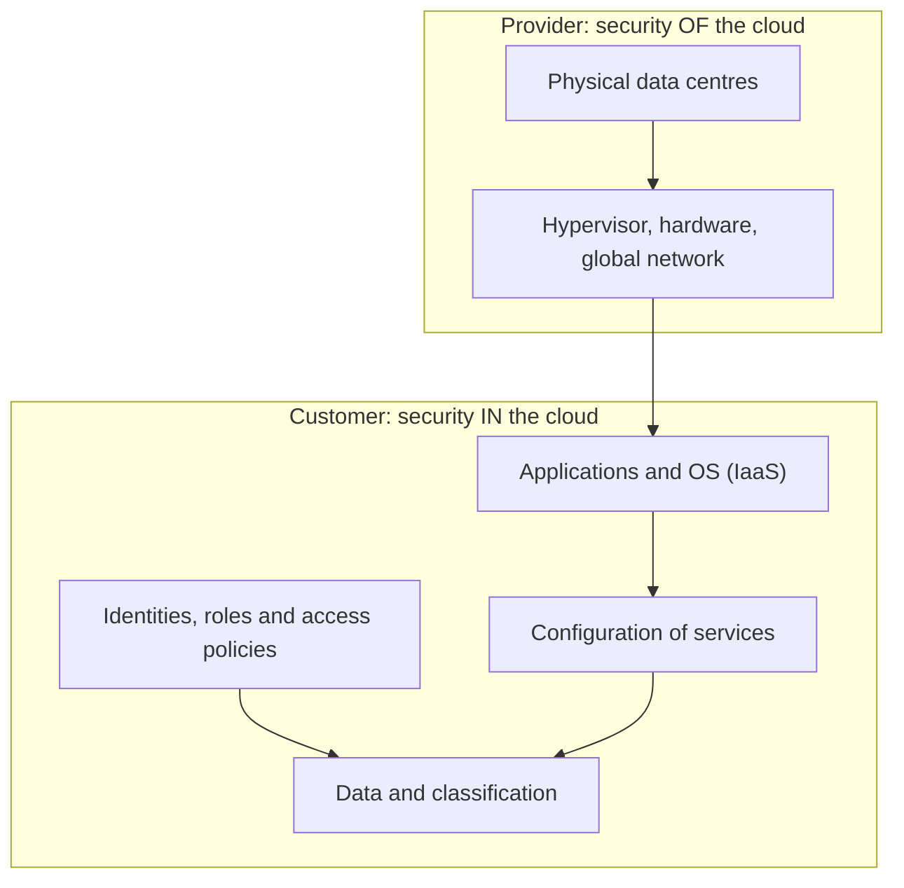

## Introduction

Cloud computing has changed how organisations of every size acquire IT. A start-up in Accra can rent servers, databases and machine-learning services by the hour from a global provider, and a long-established company can move its email and office productivity to a software-as-a-service suite in a weekend. These services are often more secure at the infrastructure level than anything a small organisation could build itself. Yet cloud breaches remain common, and most of them are not caused by the provider being hacked. They are caused by customers misunderstanding which security duties remain theirs, and above all by weaknesses in identity and access management.

In the cloud, identity is the new perimeter. There is no data-centre door to lock; anyone on the internet who holds a valid key or password can reach the management console or API. This lesson explains the shared responsibility model and then focuses on the identity and access controls that determine whether a cloud environment is safe.

## Learning Objectives

- Explain the essential characteristics, service models and deployment models of cloud computing as defined by NIST SP 800-145.
- Apply the shared responsibility model to allocate security duties between provider and customer for IaaS, PaaS and SaaS.
- Design cloud identity and access management controls using least privilege, roles, federation and temporary credentials.
- Analyse how a server-side request forgery flaw combined with an over-permissive role led to the Capital One 2019 breach.
- Evaluate cloud adoption risks for a Ghanaian organisation, including regulatory considerations for personal data.

## Prerequisite Knowledge

- Authentication, MFA, RBAC and ABAC from the previous module.
- Network segmentation and firewall concepts from Module 3.
- Basic awareness of virtualisation.

## Key Terminology

- **Shared responsibility model**: The division of security duties between the cloud provider (security *of* the cloud) and the customer (security *in* the cloud), which varies by service model.
- **IaaS, PaaS, SaaS**: Infrastructure, Platform and Software as a Service, offering progressively more provider-managed layers.
- **Identity and access management (IAM)**: The policies, processes and technologies that create, manage and enforce digital identities and their permissions.
- **Principal**: Any entity that can make a request to a cloud API, such as a human user, a group, an application or a workload.
- **IAM role**: An identity with permissions that can be assumed temporarily by users or workloads, issuing short-lived credentials rather than permanent keys.
- **Federation**: Allowing users authenticated by an organisation's own identity provider to access cloud resources through standards such as SAML or OpenID Connect, without separate cloud passwords.
- **Instance metadata service**: An internal endpoint available to a virtual machine that provides configuration data and, in many clouds, temporary credentials for the machine's role.
- **Root or global administrator account**: The highest-privilege account in a cloud tenancy, which should be protected with strong MFA and used only in emergencies.

## Detailed Explanation

### What cloud computing is

NIST SP 800-145 (Mell & Grance, 2011) defines cloud computing through five essential characteristics: on-demand self-service, broad network access, resource pooling, rapid elasticity and measured service. It identifies three service models (IaaS, PaaS, SaaS) and four deployment models: public, private, community and hybrid. These definitions remain useful because each characteristic has a security implication. Self-service means anyone with the right permissions can create resources, including insecure ones, in seconds. Resource pooling means tenants share hardware, so isolation depends on the provider's engineering. Broad network access means management interfaces are reachable from anywhere.

### The shared responsibility model

Providers secure the physical facilities, hardware, hypervisors and their own global network. What the customer must secure depends on the service model:

| Layer | On-premises | IaaS | PaaS | SaaS |
|---|---|---|---|---|
| Data, classification and accountability | Customer | Customer | Customer | Customer |
| Identities, access and endpoints | Customer | Customer | Customer | Customer (provider supplies tools) |
| Application | Customer | Customer | Customer | Provider |
| Operating system, runtime, middleware | Customer | Customer | Provider | Provider |
| Virtualisation, hardware, network | Customer | Provider | Provider | Provider |
| Physical data centre | Customer | Provider | Provider | Provider |

The crucial pattern is the top two rows. **Data and identity are always the customer's responsibility**, whatever the service model. A provider cannot know that a storage bucket containing payroll data should not be public, or that a former employee's account should have been disabled. Each major provider publishes its own version of the model, and customers should read the one for every service they use, since boundaries differ between services.

### Identity as the perimeter

Cloud management planes are reached through web consoles and APIs over the internet. An attacker with a valid access key can create, read or delete resources from anywhere. As a result, the most important cloud controls are identity controls:

- **Protect the root account**: enable strong MFA, remove long-lived access keys from it, and reserve it for break-glass tasks.
- **Federate human access**: staff sign in through the organisation's identity provider with MFA and single sign-on, so leavers lose cloud access when their corporate account is disabled.
- **Prefer roles and temporary credentials**: workloads should obtain short-lived credentials through roles attached to the compute resource, not static keys stored in code or configuration files.
- **Least privilege**: grant only the actions and resources needed, scoped to specific resources rather than wildcards; review unused permissions regularly; use provider tools that analyse effective permissions.
- **Separate environments**: use separate accounts, subscriptions or projects for production, development and security logging, limiting blast radius.
- **Guardrails**: organisation-level policies that forbid dangerous actions (for example disabling logging or creating public storage) regardless of individual permissions.
- **Logging**: enable the provider's control-plane audit log in every region and send it to a protected, separate account.

### Privileged access

Administrative roles should be eligible rather than permanently assigned where the platform supports it (just-in-time elevation with approval and time limits), with every elevation logged. Emergency break-glass accounts should be few, tightly monitored and tested.

## Theories, Frameworks and Models

### Zero trust applied to cloud

NIST SP 800-207 describes zero trust architecture as a model in which no implicit trust is granted based on network location; every request is authenticated, authorised and evaluated against policy. Cloud environments are a natural fit: rather than trusting anything inside a virtual network, access decisions consider the identity, device posture and context of each request. Workload identity (roles for compute) and federated user identity are the building blocks.

### The Cloud Security Alliance perspective

The Cloud Security Alliance's *Security Guidance for Critical Areas of Focus in Cloud Computing* organises cloud security into domains such as governance, compliance, identity and access management, data security and incident response. Its central message mirrors this lesson: moving to the cloud shifts *how* controls are implemented, but the customer remains accountable for governance, identity and data.

## Worked Example

**Illustrative scenario.** *Volta Agritech* (a fictional company that connects cocoa and cashew farmers to buyers) runs a web application on IaaS virtual machines, uses a managed database (PaaS) and staff email on a SaaS suite. Management asks: "What exactly are we responsible for?"

**Step 1: Map services to models.** Virtual machines (IaaS): Volta patches operating systems, configures host firewalls and secures the application. Managed database (PaaS): the provider patches the engine; Volta configures network access, encryption options, database users and backups retention. Email suite (SaaS): the provider runs the application; Volta configures MFA, sharing settings, retention and administrator roles.

**Step 2: Identify identity risks.** The audit finds a developer's long-lived access key committed to a code repository, the root account without MFA, and the web servers' role permitted `*` on all storage.

**Step 3: Remediate.** Revoke and rotate the exposed key; enable secrets scanning; enforce hardware-key MFA on root and remove its access keys; federate staff sign-in through the email suite's identity provider; replace the wildcard with a policy allowing the web role to read and write only the `volta-uploads` bucket; enable organisation-wide audit logging to a separate security account.

**Step 4: Verify.** Use the provider's access analysis tool to confirm no unintended external access remains, and schedule quarterly access reviews.

## Diagram

## Ghanaian Business Application

Cloud adoption in Ghana brings real advantages: avoiding the cost of on-premises generators and cooling, reducing exposure to local power disruptions, and accessing advanced security tooling. It also raises questions boards must answer. Where will personal data be stored and processed, and does that satisfy the Data Protection Act, 2012 (Act 843) and any sector-specific rules? Regulated institutions, such as banks supervised by the Bank of Ghana, may face specific requirements or notification expectations for outsourcing and cloud use, which must be checked against current directives. If a service supports Critical Information Infrastructure as defined under the Cybersecurity Act, 2020 (Act 1038), the organisation should consider its obligations to the Cyber Security Authority when designing incident reporting and access arrangements with the provider.

Practically, small Ghanaian organisations often begin with a SaaS email and file-sharing suite. The highest-value first steps are usually the same everywhere: enforce MFA for all users (phishing-resistant for administrators), limit the number of global administrators, disable legacy authentication protocols that bypass MFA, review external sharing settings, and turn on audit logging.

## International Case Study

**Capital One (United States), 2019.** In July 2019 Capital One disclosed that an outside individual had obtained data relating to approximately 100 million people in the United States and about 6 million in Canada, mainly from credit card applications. The data was held in Amazon Web Services storage. According to court documents and public analyses, the attacker exploited a misconfigured web application firewall running on a cloud virtual machine to perform a server-side request forgery (SSRF): the firewall could be induced to send requests to the instance metadata service, which returned temporary credentials for the role attached to the machine. That role had permissions to list and read storage buckets containing sensitive data, which the attacker then copied. A former employee of the cloud provider was later convicted in a US federal court. US banking regulators imposed a civil penalty on Capital One, citing failures in risk assessment for its cloud migration.

The case is a precise illustration of shared responsibility. The provider's infrastructure was not breached; the misconfiguration and the over-permissive role were within the customer's domain. Lessons include: restrict workload roles to the minimum resources needed; harden metadata access (providers have since promoted session-based metadata service versions that resist simple SSRF); monitor for unusual storage listing and bulk reads; and treat SSRF (OWASP A10:2021) as a cloud-critical vulnerability.

## Common Misconceptions

- **"The cloud provider is responsible for security."** Providers secure the underlying platform; customers always remain responsible for their data, identities and configuration.
- **"SaaS means there is nothing to configure."** SaaS tenants must still manage MFA, administrator roles, sharing settings, retention and logging.
- **"Long-lived access keys are fine if they are kept private."** Keys leak through code repositories, logs and laptops; roles with temporary credentials greatly reduce exposure.
- **"Being inside the virtual network means a request can be trusted."** Zero trust principles and incidents such as Capital One show that internal position is not proof of legitimacy.

## Common Examination Mistakes

- Drawing the shared responsibility model without showing that data and identity remain with the customer in every model.
- Confusing service models (IaaS, PaaS, SaaS) with deployment models (public, private, community, hybrid).
- Describing the Capital One breach as "AWS was hacked" rather than as customer-side misconfiguration and excessive permissions.
- Recommending "use strong passwords" for cloud security without mentioning MFA, federation, roles and least privilege.

## Critical Thinking Questions

1. If a SaaS provider suffers an outage that halts a Ghanaian company's operations for two days, where does accountability lie, and what should the company have done beforehand?
2. Is it realistic for a small business to implement least privilege in the cloud, given the complexity of IAM policy languages? What tools or practices make it achievable?
3. How should data residency concerns be weighed against the security benefits of large global providers?

## Practical Exercises

1. **Responsibility mapping.** Choose three cloud services you or your employer use (for example an email suite, a hosting platform and a database service). *Expected output:* a table listing each service's model and the customer's specific responsibilities, citing the provider's published shared responsibility documentation.
2. **Free-tier IAM lab.** In a free-tier cloud account you own, create a user with no permissions, then grant a policy allowing read-only access to a single storage bucket, and test that access to other buckets is denied. *Expected output:* the policy document and screenshots of allowed and denied requests. Delete resources afterwards.
3. **Root account hardening.** In the same personal account, enable MFA on the root or global administrator account and confirm no root access keys exist. *Expected output:* a checklist of completed hardening steps.

## Key Takeaways

- NIST SP 800-145 defines cloud via five characteristics, three service models and four deployment models.
- In every service model, the customer is responsible for data, identities and configuration.
- Identity is the cloud perimeter: protect root, federate users, use roles and temporary credentials, and apply least privilege.
- Separate environments, organisation-wide guardrails and protected audit logs limit blast radius and support investigations.
- Capital One (2019) shows how SSRF plus an over-permissive role can expose large volumes of data without any provider failure.

## Further Reading

- Mell, P., & Grance, T. (2011). *The NIST definition of cloud computing* (NIST Special Publication 800-145). National Institute of Standards and Technology. <https://csrc.nist.gov/pubs/sp/800/145/final>
- Rose, S., Borchert, O., Mitchell, S., & Connelly, S. (2020). *Zero trust architecture* (NIST Special Publication 800-207). National Institute of Standards and Technology. <https://csrc.nist.gov/pubs/sp/800/207/final>
- Cloud Security Alliance. (2017). *Security guidance for critical areas of focus in cloud computing* (Version 4.0). Cloud Security Alliance.
- Republic of Ghana. (2020). *Cybersecurity Act, 2020 (Act 1038)*.

## Video Resources

- [AWS Shared Responsibility Model](https://aws.amazon.com/compliance/shared-responsibility-model/) — Amazon Web Services. Official explanation of how security duties are divided between AWS and its customers.
- [Microsoft Learn](https://learn.microsoft.com/en-us/training/) — Microsoft. Official free training portal; search for cloud security fundamentals and identity modules.
- [Cloud Security Alliance](https://cloudsecurityalliance.org/) — Cloud Security Alliance. Official site with cloud security guidance, research and training information.

## Revision Summary

Cloud computing (NIST SP 800-145) offers IaaS, PaaS and SaaS across public, private, community and hybrid deployments. The shared responsibility model gives the provider security of the cloud and the customer security in the cloud, with data and identity always the customer's duty. Identity is the new perimeter.

- Protect root with strong MFA; no root access keys.
- Federate staff identities; enforce MFA; disable legacy authentication.
- Use roles and temporary credentials instead of static keys.
- Least privilege scoped to specific resources; review regularly.
- Separate accounts, guardrail policies and protected audit logs.
- Capital One (2019): SSRF to metadata service, over-permissive role, bulk storage reads.
