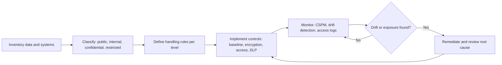

## Introduction

Many of the most damaging breaches of the past decade did not require a clever exploit. A storage bucket was left publicly readable, a database was exposed to the internet without a password, a cloud access key was committed to a code repository, or default administrator credentials were never changed. These are *configuration* failures, and the OWASP Top 10:2021 recognises their importance with its Security Misconfiguration category. In cloud environments, where a single setting can expose millions of records, configuration security has become a discipline of its own.

Configuration security protects systems; data protection protects what those systems hold. To protect data proportionately, an organisation must first know what data it has and how sensitive it is, which is the purpose of data classification. This lesson connects the three: secure configuration, classification, and the technical and procedural controls that follow from each classification level.

## Learning Objectives

- Explain why misconfiguration is a leading cause of breaches, particularly in cloud environments.
- Apply secure configuration baselines, infrastructure-as-code scanning and continuous monitoring to prevent and detect configuration drift.
- Design a data classification scheme with clear labels and handling rules for a business context.
- Select proportionate data protection controls, including encryption, key management, tokenisation, masking and data loss prevention.
- Evaluate secrets management failures using the Uber 2016 breach.

## Prerequisite Knowledge

- The shared responsibility model and cloud IAM from the previous lesson.
- Symmetric encryption and key management from the cryptography module.
- The CIA triad.

## Key Terminology

- **Security misconfiguration**: An insecure setting, default, permission or unnecessary feature that exposes a system, such as public storage or verbose error messages.
- **Secure configuration baseline**: A documented, approved set of security settings for a type of system, often derived from vendor guidance or CIS Benchmarks.
- **Configuration drift**: The gradual divergence of a system's actual settings from its approved baseline through manual changes or updates.
- **Infrastructure as code (IaC)**: Defining infrastructure (networks, servers, storage, permissions) in version-controlled templates that can be reviewed, scanned and deployed repeatably.
- **Cloud security posture management (CSPM)**: Tools that continuously assess cloud configurations against policies and benchmarks and alert on risky settings.
- **Data classification**: Categorising data by sensitivity and criticality so that appropriate handling and protection rules can be applied.
- **Tokenisation**: Replacing a sensitive value (such as a card number) with a non-sensitive surrogate, with the mapping held in a secured vault.
- **Data loss prevention (DLP)**: Controls that detect and block unauthorised movement of sensitive data through email, web uploads, endpoints or cloud services.

## Detailed Explanation

### Why misconfiguration dominates

Three forces make misconfiguration common. **Speed and self-service**: cloud resources can be created in seconds by many people, often without security review. **Complexity**: modern platforms have thousands of settings, permission combinations and service-specific defaults. **Invisibility**: unlike a missing door lock, a public storage bucket looks no different to its owner. Attackers, by contrast, run automated scans of the internet for exposed databases, open storage and unauthenticated administration panels, so exposure is often discovered within hours.

### Secure configuration in practice

A mature configuration security programme typically includes:

1. **Baselines**: hardened standards for each platform (operating systems, databases, cloud accounts, network devices), commonly based on the Center for Internet Security (CIS) Benchmarks or vendor security baselines. Baselines disable unused services, remove default accounts, enforce logging and set secure defaults.
2. **Infrastructure as code with review**: changes are made through templates in version control, reviewed by a second person, and scanned automatically for risky settings (public access, unencrypted storage, wildcard permissions) before deployment.
3. **Guardrails**: organisation-wide policies that make some insecure states impossible, such as blocking public access to storage at account level.
4. **Continuous monitoring**: CSPM and configuration management tools compare running systems against baselines and alert on drift.
5. **Secrets management**: passwords, API keys and certificates are stored in a dedicated secrets manager or key vault, injected at runtime, rotated, and never written into source code, images or tickets. Repositories are scanned for accidental commits.
6. **Change and exception management**: deviations from the baseline are documented, risk-accepted by an accountable owner and time-limited.

### Data classification

Classification answers two questions: *how bad would it be if this data were disclosed, altered or unavailable?* and *therefore, how must it be handled?* A typical four-level scheme for a business is:

| Level | Examples | Handling rules (illustrative) |
|---|---|---|
| Public | Published prices, marketing material | No restrictions on disclosure; integrity checks before publication |
| Internal | Staff directory, internal procedures | Staff access only; no public sharing |
| Confidential | Customer records, contracts, financial forecasts | Need-to-know access; encryption in transit and at rest; external sharing only with approval |
| Restricted | Health records, national ID numbers, payment card data, encryption keys | Strict named access; strong encryption with managed keys; logging of every access; DLP; no storage on personal devices |

Good classification schemes are *simple* (staff can apply them without a manual), *owned* (each dataset has a data owner who sets its level) and *actionable* (each label maps to concrete handling rules and technical controls). Labels can be applied manually, by default at the repository level, or automatically by tools that recognise patterns such as Ghana Card numbers or card numbers.

### Data protection controls

Classification drives control selection:

- **Encryption in transit** (TLS) for all data crossing networks; **encryption at rest** for storage, databases and backups. For restricted data, customer-managed keys in a key management service give the organisation control over rotation and revocation.
- **Key management**: separation of keys from data, rotation, least-privilege access to keys, and logging of key use. Encryption is only as strong as the protection of its keys.
- **Tokenisation and masking**: tokenisation removes real values from most systems; masking shows only partial values (for example the last four digits of a phone number) to support staff.
- **Data minimisation and retention**: collect only what is needed and delete it when no longer required, which reduces the impact of any breach.
- **DLP and monitoring**: detect bulk downloads, uploads to personal cloud storage, and emails containing restricted patterns.
- **Backup protection**: backups contain the same data and need the same classification-driven controls (covered in the next lesson).

## Theories, Frameworks and Models

### Privacy by design and data protection principles

Ghana's Data Protection Act, 2012 (Act 843), like comparable laws elsewhere, is built on principles that include accountability, lawful processing, purpose specification, data quality, openness, security safeguards and data subject participation. The *security safeguards* principle requires data controllers to take appropriate, reasonable technical and organisational measures to prevent loss, damage or unauthorised access. Classification and the controls above are how an organisation demonstrates that its measures are "appropriate" to the sensitivity of the data. Privacy by design extends this thinking: build minimisation, access restriction and retention limits into systems from the start rather than adding them later.

### The configuration management lifecycle

Configuration security can be modelled as a loop: *define* the baseline, *implement* it through code, *verify* continuously, *remediate* drift, and *improve* the baseline as threats and platforms change. NIST SP 800-53 captures related requirements in its Configuration Management (CM) control family, including baseline configuration, configuration change control and least functionality.

## Worked Example

**Illustrative scenario.** *Asante Pharma Distributors* (fictional) uses a cloud storage service for invoices, a SaaS customer relationship management system and an on-premises warehouse database. A CSPM tool reports the following:

| Finding | Classification of data affected | Risk | Action |
|---|---|---|---|
| Storage bucket `asante-invoices` allows public read | Confidential (customer invoices with names and phone numbers) | High: automated scanners find such buckets quickly | Block public access at account level; review access logs for prior downloads; assess whether a breach notification duty arises |
| Database backups unencrypted in a secondary bucket | Restricted (pharmacist licence numbers, some patient prescriptions) | High | Enable encryption with customer-managed keys; restrict bucket access to the backup role |
| CRM allows any user to export all contacts | Confidential | Medium | Restrict export to sales managers; enable DLP alerts on large exports |
| Development server has SSH open to the internet | Internal | Medium | Restrict to the corporate VPN; adopt a hardened baseline |

The worked lesson is that *classification turns findings into priorities*. The same misconfiguration (public read) would be low priority for a bucket of public brochures and critical for prescriptions.

## Diagram

## Ghanaian Business Application

For Ghanaian organisations, data classification is a practical way to show compliance with Act 843. The Data Protection Commission oversees the Act and maintains a register of data controllers. An organisation that can show a classification scheme, an inventory of where restricted data lives, and matching controls is far better placed to respond to a complaint, a regulator's enquiry or a breach than one that cannot say where its customer data is stored.

Typical restricted data in Ghana includes Ghana Card numbers, mobile money account and transaction histories, health records and payroll data. These often spread into spreadsheets, email attachments and messaging applications. A pragmatic programme starts by finding these locations, setting a few simple rules (for example, "never send Ghana Card images through personal messaging apps; use the approved document system"), and applying technical controls such as DLP alerts and encryption to the main repositories. Where systems are part of Critical Information Infrastructure under the Cybersecurity Act, 2020 (Act 1038), secure configuration and monitoring also support obligations to the Cyber Security Authority.

## International Case Study

**Uber (2016 breach, disclosed 2017).** In late 2016 attackers obtained credentials that allowed them to access a private code repository used by Uber engineers. Within it they found cloud access credentials, which they used to access stored data containing names, email addresses and phone numbers of around 57 million riders and drivers worldwide, as well as driver's licence numbers of hundreds of thousands of drivers in the United States. Rather than disclosing the breach, the company paid the attackers $100,000 through its bug bounty programme and had them sign non-disclosure agreements. New leadership disclosed the incident in November 2017. Uber later reached settlements with US regulators and state authorities, and its former chief security officer was convicted in 2022 on charges relating to concealment of the breach.

The configuration lesson is about secrets management: long-lived cloud credentials stored in a code repository turned one compromised developer account into a mass data breach. Secrets should live in a dedicated manager, workloads should use roles with temporary credentials, and repositories should be scanned for secrets. The governance lesson is equally stark: concealment converted a security incident into a legal and reputational crisis.

## Common Misconceptions

- **"Misconfiguration is a minor housekeeping issue."** Public storage and exposed databases have caused some of the largest data exposures on record; misconfiguration deserves the same priority as software vulnerabilities.
- **"Private repositories are a safe place for credentials."** Repository access can be compromised; secrets belong in a secrets manager with rotation and access logging.
- **"Classify everything as confidential to be safe."** Over-classification makes rules impractical, so staff ignore them; levels must be meaningful and proportionate.
- **"Encryption solves data protection."** Encryption without key management, access control, minimisation and monitoring leaves major gaps.

## Common Examination Mistakes

- Listing classification levels without stating the handling rules and controls that follow from each.
- Recommending encryption without addressing who holds and manages the keys.
- Treating configuration security as a one-off hardening exercise rather than continuous monitoring for drift.
- Ignoring legal context, such as data controller duties under Act 843, when discussing data protection.

## Critical Thinking Questions

1. Who should own the classification of a dataset: IT, the business unit that creates it, or the data protection officer? Justify your answer.
2. Can a small organisation without a security team realistically prevent cloud misconfiguration? Which two or three controls give the greatest return?
3. Was the decision to conceal the Uber breach a failure of individuals, of governance, or of incentives? What structural controls would prevent a repeat?

## Practical Exercises

1. **Classification scheme.** Draft a four-level classification scheme for an organisation you know (or an illustrative SME). *Expected output:* a one-page table with levels, examples, owners and handling rules for storage, sharing, retention and disposal.
2. **Secrets scan.** On a code repository you own, run a free secrets-scanning tool or enable your hosting platform's secret scanning. *Expected output:* a short report of findings (even if none) and the steps you would take to rotate any exposed secret.
3. **Baseline review.** Download the relevant CIS Benchmark (free registration may be required) for an operating system you use and compare five recommendations with your own machine's settings. *Expected output:* a table of recommendation, current setting, compliant yes/no and remediation.

## Key Takeaways

- Misconfiguration is a leading cause of breaches because cloud platforms are fast, complex and exposed to automated scanning.
- Baselines, infrastructure as code with review, guardrails and continuous monitoring prevent and detect drift.
- Secrets must be kept out of code and managed centrally, with rotation and temporary credentials.
- Data classification turns sensitivity into concrete handling rules and control priorities.
- Data protection combines encryption, key management, minimisation, masking, tokenisation and DLP, aligned with Act 843 duties.

## Further Reading

- Joint Task Force. (2020). *Security and privacy controls for information systems and organizations* (NIST Special Publication 800-53, Revision 5). National Institute of Standards and Technology. <https://csrc.nist.gov/pubs/sp/800/53/r5/upd1/final>
- OWASP Foundation. (2021). *OWASP Top 10:2021* (A05 Security Misconfiguration). <https://owasp.org/Top10/>
- Republic of Ghana. (2012). *Data Protection Act, 2012 (Act 843)*.
- Stallings, W., & Brown, L. (2018). *Computer security: Principles and practice* (4th ed.). Pearson.

## Video Resources

- [CIS Benchmarks](https://www.cisecurity.org/cis-benchmarks): Center for Internet Security. Official page for consensus-based secure configuration guides for operating systems, cloud platforms and applications.
- [Microsoft Learn](https://learn.microsoft.com/en-us/training/): Microsoft. Official free training portal; search for data classification, information protection and cloud posture management modules.
- [Cisco Skills for All](https://skillsforall.com/): Cisco Networking Academy. Official learning portal with free introductory cybersecurity courses that cover data protection basics.

## Revision Summary

Misconfiguration (OWASP A05:2021) is a major breach cause, especially in the cloud. Prevent it with baselines, reviewed infrastructure as code and guardrails; detect it with CSPM and drift monitoring. Classify data so that protection is proportionate, and keep secrets out of code.

- Typical levels: public, internal, confidential, restricted, each with handling rules.
- Data owners set classification; rules must be simple and actionable.
- Encryption needs key management: separation, rotation, restricted access, logging.
- Minimise, mask and tokenise to shrink what can be lost.
- Act 843 requires appropriate security safeguards for personal data.
- Uber (2016): cloud keys in a code repository, then concealment.
