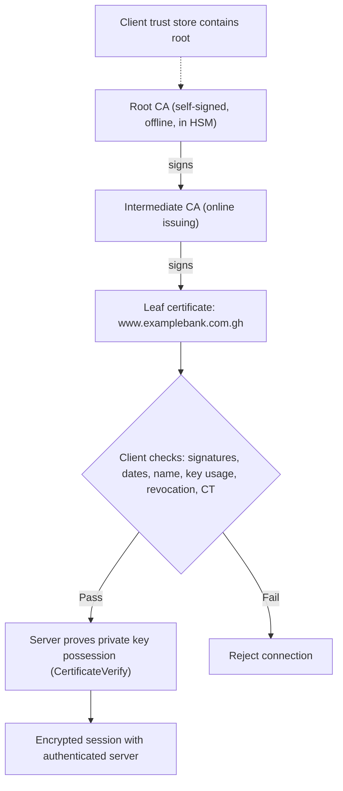

## Introduction

Public-key cryptography solves the problem of sharing secret keys, but it creates a new one: how do you know that a public key really belongs to the bank, the government agency or the colleague you think it does? If an attacker can persuade you to use *their* public key, every encryption and signature check will succeed, and you will be talking securely to the wrong party. Public key infrastructure (PKI) answers this question by having trusted authorities vouch for the binding between identities and keys through digital certificates.

Even perfect certificates are useless if the private keys behind them are stolen, lost or left to expire. Many real outages have been caused not by attacks but by forgotten certificate renewals, and many breaches by keys stored carelessly. This lesson explains certificates, the chain of trust, validation and revocation, and then the full lifecycle of cryptographic keys, from generation to destruction. The 2011 DigiNotar compromise, which destroyed a certificate authority, shows how much of the internet's security depends on PKI working correctly.

## Learning Objectives

- Explain the purpose and main fields of an X.509 certificate.
- Describe the PKI chain of trust from root to intermediate to end-entity certificate, and explain why roots are kept offline.
- Apply the steps of certificate path validation, including name, validity, signature and revocation checks.
- Compare revocation mechanisms (CRLs, OCSP, short-lived certificates) and the role of Certificate Transparency.
- Design a key management lifecycle covering generation, storage, distribution, use, rotation, backup, revocation and destruction.

## Prerequisite Knowledge

- Asymmetric encryption and digital signatures from the previous two lessons.
- The TLS 1.3 handshake from Module 3.

## Key Terminology

- **Digital certificate**: A signed data structure that binds a public key to an identity such as a domain name, person or organisation.
- **X.509**: The standard format for public-key certificates used on the internet, profiled in RFC 5280.
- **Certificate authority (CA)**: A trusted entity that verifies identities and issues certificates by signing them.
- **Root certificate**: A self-signed CA certificate trusted directly because it is pre-installed in operating systems or browsers (the trust store).
- **Intermediate certificate**: A CA certificate signed by a root (or another intermediate) and used to issue end-entity certificates.
- **Chain of trust**: The sequence of certificates linking an end-entity certificate to a trusted root through successive signatures.
- **Revocation**: Declaring a certificate invalid before its expiry date, for example because its private key was compromised.
- **Certificate Transparency (CT)**: Public, append-only logs of issued certificates that allow domain owners and others to detect mis-issuance.
- **Hardware security module (HSM)**: A tamper-resistant device that generates, stores and uses cryptographic keys without exposing them.
- **Key rotation**: Replacing a cryptographic key with a new one at planned intervals or after suspected compromise.

## Detailed Explanation

### What a certificate contains

An X.509 version 3 certificate includes, among other fields:

| Field | Purpose |
|---|---|
| Subject | Who the certificate identifies (for web servers, chiefly via the Subject Alternative Name extension listing domain names) |
| Subject public key | The public key being certified |
| Issuer | The CA that signed the certificate |
| Validity period | "Not before" and "not after" dates |
| Serial number | Unique identifier assigned by the issuer, used in revocation |
| Key usage and extended key usage | What the key may be used for, such as server authentication, code signing or certificate signing |
| Basic constraints | Whether the certificate belongs to a CA and may issue other certificates |
| Revocation information | Locations of CRLs or OCSP responders |
| Signature | The issuer's signature over all the above |

The certificate is public; possessing it proves nothing. Identity is proven when the holder demonstrates possession of the **matching private key**, as the server does with CertificateVerify in TLS 1.3.

### Levels of validation

CAs verify applicants to different levels. **Domain validation (DV)** confirms only control of the domain, often automatically through protocols such as ACME, popularised by the free CA Let's Encrypt. **Organisation validation (OV)** and **extended validation (EV)** add checks on the legal organisation. A DV certificate proves that the site controls the domain name, not that the organisation behind it is honest, which is why fraudulent lookalike domains can display a padlock.

### The chain of trust

Trust in PKI is hierarchical:

1. **Root CAs** hold self-signed certificates distributed in trust stores by operating system and browser vendors, which run root programmes with audit and policy requirements.
2. Roots sign **intermediate CA** certificates. The root's private key is kept **offline** in an HSM and used rarely, so a compromise of day-to-day issuing systems does not expose the root.
3. Intermediates sign **end-entity** (leaf) certificates for websites, users or devices.

A server sends its leaf certificate and any intermediates; the client already has the root. If any link's signature fails, or any certificate is expired, revoked or misused, the chain is rejected.

### Revocation and transparency

Private keys are sometimes compromised, or certificates issued in error, before their expiry date. Revocation mechanisms include:

- **Certificate revocation lists (CRLs)**: signed lists of revoked serial numbers published by the CA. They can grow large and are fetched periodically.
- **Online Certificate Status Protocol (OCSP)**: the client asks the CA's responder about one certificate. **OCSP stapling** lets the server attach a recent signed OCSP response, improving speed and privacy.
- **Short-lived certificates**: certificates valid for a short period reduce reliance on revocation, since a compromised certificate soon expires. Industry practice has steadily reduced maximum public TLS certificate lifetimes, making automated renewal essential.

Revocation checking in browsers has historically been imperfect, because clients often "soft-fail" when a status check cannot be completed. **Certificate Transparency** complements revocation: publicly trusted CAs log the certificates they issue, and browsers expect evidence of logging. Domain owners can monitor CT logs to detect any certificate issued for their domains without their knowledge.

### Key management

NIST Special Publication 800-57 Part 1 provides extensive guidance on key management. Core principles include:

- **Generate** keys with a cryptographically secure random number generator, inside an HSM or trusted module where possible.
- **Protect** private and secret keys at rest: HSMs, cloud key management services or at least encrypted key stores with strict access control. Never embed keys in source code or configuration files committed to repositories.
- **Separate** keys by purpose: different keys for signing and encryption, and for different systems and environments.
- **Limit cryptoperiods**: define how long each key may be used and rotate accordingly.
- **Control access**: apply least privilege and **dual control** or **split knowledge** for the most important keys, so that no single person can use or extract a root key.
- **Back up and escrow** where loss would destroy data (for example encryption keys for archives), but never back up signing keys in ways that weaken non-repudiation unnecessarily.
- **Revoke and destroy** keys at end of life, and record each event in an auditable log.

**Envelope encryption** is a common cloud pattern: data is encrypted with a data encryption key (DEK), which is itself encrypted with a key encryption key (KEK) held in a KMS or HSM. Rotating the KEK requires re-wrapping DEKs, not re-encrypting all data.

## Step-by-Step Guide

### Validating a certificate chain

When a customer's browser connects to `www.examplebank.com.gh` (an illustrative domain) and receives a leaf certificate and one intermediate, it performs path validation, broadly as follows:

1. **Build the path**: leaf (issued by Intermediate CA X) → Intermediate CA X (issued by Root CA R) → Root CA R, found in the local trust store.
2. **Verify each signature**: use Root R's public key to verify the intermediate's signature, then the intermediate's public key to verify the leaf's signature.
3. **Check validity periods**: the current date must fall within each certificate's "not before" and "not after" dates.
4. **Check CA constraints**: the root and intermediate must have basic constraints marking them as CAs, with any path-length limits respected; the leaf must not be a CA.
5. **Check key usage**: the leaf must be authorised for TLS server authentication.
6. **Check the name**: `www.examplebank.com.gh` must match a Subject Alternative Name entry in the leaf.
7. **Check revocation status**: via a stapled OCSP response, an OCSP query or a CRL, according to client policy.
8. **Check Certificate Transparency evidence** where the client requires it.
9. **Proof of possession**: during the TLS handshake, verify that the server's CertificateVerify signature was made with the private key matching the leaf's public key.

Failure at any step should abort the connection. Users who click through browser warnings, or apps that disable certificate validation "to fix an error", defeat the entire system. A common and serious mobile app flaw is developers turning off validation during testing and forgetting to re-enable it.

## Worked Example

### Designing PKI and key management for a bank

**Illustrative scenario.** *Ofori Merchant Bank*, a fictional Accra bank, suffered a two-hour mobile banking outage when its API certificate expired unnoticed over a weekend. The board asks for a key and certificate management plan.

**Step 1: inventory.** The bank discovers 140 certificates across public websites, APIs, internal servers, VPN gateways and partner connections, owned by different teams, with no central record. It also finds an API signing key stored in a configuration file in the source code repository.

**Step 2: define the architecture.**

| Use | Certificate or key source | Protection |
|---|---|---|
| Public websites and APIs | Publicly trusted CA, automated issuance and renewal (for example via ACME) | Private keys on load balancers with restricted administrator access |
| Internal servers and staff devices | Internal PKI: offline root in an HSM, online issuing intermediate | Root used only in a documented ceremony with dual control |
| Partner bank connections | Mutual TLS with certificates from an agreed CA | Keys in HSM-backed modules |
| Payment message signing | Signing keys generated and kept in an HSM | Dual control; signing requests logged |
| Database field encryption | Envelope encryption with KEKs in an HSM or KMS | Separate KEKs per system; annual rotation |

**Step 3: lifecycle controls.**

- Central certificate inventory with owners, expiry dates and automated alerts at 30, 14 and 7 days.
- Automated renewal wherever possible; certificate lifetimes kept short.
- The key found in the repository is treated as **compromised**: revoked, replaced, removed from code history, and secret scanning is added to the development pipeline.
- Certificate Transparency monitoring for all bank domains, to detect mis-issued certificates or fraudulent lookalikes.
- Documented procedures for emergency revocation and re-issuance.

**Step 4: governance.** A named key custodian role, separation of duties between those who request certificates and those who approve them, and annual audit of the PKI against the bank's policy. The plan should map to the bank's obligations under sector cybersecurity requirements issued by the Bank of Ghana, as stated in the current official directive.

**Result.** The outage risk is reduced by automation and monitoring (availability), and the risk of key theft is reduced by HSMs, dual control and secret scanning (confidentiality, integrity and non-repudiation).

## Ghanaian Business Application

- **Certificate expiry outages.** For organisations with small IT teams, expired certificates are a common cause of avoidable downtime on websites, APIs and email. A simple inventory spreadsheet with renewal reminders is better than nothing; automated renewal is better still.
- **Free certificates for SMEs.** Domain-validated certificates from free CAs make HTTPS affordable for every Ghanaian SME website. Managers should understand that this padlock proves domain control, not trustworthiness.
- **Lookalike domains.** Fraudsters register domains resembling those of Ghanaian banks, telcos and government agencies to host phishing pages with valid certificates. Certificate Transparency monitoring helps organisations detect these early and request takedowns.
- **Electronic signatures.** The Electronic Transactions Act, 2008 (Act 772) provides for electronic signatures and certification services. Organisations relying on certificate-based signatures for contracts or approvals should confirm current legal requirements with qualified advisers.
- **Keys in code.** Developers in start-ups often store API keys for payment gateways or mobile money APIs in code or shared documents. Leaks of such keys can allow fraudulent transactions, so secret management tools and rotation are essential.

## International Case Study

### DigiNotar (2011)

DigiNotar was a Dutch certificate authority whose roots were trusted by major browsers and which also issued certificates for Dutch government services. In 2011 attackers compromised DigiNotar's systems and issued fraudulent certificates for many domains, including a wildcard certificate for `*.google.com`. Investigations, including a report commissioned by the Dutch government, found that the fraudulent Google certificate had been used to intercept connections of large numbers of users, predominantly in Iran, allowing their supposedly secure traffic to Google services to be read.

The attack was detected partly because the Chrome browser had **pinned** the expected keys for Google domains and rejected the fraudulent certificate, prompting user reports. Browser and operating system vendors then removed DigiNotar's roots from their trust stores. The Dutch government took over management of its affected services, and DigiNotar was declared bankrupt in September 2011.

**Lessons:**

- **Any trusted CA can issue for any domain.** The security of every website therefore depends on the weakest trusted CA, which motivated Certificate Transparency and stronger audit requirements.
- **CA operational security** (network segmentation, monitoring, protection of issuing systems) is as important as cryptography.
- **Detection mechanisms** such as pinning and transparency logs help reveal mis-issuance.
- **Loss of trust is existential** for a CA: once removed from trust stores, its certificates became worthless.

## Diagram

## Common Misconceptions

- "A certificate proves the website is legitimate." A domain-validated certificate proves control of the domain name only; phishing sites can obtain one.
- "Possessing a certificate proves identity." Certificates are public; identity is proven by demonstrating possession of the matching private key.
- "Revocation reliably stops compromised certificates." Clients often fail open when status checks fail; short lifetimes and transparency monitoring are important complements.
- "Key management is just storing keys safely." It is a full lifecycle including generation, distribution, rotation, backup, revocation, destruction and audit.
- "Internal systems do not need proper certificates." Self-signed certificates that users are trained to click through teach dangerous habits; an internal PKI gives real authentication.

## Common Examination Mistakes

- Saying a CA "encrypts" certificates rather than signs them.
- Omitting intermediate certificates when describing the chain of trust.
- Failing to mention hostname matching and revocation in path validation.
- Confusing the certificate (public) with the private key (secret).
- Describing key management without addressing rotation, backup and destruction.

## Critical Thinking Questions

1. Browser vendors effectively decide which CAs the world trusts. Is this concentration of power appropriate? What alternatives exist?
2. How short should public certificate lifetimes be, given the operational burden on small organisations?
3. Should a Ghanaian bank operate its own internal CA or rely on a managed PKI service? Evaluate the trade-offs.
4. What should happen to the private signing keys of an employee who leaves the organisation, and to documents they signed?
5. How could Certificate Transparency monitoring be used by a regulator to protect consumers from lookalike financial websites?

## Practical Exercises

1. **Inspect a certificate chain.** In your browser, view the certificate chain for a website you use. Record each certificate's subject, issuer, validity dates, key type and Subject Alternative Names. Expected output: a three-level table (root, intermediate, leaf) and a sentence explaining how each is verified.
2. **Search Certificate Transparency logs.** Using a public CT search service, look up certificates issued for a domain you own or your organisation's domain (with permission). Expected output: a list of recent certificates, issuers and any unexpected entries.
3. **Key inventory.** For a project or system you are responsible for, list every key, password, API token and certificate it uses, where each is stored, who can access it and when it expires. Do not record actual secret values. Expected output: an inventory table with at least one improvement identified.
4. **Self-signed versus CA-signed.** On a local virtual machine or development environment you control, create a self-signed certificate with a standard tool such as OpenSSL, connect to it with a browser and record the warning shown. Expected output: a screenshot and a paragraph explaining why the browser cannot validate the chain.

## Key Takeaways

- Certificates bind identities to public keys and are signed by CAs; identity is proven by possession of the matching private key.
- The chain of trust runs from offline root to intermediate to leaf; clients validate signatures, dates, constraints, names, key usage and revocation.
- Revocation is imperfect, so short-lived certificates, automation and Certificate Transparency monitoring matter.
- Key management covers the whole lifecycle; HSMs, envelope encryption, dual control and rotation protect important keys.
- DigiNotar shows that one compromised CA can undermine trust for any domain, and that losing trust is fatal for a CA.

## Further Reading

- Cooper, D., Santesson, S., Farrell, S., Boeyen, S., Housley, R., & Polk, W. (2008). *Internet X.509 public key infrastructure certificate and certificate revocation list (CRL) profile* (RFC 5280). Internet Engineering Task Force. <https://www.rfc-editor.org/rfc/rfc5280>
- Barker, E. (2020). *Recommendation for key management: Part 1 – General* (NIST Special Publication 800-57 Part 1 Rev. 5). National Institute of Standards and Technology. <https://doi.org/10.6028/NIST.SP.800-57pt1r5>
- Anderson, R. (2020). *Security engineering: A guide to building dependable distributed systems* (3rd ed.). Wiley.
- Stallings, W., & Brown, L. (2018). *Computer security: Principles and practice* (4th ed.). Pearson.

## Video Resources

- [NIST Computer Security Resource Center](https://csrc.nist.gov/) — National Institute of Standards and Technology. Official source for key management guidance, including SP 800-57, and related project pages.
- [Cisco Skills for All](https://skillsforall.com/) — Cisco Networking Academy. Free cybersecurity courses with modules explaining certificates, PKI and cryptographic key use.

## Revision Summary

PKI binds identities to public keys through CA-signed certificates arranged in a chain from offline roots through intermediates to leaf certificates. Clients validate signatures, dates, constraints, names, key usage and revocation, and servers prove possession of their private keys. Key management protects keys across their whole lifecycle with HSMs, rotation, dual control and audit.

- Certificate = public key + identity + CA signature.
- Chain: root (offline) → intermediate → leaf.
- Validate: signatures, dates, CA flags, name, usage, revocation, CT.
- Revocation via CRL, OCSP, stapling; short-lived certificates help.
- Key lifecycle: generate, store, distribute, use, rotate, back up, revoke, destroy.
- DigiNotar 2011: fraudulent `*.google.com`, CA removed from trust stores.
