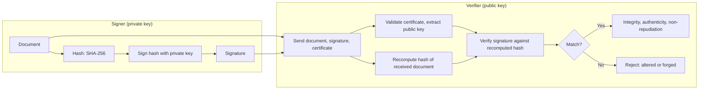

## Introduction

Encryption hides data, but many security problems are not about secrecy at all. A bank needs to know that a payment instruction has not been altered; a software vendor needs customers to be sure that an update really came from it; a website needs to check passwords without storing them in a form that thieves could reuse. Cryptographic hash functions and digital signatures solve these problems.

A hash function turns any input into a short, fixed-length "fingerprint" that changes completely if a single character of the input changes. Digital signatures combine hashing with asymmetric cryptography so that anyone can verify who produced a document and that it has not been altered since. This lesson explains the properties that make hash functions secure, why ordinary fast hashes are dangerous for storing passwords, how bcrypt and Argon2 fix this, and how signatures provide non-repudiation. Real incidents, including the 2012 LinkedIn password leak and the Flame malware's forged Microsoft signature, show what happens when these tools are misused.

## Learning Objectives

- Explain the properties of cryptographic hash functions: preimage resistance, second-preimage resistance, collision resistance and the avalanche effect.
- Distinguish hashing, encryption and message authentication codes, and choose the right one for a requirement.
- Apply salted, slow password hashing (bcrypt, scrypt or Argon2) and explain why it defeats precomputed and large-scale cracking.
- Describe step by step how a digital signature is created and verified, and what each step guarantees.
- Evaluate the consequences of using deprecated algorithms such as MD5 and SHA-1.

## Prerequisite Knowledge

- Symmetric and asymmetric encryption, including the toy RSA example from the previous lesson.
- Credential attacks and search-space calculations from Module 2.

## Key Terminology

- **Cryptographic hash function**: A function that maps input of any length to a fixed-length output (digest) and is designed to be one-way and collision-resistant.
- **Digest**: The fixed-length output of a hash function, such as 256 bits for SHA-256.
- **Preimage resistance**: Given a digest, it is infeasible to find any input that produces it.
- **Second-preimage resistance**: Given an input, it is infeasible to find a different input with the same digest.
- **Collision resistance**: It is infeasible to find any two different inputs with the same digest.
- **Salt**: A unique random value combined with each password before hashing so that identical passwords produce different hashes.
- **Key stretching**: Deliberately making password hashing slow (and, for memory-hard functions, memory-intensive) to raise the cost of each guess.
- **Message authentication code (MAC)**: A short tag computed from a message and a shared secret key that verifies integrity and authenticity, for example HMAC.
- **Digital signature**: A value created with a private key over the hash of a message, which anyone with the public key can verify.

## Detailed Explanation

### What a hash function does

A cryptographic hash function such as SHA-256 takes any input, from one character to a whole film, and produces a fixed-length digest. It is:

- **Deterministic**: the same input always yields the same digest.
- **Fast to compute** for ordinary inputs (a property that matters, as we will see, for passwords).
- **Avalanche-sensitive**: a tiny change in input changes roughly half the output bits.

For example, the SHA-256 digests of two nearly identical payment instructions are completely different:

| Input | SHA-256 digest (hexadecimal) |
|---|---|
| `Pay GHS 100 to Kofi` | `e1df7e8b044e3c9acfd3e7d100e3218d3901f9dcaabb98b0e6479b1c5e1c676f` |
| `Pay GHS 900 to Kofi` | `a52be5dd2973c4edc7c3edf486398291f061d7f3e51764c90e6554179bb8d5f2` |

### The three resistance properties

1. **Preimage resistance** (one-wayness): from the digest you cannot work back to the input except by guessing.
2. **Second-preimage resistance**: an attacker given a specific document cannot craft a different document with the same digest.
3. **Collision resistance**: an attacker cannot find *any* two documents with the same digest. Because of the **birthday paradox**, finding a collision for an `n`-bit hash takes roughly `2^(n/2)` work rather than `2^n`. For SHA-256 this is about `2^128`, which remains infeasible; for a 128-bit hash such as MD5 it is about `2^64` in theory, and cryptanalysis has made MD5 collisions practical.

**Algorithm status:** MD5 and SHA-1 are broken for collision resistance and should not be used for signatures or certificates. In 2017 researchers from Google and CWI Amsterdam announced the first practical SHA-1 collision, two different PDF files with the same SHA-1 digest. SHA-256 and the rest of the SHA-2 family, and SHA-3, are current standards.

### Hashing, encryption and MACs compared

| Requirement | Tool | Why |
|---|---|---|
| Keep data secret and recover it later | Encryption | Reversible with the key |
| Detect accidental or malicious change, where anyone may compute the check | Hash | No key needed; publish the digest via a trusted channel |
| Detect tampering between two parties sharing a secret | MAC (such as HMAC-SHA256) or authenticated encryption | An attacker without the key cannot forge a valid tag |
| Prove to third parties who produced a document | Digital signature | Only the private-key holder can sign; anyone can verify |
| Verify a password without storing it | Slow, salted password hash | One-way; costly to guess at scale |

A plain hash does not prove authenticity: an attacker who changes a file can simply recompute its hash. A MAC adds a secret key, but because both parties share it, either could have produced the tag, so a MAC cannot provide non-repudiation. Only a signature does.

### Password storage

A system that checks passwords should store neither the password nor anything that lets an attacker quickly recover it.

- **Plaintext storage** is indefensible: a single database leak exposes every password.
- **Encryption** is wrong in principle: whoever obtains the key can decrypt every password.
- **Fast unsalted hashes** (MD5, SHA-1, even SHA-256) are dangerous. Identical passwords produce identical hashes, so one cracked hash reveals everyone using that password, and attackers can use **precomputed tables** (including rainbow tables) and hardware that computes billions of fast hashes per second.
- **Salting** stores a unique random salt with each hash, computed as `hash(salt + password)`. Two users with the password `Accra2024!` now have different stored values, precomputed tables become useless and the attacker must crack each hash separately. Salts are not secret; their job is uniqueness.
- **Slow, adaptive hashing** makes each guess expensive. **bcrypt** (Provos and Mazières, 1999) has a configurable cost factor; **scrypt** and **Argon2** are also **memory-hard**, which hinders attackers using graphics processors or custom hardware. Argon2 won the Password Hashing Competition in 2015 and is specified in RFC 9106. PBKDF2 with a high iteration count is an acceptable option where standards require it.
- A **pepper**, a secret value held outside the database (for example in a hardware security module), can add protection if the database alone is stolen.

The cost factor should be tuned so that a single login takes a fraction of a second on the server; that is negligible for a user but multiplies an attacker's work enormously across billions of guesses.

## Step-by-Step Guide

### Creating and verifying a digital signature

**Signing (by the sender, Abena, the finance director):**

1. Abena prepares the document, for example a payment authorisation.
2. Her software computes the hash of the document: `h = SHA-256(document)`.
3. The software signs `h` with her **private key**, using a signature algorithm such as RSA-PSS, ECDSA or Ed25519, producing the signature `s`.
4. Abena sends the document, the signature and (usually) her certificate, which binds her identity to her public key.

**Verifying (by the recipient, the bank):**

5. The bank validates Abena's certificate chain to a trusted certificate authority (covered in the next lesson).
6. It computes its own hash of the received document: `h' = SHA-256(received document)`.
7. It uses Abena's **public key** to verify `s` against `h'`.
8. If verification succeeds, the bank knows that (a) the document has not changed since signing (**integrity**), (b) it was signed by the holder of Abena's private key (**authenticity**) and (c) Abena cannot plausibly deny signing it, provided her private key was properly protected (**non-repudiation**).

**Toy illustration with the RSA keys from the previous lesson** (`n = 55`, `e = 3`, `d = 27`): suppose the document hashes, in a toy hash, to the number 9. Signing: `s = 9^27 mod 55 = 4`. Verification: `4^3 mod 55 = 64 mod 55 = 9`, which equals the recomputed hash, so the signature is valid. If an attacker changed the document so that it hashed to 8, verification would yield 9 ≠ 8 and fail.

**Why sign the hash rather than the document?** Hashing produces a short, fixed-length value, so signing is fast for documents of any size, and the hash's collision resistance ensures that the signature effectively covers the entire document. This is also why a broken hash function undermines signatures: if an attacker can find two documents with the same hash, a signature on one is valid for the other.

## Worked Example

### Upgrading password storage at an online retailer

**Illustrative scenario.** *Kumasi Kicks*, a fictional online footwear retailer, stores customer passwords as unsalted SHA-1 hashes. A security review recommends migration to Argon2id.

**Step 1: assess the current exposure.** Unsalted SHA-1 means that any customers who share a password share a hash; an attacker who steals the table can crack common passwords almost instantly using precomputed tables and fast hardware.

**Step 2: demonstrate the effect of salting.** Two customers both choose `Accra2024!`.

| Customer | Salt | Stored value (first 16 hex characters of SHA-256(salt + password)) |
|---|---|---|
| Customer A | `a9f3` | `c5775757deb6a1b1` |
| Customer B | `71c2` | `1a1b1cc2df9d848c` |

The stored values differ, so cracking one gives no information about the other. (In production, salts are much longer, typically 16 bytes, and the hash function is Argon2id, not SHA-256; SHA-256 is used here only to illustrate the principle.)

**Step 3: plan migration without forcing every customer to reset.** Wrap existing hashes: compute `Argon2id(salt, SHA-1(password))` for every stored value now, so no weak hash remains in the database. When each customer next logs in, verify against the wrapped value, then replace it with a direct `Argon2id(salt, password)` hash.

**Step 4: tune parameters.** Choose memory, iteration and parallelism parameters so that hashing takes a fraction of a second on the login server, and record them with each hash so they can be raised later.

**Step 5: complementary controls.** Screen new passwords against breached-password lists, enable MFA and rate limit logins (Module 2). If the old database might already have been copied, prompt customers to change passwords and warn them about reuse.

## Ghanaian Business Application

- **Electronic signatures and transactions.** Ghana's Electronic Transactions Act, 2008 (Act 772) provides a legal framework for electronic records and signatures. Organisations adopting digital approval workflows should take legal advice on the evidential weight of different signature methods; cryptographic digital signatures with protected private keys provide far stronger evidence than a typed name or scanned image.
- **Payment instructions.** Banks and fintechs can require that bulk payment files uploaded by corporate customers be digitally signed, so altered files are rejected automatically. This counters both insider tampering and business email compromise.
- **Software and app integrity.** Ghanaian developers distributing Android apps sign their releases; customers should install apps only from official stores, which check signatures. Fake banking apps distributed through messaging platforms bypass this protection.
- **Password storage under the Data Protection Act.** Storing customer passwords in plaintext or with fast unsalted hashes would be difficult to defend as an "appropriate" security measure under the Data Protection Act, 2012 (Act 843).
- **Document verification.** Universities, examination bodies and government agencies issuing certificates can publish hashes or signed records so that employers can verify authenticity, reducing certificate fraud.

## International Case Study

### LinkedIn (2012) and the Flame malware (2012)

**LinkedIn.** In June 2012 a large file of password hashes belonging to LinkedIn users was posted online. LinkedIn confirmed that some of its members' passwords had been compromised. The hashes were **unsalted SHA-1**, so researchers and criminals cracked a large proportion within days. In 2016 it emerged that the 2012 breach was much larger than originally understood, with data on far more accounts offered for sale. Because many users reused passwords, the leak fuelled credential stuffing against other services for years. LinkedIn had already moved to salted hashing by the time of the later disclosures.

**Flame.** In 2012 researchers analysed Flame, a sophisticated espionage malware found mainly in the Middle East. Microsoft reported that Flame's authors had abused a weakness in a Microsoft certificate authority used for Terminal Server licensing, combined with an **MD5 collision attack**, to produce a fraudulent code-signing certificate that chained to a Microsoft root. This let the malware appear to be legitimately signed Microsoft software, enabling it to spread via a spoofed Windows Update mechanism. Microsoft issued an emergency security advisory, revoked the affected certificates and accelerated its removal of MD5 from certificate processes.

**Lessons:**

- Fast, unsalted hashes are unsuitable for passwords; slow, salted, memory-hard functions are the standard.
- Deprecated hash functions are not merely theoretically weak: collision attacks against MD5 were used in a real attack to forge trust.
- The security of a signature scheme depends on every component: the hash, the signature algorithm, the certificate authority's processes and private key protection.

## Diagram

## Common Misconceptions

- "Hashing is a form of encryption." Hashing is one-way and has no key or decryption step; encryption is reversible with a key.
- "SHA-256 is fine for storing passwords." It is a sound general-purpose hash but too fast for passwords; use bcrypt, scrypt or Argon2 with unique salts.
- "Salts must be kept secret." Salts are stored alongside hashes; their purpose is uniqueness, not secrecy. A pepper, by contrast, is kept secret elsewhere.
- "A MAC provides non-repudiation." Both parties hold the MAC key, so either could have created the tag; only digital signatures provide non-repudiation.
- "A digital signature encrypts the document." A signature provides integrity and authenticity; the document itself remains readable unless it is separately encrypted.

## Common Examination Mistakes

- Confusing second-preimage resistance with collision resistance.
- Stating that signatures are created with the public key and verified with the private key (it is the reverse).
- Recommending encryption for password storage.
- Omitting certificate validation when describing signature verification.
- Describing MD5 or SHA-1 as acceptable for new signature or certificate use.

## Critical Thinking Questions

1. If a user's private signing key is stored on a shared office PC without a passphrase, can the organisation still rely on non-repudiation? What would strengthen it?
2. Why might an organisation choose PBKDF2 rather than Argon2, and is that choice defensible?
3. How should a regulator respond if a licensed institution is found storing customer passwords with unsalted SHA-1?
4. Does publishing the SHA-256 digest of a software download on the same website as the download provide meaningful protection? When would it?
5. The Flame attack combined a cryptographic weakness with a process weakness at a certificate authority. Which was more important, and why?

## Practical Exercises

1. **Observe the avalanche effect.** Using a command-line tool on your own computer (for example `sha256sum` on Linux, `shasum -a 256` on macOS or `Get-FileHash` in Windows PowerShell), hash two text files that differ by one character. Expected output: two completely different 64-character digests and a sentence explaining the avalanche effect.
2. **Verify a download.** Download a file from a software publisher that provides an official SHA-256 checksum or signature, and verify it. Expected output: a record of the published and computed values and whether they match.
3. **Password hashing experiment.** In a local programming environment you control, use a well-known library to hash a test password with bcrypt or Argon2 at two different cost settings and time each. Use only test passwords. Expected output: the two timings and an explanation of how the cost factor affects an attacker.
4. **Toy signature.** With the RSA keys `n = 33`, `e = 7`, `d = 3` from the previous lesson's exercise, sign the toy hash value 5 and verify it. Expected output: `s = 5^3 mod 33 = 26`; verification `26^7 mod 33 = 5`.

## Key Takeaways

- Cryptographic hashes provide fixed-length fingerprints with preimage, second-preimage and collision resistance; MD5 and SHA-1 are broken for collisions.
- Hashes detect change, MACs add a shared secret for authenticity between two parties, and only digital signatures provide non-repudiation.
- Passwords must be stored with unique salts and slow, adaptive, ideally memory-hard functions such as Argon2 or bcrypt.
- Signing hashes the document, signs the hash with the private key, and verification recomputes the hash and checks it with the public key.
- LinkedIn 2012 and Flame 2012 show the real-world cost of weak password hashing and deprecated hash functions.

## Further Reading

- Biryukov, A., Dinu, D., Khovratovich, D., & Josefsson, S. (2021). *Argon2 memory-hard function for password hashing and proof-of-work applications* (RFC 9106). Internet Engineering Task Force. <https://www.rfc-editor.org/rfc/rfc9106>
- Provos, N., & Mazières, D. (1999). A future-adaptable password scheme. In *Proceedings of the 1999 USENIX Annual Technical Conference*. USENIX Association.
- Katz, J., & Lindell, Y. (2020). *Introduction to modern cryptography* (3rd ed.). CRC Press.
- Ferguson, N., Schneier, B., & Kohno, T. (2010). *Cryptography engineering: Design principles and practical applications*. Wiley.

## Video Resources

- [OWASP](https://owasp.org/): OWASP Foundation. Official site of the open community, whose cheat sheet series includes guidance on password storage and cryptographic practice.
- [NIST Computer Security Resource Center](https://csrc.nist.gov/): National Institute of Standards and Technology. Official source for hash function and digital signature standards.

## Revision Summary

Hash functions create fixed-length, one-way fingerprints; their security depends on preimage, second-preimage and collision resistance. Passwords need unique salts and slow, memory-hard hashing. Digital signatures sign a hash with a private key so that anyone can verify integrity and authenticity with the public key, providing non-repudiation when the key is protected.

- Collision work ≈ `2^(n/2)` (birthday bound).
- MD5 and SHA-1 broken; use SHA-256, SHA-3.
- Hash ≠ encryption; MAC ≠ signature.
- Passwords: unique salt plus Argon2id, bcrypt or scrypt.
- Sign with private key; verify with public key and certificate.
- LinkedIn 2012 unsalted SHA-1; Flame 2012 MD5 collision forged signature.
