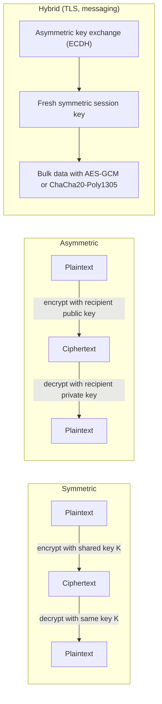

## Introduction

Encryption is the technical heart of data protection. It lets a bank send balances to a customer's phone across networks it does not control, lets a hospital store patient records so that a stolen disk reveals nothing, and lets two strangers on opposite sides of the world agree a secret key without ever meeting. Yet encryption is also widely misunderstood: managers assume that "encrypted" means "secure", while developers sometimes invent their own schemes or misuse sound algorithms.

This lesson explains the two great families of encryption. **Symmetric** encryption uses one shared secret key and is fast enough to protect bulk data. **Asymmetric** (public-key) encryption uses mathematically linked key pairs and solves the problem of distributing keys among people who have never met. You will work through small-number examples of Diffie–Hellman key agreement and RSA encryption by hand, so that the mathematics is concrete rather than mysterious, and then see how real systems combine both families in hybrid designs such as TLS and end-to-end encrypted messaging.

## Learning Objectives

- Explain the goals of encryption and Kerckhoffs's principle.
- Compare symmetric and asymmetric encryption in terms of keys, speed, key distribution and typical uses.
- Apply the RSA and Diffie–Hellman algorithms to small-number examples and verify the results.
- Explain why block cipher modes matter, contrasting ECB, CBC and GCM.
- Evaluate algorithm and key-length choices for a business system, including hybrid encryption and the transition to post-quantum cryptography.

## Prerequisite Knowledge

- The CIA triad and the secure protocols lesson, especially the TLS handshake.
- Comfort with basic arithmetic, including remainders (modular arithmetic is explained here).

## Key Terminology

- **Plaintext and ciphertext**: Plaintext is the readable message; ciphertext is its encrypted, unreadable form.
- **Key**: A secret (or, in asymmetric cryptography, a public or private) value that controls the transformation between plaintext and ciphertext.
- **Symmetric encryption**: Encryption in which the same secret key is used to encrypt and decrypt.
- **Asymmetric encryption**: Encryption using a key pair, where data encrypted with the public key can be decrypted only with the matching private key.
- **Block cipher**: A symmetric algorithm that encrypts fixed-size blocks of data, such as AES with 128-bit blocks.
- **Mode of operation**: The method by which a block cipher is applied to messages longer than one block, such as CBC or GCM.
- **Authenticated encryption**: Encryption that also provides integrity and authenticity of the ciphertext, such as AES-GCM.
- **Modular arithmetic**: Arithmetic on remainders; `a mod n` is the remainder when `a` is divided by `n`.
- **Hybrid encryption**: Using asymmetric cryptography to establish or protect a symmetric key, then symmetric encryption for the data.
- **Kerckhoffs's principle**: A cryptosystem should remain secure even if everything about it except the key is public.

## Detailed Explanation

### Goals and principles

Encryption primarily provides **confidentiality**. Combined with other mechanisms, modern schemes also provide integrity and authentication. Kerckhoffs's principle, articulated in the nineteenth century, holds that security must rest on the secrecy of the key, not of the algorithm. This is why organisations should use published, extensively analysed standards such as AES rather than proprietary "secret" algorithms. The principle echoes Saltzer and Schroeder's "open design".

The strength of a well-designed cipher against brute force depends on key length. A 128-bit key has `2^128` possible values, far beyond any foreseeable exhaustive search. In practice, encryption is almost never broken by brute-forcing a modern key; it fails through poor key management, misuse of modes, weak passwords used to derive keys, or implementation flaws.

### Symmetric encryption

In symmetric encryption the sender and receiver share one secret key. Algorithms are fast and suitable for bulk data: disk encryption, database fields, VPN tunnels and the data phase of TLS.

- **AES (Advanced Encryption Standard)**, standardised by NIST in 2001 after an open international competition, is the dominant block cipher. It uses 128-bit blocks and 128-, 192- or 256-bit keys.
- **ChaCha20** is a modern stream cipher, often paired with the Poly1305 authenticator, that performs well on devices without AES hardware acceleration, such as some lower-cost phones.
- Legacy algorithms such as DES (56-bit key, now trivially brute-forced), 3DES and RC4 should not be used for new systems.

The central weakness of symmetric encryption is **key distribution**: how do the parties obtain the shared key securely? With `n` parties who each need a private channel with every other, `n(n − 1)/2` keys are required; 100 staff would need 4,950 keys.

### Block cipher modes

A block cipher encrypts one block; a mode defines how to handle longer messages.

| Mode | How it works | Security notes |
|---|---|---|
| ECB (Electronic Codebook) | Each block encrypted independently with the same key | Identical plaintext blocks give identical ciphertext blocks, leaking patterns; should not be used for data |
| CBC (Cipher Block Chaining) | Each plaintext block is XORed with the previous ciphertext block before encryption; needs a random initialisation vector (IV) | Hides patterns; does not provide integrity on its own; vulnerable to padding oracle attacks when misused |
| CTR (Counter) | Encrypts a counter to create a keystream that is XORed with the plaintext | Fast and parallel; nonce must never repeat under the same key; no integrity alone |
| GCM (Galois/Counter Mode) | CTR encryption plus an authentication tag | Authenticated encryption; recommended default; nonce reuse is catastrophic |

The practical lesson is to prefer **authenticated encryption** (AES-GCM or ChaCha20-Poly1305) from well-reviewed libraries rather than assembling primitives yourself.

### Asymmetric encryption

In 1976 Whitfield Diffie and Martin Hellman published "New Directions in Cryptography", which introduced public-key cryptography and a method for two parties to agree a shared secret over a public channel. In 1978 Ron Rivest, Adi Shamir and Leonard Adleman published the RSA algorithm, which supports both encryption and digital signatures.

Each party has a **public key**, which can be shared freely, and a **private key**, which must be kept secret. Asymmetric schemes rely on mathematical problems that are easy in one direction and believed hard to reverse: RSA relies on the difficulty of factoring the product of two large primes; Diffie–Hellman and elliptic-curve cryptography (ECC) rely on the difficulty of discrete logarithms.

Asymmetric operations are far slower than symmetric ones and are therefore used for **key establishment** and **digital signatures**, not bulk data. ECC achieves comparable security to RSA with much shorter keys, which is why modern TLS commonly uses elliptic-curve Diffie–Hellman (such as X25519) and ECDSA or Ed25519 signatures.

| Feature | Symmetric | Asymmetric |
|---|---|---|
| Keys | One shared secret key | Public and private key pair |
| Speed | Fast | Much slower |
| Key distribution | Hard: secret must be shared securely | Easier: public key can be published |
| Typical uses | Bulk data, disk and database encryption, TLS data | Key exchange, digital signatures, certificates |
| Examples | AES, ChaCha20 | RSA, Diffie–Hellman, ECDH, ECDSA |

### Hybrid encryption

Real systems combine both: an asymmetric step establishes a fresh symmetric key, which then encrypts the data. TLS 1.3 uses ephemeral ECDH to agree keys and AES-GCM or ChaCha20-Poly1305 for data. Encrypted email standards encrypt the message with a random symmetric key and then encrypt that key with the recipient's public key.

### Looking ahead: post-quantum cryptography

A sufficiently large quantum computer running Shor's algorithm would break RSA, Diffie–Hellman and ECC. Such machines do not exist at the required scale today, but data recorded now could be decrypted in future ("harvest now, decrypt later"). In August 2024 NIST published its first post-quantum cryptography standards, including the ML-KEM key-encapsulation mechanism (FIPS 203). Organisations with long-lived sensitive data should begin inventorying where they use public-key cryptography so they can migrate. Symmetric ciphers such as AES-256 are considered much less affected.

## Worked Example

### Part A: toy Diffie–Hellman key agreement

The parties publicly agree a prime `p = 23` and a generator `g = 5`.

1. Ama chooses a private value `a = 6` and computes `A = g^a mod p = 5^6 mod 23`. Since `5^6 = 15625` and `15625 = 23 × 679 + 8`, `A = 8`. She sends 8 publicly.
2. Kofi chooses a private value `b = 15` and computes `B = 5^15 mod 23 = 19`. He sends 19 publicly.
3. Ama computes `B^a mod p = 19^6 mod 23 = 2`.
4. Kofi computes `A^b mod p = 8^15 mod 23 = 2`.

Both obtain the **shared secret 2** without ever sending it. An eavesdropper sees `p`, `g`, 8 and 19 but must solve a discrete logarithm to find `a` or `b`. With real parameters (2048-bit primes or elliptic curves) this is infeasible. Note that basic Diffie–Hellman is **unauthenticated**: a man-in-the-middle could run separate exchanges with each party. This is why TLS adds the server's signature (CertificateVerify).

### Part B: toy RSA

**Key generation.**

1. Choose two primes: `p = 5`, `q = 11`.
2. Compute the modulus `n = p × q = 55`.
3. Compute `φ(n) = (p − 1)(q − 1) = 4 × 10 = 40`.
4. Choose a public exponent `e` with no common factor with 40: `e = 3` (since gcd(3, 40) = 1).
5. Find the private exponent `d` such that `e × d ≡ 1 (mod 40)`. Try `d = 27`: `3 × 27 = 81 = 2 × 40 + 1`. So `d = 27`.

Public key: `(e, n) = (3, 55)`. Private key: `(d, n) = (27, 55)`.

**Encryption.** Encrypt the message `m = 7` (messages must be numbers smaller than `n`):

`c = m^e mod n = 7^3 mod 55 = 343 mod 55`. Since `55 × 6 = 330`, `343 − 330 = 13`. So `c = 13`.

**Decryption.** `m = c^d mod n = 13^27 mod 55`. Computing by repeated squaring (or a calculator that supports modular exponentiation) gives `7`, recovering the original message.

**Signing (preview of the next lesson).** To sign `m = 9`, the private-key holder computes `s = 9^27 mod 55 = 4`. Anyone can verify with the public key: `4^3 mod 55 = 64 mod 55 = 9`, which matches the message.

**Why the toy is insecure and what real RSA adds.** With `n = 55`, anyone can factor `n` into 5 × 11 and compute `d`. Real RSA uses moduli of at least 2048 bits, generated from large random primes. "Textbook" RSA as shown is also deterministic and malleable; real systems use padding schemes such as OAEP for encryption and PSS for signatures, implemented in vetted libraries.

## Ghanaian Business Application

**Illustrative scenario.** *Nsoromma Pay*, a fictional Accra fintech, offers a mobile wallet linked to customers' bank accounts. Its encryption design illustrates sound choices:

| Data or channel | Approach | Rationale |
|---|---|---|
| App-to-server traffic | TLS 1.3 (ECDHE with AES-GCM or ChaCha20-Poly1305) | Hybrid encryption with forward secrecy; ChaCha20 performs well on low-cost Android phones |
| Customer national ID numbers in the database | Field-level AES-256-GCM, keys held in a key management service or hardware security module, not on the database server | Limits exposure if the database is copied; supports Data Protection Act, 2012 (Act 843) obligations |
| Database backups | Encrypted with a separate key; key escrow arranged so backups remain recoverable | Protects confidentiality without risking availability |
| Staff laptops | Full-disk encryption | Protects data if a laptop is stolen in transit or at home |
| Partner bank API | Mutual TLS, with each side holding a certificate | Both parties authenticate, not only the server |

The company's security lead rejects a proposal to use a developer's "custom XOR scheme" for API payloads, citing Kerckhoffs's principle and the availability of standard authenticated encryption. She also records in the risk register that encryption of personal data reduces impact if data is stolen but does not remove the obligation to protect the keys: if the keys sit on the same server as the data, encryption adds little.

## International Case Study

### WhatsApp end-to-end encryption (2016)

In April 2016 WhatsApp announced that end-to-end encryption had been enabled by default for all messages, calls and attachments, using the Signal Protocol developed by Open Whisper Systems. WhatsApp published a technical white paper describing the design. In outline:

- Each device generates long-term identity key pairs and additional pre-keys, whose public parts are registered with the server.
- To start a conversation, the sender uses the recipient's public keys in an elliptic-curve Diffie–Hellman-based key agreement to derive a shared secret, even if the recipient is offline.
- Messages are encrypted with symmetric keys that are continually updated (a "ratchet"), providing forward secrecy and limiting the damage if a key is compromised.
- Users can compare "security codes" to verify that they hold each other's genuine identity keys, defending against a man-in-the-middle.

**Lessons:**

- It is a clear example of **hybrid encryption** at enormous scale: asymmetric key agreement establishes symmetric keys for fast message encryption.
- **Key verification** remains a human problem: most users never compare security codes, so trust in the service's key distribution is still involved.
- End-to-end encryption protects message content from the service provider but not metadata such as who communicates with whom and when, and it does not protect messages on a compromised or unlocked phone.
- The deployment intensified policy debates, in many countries, about lawful access and encryption, which remain unresolved.

## Diagram

## Common Misconceptions

- "Encrypted data is secure data." Encryption is only as strong as key management; keys stored beside the data or derived from weak passwords defeat it.
- "Asymmetric encryption is stronger than symmetric encryption." They serve different purposes; a 128-bit AES key and a 3072-bit RSA key are often treated as offering broadly comparable strength.
- "Secret algorithms are safer." Kerckhoffs's principle and experience show that public, peer-reviewed algorithms are far more trustworthy than proprietary ones.
- "Any mode of AES is fine." ECB leaks patterns and unauthenticated modes allow tampering; authenticated modes such as GCM are recommended, with unique nonces.
- "Quantum computers have already broken RSA." No quantum computer of the required scale exists today, but long-lived data justifies planning migration now.

## Common Examination Mistakes

- Computing `φ(n)` as `p × q` rather than `(p − 1)(q − 1)`.
- Forgetting that the RSA message must be smaller than `n`.
- Claiming RSA is used to encrypt bulk data in TLS 1.3; it is used, if at all, for signatures.
- Describing Diffie–Hellman as authenticated on its own.
- Recommending "AES" without specifying a mode, key management and integrity protection.

## Critical Thinking Questions

1. If an organisation encrypts its database but stores the key in a configuration file on the same server, what risks are actually reduced?
2. Should governments be able to require access to end-to-end encrypted communications? Discuss from security, human rights and law enforcement perspectives.
3. Why might a Ghanaian bank prefer ChaCha20-Poly1305 for mobile clients while using AES-GCM in its data centre?
4. How should an organisation decide which systems to prioritise in a post-quantum migration?
5. Is it ever acceptable for developers to implement cryptographic algorithms themselves rather than using libraries?

## Practical Exercises

1. **Toy RSA by hand.** Using `p = 3`, `q = 11` and `e = 7`, compute `n`, `φ(n)` and `d`, then encrypt `m = 4` and decrypt the result. Expected output: `n = 33`, `φ(n) = 20`, `d = 3` (since 7 × 3 = 21 ≡ 1 mod 20), `c = 4^7 mod 33 = 16` and decryption `16^3 mod 33 = 4`.
2. **Toy Diffie–Hellman.** With `p = 23`, `g = 5`, private values `a = 4` and `b = 3`, compute the public values and the shared secret. Expected output: `A = 4`, `B = 10`, shared secret `18` computed by both sides.
3. **Encrypt a file you own.** Use a reputable tool such as the encrypted-archive feature of an established archive manager or your operating system's disk encryption to encrypt a test file or folder on your own device. Record the algorithm used and how the key or password is managed. Expected output: a short note and a successful decryption test.
4. **Guided labs.** Work through an introductory cryptography module on Cisco Skills for All. Expected output: a 150-word reflection comparing the course's explanation of symmetric and asymmetric encryption with this lesson.

## Key Takeaways

- Symmetric encryption is fast and suits bulk data but needs secure key distribution; asymmetric encryption solves distribution and enables signatures but is slow.
- Kerckhoffs's principle: security must depend only on the key; use public, vetted algorithms and libraries.
- Use authenticated encryption (AES-GCM, ChaCha20-Poly1305); avoid ECB and legacy ciphers.
- RSA rests on factoring; Diffie–Hellman and ECC on discrete logarithms; toy examples show the mechanics but real keys must be large and padded.
- Real systems use hybrid encryption, and long-lived data now requires planning for post-quantum migration.

## Further Reading

- Diffie, W., & Hellman, M. E. (1976). New directions in cryptography. *IEEE Transactions on Information Theory, 22*(6), 644–654.
- Rivest, R. L., Shamir, A., & Adleman, L. (1978). A method for obtaining digital signatures and public-key cryptosystems. *Communications of the ACM, 21*(2), 120–126.
- Katz, J., & Lindell, Y. (2020). *Introduction to modern cryptography* (3rd ed.). CRC Press.
- Ferguson, N., Schneier, B., & Kohno, T. (2010). *Cryptography engineering: Design principles and practical applications*. Wiley.
- Stallings, W., & Brown, L. (2018). *Computer security: Principles and practice* (4th ed.). Pearson.

## Video Resources

- [NIST Computer Security Resource Center](https://csrc.nist.gov/) — National Institute of Standards and Technology. Official home of cryptographic standards, including AES and the post-quantum cryptography project.
- [Cisco Skills for All](https://skillsforall.com/) — Cisco Networking Academy. Free cybersecurity courses with introductory modules on cryptography.

## Revision Summary

Symmetric encryption uses one shared key and is fast; asymmetric encryption uses public and private keys and solves key distribution. Diffie–Hellman agrees secrets over public channels; RSA encrypts and signs using modular exponentiation. Real systems combine both in hybrid designs and should use authenticated encryption from vetted libraries.

- AES-GCM or ChaCha20-Poly1305 for data; never ECB.
- RSA: `n = pq`, `φ = (p−1)(q−1)`, `ed ≡ 1 mod φ`, `c = m^e mod n`.
- Toy RSA: p = 5, q = 11, e = 3, d = 27; 7 encrypts to 13.
- Toy DH: p = 23, g = 5, a = 6, b = 15, shared secret 2.
- Diffie–Hellman alone is unauthenticated.
- WhatsApp 2016: Signal Protocol, hybrid, forward secrecy.
