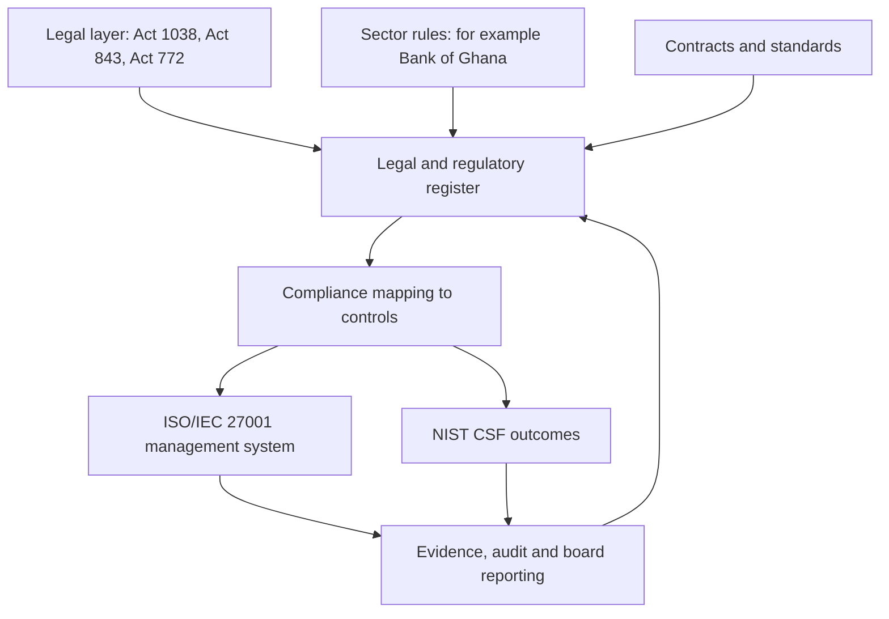

## Introduction

Security governance does not happen in a legal vacuum. A Ghanaian organisation that processes customer records, accepts electronic payments or operates important digital infrastructure is subject to national laws, regulators and sector expectations, and these shape what its security programme must achieve. Earlier lessons in this module introduced governance, policies, risk assessment and incident response in general terms. This lesson places them in the Ghanaian setting.

You will study three statutes that are central to the topic: the Cybersecurity Act, 2020 (Act 1038), the Data Protection Act, 2012 (Act 843) and the Electronic Transactions Act, 2008 (Act 772), together with the institutions associated with them. You will also consider sector expectations, particularly in financial services, the culture of incident reporting, and the practical question that matters most to a security manager: how do we turn legal obligations into a working programme that also fits internationally recognised frameworks?

**Educational notice.** This lesson is educational and is not legal advice. Laws are amended, regulators issue directives and guidance, and detailed obligations depend on an organisation's circumstances. For this reason the lesson describes the purpose and general structure of the laws rather than quoting section numbers, thresholds or penalties. Always consult the current text of each law, the relevant regulator and qualified legal counsel before relying on any statement here.

## Learning Objectives

- Describe the purpose and main areas covered by the Cybersecurity Act, 2020 (Act 1038), the Data Protection Act, 2012 (Act 843) and the Electronic Transactions Act, 2008 (Act 772).
- Explain the roles of the Cyber Security Authority and the Data Protection Commission and how they differ.
- Analyse how sector regulators, including the Bank of Ghana for financial institutions, add expectations on top of general laws.
- Evaluate the importance of timely, structured incident reporting and the obstacles to it.
- Apply a mapping approach that links legal obligations to ISO/IEC 27001 controls and NIST CSF outcomes in a Ghanaian organisation.

## Prerequisite Knowledge

- The lessons *Security Governance and Policies* and *Risk Assessment and the NIST CSF* in this module.
- Understanding of the CIA triad (confidentiality, integrity, availability) and of personal data.

## Key Terminology

- **Cybersecurity Act, 2020 (Act 1038)**: Ghana's statute that establishes the national cybersecurity regulatory structure, including the Cyber Security Authority, and addresses matters such as critical information infrastructure and cybersecurity practice.
- **Cyber Security Authority (CSA)**: The national body with statutory responsibility for cybersecurity regulation and coordination in Ghana.
- **Data Protection Act, 2012 (Act 843)**: Ghana's statute governing the processing of personal data and the rights of individuals.
- **Data Protection Commission (DPC)**: The statutory body that supervises compliance with the Data Protection Act, including registration of data controllers.
- **Electronic Transactions Act, 2008 (Act 772)**: Ghana's statute that gives legal recognition to electronic records, signatures and transactions and addresses related matters.
- **Data controller**: The person or organisation that decides the purpose and manner of processing personal data.
- **Data processor**: A party that processes personal data on behalf of a controller.
- **Data subject**: The individual to whom personal data relates.
- **Critical information infrastructure (CII)**: Systems whose disruption would seriously affect national security, the economy or essential services.
- **Compliance mapping**: A structured table linking each legal or regulatory obligation to the policies, controls and evidence that satisfy it.
- **Breach notification**: The duty or practice of informing a regulator and affected people when security of personal data or systems has been compromised.

## Detailed Explanation

### Why law and security programmes must be aligned

Security frameworks such as ISO/IEC 27001 and the NIST CSF tell an organisation how to manage security risk. Laws and regulators tell it what outcomes society expects and what it will be held accountable for. A mature organisation uses both: laws set the floor and define whose rights are at stake, while frameworks provide the management system that keeps the organisation above that floor in a repeatable, auditable way.

Ghana's legal landscape has three layers that students should keep distinct. **General statutes** apply to everyone within scope: the Cybersecurity Act, the Data Protection Act and the Electronic Transactions Act. **Sector regulation** adds requirements for regulated industries such as banking, payments, insurance, telecommunications and pensions. **Contracts and standards** add further obligations, such as card-payment security requirements imposed by payment networks or security clauses written into customer contracts.

### The Cybersecurity Act, 2020 (Act 1038) and the Cyber Security Authority

Act 1038 was passed to give Ghana a coherent legal framework for cybersecurity. It establishes the Cyber Security Authority, which took over and expanded the role of the earlier national cybersecurity coordination arrangements. In general terms, the Act addresses the following areas:

- **Institutional coordination.** The Authority regulates and coordinates cybersecurity activity nationally and works with sector bodies, law enforcement and international partners.
- **Critical information infrastructure.** The Act provides for the identification and protection of critical information infrastructure and places obligations on its owners, such as maintaining security and reporting incidents to the Authority.
- **Incident reporting and response.** The Act supports a national reporting and response arrangement so that serious incidents are visible to the national authority and can be coordinated.
- **Regulation of cybersecurity practice.** The Act provides for the licensing or accreditation of certain cybersecurity service providers and professionals, to raise the quality and trustworthiness of the market.
- **Cyber offences and child online protection.** The Act addresses offences in cyberspace and protection of children online.

For a security manager, the practical implication is to determine whether the organisation, or any of its systems, falls into a regulated category (for example, as an owner of critical information infrastructure or as a provider of cybersecurity services), and to know the channels for reporting and cooperating with the Authority. Exact definitions, duties and timelines must be taken from the current Act and Authority directives.

### The Data Protection Act, 2012 (Act 843) and the Data Protection Commission

Act 843 regulates how personal data is collected, used, stored and disclosed. It created the Data Protection Commission, which supervises compliance and maintains a register of data controllers. The Act is built around principles that will be familiar to students of international privacy law. In summary, personal data must be:

- processed lawfully and fairly, with the individual's knowledge and, where required, consent;
- collected for specified, legitimate purposes, and not further processed in an incompatible way;
- adequate, accurate and kept up to date;
- retained no longer than needed;
- protected by appropriate security safeguards; and
- handled openly, with individuals able to access and correct their data.

The Act also recognises a category of **special personal data** that attracts stricter conditions, covering sensitive matters such as health and certain beliefs and affiliations. Controllers are expected to be accountable, to register with the Commission as required, and to notify the Commission and affected individuals when security compromises occur. Rules on transfer of personal data outside Ghana are also a practical concern for any organisation using foreign cloud services.

The Commission's functions include registration, guidance, complaints handling and enforcement. The key conceptual contrast with the Cyber Security Authority is therefore one of focus: the Commission is concerned with the **rights of individuals over personal data**, while the Authority is concerned with the **security and resilience of digital systems and infrastructure**. A single incident, such as a breach of a customer database, can engage both.

### The Electronic Transactions Act, 2008 (Act 772)

Act 772 supports electronic commerce by giving legal recognition to electronic records, electronic signatures and electronic contracts, so that a transaction is not denied legal effect merely because it is in electronic form. It also addresses related matters such as the use of electronic communications by public bodies and the position of intermediaries and service providers. For security management, its importance lies in **evidence and trust**: if records and signatures are to be relied on in a dispute, the organisation must be able to show that they are authentic, complete and have not been altered. That depends on good identity management, logging, integrity controls and retention practices, which are the same controls security frameworks recommend.

### Sector expectations

General laws are supplemented by sector regulators. In financial services, the Bank of Ghana has issued cyber and information security requirements for the institutions it regulates, covering matters such as board and senior management oversight of cyber risk, risk assessment, incident reporting to the regulator and expectations for outsourced and third-party services. Payment-system operators and mobile money issuers are also subject to central bank oversight. Other regulators, for example in telecommunications, insurance and pensions, may impose their own expectations. The detail changes over time, so organisations should obtain current directives directly from their regulator. The general lesson is that regulated firms must satisfy both national statutes and the sector rulebook, and that regulators usually expect evidence of board-level oversight, not just technical controls.

### Incident reporting culture

Reporting incidents is where law, ethics and organisational culture meet. Legal duties, where they exist, require organisations to inform regulators and sometimes affected people. Yet reporting also depends on **culture**: if staff fear blame, they hide mistakes such as clicking a phishing link; if executives fear reputational damage, they delay disclosure. Delays make harm worse, because affected individuals cannot change passwords, watch their accounts or take other protective steps.

A healthy reporting culture has several features: a clear internal channel that is easy to use; a no-blame principle for good-faith reporting; defined criteria for what counts as an incident and who decides on external notification; pre-agreed contact points for the regulators; and rehearsal through exercises. National reporting also has a collective benefit: when many organisations report, the national authority can spot patterns, warn others and coordinate response, a form of shared defence.

## Theories, Frameworks and Models

**ISO/IEC 27001 as the management system.** ISO/IEC 27001:2022 specifies requirements for an information security management system, including context, leadership, risk assessment and treatment, performance evaluation and improvement. Its requirement to identify applicable legal, regulatory and contractual obligations gives a natural place to record Ghanaian statutes. Annex A controls supply the technical and organisational measures.

**NIST Cybersecurity Framework 2.0.** The NIST CSF (NIST, 2024) organises outcomes into functions: Govern, Identify, Protect, Detect, Respond and Recover. The Govern function is especially relevant to legal alignment because it covers context, roles, policy and oversight, while the Respond function covers incident management and communications, which include regulator notification.

## Step-by-Step Guide

A Ghanaian organisation can operationalise compliance as follows.

1. **Establish scope.** Identify the organisation's role (data controller, processor, critical infrastructure owner, regulated financial institution) and the systems and data in scope.
2. **Build a legal and regulatory register.** List applicable statutes, sector directives and contractual duties, with owner, source and review date. Obtain the current texts and take legal advice.
3. **Map obligations to controls.** For each duty, record the policy, control and evidence that satisfy it, using ISO/IEC 27001 Annex A and NIST CSF outcomes as the control vocabulary.
4. **Create data and system inventories.** Know what personal data is held, where it flows, who processes it and where it is stored, including cross-border transfers.
5. **Define incident and notification procedures.** Set severity criteria, internal escalation, decision rights for external notification, regulator contact details and communication templates.
6. **Train and test.** Train staff on data handling and reporting, test the incident plan with exercises, and review vendors against contractual security terms.
7. **Monitor and improve.** Review the register after law or directive changes, audit internally, and report compliance metrics to the board.

## Ghanaian Business Application

**Illustrative scenario.** *Adwoa Pay* (fictional) is a regulated payments company serving small traders through a mobile app and USSD, hosting its platform with a foreign cloud provider and outsourcing customer support to a call centre. Its security officer builds a compliance map.

On the data side, the company is a data controller for customer identity and transaction data, and the cloud provider and call centre are processors. The map therefore records the registration status with the Data Protection Commission, privacy notices in the app, consent and purpose records, processor contracts that impose security and breach notification duties, and a review of cross-border storage. On the cyber side, the company notes its obligations to its financial regulator and, depending on its classification, to the Cyber Security Authority, and records escalation contacts. On the electronic transactions side, it ensures that e-receipts, electronic agreements and logs are retained in a manner that preserves their integrity and evidential value.

The map is then connected to frameworks. The register of obligations is part of the ISO/IEC 27001 "context" and "legal requirements" documentation; the incident procedure is tested in a tabletop exercise based on a fraud involving stolen credentials; and the board receives quarterly reports aligned to the NIST CSF functions. A phishing report from a call-centre agent is treated as an incident, not a disciplinary matter, which encourages early reporting. All legal statements in the register are reviewed by counsel and labelled with their review date, since directives change.

## International Case Study

**The Equifax breach (2017).** Equifax, a US consumer credit reporting company, disclosed in 2017 that attackers had gained access to personal information of a very large number of people, widely reported as well over a hundred million individuals. Public investigations, including a report by the US House Committee on Oversight and Government Reform (2018), described that the intrusion exploited a known vulnerability in a web application component for which a fix had been available, and that failures in vulnerability management, asset visibility and certificate management allowed the attackers to remain undetected for a period. The disclosure itself drew criticism for its timing and handling.

The case is relevant to Ghana because it connects the three elements of this lesson. The technical lessons concern patching, asset inventory and monitoring, which are core to ISO/IEC 27001 and the NIST CSF Identify, Protect and Detect functions. The data protection lessons concern the scale of harm when sensitive personal data is aggregated in one place. The reporting lessons show that how and how quickly an organisation informs regulators and affected people shapes public trust. Ghana's laws differ from US law, so the case should be used for its management lessons, not as a statement about Ghanaian legal duties.

## Diagram

| Institution | Main focus | Typical question it asks |
|---|---|---|
| Cyber Security Authority | Security and resilience of digital systems and critical infrastructure | Are systems protected and incidents reported and coordinated? |
| Data Protection Commission | Rights of individuals over personal data | Is personal data processed lawfully, securely and transparently? |
| Sector regulator (for example Bank of Ghana) | Safety and soundness of regulated institutions | Does management oversee cyber risk and report incidents to us? |

## Common Misconceptions

- "Complying with ISO/IEC 27001 means we comply with Ghanaian law." Certification shows a management system meets the standard but does not by itself prove legal compliance, which depends on identifying and meeting each legal duty.
- "The Cyber Security Authority and the Data Protection Commission do the same job." Their focuses differ, systems security versus personal data rights, although one incident can engage both.
- "Data protection is only an IT issue." It is a governance, legal and business issue involving consent, purpose, retention and vendor contracts as well as technical safeguards.
- "Reporting an incident is an admission of failure." Reporting is a control and often a legal or regulatory expectation; concealment typically makes consequences worse.

## Common Examination Mistakes

- Quoting section numbers, fines or deadlines from memory instead of describing purpose and structure and noting the need to check current texts.
- Confusing the roles of the Cyber Security Authority and the Data Protection Commission.
- Treating legal compliance and framework adoption as separate activities rather than a mapped, integrated programme.
- Discussing only technical controls and omitting governance, accountability and reporting culture.

## Critical Thinking Questions

1. A staff member loses a laptop containing customer records. Identify who must be informed and how the organisation should decide.
2. How might a no-blame reporting culture and strict regulatory accountability pull in opposite directions, and how can leaders reconcile them?
3. If your cloud provider stores data outside Ghana, what questions would you ask before signing, and why?
4. Is it better to design the security programme around frameworks or around legal duties? Defend your position.

## Practical Exercises

1. Choose a fictional Ghanaian organisation and draft a five-row legal and regulatory register with columns for obligation, source type (statute, sector rule, contract), owner and evidence. Mark the entries that need legal confirmation. Expected output: a table and a one-paragraph note on how you would verify each entry.
2. Map three obligations (for example, protecting personal data, retaining electronic records, reporting incidents) to one ISO/IEC 27001 Annex A control area and one NIST CSF function each. Expected output: a three-row mapping table with a sentence of justification per row.
3. Write a one-page incident notification decision guide for a fictional organisation, covering severity levels, who decides on external notification, and who contacts regulators. Expected output: a decision tree or table.

## Key Takeaways

- Laws define outcomes and accountability; frameworks provide the management system to achieve them repeatably.
- The Cybersecurity Act, 2020 (Act 1038) establishes the Cyber Security Authority and addresses national cybersecurity, critical infrastructure and incident coordination.
- The Data Protection Act, 2012 (Act 843) governs personal data and created the Data Protection Commission.
- The Electronic Transactions Act, 2008 (Act 772) underpins the legal validity of electronic records and signatures, which depends on integrity and evidence controls.
- Sector regulators such as the Bank of Ghana add expectations; organisations must verify current directives.
- A legal register mapped to controls turns obligations into evidence, and a no-blame culture supports timely reporting.

## Further Reading

- International Organization for Standardization. (2022). *ISO/IEC 27001:2022 Information security, cybersecurity and privacy protection: Information security management systems: Requirements*. ISO.
- National Institute of Standards and Technology. (2024). *The NIST Cybersecurity Framework (CSF) 2.0* (NIST CSWP 29). <https://www.nist.gov/cyberframework>
- Republic of Ghana. (2008). *Electronic Transactions Act, 2008 (Act 772)*.
- Republic of Ghana. (2012). *Data Protection Act, 2012 (Act 843)*.
- Republic of Ghana. (2020). *Cybersecurity Act, 2020 (Act 1038)*.
- U.S. House of Representatives Committee on Oversight and Government Reform. (2018). *The Equifax data breach: Majority staff report*.

## Video Resources

- [Cyber Security Authority, Ghana](https://csa.gov.gh/): Cyber Security Authority. Official site with national cybersecurity guidance and awareness material.
- [Data Protection Commission, Ghana](https://www.dataprotection.org.gh/): Data Protection Commission. Official site with information on registration, data subject rights and compliance.

## Revision Summary

Ghanaian organisations operate under general statutes, sector rules and contracts. The Cybersecurity Act, 2020 (Act 1038) created the Cyber Security Authority and addresses national cybersecurity, critical information infrastructure and incident coordination. The Data Protection Act, 2012 (Act 843) governs personal data and is supervised by the Data Protection Commission. The Electronic Transactions Act, 2008 (Act 772) gives legal effect to electronic records and signatures. Organisations operationalise compliance with a legal register mapped to ISO/IEC 27001 controls and NIST CSF outcomes, supported by clear accountability and a no-blame reporting culture. This content is educational and is not legal advice.

- Authority focuses on systems security; Commission focuses on personal data rights.
- Sector regulators such as the Bank of Ghana add expectations.
- Certification is not the same as legal compliance.
- Map obligations to controls and evidence.
- Report incidents early; concealment worsens harm.
- Always check current legal texts and take legal advice.
