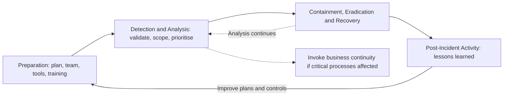

## Introduction

However strong its defences, every organisation will experience security incidents. The difference between a contained event and a corporate crisis usually lies in preparation: whether people know their roles, whether evidence is preserved, whether critical business processes can continue while systems are restored, and whether leadership communicates honestly with customers and regulators. Incident response, business continuity and audit are the disciplines that make this preparation real and verifiable.

This lesson covers three connected topics. Incident response handles the security event itself. Business continuity keeps the organisation's essential services running during any disruption, whether caused by an attacker, a flood or a power failure. Security audits provide independent assurance to the board that the controls and plans described in policy actually work. Together they correspond closely to the Detect, Respond and Recover Functions of NIST CSF 2.0, overseen through Govern.

## Learning Objectives

- Explain the phases of the incident response lifecycle described in NIST SP 800-61 and the activities within each phase.
- Apply incident classification and escalation to decide how a reported event should be handled.
- Conduct a simple business impact analysis to identify critical processes, maximum tolerable downtime and recovery priorities.
- Distinguish incident response, business continuity and disaster recovery plans and explain how they interact.
- Explain the purpose, types and stages of security audits and evaluate audit findings.

## Prerequisite Knowledge

- RPO, RTO and disaster recovery from the cloud and infrastructure module.
- NIST CSF 2.0 Functions and risk assessment from the previous lesson.
- Governance roles and policy hierarchy.

## Key Terminology

- **Security event**: Any observable occurrence in a system or network, such as a login or an alert, which may or may not be harmful.
- **Security incident**: An event that actually or potentially jeopardises the confidentiality, integrity or availability of information or systems, or violates security policy.
- **Incident response plan (IRP)**: The documented approach, roles and procedures for detecting, analysing, containing, eradicating and recovering from incidents.
- **Containment**: Actions that limit the spread and impact of an incident, such as isolating hosts or disabling compromised accounts.
- **Chain of custody**: A documented record of who collected, handled and stored evidence, preserving its integrity for investigation or legal proceedings.
- **Business continuity plan (BCP)**: The documented arrangements for continuing critical business functions during and after a disruption.
- **Business impact analysis (BIA)**: An analysis of how disruption to business processes would affect the organisation over time, used to set recovery priorities and objectives.
- **Security audit**: A systematic, independent examination of evidence to determine whether security controls are designed appropriately and operating effectively against defined criteria.

## Detailed Explanation

### The NIST SP 800-61 incident response lifecycle

NIST SP 800-61 Rev. 2 (Cichonski et al., 2012) describes a four-phase lifecycle that remains the most widely taught model:

1. **Preparation**: establishing the incident response capability (policy, plan, team roles, contact lists, tools, logging, playbooks, training and exercises) and reducing the number of incidents through sound security controls.
2. **Detection and Analysis**: recognising signs of an incident from alerts, logs and reports; validating whether an incident has occurred; determining scope; prioritising it by functional impact, information impact and recoverability; documenting findings; and notifying the right people.
3. **Containment, Eradication and Recovery**: choosing a containment strategy (short-term isolation and longer-term measures), preserving evidence, removing the cause (malware, attacker accounts, persistence mechanisms), and restoring systems to normal operation with heightened monitoring.
4. **Post-Incident Activity**: holding a lessons-learned review, updating plans and controls, and using incident data to improve.

The lifecycle is iterative: analysis often continues during containment, and lessons feed back into preparation. In 2025 NIST published Rev. 3 of SP 800-61, which reframes incident response recommendations around the CSF 2.0 Functions, emphasising that incident response is part of overall cybersecurity risk management rather than a stand-alone activity. Students should recognise both the classic four-phase model and this CSF-aligned view.

### Classification and escalation

Not every event is an incident, and not every incident is a crisis. Organisations define severity levels so that responses are proportionate. A typical scheme considers: the business functions affected, whether sensitive data is involved, the number of users or systems affected, and whether the incident is ongoing. Severity drives escalation: a single malware detection on a laptop may be handled by the service desk, while suspected exfiltration of customer data triggers the full incident response team, executive notification, legal advice and assessment of regulatory reporting duties.

### Practical response principles

- **Preserve evidence before wiping**: capture memory and disk images and relevant logs where feasible, and maintain chain of custody.
- **Contain decisively but deliberately**: disconnecting systems may alert attackers or destroy volatile evidence, so containment choices should follow playbooks.
- **Communicate through agreed channels**: if email may be compromised, use out-of-band communication; give accurate, timely updates to executives, staff, customers and regulators.
- **Hunt for persistence**: removing the visible malware is not enough if attackers retain stolen credentials or backdoors.
- **Record decisions**: a timeline of actions and decisions supports the lessons-learned review and any regulatory enquiry.

### Business continuity

Business continuity management takes a wider view than IT: its question is "how do we keep serving customers?" whatever the cause of disruption. A BCP might specify manual workarounds (paper forms, alternative sites, temporary staff reassignment) while IT systems are restored. It sits alongside the incident response plan (which handles the security incident) and the disaster recovery plan (which restores technology). ISO 22301:2019 provides requirements for a business continuity management system, and NIST SP 800-34 Rev. 1 places the BIA at the heart of contingency planning.

### Security audits

Audits answer the board's question: "how do we know?" Key distinctions include:

- **Internal versus external**: internal audit reports independently to the board's audit committee; external audits are performed by independent firms, certification bodies or regulators.
- **Compliance versus performance**: compliance audits test conformity with a standard or law (for example ISO/IEC 27001 certification); performance or effectiveness audits ask whether controls achieve their objectives.
- **Design versus operating effectiveness**: is the control well designed, and did it actually operate throughout the period (for example, were leavers' accounts disabled for every leaver sampled)?

A typical audit proceeds through planning and scoping, risk assessment of the area, fieldwork (interviews, document review, observation, sampling and technical testing), evaluation of evidence, reporting of findings with ratings and recommendations, management responses with owners and deadlines, and follow-up to verify remediation. Audits differ from penetration tests: an audit assesses controls against criteria, whereas a penetration test attempts, with authorisation, to exploit weaknesses.

## Theories, Frameworks and Models

### How the plans fit together

| Plan | Focus | Triggered by | Example content |
|---|---|---|---|
| Incident response plan | The security incident | Detection of a suspected incident | Roles, severity levels, playbooks, evidence handling, notification |
| Business continuity plan | Critical business processes | Any significant disruption | Manual workarounds, alternative sites, staff arrangements, customer communication |
| Disaster recovery plan | IT systems and data | Loss of systems or sites | Restore order, backup locations, failover steps, RTO and RPO |
| Crisis communications plan | Stakeholder communication | Serious incident with reputational impact | Spokespeople, approval process, holding statements |

### Business impact analysis method

A BIA identifies critical processes, estimates impact over time across financial, operational, legal, regulatory, safety and reputational dimensions, determines the maximum tolerable downtime, identifies dependencies (systems, suppliers, people, locations) and sets RTO and RPO for supporting systems. Its outputs drive both the BCP and the DR strategy.

## Worked Example

**Illustrative scenario.** *Bosomtwe Rural Bank* (fictional) conducts a BIA for four processes. Impact is rated 1 (low) to 5 (severe) over time:

| Process | 4 hours | 1 day | 3 days | 1 week | MTD | Supporting system RTO |
|---|---|---|---|---|---|---|
| Customer cash withdrawals and deposits | 3 | 5 | 5 | 5 | 1 day | 8 hours |
| Mobile money and electronic transfers | 3 | 4 | 5 | 5 | 1 day | 8 hours |
| Loan origination | 1 | 2 | 3 | 4 | 1 week | 3 days |
| Monthly regulatory reporting | 1 | 1 | 2 | 4 | 1 week (deadline dependent) | 3 days |

**Analysis.** Withdrawals and transfers reach severe impact within a day (customer hardship, liquidity concerns, regulatory attention and reputational damage), so their MTD is one day and the core banking and payment interfaces need an RTO comfortably shorter, set at 8 hours. The BCP adds a manual procedure: limited cash withdrawals against signed vouchers and pre-printed balance lists, reconciled when systems return. Loan origination can pause for days, so a cheaper recovery approach is acceptable.

**Incident scenario.** At 09:00 on a Monday, tellers report that the core banking client shows ransom notes.

- *Detection and Analysis*: the service desk escalates to the incident response lead; the incident is classified as **Critical** (core systems affected, possible data theft). The CEO, legal adviser and communications lead are notified; the team checks whether backups and the payment interface are affected.
- *Containment*: infected network segments are isolated according to the ransomware playbook; privileged accounts are reset; memory and disk images are taken from two affected servers with chain of custody recorded.
- *Business continuity*: branches invoke the manual withdrawal procedure within the hour.
- *Eradication and Recovery*: the core banking server is rebuilt from clean images and restored from the immutable off-site backup taken at 06:00 (data loss of three hours, recovered by re-keying from vouchers); service resumes at 16:30, within the 8-hour RTO.
- *Reporting*: management assesses obligations to the Bank of Ghana, to the Data Protection Commission if personal data was compromised, and to the Cyber Security Authority where applicable under Act 1038.
- *Post-incident*: a lessons-learned meeting within two weeks finds that the initial access came through a phishing email; actions include phishing-resistant MFA for staff and an additional tabletop exercise.

## Diagram

## Ghanaian Business Application

The Cybersecurity Act, 2020 (Act 1038) gives the Cyber Security Authority responsibilities for incident response co-ordination at national level, including through the national Computer Emergency Response Team (CERT-GH) and sectoral CERTs, and places incident reporting obligations on owners of Critical Information Infrastructure. Ghanaian organisations should therefore include in their incident response plans: whether they are CII owners or suppliers to CII; who is authorised to report to the CSA and sector regulators; how to contact CERT-GH; and what information must be preserved. Data breaches involving personal data also raise questions under the Data Protection Act, 2012 (Act 843). Because the precise reporting requirements and timelines are set in the legislation and regulatory directives, the plan should cite the primary texts and be reviewed by legal counsel.

Continuity planning in Ghana should explicitly consider power and connectivity disruptions, dependence on a small number of telecom and payment partners, and the ability to serve customers manually for a period. Internal audit functions in banks, insurers and public bodies increasingly include cybersecurity in their annual plans, often using ISO/IEC 27001, COBIT or NIST CSF as audit criteria.

## International Case Study

**SolarWinds and the FireEye discovery (2020).** In December 2020 the cybersecurity company FireEye disclosed that it had been breached by a highly sophisticated attacker who had stolen some of its red-team assessment tools. FireEye's investigation traced the intrusion to a trojanised update of SolarWinds Orion, a widely used network management product. Attackers had inserted malicious code (later named SUNBURST) into Orion's build process, so legitimate, digitally signed updates distributed in 2020 contained a backdoor. SolarWinds stated in a regulatory filing that fewer than 18,000 customers may have installed affected versions, although the attackers pursued follow-on intrusions against a much smaller number of targets, including US government agencies and technology companies. US government agencies issued emergency directives instructing federal bodies to disconnect or power down affected Orion products.

The incident response lessons are notable. FireEye's detection reportedly began with an anomaly in its own authentication, a new device registered for a user's MFA, showing the value of monitoring identity events. FireEye publicly disclosed its breach and released countermeasures to detect misuse of its stolen tools, demonstrating transparent communication and information sharing. For victim organisations, response required careful scoping across a supply chain, hunting for persistence beyond the initial backdoor, and co-ordination with national authorities. From a continuity and audit perspective, the case shows that trusted, signed software updates can be an attack path, so supplier risk (CSF GV.SC) belongs in governance and audit scope.

## Common Misconceptions

- **"Incident response starts when an attack is detected."** Preparation is the first phase; without plans, roles, logging and practice, detection and response are slow and chaotic.
- **"The priority is always to wipe and restore immediately."** Restoring before scoping and preserving evidence can leave attackers' access in place and destroy information needed to understand what happened.
- **"Business continuity is the same as disaster recovery."** DR restores technology; BC keeps critical business processes running, sometimes manually, while technology is restored.
- **"A clean audit report means the organisation is secure."** Audits test specific controls against criteria over a period; they provide reasonable, not absolute, assurance.

## Common Examination Mistakes

- Listing the NIST SP 800-61 phases out of order or omitting Preparation and Post-Incident Activity.
- Confusing events with incidents, or failing to explain how severity drives escalation.
- Describing a BIA without mentioning impact over time, MTD and dependencies.
- Treating an audit and a penetration test as the same activity.
- Ignoring legal and regulatory reporting, including Ghanaian obligations, in incident scenarios.

## Critical Thinking Questions

1. When might an organisation deliberately delay containment to observe an attacker, and what are the risks of doing so?
2. How should a board balance the duty to disclose an incident promptly against the risk of disclosing inaccurate information early?
3. Should internal audit be permitted to audit the security function it may later advise? How does the Three Lines Model address this?

## Practical Exercises

1. **Playbook drafting.** Write a one-page ransomware playbook for an illustrative organisation covering the four SP 800-61 phases. *Expected output:* a playbook with roles, first-hour actions, containment options, evidence steps, recovery order and notification decision points.
2. **Mini BIA.** For a small business you know, identify three critical processes and rate impact at 4 hours, 1 day, 3 days and 1 week. *Expected output:* a BIA table with MTD, dependencies and proposed RTO and RPO for supporting systems.
3. **Tabletop exercise.** Use one of CISA's publicly available tabletop exercise packages and adapt it to a Ghanaian context with three or four colleagues. *Expected output:* an after-action report listing strengths, gaps and five improvement actions with owners.

## Key Takeaways

- NIST SP 800-61 Rev. 2 describes Preparation; Detection and Analysis; Containment, Eradication and Recovery; and Post-Incident Activity, and Rev. 3 aligns incident response with CSF 2.0.
- Severity classification ensures proportionate escalation, evidence handling and communication.
- A BIA sets MTD, recovery priorities and RTO/RPO, driving both the BCP and DR strategy.
- Incident response, continuity, disaster recovery and crisis communication plans are distinct but must be co-ordinated.
- Audits provide independent assurance on control design and operating effectiveness, reported to the board.

## Further Reading

- Cichonski, P., Millar, T., Grance, T., & Scarfone, K. (2012). *Computer security incident handling guide* (NIST Special Publication 800-61, Revision 2). National Institute of Standards and Technology. <https://csrc.nist.gov/pubs/sp/800/61/r2/final>
- Swanson, M., Bowen, P., Phillips, A. W., Gallup, D., & Lynes, D. (2010). *Contingency planning guide for federal information systems* (NIST Special Publication 800-34, Revision 1). National Institute of Standards and Technology.
- International Organization for Standardization. (2019). *Security and resilience, Business continuity management systems, Requirements* (ISO 22301:2019). ISO.
- National Institute of Standards and Technology. (2024). *The NIST Cybersecurity Framework (CSF) 2.0* (NIST CSWP 29). <https://doi.org/10.6028/NIST.CSWP.29>

## Video Resources

- [CISA Tabletop Exercise Packages](https://www.cisa.gov/resources-tools/services/cisa-tabletop-exercise-packages): Cybersecurity and Infrastructure Security Agency. Official, free exercise packages for practising incident response and continuity decisions.
- [Cyber Security Authority, Ghana](https://www.csa.gov.gh/): Cyber Security Authority. Official website with information on incident reporting, CERT-GH and Act 1038.
- [NIST Computer Security Resource Center](https://csrc.nist.gov/): National Institute of Standards and Technology. Official portal for SP 800-61 and contingency planning publications.

## Revision Summary

Incident response handles the security incident, business continuity keeps critical processes running, and audits prove that controls and plans work. NIST SP 800-61 provides the lifecycle; the BIA sets continuity priorities; audits report independently to the board.

- Lifecycle: Preparation; Detection and Analysis; Containment, Eradication and Recovery; Post-Incident Activity.
- Preserve evidence and chain of custody; hunt for persistence; communicate out of band if needed.
- BIA: impact over time, MTD, dependencies, then RTO and RPO.
- IRP, BCP, DRP and crisis communications are distinct but linked.
- Audits test design and operating effectiveness; they are not penetration tests.
- Ghana: Act 1038, CSA, CERT-GH, CII incident reporting; SolarWinds (2020) shows supply-chain response.
