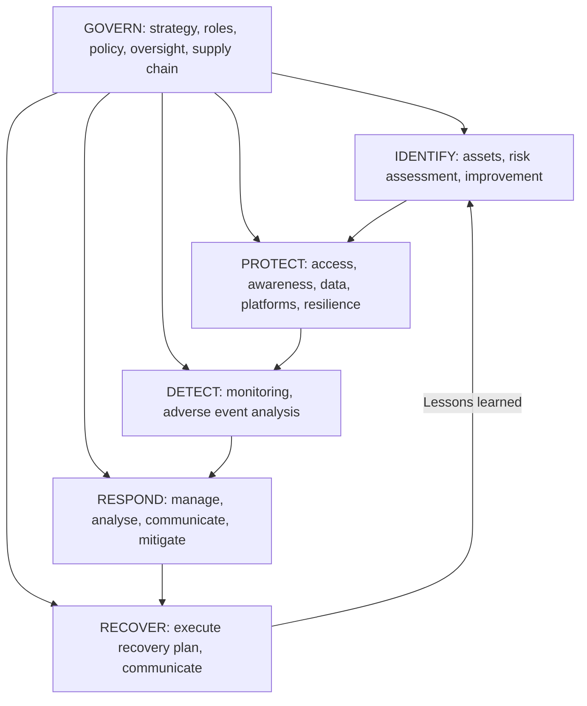

## Introduction

No organisation can protect everything equally. Budgets, staff time and management attention are limited, while threats are effectively unlimited. Risk assessment is the discipline that decides where protection matters most. It converts a vague sense of danger ("we might be hacked") into a ranked list of specific risks, each with an owner, a rating and a decision about what to do. That list is the bridge between technical security work and business decision-making.

Frameworks help organisations do this consistently. The NIST Cybersecurity Framework (CSF), first published in 2014 and substantially revised as CSF 2.0 in February 2024, is one of the most widely used. It provides a common language for describing cybersecurity outcomes across six Functions, from governance through to recovery. This lesson teaches you to perform a structured risk assessment and then to use CSF 2.0 to organise, communicate and improve an organisation's cybersecurity programme.

## Learning Objectives

- Explain the stages of a risk assessment as described in NIST SP 800-30 Rev. 1.
- Apply a five-by-five likelihood and impact matrix to rate and rank cybersecurity risks.
- Select and justify risk treatments (mitigate, transfer, avoid, accept) with reference to risk appetite and residual risk.
- Explain accurately the six Functions of NIST CSF 2.0: Govern, Identify, Protect, Detect, Respond and Recover.
- Use CSF Profiles and Tiers to describe current and target cybersecurity posture.

## Prerequisite Knowledge

- The relationship between threats, vulnerabilities and risk from Module 1.
- Security governance roles and policy from the previous lesson.
- Awareness of common controls covered earlier in the course.

## Key Terminology

- **Risk**: The effect of uncertainty on objectives; in cybersecurity, commonly expressed as a combination of the likelihood of a threat event and the impact if it occurs.
- **Risk assessment**: The process of identifying, estimating and prioritising risks to operations, assets and individuals.
- **Inherent risk**: The level of risk before new or additional controls are applied.
- **Residual risk**: The risk that remains after controls or other treatments have been applied.
- **Risk appetite**: The amount and type of risk an organisation is willing to pursue or retain in pursuit of its objectives, set by its governing body.
- **Risk register**: A record of identified risks, their ratings, owners, treatments and status.
- **CSF Core**: The hierarchy of cybersecurity outcomes in NIST CSF 2.0, organised into Functions, Categories and Subcategories.
- **CSF Profile**: A description of an organisation's current or target cybersecurity posture in terms of CSF Core outcomes.
- **CSF Tier**: A characterisation of the rigour of an organisation's cybersecurity risk governance and management practices, from Tier 1 (Partial) to Tier 4 (Adaptive).

## Detailed Explanation

### The risk assessment process

NIST SP 800-30 Rev. 1 describes risk assessment in four steps: **prepare** (define purpose, scope, assumptions and the risk model), **conduct** (identify threat sources and events, vulnerabilities and predisposing conditions, determine likelihood and impact, and determine risk), **communicate** results to decision-makers, and **maintain** the assessment as conditions change. ISO/IEC 27005 offers comparable guidance aligned with ISO/IEC 27001.

In practice a cybersecurity risk assessment for a business typically proceeds as follows:

1. **Establish context**: business objectives, critical processes, legal obligations and risk appetite.
2. **Identify assets**: information, systems, services and people that matter, with owners.
3. **Identify threats and vulnerabilities**: realistic threat events (phishing-led ransomware, fraud, insider misuse, outages) and the weaknesses they could exploit.
4. **Analyse likelihood and impact**, taking existing controls into account.
5. **Evaluate**: compare ratings against risk appetite to decide which risks need treatment.
6. **Treat**: choose and plan responses, assign owners and deadlines.
7. **Monitor and review**: update the register when threats, systems or controls change.

### Qualitative versus quantitative assessment

Qualitative assessment uses ordinal scales (for example 1 to 5) and is fast, inclusive and easy to communicate, but subjective. Quantitative assessment expresses risk in monetary terms; a classic simple model is **annualised loss expectancy (ALE) = single loss expectancy (SLE) × annualised rate of occurrence (ARO)**. If a laptop theft costs GH₵ 20,000 (replacement, investigation and recovery) and is expected 0.5 times per year, ALE = GH₵ 10,000, which helps judge whether a control costing GH₵ 4,000 per year is worthwhile. Quantitative estimates need reliable data, which is often scarce, so many organisations use qualitative matrices supported by quantitative reasoning for major decisions.

### Risk treatment options

- **Mitigate (modify)**: apply controls that reduce likelihood or impact.
- **Transfer (share)**: shift part of the financial impact, for example through cyber insurance or contracts; accountability for the data and duties to regulators usually remain.
- **Avoid**: stop the activity that creates the risk, such as retiring an insecure legacy service.
- **Accept (retain)**: knowingly tolerate the risk because it is within appetite or treatment costs exceed benefits; acceptance must be made by an authorised risk owner and recorded.

## Worked Example

**Illustrative scenario.** *Akwaaba Mobile Credit* (fictional) provides small loans through a mobile app and a USSD service in partnership with mobile network operators. It holds customer identity data, repayment histories and links to mobile money wallets. The board's stated risk appetite is: *low* for risks to customer funds and personal data; *moderate* for short service outages.

**Scales used:**

| Score | Likelihood (within 12 months) | Impact |
|---|---|---|
| 1 | Rare | Negligible: minor inconvenience |
| 2 | Unlikely | Minor: limited cost, no regulatory interest |
| 3 | Possible | Moderate: noticeable losses or a short outage |
| 4 | Likely | Major: significant losses, regulatory enquiry, media coverage |
| 5 | Almost certain | Severe: large customer losses, sustained outage, threat to licence |

Risk score = likelihood × impact. Bands: **1–4 Low**, **5–9 Medium**, **10–14 High**, **15–25 Critical**.

**Risk register extract (inherent ratings, with existing controls):**

| ID | Risk | L | I | Score | Band |
|---|---|---|---|---|---|
| R1 | Phishing leads to ransomware across servers and backups | 4 | 5 | 20 | Critical |
| R2 | Fraudsters abuse the loan API to take loans in others' names | 3 | 4 | 12 | High |
| R3 | SIM-swap enables takeover of customer accounts | 3 | 4 | 12 | High |
| R4 | Distributed denial of service makes the app unavailable for hours | 3 | 3 | 9 | Medium |
| R5 | Lost staff laptop with encrypted disk | 3 | 2 | 6 | Medium |
| R6 | Flood damages the office server room | 2 | 3 | 6 | Medium |

**Five-by-five matrix (inherent positions):**

| Likelihood \ Impact | 1 | 2 | 3 | 4 | 5 |
|---|---|---|---|---|---|
| 5 Almost certain | | | | | |
| 4 Likely | | | | | R1 |
| 3 Possible | | R5 | R4 | R2, R3 | |
| 2 Unlikely | | | R6 | | |
| 1 Rare | | | | | |

**Evaluation and treatment:**

- **R1 (Critical, outside appetite)**: mitigate with phishing-resistant MFA for staff, endpoint detection and response, immutable off-site backups and an incident response plan; partially transfer through cyber insurance. Target residual: L2 × I4 = 8 (Medium). Owner: Chief Operating Officer.
- **R2 and R3 (High, outside the low appetite for customer funds)**: mitigate with stronger identity verification at onboarding, velocity limits, device binding, fraud analytics and SIM-change checks where telecom partners provide them. Target residual: L2 × I3 = 6 (Medium). Owner: Head of Credit Risk.
- **R4 (Medium, within moderate appetite for outages)**: mitigate cheaply with a provider-level DDoS protection service; otherwise accept.
- **R5 (Medium)**: accept, because full-disk encryption already limits impact; record acceptance by the IT manager.
- **R6 (Medium)**: largely avoid by migrating the remaining server-room workloads to cloud hosting.

The board receives a one-page summary: two critical-or-high clusters, the planned investment, target residual ratings and the formally accepted risks. That is risk assessment doing its real job, supporting decisions.

## Theories, Frameworks and Models

### NIST CSF 2.0: structure

CSF 2.0 (NIST, 2024) is voluntary guidance intended for organisations of all sizes and sectors, a broadening from the original focus on critical infrastructure. It has three main components: the **Core**, **Organizational Profiles** and **Tiers**. The Core is organised into six **Functions**, each divided into **Categories** and more specific **Subcategories** (outcomes). It describes *what* outcomes to achieve, not *how*; organisations select controls from catalogues such as NIST SP 800-53 or ISO/IEC 27001 Annex A to achieve them.

### The six Functions

| Function | What it is about | Example Categories |
|---|---|---|
| **Govern (GV)** | The organisation's cybersecurity risk management strategy, expectations and policy are established, communicated and monitored. New in 2.0 and placed at the centre because it informs all other Functions. | Organisational Context; Risk Management Strategy; Roles, Responsibilities and Authorities; Policy; Oversight; Cybersecurity Supply Chain Risk Management |
| **Identify (ID)** | The organisation's current cybersecurity risks are understood. | Asset Management; Risk Assessment; Improvement |
| **Protect (PR)** | Safeguards to manage the organisation's cybersecurity risks are used. | Identity Management, Authentication and Access Control; Awareness and Training; Data Security; Platform Security; Technology Infrastructure Resilience |
| **Detect (DE)** | Possible cybersecurity attacks and compromises are found and analysed. | Continuous Monitoring; Adverse Event Analysis |
| **Respond (RS)** | Actions regarding a detected cybersecurity incident are taken. | Incident Management; Incident Analysis; Incident Response Reporting and Communication; Incident Mitigation |
| **Recover (RC)** | Assets and operations affected by a cybersecurity incident are restored. | Incident Recovery Plan Execution; Incident Recovery Communication |

The Functions are not a linear sequence. Govern, Identify, Protect and Detect operate continuously; Respond and Recover are ready at all times and activated when incidents occur. Risk assessment itself sits in Identify (ID.RA), while risk management strategy and appetite sit in Govern (GV.RM).

### Profiles and Tiers

An **Organizational Profile** describes posture in terms of Core outcomes. A **Current Profile** records what is achieved now; a **Target Profile** records the outcomes the organisation aims for, given its risk appetite and obligations. The gap between them produces a prioritised action plan. NIST also supports **Community Profiles**, shared baselines for a sector or use case.

**Tiers** characterise how rigorous an organisation's cybersecurity risk governance and management practices are: **Tier 1 Partial**, **Tier 2 Risk Informed**, **Tier 3 Repeatable** and **Tier 4 Adaptive**. Tiers are used to set expectations and guide improvement; NIST does not require every organisation to reach Tier 4, and the appropriate Tier depends on the organisation's risk and resources.

## Diagram

## Ghanaian Business Application

CSF 2.0 is a United States framework, but it is used internationally because it is free, outcome-based and maps to other standards. A Ghanaian organisation can use it alongside its legal and regulatory duties: Govern outcomes help demonstrate board oversight and clear roles; Identify outcomes support the asset inventories and risk assessments that underpin data protection compliance under Act 843; Respond and Recover outcomes support incident handling and reporting expectations, including those that apply to Critical Information Infrastructure owners under the Cybersecurity Act, 2020 (Act 1038).

A practical approach for a Ghanaian SME is to build a simple Current Profile by rating a selection of Subcategories (for example asset inventory, MFA, backups, logging and incident response) on a three-point scale, agree a modest Target Profile with management, and track progress quarterly. Risk matrices should reflect local realities: mobile money fraud, SIM-swap, power disruption and dependence on a small number of telecom and cloud providers.

## International Case Study

**WannaCry and the NHS (United Kingdom), 2017.** In May 2017 the WannaCry ransomware worm spread rapidly across the world, exploiting a vulnerability in the Windows SMBv1 protocol for which Microsoft had released a security update (MS17-010) in March 2017 for supported systems. In England, the National Health Service was badly affected: some hospital trusts and GP practices had systems encrypted or shut down as a precaution, and appointments and operations were cancelled. The UK National Audit Office's 2017 investigation found that affected organisations had not applied available patches or had not managed their firewalls effectively, and that the Department of Health did not know whether local NHS organisations were prepared for a cyber attack before it happened.

Analysed through a risk lens, WannaCry shows a well-known, high-likelihood risk (unpatched, exposed systems) with high impact (patient care) that had not been treated. Through a CSF lens it illustrates gaps across Functions: Govern (unclear accountability and oversight across a federated system), Identify (incomplete knowledge of vulnerable assets), Protect (patching and network controls), and Respond and Recover (incident co-ordination plans that had not been tested at national level).

## Common Misconceptions

- **"Risk assessment is a one-off compliance exercise."** Threats, systems and controls change, so assessments must be maintained and the register reviewed regularly.
- **"Transferring risk through insurance removes responsibility."** Insurance offsets some financial loss, but legal duties, regulatory accountability and reputational harm remain with the organisation.
- **"The CSF Functions are steps performed in order."** They operate concurrently; Govern informs all of them, and Respond and Recover must be ready before incidents occur.
- **"Every organisation should aim for Tier 4."** The appropriate Tier depends on risk and resources; Tiers guide improvement rather than set a universal target.

## Common Examination Mistakes

- Naming only the five original CSF Functions and omitting Govern, or describing Govern inaccurately as "governance of IT hardware".
- Multiplying likelihood and impact correctly but failing to compare the result with risk appetite or to state a treatment.
- Recommending "mitigate" for every risk without considering transfer, avoidance or justified acceptance.
- Confusing Profiles (posture: current and target outcomes) with Tiers (rigour of risk management practices).
- Presenting a risk register without risk owners.

## Critical Thinking Questions

1. What biases can distort qualitative likelihood and impact ratings, and how could a facilitator reduce them?
2. Why did NIST add a Govern Function in CSF 2.0 rather than leaving governance implicit within Identify? What difference might this make in practice?
3. Is it ever reasonable for a board to accept a risk rated Critical? Under what conditions?

## Practical Exercises

1. **Mini risk assessment.** For an organisation you know (or an illustrative Ghanaian SME), identify six cybersecurity risks and rate them on the five-by-five matrix in this lesson. *Expected output:* a risk register with likelihood, impact, score, band, owner, treatment and target residual rating, plus a completed matrix.
2. **CSF Current and Target Profile.** Download CSF 2.0 from NIST and choose ten Subcategories across at least five Functions. *Expected output:* a table recording current state, target state, gap and one priority action per Subcategory.
3. **ALE calculation.** Estimate SLE and ARO for one risk from your register and compare the ALE with the annual cost of a proposed control. *Expected output:* calculations and a short recommendation.

## Key Takeaways

- Risk assessment identifies, analyses, evaluates and prioritises risks so that limited resources go where they matter most.
- A likelihood × impact matrix gives a transparent ranking, which must be compared with the board's risk appetite.
- Treatments are mitigate, transfer, avoid or accept, each owned and recorded, with target residual risk.
- NIST CSF 2.0 has six Functions: Govern, Identify, Protect, Detect, Respond and Recover, with Govern at the centre.
- Profiles describe current and target outcomes; Tiers describe the rigour of risk management practices.

## Further Reading

- National Institute of Standards and Technology. (2024). *The NIST Cybersecurity Framework (CSF) 2.0* (NIST CSWP 29). <https://doi.org/10.6028/NIST.CSWP.29>
- Joint Task Force Transformation Initiative. (2012). *Guide for conducting risk assessments* (NIST Special Publication 800-30, Revision 1). National Institute of Standards and Technology. <https://csrc.nist.gov/pubs/sp/800/30/r1/final>
- National Audit Office. (2017). *Investigation: WannaCry cyber attack and the NHS*. National Audit Office.
- Stallings, W., & Brown, L. (2018). *Computer security: Principles and practice* (4th ed.). Pearson.

## Video Resources

- [NIST Cybersecurity Framework](https://www.nist.gov/cyberframework) — National Institute of Standards and Technology. Official CSF 2.0 home with the framework, quick-start guides and explanatory material.
- [NIST Computer Security Resource Center](https://csrc.nist.gov/) — National Institute of Standards and Technology. Official portal for SP 800-30 and related risk management publications.
- [Cisco Skills for All](https://skillsforall.com/) — Cisco Networking Academy. Official learning portal with free courses introducing cybersecurity risk management.

## Revision Summary

Risk assessment ranks risks by likelihood and impact so that treatment follows business priorities and risk appetite. NIST SP 800-30 frames it as prepare, conduct, communicate and maintain. NIST CSF 2.0 organises cybersecurity outcomes into six concurrent Functions, with Govern at the centre.

- Score = likelihood × impact; compare bands with appetite; assign owners.
- Treat: mitigate, transfer, avoid or accept (formally, by an authorised owner).
- ALE = SLE × ARO supports cost-benefit decisions.
- CSF Functions: Govern, Identify, Protect, Detect, Respond, Recover.
- Profiles = current and target outcomes; Tiers 1–4 = Partial, Risk Informed, Repeatable, Adaptive.
- WannaCry (2017): an untreated, known risk with severe impact on patient services.
