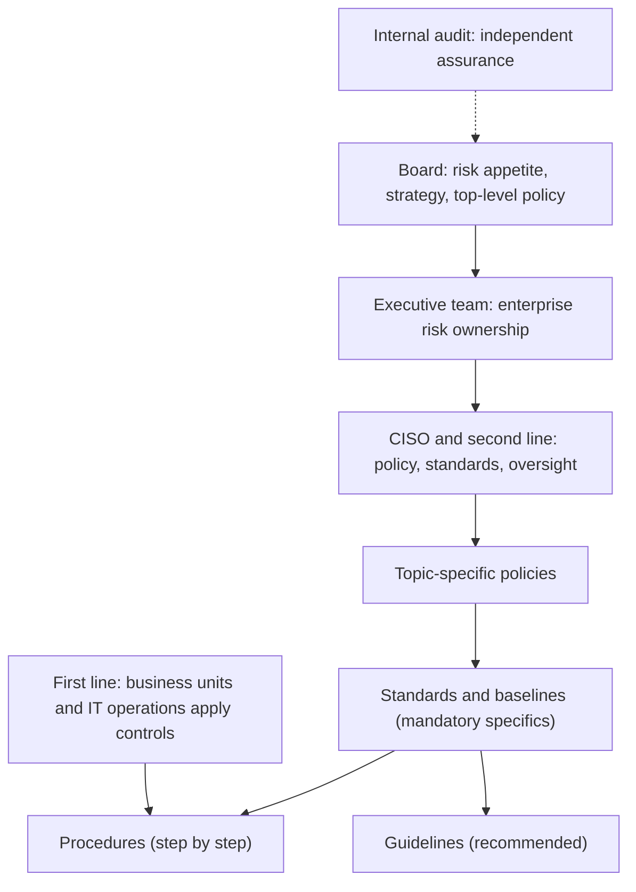

## Introduction

Earlier modules focused on technical controls: firewalls, encryption, secure coding and cloud identity. Yet many major breaches happen in organisations that owned the right technology. Alerts were generated but nobody had the authority or resources to act; a vendor was given network access without anyone owning the risk; a patching policy existed on paper but nobody measured compliance. These are failures of *governance*, the system by which an organisation directs and controls its security so that it serves business objectives and stays within acceptable risk.

This lesson moves the discussion from the server room to the boardroom. You will learn who is accountable for security, how responsibilities flow from the board to individual staff, and how a policy hierarchy turns high-level intent into concrete, enforceable rules. For MSc IT for Business students, this is where technical knowledge becomes managerial influence: the ability to write a policy that people follow, or to explain to a board why a risk needs funding.

## Learning Objectives

- Distinguish security governance from security management and explain why both are needed.
- Identify the roles of the board, executives, CISO, data owners, custodians, users and internal audit in security governance.
- Explain the Three Lines Model and apply it to allocate security responsibilities.
- Design a policy hierarchy of policies, standards, procedures and guidelines with appropriate content at each level.
- Evaluate governance failures using the Target 2013 breach and relate governance to Ghana's Cybersecurity Act, 2020 (Act 1038).

## Prerequisite Knowledge

- Threats, vulnerabilities and risk from Module 1.
- General understanding of organisational structures and management responsibilities.
- Familiarity with the idea of controls from earlier modules.

## Key Terminology

- **Security governance**: The set of responsibilities and practices exercised by the board and executive management to provide strategic direction, ensure objectives are achieved, manage risk and verify that resources are used responsibly.
- **Security management**: The planning, building, running and monitoring of security activities in line with the direction set by governance.
- **Chief Information Security Officer (CISO)**: The senior manager responsible for the information security programme, its strategy and reporting to executives and the board.
- **Data owner**: A senior business role accountable for a dataset, including its classification and who may access it.
- **Data custodian**: The role (often IT) that implements and operates the controls protecting data on behalf of the owner.
- **Policy**: A high-level, management-approved statement of intent and direction that is mandatory and changes infrequently.
- **Standard**: A mandatory, specific requirement that supports a policy, such as a minimum encryption algorithm or MFA requirement.
- **Procedure**: Step-by-step instructions for performing a task in compliance with policies and standards.
- **Guideline**: Recommended, non-mandatory advice that helps people apply policies and standards.

## Detailed Explanation

### Governance versus management

Governance answers *what* the organisation wants to achieve and *how much risk* it will accept; management answers *how* to achieve it. The board sets risk appetite, approves the security strategy and policy, allocates resources and demands evidence that risk is being controlled. Management designs and operates the programme, implements controls and reports performance. When these are confused, two failure modes appear: boards that micro-manage technology without setting direction, and security teams that make risk decisions they have no authority to make.

COBIT 2019, ISACA's framework for governance and management of enterprise information and technology, formalises this separation: governance objectives are framed as *Evaluate, Direct and Monitor*, while management objectives cover planning, building, running and monitoring. NIST's Cybersecurity Framework 2.0 introduced a dedicated **Govern** Function in 2024, recognising that cybersecurity risk management is an enterprise responsibility, not just an IT activity.

### Governance roles and accountabilities

| Role | Key security responsibilities |
|---|---|
| Board of directors | Sets risk appetite; approves strategy and top-level policy; receives regular risk reporting; ensures adequate resources; holds executives accountable |
| Chief executive and executive team | Own enterprise risk; embed security in business decisions; approve risk acceptance above defined thresholds |
| CISO | Leads the security programme; advises on risk; develops policy and standards; reports independently and clearly to executives and the board |
| Data and system owners | Classify data; approve access; accept or treat risks for their assets within delegated limits |
| Data custodians and IT operations | Implement and operate controls: backups, patching, access provisioning, monitoring |
| Data Protection Officer (where designated) | Advises on and monitors compliance with data protection law |
| All staff and contractors | Follow policies; protect credentials; report incidents and suspicious activity |
| Internal audit | Provides independent assurance to the board that controls are designed and operating effectively |

A recurring governance question is where the CISO reports. Reporting solely through the IT function can create a conflict of interest, because the CISO may need to report problems in IT's own work. Many organisations therefore give the CISO a direct line to the chief executive, chief risk officer or a board committee.

### The Three Lines Model

The Institute of Internal Auditors' Three Lines Model (2020) describes how responsibilities are divided. The **first line** consists of the operational managers who own and manage risk day to day (for example IT operations and business units applying controls). The **second line** provides expertise, support, monitoring and challenge on risk matters (for example the CISO's function, risk management and compliance). The **third line**, internal audit, provides independent and objective assurance to the governing body. The governing body is accountable overall, and external assurance providers (external auditors, regulators) sit outside the lines.

### The policy hierarchy

Policy documents form a hierarchy that moves from intent to detail:

1. **Information security policy** (approved by the board or executive): purpose, scope, commitment, roles and responsibilities, principles, consequences of non-compliance, review cycle. Typically a few pages.
2. **Topic-specific policies**: acceptable use, access control, data classification and handling, backup, incident response, supplier security, remote working.
3. **Standards**: mandatory specifics, such as "all remote access requires phishing-resistant MFA" or "laptops must use full-disk encryption".
4. **Baselines**: approved configuration settings for platforms (often derived from CIS Benchmarks).
5. **Procedures**: step-by-step instructions, such as how the service desk verifies identity before resetting a password.
6. **Guidelines**: helpful, non-mandatory advice, such as how to create a memorable passphrase.

The hierarchy matters because each level changes at a different pace and is approved by a different authority. The board should not need to approve a change to the approved encryption algorithm, and a service-desk procedure should not be able to override a policy.

### The policy lifecycle

Policies need an owner, consultation with affected business units, formal approval, communication and training, enforcement and monitoring of compliance, a documented exception process with risk acceptance, and periodic review (commonly annually or after significant change). A policy that is never measured is an aspiration rather than a control.

## Theories, Frameworks and Models

### ISO/IEC 27001 and the ISMS

ISO/IEC 27001:2022 specifies requirements for an information security management system (ISMS): establishing context, leadership commitment, risk assessment and treatment, support, operation, performance evaluation and improvement, following a plan-do-check-act logic. Its Annex A lists reference controls grouped into organisational, people, physical and technological themes, and organisations justify inclusion or exclusion in a Statement of Applicability. Certification by an accredited body gives customers and partners independent evidence of a functioning ISMS.

### Principles of good policy

Effective policies are: aligned with business objectives and risk appetite; clear and concise, written for their audience; enforceable and measurable; technology-neutral at the top level so they do not need constant revision; supported by visible leadership; and reviewed. A useful test is whether a new employee could read the policy and understand what they must do and why.

## Worked Example

**Illustrative scenario.** *Ewurabena Logistics* (fictional), a Tema-based freight forwarder with 300 staff, has one 40-page "IT Security Policy" written five years ago by a former IT manager. It mixes strategy statements with screenshots of firewall settings, names specific products that are no longer used, and has never been approved by the board. Staff are unaware of it.

A redesign proceeds as follows:

| Level | Document | Owner and approver | Example content |
|---|---|---|---|
| Policy | Information Security Policy (3 pages) | CISO drafts; board approves | Commitment, scope, roles, principle of least privilege, risk-based approach, annual review |
| Topic policy | Access Control Policy | CISO; executive committee | Access granted by data owners; joiners-movers-leavers; quarterly reviews of privileged access |
| Standard | Authentication Standard | CISO approves | MFA for all remote and privileged access; password length and screening per NIST SP 800-63B |
| Procedure | Leaver Deprovisioning Procedure | IT operations manager | HR notifies IT on last day; accounts disabled within an agreed time; checklist for cloud and VPN accounts |
| Guideline | Passphrase Guidance | Security awareness lead | How to create and store passphrases with a password manager |

Governance improvements accompany the documents: a quarterly security report to the board covering top risks, key metrics (such as percentage of privileged accounts with MFA and patching within target) and risk acceptances; an exception register; and internal audit coverage of access control in the next audit cycle.

## Diagram

## Ghanaian Business Application

Ghana's Cybersecurity Act, 2020 (Act 1038) established the Cyber Security Authority (CSA) to regulate cybersecurity activities in the country, promote the development of cybersecurity and protect Critical Information Infrastructure (CII). The Act provides for the designation of CII, obligations on CII owners (including incident reporting), the licensing of cybersecurity service providers and the accreditation of cybersecurity establishments and professionals. For organisations in scope, these obligations need clear owners within the governance structure: someone must know whether the organisation's systems are designated CII, who reports incidents to the CSA, and whether security service providers it engages are appropriately licensed.

Sector regulators add further expectations. The Bank of Ghana has issued a cyber and information security directive for the institutions it regulates, which places governance responsibilities on boards and senior management. The Data Protection Act, 2012 (Act 843) adds duties concerning personal data. A Ghanaian governance framework therefore typically maps each legal and regulatory obligation to a named owner, a policy or standard, and evidence of compliance. Students should read the primary instruments rather than relying on secondary summaries, since detailed requirements change over time.

## International Case Study

**Target Corporation (United States), 2013.** During the 2013 holiday shopping season, attackers stole payment card data relating to around 40 million cards and personal information of up to around 70 million customers from the US retailer Target. Public reports, including a 2014 analysis by the US Senate Committee on Commerce, Science and Transportation, describe how attackers first obtained network credentials belonging to a third-party heating, ventilation and air-conditioning (HVAC) contractor, used them to access Target's network, and eventually installed malware on point-of-sale systems. Target had invested in a malware detection system that generated alerts during the attack, but these alerts were not acted on in time.

The governance lessons outweigh the technical ones. **Supplier risk** was not governed: a contractor's access path reached systems processing card data, so network segmentation and supplier access standards were inadequate. **Alert handling** lacked clear authority and escalation: technology produced warnings but the organisation's processes did not ensure decisive action. **Accountability** reached the top: in 2014 Target's chief executive resigned, and the company subsequently appointed its first dedicated chief information security officer, a visible signal that boards were beginning to treat cybersecurity as an enterprise risk.

## Common Misconceptions

- **"Security governance is the IT department's job."** Governance belongs to the board and executives; IT and the CISO implement and advise, but cannot accept enterprise risk on the organisation's behalf.
- **"A longer policy is a better policy."** Top-level policies should be short and stable; detail belongs in standards and procedures that can change without board approval.
- **"Guidelines are mandatory."** Guidelines are recommendations; mandatory requirements belong in policies and standards.
- **"Once a policy is approved, the job is done."** Policies need communication, enforcement, measurement, exception handling and review to function as controls.

## Common Examination Mistakes

- Using "governance" and "management" interchangeably.
- Listing policy, standard, procedure and guideline without explaining how they differ in mandatory status, detail and approval authority.
- Describing roles without stating accountabilities (for example, that data owners, not IT, classify data and approve access).
- Discussing Ghana's Cybersecurity Act without mentioning the Cyber Security Authority or CII, or inventing specific provisions not in the Act.
- Treating the Target breach purely as a malware story and missing supplier governance and alert-handling failures.

## Critical Thinking Questions

1. Should the CISO report to the chief information officer, the chief executive or a board committee? Evaluate the trade-offs.
2. How can a board with no technical members exercise meaningful oversight of cybersecurity?
3. When a business unit requests an exception to a security standard to meet a deadline, who should decide, and on what basis?

## Practical Exercises

1. **Policy deconstruction.** Obtain a published information security policy (many universities and public bodies publish theirs). *Expected output:* a short analysis classifying each section as policy, standard, procedure or guideline content, and recommendations for restructuring.
2. **RACI matrix.** For the process "granting access to the customer database", create a RACI (Responsible, Accountable, Consulted, Informed) matrix across the board, CISO, data owner, IT operations, line manager and internal audit. *Expected output:* a completed matrix with a one-sentence justification for each Accountable assignment.
3. **Regulatory mapping.** Using the text of the Cybersecurity Act, 2020 (Act 1038) and the Data Protection Act, 2012 (Act 843), list obligations relevant to an illustrative Ghanaian SME. *Expected output:* a table mapping each obligation to an owner and the policy or procedure that addresses it.

## Key Takeaways

- Governance sets direction, risk appetite and accountability; management delivers and operates the programme.
- Boards, executives, CISOs, data owners, custodians, users and internal audit have distinct, complementary roles.
- The Three Lines Model separates risk ownership, oversight and independent assurance.
- The policy hierarchy runs from short, stable policies to specific standards, procedures and optional guidelines.
- Act 1038, the Cyber Security Authority and sector regulators make cybersecurity governance a legal as well as a business matter in Ghana.

## Further Reading

- International Organization for Standardization & International Electrotechnical Commission. (2022). *Information security, cybersecurity and privacy protection — Information security management systems — Requirements* (ISO/IEC 27001:2022). ISO.
- ISACA. (2018). *COBIT 2019 framework: Introduction and methodology*. ISACA.
- National Institute of Standards and Technology. (2024). *The NIST Cybersecurity Framework (CSF) 2.0* (NIST CSWP 29). <https://doi.org/10.6028/NIST.CSWP.29>
- Republic of Ghana. (2020). *Cybersecurity Act, 2020 (Act 1038)*.
- Stallings, W., & Brown, L. (2018). *Computer security: Principles and practice* (4th ed.). Pearson.

## Video Resources

- [Cyber Security Authority, Ghana](https://www.csa.gov.gh/) — Cyber Security Authority. Official website of Ghana's cybersecurity regulator, with information on Act 1038, CII and licensing.
- [NIST Cybersecurity Framework](https://www.nist.gov/cyberframework) — National Institute of Standards and Technology. Official CSF 2.0 resources, including material on the Govern Function.
- [Cisco Skills for All](https://skillsforall.com/) — Cisco Networking Academy. Official learning portal with free cybersecurity courses that introduce governance and policy concepts.

## Revision Summary

Security governance is the board and executive system for directing and controlling security: setting risk appetite, approving policy, allocating resources and demanding assurance. Management implements that direction. Clear roles and a structured policy hierarchy make governance operational.

- Roles: board (appetite, oversight), executives (risk ownership), CISO (programme, advice), data owners (classification, access), custodians (operate controls), audit (assurance).
- Three Lines: operational risk owners; oversight and expertise; independent internal audit.
- Hierarchy: policy (intent) to standards and baselines (mandatory specifics) to procedures (steps) and guidelines (advice).
- Frameworks: ISO/IEC 27001:2022 ISMS, COBIT 2019, NIST CSF 2.0 Govern Function.
- Ghana: Act 1038, Cyber Security Authority, CII obligations; sector regulators; Act 843.
- Target (2013): supplier access, unacted alerts, executive accountability.
