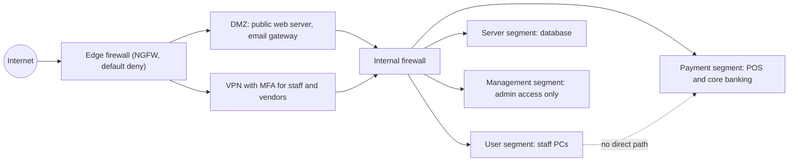

## Introduction

A network is the road system along which both legitimate business and attackers travel. Network security controls decide which journeys are allowed, watch for suspicious traffic and, crucially, limit how far an intruder can go once inside. For decades organisations relied on a hard perimeter with a soft interior: a firewall at the internet edge and few internal barriers. The incidents studied so far in this course show why that model fails. Once an attacker obtains a foothold through phishing or a supplier's credentials, a flat internal network lets them reach everything.

This lesson explains the main types of firewall, how rule sets are evaluated, how to write and audit a rule set in a worked example, and how segmentation, demilitarised zones (DMZs) and zero-trust thinking contain breaches. The 2013 Target breach, in which attackers entered through a heating and ventilation contractor's access, provides a vivid illustration of why segmentation matters.

## Learning Objectives

- Compare packet-filtering, stateful, application-layer (proxy) and next-generation firewalls.
- Apply first-match rule evaluation and a default-deny policy to write a firewall rule set for a small network.
- Analyse a rule set to identify shadowed, overly permissive and redundant rules.
- Explain network segmentation, DMZs and microsegmentation and how they limit lateral movement.
- Evaluate the strengths and limits of perimeter security compared with a zero-trust architecture.

## Prerequisite Knowledge

- Basic networking: IP addresses, ports, TCP and UDP, and the idea of the OSI or TCP/IP model.
- The threat and attack concepts from Modules 1 and 2, especially lateral movement.

## Key Terminology

- **Firewall**: A device or software that enforces a policy about which network traffic may pass between zones.
- **Packet filter**: A firewall that permits or denies individual packets based on header fields such as source and destination addresses, ports and protocol.
- **Stateful inspection**: Firewall operation that tracks the state of connections and allows return traffic belonging to established sessions.
- **Application-layer firewall (proxy)**: A firewall that understands application protocols such as HTTP and can inspect and filter their content.
- **Next-generation firewall (NGFW)**: A firewall combining stateful inspection with application awareness, user identity, intrusion prevention and threat intelligence.
- **DMZ (demilitarised zone)**: A network segment that hosts internet-facing services, separated from both the internet and the internal network.
- **Network segmentation**: Dividing a network into zones with controlled traffic between them to limit the spread of attacks.
- **Intrusion detection or prevention system (IDS/IPS)**: A system that monitors traffic for malicious patterns and alerts (IDS) or blocks (IPS).
- **Zero trust**: A security model that grants no implicit trust based on network location and verifies every access request explicitly.

## Detailed Explanation

### What a firewall decides

A firewall sits between zones of differing trust and evaluates traffic against a policy. At minimum it examines the **5-tuple**: source IP address, destination IP address, source port, destination port and protocol. More advanced firewalls also consider the connection's state, the application in use, the identity of the user and the content of the traffic.

### Types of firewall

| Type | Operates at | Strengths | Limitations |
|---|---|---|---|
| Stateless packet filter | Network and transport headers | Fast, simple, cheap (for example router access control lists) | No awareness of sessions; must explicitly allow return traffic; easily fooled by crafted packets |
| Stateful inspection | Headers plus connection state table | Allows return traffic automatically; blocks unsolicited inbound packets | Does not understand application content |
| Application-layer proxy | Application protocol | Inspects content, can enforce protocol correctness, hides internal hosts | Slower; needs a proxy per protocol |
| Web application firewall (WAF) | HTTP/HTTPS for a specific web application | Filters attacks such as SQL injection patterns | Requires tuning; not a substitute for secure code |
| Next-generation firewall | Multiple layers | Application and user awareness, integrated IPS, TLS inspection | Cost, complexity, privacy questions around decrypting traffic |
| Host-based firewall | Individual endpoint | Protects the device anywhere; limits lateral movement | Must be managed on every host |

These are not mutually exclusive. A typical design uses an NGFW at the internet edge, a WAF in front of public web applications, internal firewalls between segments and host firewalls on every endpoint.

### How rules are evaluated

Most firewalls evaluate rules **top-down, first match wins**: the first rule whose conditions match the traffic determines the action and evaluation stops. Two consequences follow:

1. **Order matters.** A broad "allow" rule placed above a specific "deny" rule *shadows* it, so the deny never takes effect.
2. **The final rule should be default deny.** This implements the fail-safe defaults principle: anything not explicitly permitted is blocked and logged.

Policies should also consider **egress filtering** (traffic leaving the network). Allowing all outbound traffic makes it easy for malware to reach command-and-control servers and for attackers to exfiltrate data.

### Segmentation and the DMZ

Segmentation divides a network into zones such as user workstations, servers, payment systems, management interfaces, guest Wi-Fi and internet-facing services. Traffic between zones passes through a firewall or access control list. A **DMZ** hosts services that must be reachable from the internet, such as a public website or email gateway; if one is compromised, the attacker is still separated from the internal network.

Segmentation can be implemented with virtual LANs (VLANs) and routing access control lists, with internal firewalls, or with **microsegmentation**, in which policies are enforced per workload, often in virtualised or cloud environments. The aim is to ensure that a compromised reception PC cannot even reach the database server, let alone log in to it.

## Theories, Frameworks and Models

### Defence in depth applied to networks

Network controls form several layers: edge filtering, DMZ separation, internal segmentation, host firewalls, intrusion detection and monitoring of logs. Each layer assumes that the previous one might fail.

### From perimeter to zero trust

NIST Special Publication 800-207 describes zero trust architecture. Its core ideas are that no user, device or network location is trusted by default; every access request is authenticated and authorised based on identity, device health and context; access is granted per session with least privilege; and all traffic is monitored. Zero trust does not abolish firewalls; it shifts the main control point from the network boundary to identity and policy enforcement in front of each resource. For organisations with cloud services and remote workers, where the "inside" of the network is no longer clearly defined, this shift is increasingly important.

## Worked Example

### Writing and auditing a rule set

**Illustrative scenario.** *Osu Microfinance* is a fictional microfinance company in Accra. Its network has three zones:

- **Internet**
- **DMZ** 203.0.113.0/28, containing a public web server at 203.0.113.10 (HTTPS on TCP 443)
- **Internal LAN** 10.10.0.0/16, including a database server at 10.10.5.20 (TCP 5432) and staff PCs on 10.10.20.0/24

**Requirements:** the public may reach the website over HTTPS; the web server may query the database; staff may browse the web; administrators on 10.10.99.0/24 may manage servers over SSH; nothing else.

**Initial rule set proposed by a junior administrator:**

| # | Source | Destination | Port/Protocol | Action |
|---|---|---|---|---|
| 1 | Any | 203.0.113.10 | TCP 443 | Allow |
| 2 | Any | Any | TCP 22 | Allow |
| 3 | 203.0.113.10 | 10.10.5.20 | TCP 5432 | Allow |
| 4 | 10.10.20.0/24 | Any | Any | Allow |
| 5 | 10.10.99.0/24 | 10.10.5.20 | TCP 22 | Allow |
| 6 | Any | Any | Any | Deny |

**Audit findings:**

1. **Rule 2 is dangerously permissive.** It allows SSH from the entire internet to every host, exposing servers to password attacks. It also *shadows* rule 5, making the intended restriction meaningless.
2. **Rule 4 is too broad.** Staff PCs can reach any destination on any port, including the database server and the internet on arbitrary ports, which helps malware command and control and data exfiltration.
3. **Rule 5 is redundant** while rule 2 exists, which shows the junior administrator did not understand first-match evaluation.
4. **Rule 6 is correct** as a default deny but should log matches.

**Corrected rule set:**

| # | Source | Destination | Port/Protocol | Action | Comment |
|---|---|---|---|---|---|
| 1 | Any | 203.0.113.10 | TCP 443 | Allow | Public website |
| 2 | 203.0.113.10 | 10.10.5.20 | TCP 5432 | Allow | Web tier to database only |
| 3 | 10.10.99.0/24 | 203.0.113.10, 10.10.5.20 | TCP 22 | Allow | Admin SSH from management subnet only |
| 4 | 10.10.20.0/24 | Web proxy 10.10.1.5 | TCP 8080 | Allow | Staff browsing via filtering proxy |
| 5 | 10.10.1.5 | Any | TCP 80, 443 | Allow | Proxy egress to the web |
| 6 | 10.10.0.0/16 | Internal DNS 10.10.1.53 | UDP/TCP 53 | Allow | Name resolution through monitored resolver |
| 7 | Any | Any | Any | Deny and log | Default deny |

**Reasoning.** Each rule now corresponds to a business requirement, is as narrow as practical and has a comment explaining its purpose. Staff PCs can no longer reach the database directly, so a phished PC cannot query customer data. Egress goes through a proxy and internal DNS, which makes command-and-control traffic easier to detect. Because the state table handles return traffic in a stateful firewall, no explicit inbound rules are needed for staff browsing. A further improvement would be requiring administrators to use a VPN with MFA to reach the management subnet.

## Ghanaian Business Application

- **Branch networks.** Ghanaian banks and microfinance institutions often connect branches over leased lines or VPNs to a head office. If every branch PC can reach every head-office server, a single compromised branch endangers the whole institution. Segmentation of teller systems, administrative systems and core banking is a priority.
- **Shared office buildings.** Many SMEs in Accra and Kumasi share building Wi-Fi or use consumer-grade routers. A separate guest network and changing default router credentials are basic segmentation steps.
- **Point-of-sale and mobile money terminals** should sit on their own segment, isolated from general office PCs, especially where staff browse the web or use personal email.
- **Third-party access.** Suppliers who maintain air conditioning, CCTV or software often require remote access. Access should be granted to specific systems only, through monitored, time-limited accounts with MFA, never to the whole network.
- **Regulatory alignment.** Institutions subject to sector cybersecurity requirements, such as those issued by the Bank of Ghana, are commonly expected to demonstrate network segmentation and perimeter controls; the current official directives should be consulted for specifics.

## International Case Study

### The 2013 Target breach

In late 2013, attackers stole payment card data for about 40 million customers of Target, a large US retailer, together with personal information on many more. A 2014 report by the majority staff of the US Senate Committee on Commerce, Science and Transportation analysed the breach using the Cyber Kill Chain. Publicly reported facts include:

- The attackers first stole network credentials from Fazio Mechanical Services, a heating, ventilation and air-conditioning (HVAC) contractor that had access to Target's systems for billing and project management.
- Using that access, the attackers moved from the vendor-facing environment into parts of Target's network and eventually installed malware on point-of-sale terminals to capture card data.
- Target's security tools generated alerts about the malware, but the alerts were not acted upon in time.
- Stolen data was moved through internal staging servers before being sent out of the network.

**Network security lessons:**

1. **Segmentation failure.** A supplier portal should never provide a path to payment terminals. Strong segmentation between vendor access, corporate systems and the cardholder data environment would have broken the chain.
2. **Third-party access control.** Vendor accounts should be limited to the specific systems required, protected with MFA and monitored.
3. **Egress filtering and monitoring.** Unusual outbound transfers from internal servers to external destinations should trigger investigation.
4. **People and process.** Detection tools have value only if alerts are triaged and acted upon.

## Diagram

## Common Misconceptions

- "A firewall at the edge makes the internal network safe." Phishing, stolen credentials and supplier access bypass the perimeter; internal segmentation and monitoring are essential.
- "Rule order does not matter if all the rules are correct." Under first-match evaluation, a broad rule placed early can shadow later, more specific rules.
- "Outbound traffic is harmless." Unrestricted egress lets malware reach command-and-control servers and allows data exfiltration.
- "Zero trust means getting rid of firewalls." Zero trust moves the emphasis to identity and per-resource policy but still uses network controls as one layer.
- "A web application firewall fixes insecure code." A WAF can block known attack patterns, but secure coding remains the primary control.

## Common Examination Mistakes

- Writing rule sets without a final default-deny rule.
- Failing to recognise shadowed rules when auditing a given rule set.
- Confusing stateless and stateful firewalls, especially regarding return traffic.
- Describing segmentation only as VLANs without explaining the controls that enforce traffic between them.
- Using the Target case without explaining the vendor access and segmentation path.

## Critical Thinking Questions

1. Should organisations decrypt and inspect TLS traffic at the firewall? Weigh security benefits against privacy, legal and technical risks.
2. How would you justify the cost of internal segmentation to the board of a medium-sized Ghanaian bank?
3. In a fully cloud-based SME with remote staff, where should the "perimeter" be?
4. The Target alerts were reportedly not acted upon. What does this suggest about relying on technology purchases to improve security?
5. When does a host-based firewall provide protection that a network firewall cannot?

## Practical Exercises

1. **Rule set design.** Design a rule set for a small office with a guest Wi-Fi, a staff network, a network printer and a file server. Guests may reach only the internet; staff may print and use the file server; nobody may reach the printer's management interface except IT. Expected output: a numbered rule table with source, destination, port, action and comment, ending in default deny.
2. **Host firewall review.** On a computer you own, open the built-in firewall settings (for example Windows Defender Firewall or the macOS firewall). List the inbound rules or allowed applications and remove any you do not need. Expected output: a before-and-after list with justification for each change.
3. **Segmentation map.** Draw the network of a fictional pharmacy chain with three branches and a head office, showing zones and allowed flows between them. Expected output: a labelled diagram and a table of permitted inter-zone flows.
4. **Structured learning.** Complete the network security or network defence material on Cisco Skills for All, which provides packet-tracer style simulations in a legal environment. Never scan networks you do not own or have explicit written permission to test. Expected output: a short summary of two firewall configurations practised.

## Key Takeaways

- Firewalls range from stateless packet filters to stateful, application-layer and next-generation designs; real networks combine several types.
- First-match evaluation makes rule order critical; every rule set should end with a logged default deny.
- Egress filtering is as important as inbound filtering for detecting and preventing command-and-control and exfiltration.
- Segmentation, DMZs and microsegmentation limit lateral movement after an initial compromise.
- Zero trust shifts control towards identity and per-request verification, complementing rather than replacing network defences.

## Further Reading

- Scarfone, K., & Hoffman, P. (2009). *Guidelines on firewalls and firewall policy* (NIST Special Publication 800-41 Rev. 1). National Institute of Standards and Technology. <https://doi.org/10.6028/NIST.SP.800-41r1>
- Rose, S., Borchert, O., Mitchell, S., & Connelly, S. (2020). *Zero trust architecture* (NIST Special Publication 800-207). National Institute of Standards and Technology. <https://doi.org/10.6028/NIST.SP.800-207>
- U.S. Senate Committee on Commerce, Science, and Transportation. (2014). *A "kill chain" analysis of the 2013 Target data breach*. Majority Staff Report.
- Stallings, W., & Brown, L. (2018). *Computer security: Principles and practice* (4th ed.). Pearson.

## Video Resources

- [Cisco Skills for All](https://skillsforall.com/): Cisco Networking Academy. Free courses on networking and network defence, including firewall and segmentation concepts with simulations.
- [NIST Computer Security Resource Center](https://csrc.nist.gov/): National Institute of Standards and Technology. Official source for SP 800-41 and SP 800-207, with project pages on zero trust.

## Revision Summary

Firewalls enforce traffic policy between zones, from simple packet filters to stateful, application-layer and next-generation devices. Rules are evaluated top-down with first match winning, so order matters and every set should end in a logged default deny. Segmentation, DMZs and zero trust limit what an attacker can reach after the perimeter fails, as the Target breach showed.

- Stateless vs stateful: stateful tracks sessions and handles return traffic.
- First match wins; watch for shadowed and over-broad rules.
- Filter egress as well as ingress.
- DMZ for public services; segment users, servers, payments and management.
- Zero trust: verify every request; no implicit trust by location.
- Target 2013: HVAC vendor credentials, weak segmentation, ignored alerts.
