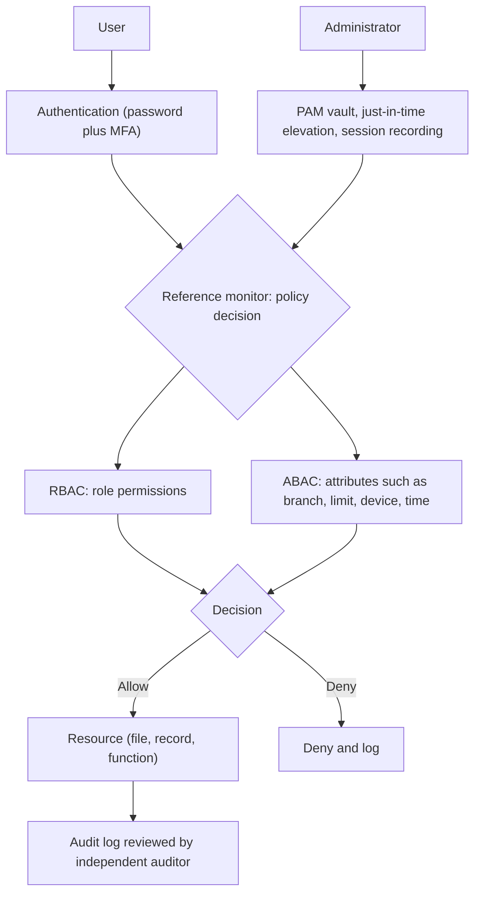

## Introduction

Networks carry data, but it is on endpoints and servers that data is created, stored and processed, and it is there that most attacks ultimately land. A phishing email becomes dangerous when it runs code on a laptop; ransomware does its damage when it gains enough privileges on servers to encrypt files and delete backups. Operating system security, endpoint protection and access control therefore form the last and often decisive line of defence.

This lesson covers three closely linked topics. First, how operating systems enforce security and how they are hardened. Second, the layered tools used to protect endpoints, from antivirus to endpoint detection and response (EDR). Third, the models used to decide who may do what, from discretionary access control to attribute-based policies, with particular attention to the principle of least privilege and the management of powerful administrator accounts. The Edward Snowden disclosures of 2013 illustrate how broad privileged access, even in a highly security-conscious organisation, can lead to massive data loss.

## Learning Objectives

- Explain how operating systems enforce security through user accounts, privilege separation, file permissions and memory protection.
- Apply hardening practices, including patching, secure configuration baselines and removal of unnecessary services, to a server or workstation.
- Compare antivirus, EDR, application allow-listing, disk encryption and mobile device management as endpoint controls.
- Compare discretionary, mandatory, role-based and attribute-based access control models.
- Design a role-based access scheme applying least privilege, segregation of duties and privileged access management.

## Prerequisite Knowledge

- The CIA triad and Saltzer and Schroeder principles from Module 1.
- Familiarity with using Windows, macOS or Linux and with the idea of an administrator account.

## Key Terminology

- **Hardening**: Reducing a system's attack surface by removing unnecessary software and services, applying secure settings and keeping it patched.
- **Attack surface**: The total set of points through which an attacker could try to enter or extract data from a system.
- **Kernel**: The core of the operating system that controls hardware, memory and processes and enforces security boundaries.
- **Endpoint detection and response (EDR)**: Software that records endpoint activity, detects suspicious behaviour and supports investigation and containment.
- **Application allow-listing**: Permitting only approved applications to run, blocking everything else by default.
- **Discretionary access control (DAC)**: A model in which owners of resources decide who may access them.
- **Mandatory access control (MAC)**: A model in which a central policy, often based on security labels, determines access and users cannot override it.
- **Role-based access control (RBAC)**: A model in which permissions are assigned to roles and users acquire permissions by being assigned roles.
- **Attribute-based access control (ABAC)**: A model in which access decisions evaluate attributes of the user, resource, action and environment against policy rules.
- **Privileged access management (PAM)**: Processes and tools for controlling, monitoring and auditing accounts with elevated rights.

## Detailed Explanation

### How operating systems enforce security

Modern operating systems provide several built-in protections:

- **User accounts and authentication** distinguish people and services so that actions can be attributed (accountability).
- **Privilege separation**: the kernel runs in a privileged mode; ordinary applications run in user mode and must request sensitive operations through controlled system calls. Windows User Account Control and Linux `sudo` let users perform administrative actions only when needed.
- **File system permissions** control reading, writing and executing files. On Linux, each file has owner, group and other permissions; on Windows, access control lists (ACLs) specify rights for users and groups.
- **Memory protections** such as address space layout randomisation (ASLR) and data execution prevention (DEP) make exploitation of software bugs harder.
- **Secure and measured boot** verify that the bootloader and kernel are signed and unaltered, defending against rootkits that load before the operating system.
- **Logging** records security-relevant events such as logins, privilege use and policy changes.

### Hardening

Hardening applies the principle of economy of mechanism: less software means fewer vulnerabilities. Standard practices include:

1. **Patch management**: apply security updates promptly, prioritising internet-facing systems and actively exploited vulnerabilities.
2. **Secure configuration baselines**: use published benchmarks, such as those from the Center for Internet Security (CIS), and deviate only with documented reasons.
3. **Remove or disable** unnecessary services, ports, default accounts and legacy protocols (for example SMBv1, which WannaCry exploited).
4. **Change default credentials** and enforce strong authentication.
5. **Enable host firewalls**, disk encryption and logging.
6. **Use supported software**: an operating system that no longer receives security updates cannot be hardened adequately, a real issue where unlicensed or end-of-life software is common.

### Endpoint protection layers

| Control | What it does | Limitation |
|---|---|---|
| Antivirus (signature-based) | Detects known malicious files | Misses new variants and "living off the land" attacks using legitimate tools |
| Next-generation antivirus | Adds behavioural and machine-learning detection | May produce false positives; still focuses on prevention |
| EDR | Records process, file and network activity; detects suspicious patterns; allows remote isolation of a device | Needs skilled people to triage alerts; licence cost |
| Application allow-listing | Only approved programs can run | Administrative effort to maintain the list |
| Full-disk encryption | Protects data if a device is lost or stolen | No protection while the device is unlocked and running |
| Mobile device management (MDM) | Enforces policy on phones and tablets; allows remote wipe | Privacy concerns on personally owned devices |
| Local administrator removal | Users run as standard users | Requires a process for legitimate software installation |

Removing local administrator rights is one of the most cost-effective endpoint controls: much malware needs administrative privileges to install persistently, disable defences or spread.

### Access control models

**DAC** is the default on most personal computers and file shares: a file's owner grants access to others. It is flexible but prone to "permission sprawl" because individuals share generously and rarely revoke.

**MAC** assigns labels to subjects and objects (for example *Confidential* and *Secret*) and enforces a central policy that users cannot override. The Bell-LaPadula model, designed for confidentiality, enforces "no read up" and "no write down"; the Biba model, designed for integrity, enforces the reverse. MAC suits military and some government settings; Linux implementations such as SELinux apply mandatory policies to processes.

**RBAC** assigns permissions to roles such as *Teller*, *Branch Manager* or *Auditor* and assigns users to roles. It scales well and supports least privilege and segregation of duties, and it is the most common model in business applications.

**ABAC** evaluates attributes: a policy might allow "a loan officer to approve loans up to GH₵ 50,000 for customers in their own branch during business hours from a managed device". ABAC is expressive and supports zero-trust decisions but is more complex to design and audit.

## Theories, Frameworks and Models

### Least privilege and its supporting practices

Least privilege means every user, process and service receives only the access needed for its current task, for no longer than necessary. Supporting practices include:

- **Segregation of duties**: no single person can initiate, approve and record a sensitive transaction.
- **Need to know**: access to information is limited to those who need it for their work, even within a role.
- **Joiner-mover-leaver processes**: access is granted on joining, adjusted when someone changes role and removed promptly on leaving.
- **Periodic access reviews**: managers recertify their staff's access, removing accumulated rights.
- **Privileged access management**: separate administrator accounts from everyday accounts; store privileged credentials in a vault; require MFA; grant **just-in-time** elevation for a limited period; record privileged sessions; apply **two-person control** for the most sensitive operations.

### The reference monitor concept

The reference monitor is a classic abstract model: an access control mechanism that mediates every access (complete mediation), is tamper-proof and is small enough to be verified. Real operating system security kernels aim to approximate it. It is a useful lens for evaluating whether a given design genuinely enforces policy or can be bypassed.

## Worked Example

### Designing RBAC for a bank branch system

**Illustrative scenario.** *Kente Savings and Loans* is a fictional savings and loans company in Accra. Its core system supports these actions: view customer record (A1), post deposit or withdrawal (A2), reverse a transaction (A3), open account (A4), approve loan (A5), change interest rates (A6), view audit logs (A7) and manage user accounts (A8).

**Step 1: define roles from job functions.**

| Permission | Teller | Customer service officer | Branch manager | Loan officer | Internal auditor | System administrator |
|---|---|---|---|---|---|---|
| A1 View customer record | Yes | Yes | Yes | Yes | Read-only | No |
| A2 Post transaction | Yes | No | No | No | No | No |
| A3 Reverse transaction | No | No | Yes (with reason) | No | No | No |
| A4 Open account | No | Yes | Yes | No | No | No |
| A5 Approve loan | No | No | Yes (above threshold) | Yes (up to limit) | No | No |
| A6 Change interest rates | No | No | No | No | No | No (head office treasury role only) |
| A7 View audit logs | No | No | Own branch | No | Yes | No |
| A8 Manage user accounts | No | No | No | No | No | Yes |

**Step 2: check segregation of duties.** A teller can post but not reverse transactions, so a teller cannot hide theft by posting and then reversing. The administrator can manage accounts but has no business permissions and cannot view audit logs, which the auditor reviews independently. The person who creates user accounts should not be the person who approves role assignments; approvals come from the branch manager.

**Step 3: apply least privilege and context.** Add ABAC-style conditions where risk justifies it: reversals above a threshold require a second manager; loan officers can approve only within their limit and branch; administrative actions require MFA and a just-in-time request.

**Step 4: operating system level.** On branch PCs, staff use standard accounts; only IT holds local administrator credentials, each unique per device (so one stolen password cannot unlock every PC), stored in a vault. On the database server, the application uses a service account with only the database permissions it needs, and no person logs in with that account.

**Step 5: plan reviews.** Quarterly access recertification by branch managers; immediate removal of access when staff leave; alerts on any use of emergency "break-glass" accounts.

### A Linux permission example

A file holding branch reports should be readable and writable by its owner, readable by the branch group, and inaccessible to others. The permission `640` (owner read and write `6`, group read `4`, others none `0`) achieves this, as in `rw-r-----`. Setting it to `777` (everyone read, write and execute) would be a classic least-privilege failure.

## Ghanaian Business Application

- **Shared accounts.** Many Ghanaian SMEs and some public offices use a single shared login on office computers or business applications. This destroys accountability and makes insider fraud almost impossible to investigate. Individual accounts, even on a small scale, are a priority.
- **Unsupported and unlicensed software.** Older or unlicensed operating systems may not receive security updates. The cost of licensed, supported software should be weighed against the risk of ransomware and data loss.
- **Mobile devices.** Staff often use personal phones for business email and mobile money operations. A simple MDM policy or at least mandatory screen locks, encryption and the ability to remove business data protects the organisation while respecting personal privacy.
- **Mobile money agents and tellers.** Role design similar to the worked example, with limits and dual control for reversals, reduces insider fraud.
- **Data protection compliance.** The Data Protection Act, 2012 (Act 843) expects appropriate measures to prevent unauthorised access to personal data; documented access control, access reviews and logs are evidence of such measures.

## International Case Study

### The 2013 Snowden disclosures and privileged access

In 2013, Edward Snowden, a contractor working as a systems administrator for the US National Security Agency (NSA), copied a very large number of classified documents and provided them to journalists. Whatever one's view of his motives, the incident is widely studied as an insider risk and privileged access case:

- As a systems administrator, he had broad access to systems and data repositories that went well beyond what any single analyst would need.
- Public reporting indicated that he was able to gather material across many systems without effective detection at the time.
- Following the disclosures, NSA leadership publicly stated that the agency would introduce a **two-person rule** for system administrators working with sensitive data, and reduce the number of administrators.

**Lessons for organisations:**

1. Administrators are the most privileged insiders; their access should be partitioned, monitored and subject to two-person control for sensitive operations.
2. Least privilege must apply to technical staff, not only to business users.
3. Monitoring of privileged activity, including unusual volumes of data access, is essential.
4. Insider risk programmes must balance trust and monitoring with clear policies and legal safeguards.

## Diagram

## Common Misconceptions

- "Administrators need unrestricted access to do their jobs." Administrators need specific privileges at specific times; just-in-time elevation and separation of duties reduce risk without preventing work.
- "Antivirus is endpoint security." Antivirus is one layer; patching, hardening, least privilege, EDR and encryption are also needed.
- "RBAC automatically enforces least privilege." Roles can be defined too broadly, and users accumulate roles over time; regular review is still required.
- "Disk encryption protects data from malware." Encryption protects data on lost or stolen devices; once the device is unlocked, malware can read the data like any user.
- "Shared accounts are acceptable in small businesses because everyone is trusted." Shared accounts remove accountability and make fraud and mistakes impossible to trace.

## Common Examination Mistakes

- Confusing MAC with RBAC, or describing MAC as something users can configure.
- Mixing up Bell-LaPadula (confidentiality) with Biba (integrity).
- Designing role matrices that violate segregation of duties, such as allowing one role to both post and reverse transactions.
- Listing hardening steps without linking them to specific threats.
- Neglecting privileged accounts and service accounts when discussing least privilege.

## Critical Thinking Questions

1. How would you implement least privilege in a five-person Ghanaian business where staff regularly cover for one another?
2. Is ABAC worth its complexity for a medium-sized bank, or is well-designed RBAC sufficient?
3. Should employers be allowed to install EDR or MDM on employees' personally owned phones used for work? What safeguards would make this acceptable?
4. What signals might have helped detect large-scale data gathering by a privileged insider?
5. When, if ever, is it acceptable to grant users local administrator rights on their workstations?

## Practical Exercises

1. **Harden your own device.** On a computer you own, confirm automatic updates are enabled, create a standard user account for daily use if you currently use an administrator account, enable full-disk encryption and the host firewall. Expected output: a checklist with each setting's before and after state.
2. **Permission exercise.** On a Linux virtual machine you own, create a group and a file, then set permissions so that the owner can read and write, the group can read and others have no access. Expected output: the commands used and the output of `ls -l` showing `rw-r-----`.
3. **Role matrix.** Design an RBAC matrix for a fictional hospital records system with at least five roles and six permissions, and identify two segregation-of-duties rules. Expected output: a matrix and a paragraph justifying the design.
4. **Baseline comparison.** Download a CIS Benchmark for an operating system you use (registration may be required) and compare five recommendations with your own device's configuration. Expected output: a table of recommendation, current setting and action taken.

## Key Takeaways

- Operating systems enforce security through accounts, privilege separation, permissions, memory protections and secure boot; hardening reduces attack surface.
- Endpoint protection layers antivirus, EDR, allow-listing, encryption and MDM; removing local administrator rights is highly effective.
- DAC, MAC, RBAC and ABAC offer increasing central control or expressiveness; RBAC is the business default and ABAC adds context.
- Least privilege requires segregation of duties, joiner-mover-leaver processes, access reviews and privileged access management.
- Privileged insiders, as the Snowden case shows, need partitioned, monitored and two-person-controlled access.

## Further Reading

- Saltzer, J. H., & Schroeder, M. D. (1975). The protection of information in computer systems. *Proceedings of the IEEE, 63*(9), 1278-1308.
- Stallings, W., & Brown, L. (2018). *Computer security: Principles and practice* (4th ed.). Pearson.
- Anderson, R. (2020). *Security engineering: A guide to building dependable distributed systems* (3rd ed.). Wiley.
- Rose, S., Borchert, O., Mitchell, S., & Connelly, S. (2020). *Zero trust architecture* (NIST Special Publication 800-207). National Institute of Standards and Technology. <https://doi.org/10.6028/NIST.SP.800-207>

## Video Resources

- [Cisco Skills for All](https://skillsforall.com/): Cisco Networking Academy. Free courses including endpoint security and operating system protection modules with hands-on activities.
- [CISA cybersecurity resources](https://www.cisa.gov/): Cybersecurity and Infrastructure Security Agency. Official guidance on patching, secure configuration and protecting privileged accounts.

## Revision Summary

Endpoints and servers are where attacks succeed or fail. Hardening, patching and layered endpoint controls reduce compromise, while access control models (DAC, MAC, RBAC, ABAC) decide who may do what. Least privilege, segregation of duties and privileged access management limit the damage any single account, including an administrator's, can cause.

- Harden: patch, baseline, remove services, change defaults.
- Remove local admin rights; use EDR and disk encryption.
- DAC = owner decides; MAC = central labels; RBAC = roles; ABAC = attributes.
- Bell-LaPadula protects confidentiality; Biba protects integrity.
- PAM: vault, MFA, just-in-time, session recording, two-person control.
- Snowden 2013: broad administrator access led to two-person rule.
