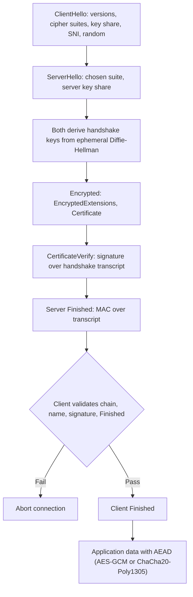

## Introduction

Almost everything a modern business does online, from customers logging in to mobile banking to administrators managing servers, depends on protocols that protect data as it crosses untrusted networks. When these protocols are designed and configured well, users rarely notice them: a padlock in the browser or a silent VPN connection. When they fail, through outdated versions, misconfiguration or implementation bugs, attackers can read or alter traffic, impersonate servers or steal keys.

This lesson explains the purpose and operation of the most important secure protocols: Transport Layer Security (TLS), Secure Shell (SSH), virtual private networks (VPNs) and Domain Name System Security Extensions (DNSSEC). The TLS 1.3 handshake is walked through step by step because it brings together the cryptographic building blocks covered in Module 4: key exchange, digital signatures, certificates and symmetric encryption. The 2014 Heartbleed vulnerability illustrates how a single implementation flaw in widely used software can undermine an otherwise sound protocol.

## Learning Objectives

- Explain the security goals of a secure channel: confidentiality, integrity, server (and optionally client) authentication and forward secrecy.
- Describe step by step the TLS 1.3 full handshake and identify what each message achieves.
- Compare SSH, IPsec VPNs and TLS-based VPNs in terms of purpose, layer and typical business use.
- Explain what DNSSEC protects (authenticity and integrity of DNS answers) and what it does not (confidentiality).
- Evaluate a protocol configuration and recommend improvements, such as disabling legacy versions.

## Prerequisite Knowledge

- Basic networking: TCP/IP, ports and DNS name resolution.
- An outline understanding of encryption and certificates (covered in depth in Module 4; a brief explanation is given here).

## Key Terminology

- **Secure channel**: A communication path that provides confidentiality, integrity and authentication between two endpoints over an untrusted network.
- **TLS (Transport Layer Security)**: The standard protocol for securing application traffic such as HTTPS, email transport and many APIs; TLS 1.3 is the current version.
- **Handshake**: The initial exchange in which parties agree parameters, authenticate and derive shared session keys.
- **Cipher suite**: The set of algorithms used in a session; in TLS 1.3 it names the authenticated encryption algorithm and hash function.
- **Ephemeral Diffie-Hellman (ECDHE/DHE)**: Key exchange using temporary key pairs generated per session, providing forward secrecy.
- **Forward secrecy**: The property that compromise of a server's long-term private key does not reveal past session keys.
- **SSH (Secure Shell)**: A protocol for secure remote login, command execution and file transfer.
- **VPN (virtual private network)**: A protected tunnel that carries traffic between networks or from a user's device to a network over an untrusted network.
- **DNSSEC**: Extensions to DNS that let resolvers verify, using digital signatures, that DNS answers are authentic and unaltered.

## Detailed Explanation

### What a secure channel must achieve

A secure channel protocol must provide:

1. **Confidentiality**: eavesdroppers on the café Wi-Fi or an internet exchange cannot read the data.
2. **Integrity**: any modification of data in transit is detected.
3. **Authentication**: at least the server proves its identity, so the client is not talking to an impostor; optionally the client proves its identity too (mutual authentication).
4. **Forward secrecy**: recording traffic today and stealing the server's key next year should not let an attacker decrypt today's traffic.

Encryption alone gives only the first property. A protocol that encrypts traffic perfectly but connects you to an attacker's server has failed, which is why authentication through certificates is central to TLS.

### TLS in context

TLS operates above TCP and below application protocols. HTTPS is HTTP carried over TLS, typically on TCP port 443. TLS 1.3, standardised in RFC 8446 in 2018, simplified and strengthened earlier versions by removing obsolete algorithms (such as RSA key transport, static Diffie-Hellman, RC4 and CBC-mode cipher suites), requiring forward secrecy, encrypting more of the handshake and reducing the full handshake to one round trip. SSL 2.0, SSL 3.0, TLS 1.0 and TLS 1.1 are all deprecated and should be disabled.

### SSH

SSH provides secure remote administration of servers and network devices, replacing the insecure Telnet and rlogin protocols, and supports secure file transfer (SFTP and SCP) and port forwarding. Its transport layer negotiates algorithms and performs a Diffie-Hellman key exchange; the server authenticates with a host key, and the client checks that key against a stored fingerprint (the "trust on first use" prompt users see on first connection). Users then authenticate, preferably with public-key authentication rather than passwords. Good practice includes disabling password login for administrators, protecting private keys with passphrases or hardware tokens, restricting which source networks may connect and never exposing SSH for privileged accounts directly to the whole internet.

### VPNs

| VPN type | Layer | Typical use | Notes |
|---|---|---|---|
| IPsec site-to-site | Network layer | Linking a branch office to head office | Encrypts all IP traffic between gateways; uses IKE for key exchange |
| IPsec remote access | Network layer | Staff laptops connecting to the corporate network | Requires client software |
| TLS (SSL) VPN | Transport/application | Remote access through a client or browser portal | Easier through restrictive networks; gateway devices are frequent attack targets and must be patched promptly |
| WireGuard | Network layer | Modern lightweight tunnels | Small codebase, modern fixed algorithms |

A VPN protects traffic in transit and controls who can reach the network, but it is not a complete security solution. If a VPN account has a weak password and no MFA, as in the Colonial Pipeline case studied earlier, it becomes an attacker's front door. Zero-trust approaches increasingly replace broad network-level VPN access with per-application access decisions.

### DNSSEC

The Domain Name System translates names such as a bank's domain into IP addresses. Traditional DNS has no built-in authentication, so attackers who can inject forged responses (cache poisoning) can redirect users to fake sites. DNSSEC adds digital signatures to DNS records. A validating resolver checks a chain of signatures from the DNS root, through the top-level domain (for example `.gh` or `.com`), down to the domain's own zone. If the signature does not verify, the answer is rejected.

DNSSEC provides **authenticity and integrity** of DNS data, **not confidentiality**: queries and answers remain readable. Privacy is addressed by separate protocols, DNS over TLS and DNS over HTTPS. DNSSEC also does not protect against a legitimately signed but malicious domain, such as a lookalike domain registered by a fraudster.

## Step-by-Step Guide

### The TLS 1.3 full handshake

Consider a customer's phone connecting to a bank's API server. The handshake proceeds as follows.

**Step 1: ClientHello (client → server).** The client sends:
- the TLS versions it supports (indicating 1.3);
- a random value (nonce);
- a list of supported cipher suites, for example `TLS_AES_128_GCM_SHA256` and `TLS_CHACHA20_POLY1305_SHA256`;
- supported key-exchange groups (for example X25519) and one or more **key shares**, which are ephemeral Diffie-Hellman public values;
- the Server Name Indication (SNI), naming the site it wants;
- supported signature algorithms.

Because the client guesses the key-exchange group and sends its key share immediately, TLS 1.3 can complete in one round trip.

**Step 2: ServerHello (server → client).** The server selects the version, a cipher suite and a key-exchange group, and sends its own ephemeral key share and random value. At this point **both sides can compute the same shared secret** from the two Diffie-Hellman key shares. Using a key derivation function (HKDF), each derives handshake encryption keys. Everything after this message is encrypted.

**Step 3: EncryptedExtensions (server → client, encrypted).** Additional parameters, such as the application protocol negotiated (for example HTTP/2).

**Step 4: Certificate (server → client, encrypted).** The server's certificate chain, binding the server's name to its long-term public key and signed by a certificate authority.

**Step 5: CertificateVerify (server → client, encrypted).** The server signs a hash of the entire handshake so far using its long-term private key. This proves possession of the private key that matches the certificate and binds the ephemeral key exchange to the server's identity, so a man-in-the-middle cannot substitute its own key share.

**Step 6: Finished (server → client, encrypted).** A message authentication code over the whole handshake transcript, proving that the server saw the same messages as the client and that nothing was tampered with.

**Step 7: Client verification.** The client:
- validates the certificate chain up to a trusted root certificate authority, checks validity dates, revocation information where available and that the certificate's name matches the requested server name;
- verifies the CertificateVerify signature with the certificate's public key;
- verifies the server's Finished message.
If any check fails, the client aborts. This is where a fake bank server is rejected.

**Step 8: Client Finished (client → server).** The client sends its own Finished message. If the server requested client authentication (mutual TLS), the client first sends its own Certificate and CertificateVerify.

**Step 9: Application data.** Both sides derive application traffic keys and exchange data protected by authenticated encryption (AES-GCM or ChaCha20-Poly1305), which provides confidentiality and integrity together.

**Why this design gives forward secrecy:** the session keys came from ephemeral Diffie-Hellman values that are discarded after the session. The server's long-term private key was used only to *sign*, not to encrypt the key. Stealing that key later does not reveal recorded sessions.

**Comparison with TLS 1.2:** TLS 1.2 normally needed two round trips, sent the certificate unencrypted and allowed RSA key transport, in which the client encrypted the pre-master secret with the server's RSA public key, giving no forward secrecy. TLS 1.3 also offers session resumption and optional "0-RTT" early data, which is faster but can be replayed, so it should be used only for requests that are safe to repeat.

## Ghanaian Business Application

**Illustrative scenario.** *Volta Agro Exports*, a fictional exporter in Tema, has a head office, a warehouse in Kumasi and staff who work from home. Its systems include a customer web portal, an email service and an on-premises accounting server. An external review finds:

| Finding | Risk | Recommendation |
|---|---|---|
| Web portal accepts TLS 1.0 and 1.1 | Downgrade and weak cipher attacks; non-compliance with payment industry expectations | Allow only TLS 1.2 and 1.3 with modern cipher suites; enable HTTP Strict Transport Security |
| Accounting server's administrative interface uses plain HTTP inside the LAN | Credentials readable by any compromised device on the LAN | Enable HTTPS with an internal certificate; restrict access to the management segment |
| Routers managed by Telnet | Passwords sent in clear text | Switch to SSH with key-based authentication; disable Telnet |
| Warehouse connected to head office over the public internet without a tunnel | Interception and alteration of stock data | IPsec site-to-site VPN between gateways |
| Remote staff use a TLS VPN with password-only login; gateway firmware two years old | Credential attacks and exploitation of known VPN gateway flaws | Enforce MFA; patch the gateway urgently and subscribe to vendor advisories |
| Company domain not signed with DNSSEC | DNS forgery could redirect customers | Investigate DNSSEC support with the registrar and DNS host; also monitor for lookalike domains |

Such reviews are inexpensive relative to the risk. Ghanaian firms handling payments or personal data should also consider their obligations under the Data Protection Act, 2012 (Act 843), which requires appropriate technical measures to protect personal data, including in transit. Public Wi-Fi in hotels, airports and cafés is common, so staff should be taught to rely on TLS and the VPN rather than on the Wi-Fi password for protection.

## International Case Study

### Heartbleed (2014)

In April 2014 researchers disclosed a serious vulnerability, catalogued as CVE-2014-0160 and nicknamed Heartbleed, in OpenSSL, an open-source library used by a very large proportion of web servers and many other devices to implement TLS. The flaw was in OpenSSL's implementation of the TLS "heartbeat" extension, which lets one side check that the other is still alive. Because the code did not properly check the length field in heartbeat requests, a remote party could cause the server to return up to 64 kilobytes of its memory per request. That memory could contain session cookies, passwords and, in some cases, the server's private key. Exploitation left little trace in normal logs.

**Lessons:**

- **Protocol design versus implementation.** TLS itself was not broken; a coding error (a missing bounds check) in one implementation undermined it. Secure protocols depend on secure software.
- **Forward secrecy matters.** Servers using RSA key transport faced the risk that recorded past traffic could be decrypted with a leaked private key; servers using ephemeral Diffie-Hellman limited that exposure. This contributed to the industry's move to make forward secrecy mandatory in TLS 1.3.
- **Response requires more than patching.** Organisations had to patch OpenSSL, then generate new key pairs, obtain and install new certificates, revoke old certificates and invalidate user sessions and passwords where appropriate.
- **Open-source sustainability.** The incident drew attention to under-resourced projects maintaining critical infrastructure, and led to industry funding initiatives for core open-source projects.

## Diagram

## Common Misconceptions

- "The padlock means the website is trustworthy." It means the connection is encrypted to a server that holds a valid certificate for that name; a fraudster's lookalike domain can also have a valid certificate.
- "TLS encrypts the data with the server's public key." In TLS 1.3 the session keys come from ephemeral Diffie-Hellman; the certificate key is used to sign the handshake, not to encrypt data.
- "DNSSEC encrypts DNS queries." DNSSEC provides authenticity and integrity only; confidentiality requires DNS over TLS or DNS over HTTPS.
- "Having a VPN means we are secure." A VPN protects traffic in transit and controls network access; weak VPN credentials or unpatched gateways create a direct path for attackers.
- "SSH is safe whatever the configuration." Password-based SSH exposed to the internet invites credential attacks; key-based authentication and restricted access are needed.

## Common Examination Mistakes

- Describing the TLS handshake in the TLS 1.2 order with RSA key transport when the question asks about TLS 1.3.
- Omitting the CertificateVerify step and therefore failing to explain how the server proves possession of its private key.
- Confusing forward secrecy with integrity.
- Stating that DNSSEC prevents phishing generally, rather than forged DNS responses specifically.
- Recommending "use encryption" without specifying protocols, versions and configuration.

## Critical Thinking Questions

1. Why did TLS 1.3 remove RSA key transport entirely rather than leaving it as an option? Who might have preferred to keep it, and why?
2. Should a Ghanaian bank use mutual TLS between its mobile app and its servers? What operational challenges would this create?
3. If TLS is designed correctly, why do serious TLS-related vulnerabilities keep appearing? What does this imply for software supply chain security?
4. Is DNSSEC worth the operational effort for a small business, given that it does not stop lookalike domains?
5. How might a zero-trust approach change an organisation's reliance on VPNs?

## Practical Exercises

1. **Inspect a TLS connection.** In a web browser, open a site you use and view its certificate details and connection information. Record the TLS version, cipher suite (if shown), certificate issuer, validity dates and subject alternative names. Expected output: a table of these fields and one sentence explaining what each tells you.
2. **Configuration review of your own server.** If you operate a website or lab server that you own, use a reputable public TLS configuration checker or a local tool to review its supported versions and cipher suites. Test only domains you control. Expected output: the list of supported versions, any weaknesses found and the configuration changes made.
3. **SSH hardening.** On a virtual machine you own, configure SSH key-based authentication and disable password login for the account. Expected output: a short write-up of the steps and a screenshot showing that password login is refused.
4. **Guided learning.** Work through the TLS and secure communication topics on Cisco Skills for All or the relevant PortSwigger Web Security Academy material on transport security. Expected output: a 200-word explanation of forward secrecy in your own words.

## Key Takeaways

- Secure channels need confidentiality, integrity, authentication and ideally forward secrecy; encryption alone is insufficient.
- TLS 1.3 completes in one round trip, uses ephemeral Diffie-Hellman, encrypts most of the handshake and authenticates the server via certificate and CertificateVerify signature.
- SSH secures remote administration and should use key-based authentication with restricted access.
- VPNs protect traffic in transit but become attack paths when credentials are weak or gateways unpatched.
- DNSSEC authenticates DNS answers but provides no confidentiality; Heartbleed shows implementations can fail even when protocols are sound.

## Further Reading

- Rescorla, E. (2018). *The Transport Layer Security (TLS) protocol version 1.3* (RFC 8446). Internet Engineering Task Force. <https://www.rfc-editor.org/rfc/rfc8446>
- Ylonen, T., & Lonvick, C. (Ed.). (2006). *The Secure Shell (SSH) transport layer protocol* (RFC 4253). Internet Engineering Task Force. <https://www.rfc-editor.org/rfc/rfc4253>
- Arends, R., Austein, R., Larson, M., Massey, D., & Rose, S. (2005). *DNS security introduction and requirements* (RFC 4033). Internet Engineering Task Force. <https://www.rfc-editor.org/rfc/rfc4033>
- Stallings, W., & Brown, L. (2018). *Computer security: Principles and practice* (4th ed.). Pearson.

## Video Resources

- [Cisco Skills for All](https://skillsforall.com/): Cisco Networking Academy. Free networking and cybersecurity courses covering VPNs, SSH and secure communications.
- [PortSwigger Web Security Academy](https://portswigger.net/web-security): PortSwigger. Free learning material on web security topics, including how HTTPS and related protections fit into web application defence.

## Revision Summary

Secure protocols create protected channels over untrusted networks. TLS 1.3 uses an ephemeral Diffie-Hellman key exchange, certificate-based server authentication with a signature over the handshake and authenticated encryption for data. SSH secures administration, VPNs secure network-level tunnels, and DNSSEC signs DNS answers for authenticity without confidentiality.

- Goals: confidentiality, integrity, authentication, forward secrecy.
- TLS 1.3: ClientHello and ServerHello with key shares, then encrypted Certificate, CertificateVerify, Finished.
- Certificate key signs; ephemeral DH keys produce session keys.
- Disable SSL and TLS 1.0/1.1; prefer SSH keys over passwords.
- DNSSEC = authenticity and integrity, not confidentiality.
- Heartbleed 2014: implementation bug leaked server memory, including keys.
