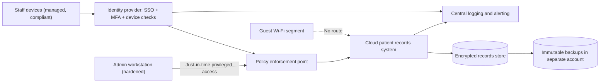

## Introduction

This final lesson brings the course together around three practical capabilities that employers expect of IT-for-business graduates. The first is people: most attacks still involve a human decision, such as clicking a link, approving a payment change or resetting a password for a convincing caller, so organisations need awareness programmes that genuinely change behaviour. The second is rehearsal: incident response plans only work if people have practised them, and tabletop exercises are the cheapest, safest way to practise. The third is design: secure architecture applies principles from every earlier module so that a single failure does not become a disaster.

The thread connecting all three is realism. Awareness should be based on the threats staff actually face; exercises should use plausible scenarios with real decision points; architectures should assume that some controls will fail. Throughout, the work remains defensive and authorised: phishing simulations, exercises and design reviews are conducted with management approval and respect for staff.

## Learning Objectives

- Design a security awareness and training programme that targets specific behaviours and measures outcomes.
- Plan, facilitate and evaluate a tabletop exercise using realistic scenarios and injects.
- Apply Saltzer and Schroeder's secure design principles, defence in depth and zero trust to an architecture.
- Evaluate an architecture for single points of failure, excessive trust and missing detection.
- Analyse how social engineering combined with powerful internal tools led to the Twitter 2020 incident.

## Prerequisite Knowledge

- Phishing and social engineering from Module 2.
- Incident response lifecycle and business continuity from Module 7.
- Network segmentation, identity management and cloud security from earlier modules.

## Key Terminology

- **Security awareness**: Activities that focus attention on security so that individuals recognise concerns and respond appropriately; distinct from role-based training and formal education.
- **Phishing simulation**: An authorised exercise in which an organisation sends realistic but harmless phishing messages to staff to measure and improve reporting behaviour.
- **Tabletop exercise**: A discussion-based exercise in which participants talk through their responses to a simulated incident scenario.
- **Inject**: A new piece of information introduced during an exercise (such as a media enquiry or a ransom note) that forces participants to make decisions.
- **After-action report**: The document produced after an exercise recording what happened, strengths, gaps and improvement actions.
- **Defence in depth**: Layering independent controls so that the failure of one does not expose the asset.
- **Zero trust**: An architecture approach in which no implicit trust is granted based on network location; every access request is authenticated, authorised and evaluated against policy.
- **Complete mediation**: The design principle that every access to every object must be checked for authority, rather than relying on earlier checks.

## Detailed Explanation

### Designing an awareness programme that changes behaviour

NIST SP 800-50 (Wilson & Hash, 2003) distinguishes **awareness** (for everyone, changing attention and habits), **training** (role-specific skills, such as secure coding for developers or payment verification for finance staff) and **education** (deeper professional knowledge). It describes a programme lifecycle of design, material development, implementation and post-implementation monitoring and improvement.

Effective programmes share several characteristics:

1. **Behaviour-focused objectives**: rather than "staff understand phishing", aim for "staff report suspicious emails using the report button within minutes" or "finance staff verify every bank-detail change by calling a known number".
2. **Risk-based targeting**: prioritise the groups and behaviours linked to the organisation's top risks: finance and payroll (business email compromise), service desk (password-reset social engineering), executives (targeted phishing), developers (secrets in code).
3. **Short, frequent, relevant content**: brief modules and local examples (for example mobile money fraud scripts, fake Ghana Revenue Authority or utility payment messages) are more memorable than an annual hour-long lecture.
4. **Make secure behaviour easy**: a one-click report button, password managers, clear verification procedures and supportive managers matter more than slogans.
5. **Positive reporting culture**: staff who report mistakes quickly (including clicking a link) should be thanked, because early reports shorten incidents. Blame discourages reporting.
6. **Ethical simulations**: phishing simulations should be approved, proportionate, avoid exploiting genuinely distressing themes, and be used for learning rather than punishment.
7. **Measurement**: track reporting rates, time to report, simulation click rates over time, completion of role-based training and, ultimately, incident trends.

### Incident scenarios and tabletop exercises

A tabletop exercise tests plans, roles and decisions without touching production systems. Planning steps:

1. **Set objectives**: for example, test escalation to executives, decisions on regulatory notification and the business continuity hand-off.
2. **Choose participants**: decision-makers (executives, legal, communications) as well as technical staff.
3. **Write the scenario and injects**: a realistic timeline, with injects that add pressure and ambiguity.
4. **Facilitate**: a neutral facilitator presents injects, asks "what do you do now, who decides, and how do you know?" and keeps time.
5. **Debrief and report**: capture strengths, gaps and owned actions in an after-action report.

**Scenario A: business email compromise.** *Illustrative scenario.* A supplier's genuine email account is compromised. Injects: (1) an email from the supplier asking to change bank details before a large payment; (2) a follow-up "urgent" message from a spoofed address imitating the managing director; (3) the payment is made; (4) the real supplier asks why they have not been paid. Decision points: was the verification procedure followed? Who contacts the bank to attempt recall, and how quickly? Is personal data involved? Who informs the board?

**Scenario B: ransomware with data theft.** Injects: (1) the service desk receives multiple reports of inaccessible files at 07:30; (2) ransom notes threaten to publish customer data; (3) a journalist calls asking for comment; (4) backups for one system are found to be encrypted. Decision points: containment priorities, whether to invoke business continuity, how to assess notification obligations to regulators (including the Cyber Security Authority where applicable and the Data Protection Commission if personal data is affected), the organisation's position on ransom payment, and customer communication.

### Secure architecture design

Saltzer and Schroeder (1975) articulated design principles that remain the foundation of secure architecture:

| Principle | Meaning | Modern application |
|---|---|---|
| Economy of mechanism | Keep designs simple and small | Fewer components and integrations to secure and review |
| Fail-safe defaults | Deny by default; grant access explicitly | Default-deny firewall rules and access policies |
| Complete mediation | Check every access | Authorise every API request server-side |
| Open design | Security should not depend on secrecy of the design | Use public, vetted cryptography and protocols |
| Separation of privilege | Require more than one condition or person | MFA; dual approval for large payments |
| Least privilege | Grant minimum necessary rights | Scoped roles, just-in-time admin access |
| Least common mechanism | Minimise shared components between users | Tenant isolation; separate admin interfaces |
| Psychological acceptability | Security must be usable | Passkeys, single sign-on, clear prompts |

**Defence in depth** layers controls across identity, endpoint, network, application, data and monitoring, so an attacker must defeat several independent barriers. **Zero trust** (NIST SP 800-207) replaces trust in network location with per-request decisions based on identity, device health and context, typically through a policy decision point and policy enforcement points in front of resources. **Segmentation** separates high-value systems (payments, identity, backups) from general user networks. **Secure administration** places privileged access on hardened workstations or bastion services with MFA and session logging. **Detection by design** ensures logs from identity, endpoints, cloud control planes and key applications flow to a monitored platform. **Resilience** adds immutable backups and tested recovery.

## Theories, Frameworks and Models

### Socio-technical security

Security outcomes emerge from the interaction of people, processes and technology. Awareness programmes fail when they ask people to compensate for poor design (for example expecting staff to spot every fraudulent email when payment changes can be approved by one person). Architectures fail when they ignore human behaviour (for example controls so inconvenient that staff bypass them). Good design therefore combines technical controls that reduce the chance of human error with processes, such as separation of privilege, that ensure a single mistake is not catastrophic, and awareness that equips people to act as an early-warning system.

### Mapping to NIST CSF 2.0

Awareness and training sit in Protect (PR.AT); tabletop exercises test Respond and Recover and feed Identify's Improvement category; secure architecture spans Protect (identity, data, platform and infrastructure resilience) and Detect (continuous monitoring); and Govern sets the risk appetite and roles that shape all three.

## Worked Example

**Illustrative scenario.** *Afadjato Health Network* (fictional), a group of five private clinics in the Volta and Greater Accra regions, is replacing a flat office network and a single on-premises server with a cloud-hosted patient records system. Management asks for a secure reference architecture and a first-year awareness and exercise plan.

**Architecture decisions and the principles they apply:**

1. **Identity first**: all staff authenticate through a single identity provider with MFA (phishing-resistant for administrators and doctors with remote access); accounts are role-based (receptionist, nurse, doctor, billing, administrator) with ABAC conditions limiting records to the clinic where the patient is registered. *Least privilege, separation of privilege, complete mediation.*
2. **Segmented clinic networks**: separate network segments for clinical workstations, guest Wi-Fi, medical devices and administration; default-deny rules between them. *Fail-safe defaults, least common mechanism.*
3. **Zero trust access to the records system**: access only through the identity provider, with device compliance checks for clinic workstations; no reliance on "being on the clinic network". *Zero trust.*
4. **Data protection**: encryption in transit and at rest with managed keys; audit logging of every record view; alerts on unusual access, such as viewing many records quickly. *Defence in depth, detection by design.*
5. **Administration**: administrators use separate privileged accounts, just-in-time elevation and a hardened admin workstation. *Least privilege.*
6. **Resilience**: daily immutable backups to a separate account; a documented downtime procedure using printed appointment lists. *Resilience.*
7. **Usability**: single sign-on and fast re-authentication at shared clinical workstations to avoid password sharing. *Psychological acceptability.*

**Year-one awareness and exercise plan:** a ten-minute onboarding module for all staff; quarterly short modules on phishing, patient data confidentiality under Act 843 and reporting; role-based training for receptionists on identity verification for phone requests; monthly phishing simulations with immediate supportive feedback; a report-phish button. Two tabletop exercises: Scenario B (ransomware) in quarter two with clinic managers and the IT provider, and a records-snooping insider scenario in quarter four. Metrics: reporting rate, time to report, and actions closed from after-action reports.

## Ghanaian Business Application

Social engineering in Ghana frequently exploits trusted channels: phone calls impersonating telecom or bank staff, messages purporting to come from mobile money operators, and fake payment requests that appear to come from executives or suppliers. Awareness content built around these local patterns, delivered in clear language and supported by simple verification procedures, is more effective than generic international material. The Cyber Security Authority runs national awareness activities, and organisations can align internal campaigns with national messaging.

Secure architecture matters especially for organisations growing quickly from a single office to multiple branches or cloud services, where flat networks and shared administrator accounts often persist. Designing identity, segmentation, logging and backups correctly at that transition is far cheaper than retrofitting them after an incident. For Critical Information Infrastructure owners under Act 1038, documented architecture decisions and exercise reports also provide evidence of preparedness.

## International Case Study

**Twitter (2020).** On 15 July 2020 a number of high-profile Twitter accounts, including those of prominent politicians, business leaders and companies, posted messages promoting a cryptocurrency scam. Twitter reported that attackers had targeted a small number of employees through a phone spear-phishing attack, obtained their credentials, and used them to access internal administrative tools, ultimately targeting around 130 accounts. An investigation by the New York State Department of Financial Services described how the attackers posed as Twitter IT staff, directed employees to a fake login page, and captured credentials and MFA codes in real time. Several individuals were later charged, and the alleged ringleader, a teenager in Florida, pleaded guilty in 2021.

The case links all three themes of this lesson. **Awareness**: staff were persuaded by convincing phone calls, so training needed to address voice-based social engineering and verification of internal IT requests. **Architecture**: internal tools offered very powerful capabilities (such as changing account email addresses) to many employees, so least privilege, separation of privilege for sensitive actions and phishing-resistant MFA for internal tools were critical. **Response**: the company temporarily restricted functionality for verified accounts while it contained the incident, a business-impacting decision of the kind tabletop exercises rehearse.

## Common Misconceptions

- **"Awareness training means an annual presentation."** Behaviour change requires frequent, relevant, role-based content, easy secure options and measurement.
- **"Phishing simulations exist to catch and punish staff."** Their value lies in learning and improving reporting; punitive use damages trust and reduces reporting.
- **"Tabletop exercises are only for IT staff."** The most important decisions in incidents (notification, ransom, communications, continuity) are taken by executives, legal and communications, who must participate.
- **"Zero trust is a product you can buy."** It is an architectural approach built from identity, device, policy and monitoring capabilities.

## Common Examination Mistakes

- Describing awareness activities without measurable behavioural objectives or metrics.
- Writing an incident scenario without injects, decision points or an after-action process.
- Listing design principles without applying them to the architecture in the question.
- Treating defence in depth as "more firewalls" rather than independent layers across identity, endpoint, network, application, data and monitoring.
- Ignoring usability, which leads to recommendations that staff would bypass.

## Critical Thinking Questions

1. How would you measure whether an awareness programme has reduced risk, rather than merely increased training completion rates?
2. In the Twitter 2020 case, which control would have been most effective: better awareness, phishing-resistant MFA or reduced access to internal tools? Defend your ranking.
3. What are the main barriers to adopting zero trust in a Ghanaian SME, and how might they be overcome incrementally?

## Practical Exercises

1. **Awareness plan.** Design a twelve-month awareness and training plan for an illustrative Ghanaian organisation of 150 staff. *Expected output:* a table of target behaviours, audiences, activities, frequency and metrics, linked to the organisation's top three risks.
2. **Tabletop exercise.** Using a CISA tabletop exercise package as a template, adapt Scenario A or B from this lesson and run it with at least three colleagues. *Expected output:* an after-action report with timeline, strengths, gaps and at least five owned actions.
3. **Architecture review.** Draw the current architecture of a small network or cloud environment you own or are authorised to review, then redesign it applying at least five Saltzer and Schroeder principles. *Expected output:* before and after diagrams with a justification table.
4. **Cisco Skills for All.** Complete a free introductory cybersecurity course section on security awareness or network defence. *Expected output:* a reflective note on three changes you will make to your own security behaviour.

## Key Takeaways

- Effective awareness targets specific behaviours, focuses on high-risk roles, makes secure actions easy, rewards reporting and measures outcomes.
- Tabletop exercises rehearse decisions safely; realistic injects and an after-action report turn them into improvements.
- Saltzer and Schroeder's principles, defence in depth and zero trust provide a vocabulary for justifying architecture decisions.
- Secure architecture combines identity, segmentation, data protection, secure administration, monitoring and resilience.
- Twitter (2020) shows how social engineering plus over-powerful internal tools can compromise even a major technology company.

## Further Reading

- Wilson, M., & Hash, J. (2003). *Building an information technology security awareness and training program* (NIST Special Publication 800-50). National Institute of Standards and Technology.
- Saltzer, J. H., & Schroeder, M. D. (1975). The protection of information in computer systems. *Proceedings of the IEEE, 63*(9), 1278–1308.
- Rose, S., Borchert, O., Mitchell, S., & Connelly, S. (2020). *Zero trust architecture* (NIST Special Publication 800-207). National Institute of Standards and Technology. <https://csrc.nist.gov/pubs/sp/800/207/final>
- Anderson, R. (2020). *Security engineering: A guide to building dependable distributed systems* (3rd ed.). Wiley.

## Video Resources

- [CISA Tabletop Exercise Packages](https://www.cisa.gov/resources-tools/services/cisa-tabletop-exercise-packages) — Cybersecurity and Infrastructure Security Agency. Official, free scenario packages for planning and running tabletop exercises.
- [Cisco Skills for All](https://skillsforall.com/) — Cisco Networking Academy. Official learning portal with free cybersecurity courses covering awareness and network defence.
- [Cyber Security Authority, Ghana](https://www.csa.gov.gh/) — Cyber Security Authority. Official website with national cybersecurity awareness information and guidance.

## Revision Summary

People, rehearsal and design complete a defensive security programme. Awareness should change measurable behaviours; tabletop exercises should test real decisions; architecture should assume controls fail and layer defences accordingly.

- NIST SP 800-50: awareness (all), training (roles), education (depth); lifecycle of design, develop, implement, monitor.
- Good awareness: targeted, frequent, local, easy secure options, positive reporting culture, ethical simulations, metrics.
- Tabletop: objectives, decision-makers, scenario and injects, neutral facilitator, after-action report.
- Saltzer and Schroeder: economy of mechanism, fail-safe defaults, complete mediation, open design, separation of privilege, least privilege, least common mechanism, psychological acceptability.
- Defence in depth plus zero trust (SP 800-207), segmentation, secure admin, logging, immutable backups.
- Twitter (2020): phone spear-phishing, real-time credential capture, powerful internal tools.
