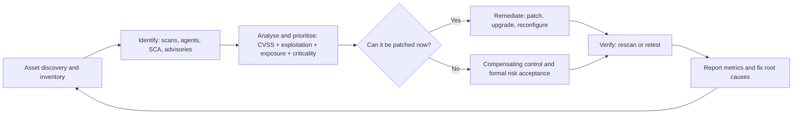

## Introduction

New vulnerabilities in widely used software are disclosed every day. Many are minor; a few, such as the Log4Shell flaw in December 2021, trigger worldwide emergency patching within hours. No organisation can fix everything immediately, and attackers know it: they scan the internet for systems that have not yet been patched against well-publicised flaws. Vulnerability management is the continuous discipline of finding weaknesses in your own environment, deciding which matter most, and fixing them before attackers exploit them.

Vulnerability management depends on security assessment: the scanning, testing and review activities that reveal weaknesses in the first place. This lesson compares assessment methods, sets out the vulnerability management lifecycle, and explains the Common Vulnerability Scoring System (CVSS) so that you can read a score correctly and avoid the common mistake of treating severity as if it were risk. All testing described here must be performed only on systems you own or are explicitly authorised in writing to test.

## Learning Objectives

- Compare vulnerability scanning, penetration testing, red teaming and configuration and code review by purpose, depth and output.
- Explain why written authorisation, scope and rules of engagement are essential for security testing.
- Apply the vulnerability management lifecycle from asset discovery to verification and reporting.
- Interpret CVSS base metrics and vector strings and explain the difference between severity and risk.
- Prioritise vulnerabilities using CVSS together with exploitation evidence, exposure and asset criticality.

## Prerequisite Knowledge

- Risk assessment and likelihood × impact reasoning from Module 7.
- Secure SDLC, SAST, DAST and software composition analysis from Module 5.
- Basic networking (ports, services, protocols).

## Key Terminology

- **Vulnerability**: A weakness in a system, procedure, control or implementation that could be exploited by a threat source.
- **CVE (Common Vulnerabilities and Exposures)**: A system of unique identifiers for publicly disclosed vulnerabilities, such as CVE-2021-44228.
- **CVSS (Common Vulnerability Scoring System)**: An open framework, maintained by FIRST, for describing the characteristics and severity of software vulnerabilities on a 0 to 10 scale.
- **Vector string**: A compact text representation of the CVSS metric values used to calculate a score, such as `AV:N/AC:L/PR:N/UI:N`.
- **Authenticated scan**: A vulnerability scan that logs in to systems with credentials, giving a more accurate view of missing patches and configuration than an unauthenticated scan.
- **Penetration test**: An authorised, goal-oriented attempt to exploit vulnerabilities to demonstrate real-world impact.
- **Rules of engagement**: A written agreement defining the scope, methods, timing, contacts and limits of a security test.
- **Compensating control**: An alternative control that reduces risk when the primary remediation, such as a patch, cannot be applied promptly.

## Detailed Explanation

### Security assessment methods

| Method | Purpose | Depth | Typical frequency | Output |
|---|---|---|---|---|
| Vulnerability scanning | Broad, automated discovery of known weaknesses | Wide, shallow | Continuous to monthly | List of findings with severity |
| Configuration review | Compare settings against baselines (for example CIS Benchmarks) | Targeted | Periodic and on change | Deviations from baseline |
| Code review and SAST | Find flaws in source code | Deep for code | Every change | Code-level findings |
| Penetration testing | Demonstrate exploitability and impact, chain weaknesses | Narrow, deep | Annually or for major changes | Narrative report with evidence |
| Red teaming | Test detection and response against a realistic adversary over time | Objective-based | Mature organisations, periodically | Assessment of defensive capability |

NIST SP 800-115 (Scarfone et al., 2008) groups technical assessment techniques into **review techniques** (documentation, logs, rule sets, configuration), **target identification and analysis techniques** (network discovery, port and service identification, vulnerability scanning) and **target vulnerability validation techniques** (password cracking on authorised data, penetration testing, social engineering tests). It stresses planning, legal authorisation and safe handling of data gathered during assessments.

### Authorisation and rules of engagement

Testing a system without permission is unethical and may be a criminal offence in many jurisdictions. Legitimate assessments are preceded by written authorisation from someone with authority over the systems, and by rules of engagement covering: precise scope (IP ranges, applications, cloud accounts) and exclusions; permitted techniques; testing windows; emergency contacts and stop conditions; handling of sensitive data discovered; and reporting arrangements. Cloud and hosting providers may have their own testing policies that must also be respected. In Ghana, the Cybersecurity Act, 2020 (Act 1038) provides for the licensing of cybersecurity service providers by the Cyber Security Authority, so organisations commissioning external testing should check that providers hold any required licence.

### The vulnerability management lifecycle

1. **Asset discovery and inventory**: you cannot protect what you do not know exists. Maintain an inventory of hardware, software, cloud resources and internet-facing services, with owners and criticality.
2. **Identification**: authenticated scanning, agent-based detection, SCA for software dependencies, cloud posture tools and vendor advisories.
3. **Analysis and prioritisation**: validate findings, remove false positives, and rank by risk (see below).
4. **Remediation**: patch, upgrade, reconfigure, or apply compensating controls (such as blocking an exposed service, adding a WAF rule or isolating a legacy system) where patching must wait.
5. **Verification**: rescan or retest to confirm the fix worked.
6. **Reporting and improvement**: track metrics such as time to remediate by severity, percentage of critical findings past target, and coverage of scanning; report to management; fix root causes such as missing ownership or unsupported software.

### Remediation targets

Organisations commonly define target timeframes by priority, for example: critical issues on internet-facing systems with known exploitation within days; high issues within a few weeks; medium within a quarter. These targets should be set by policy and risk appetite, and exceptions should be formally risk-accepted by system owners.

## Theories, Frameworks and Models

### CVSS in outline

CVSS is maintained by FIRST (the Forum of Incident Response and Security Teams). Version 3.1 remains widely used in vulnerability databases, and version 4.0, published in November 2023, refines the model. In CVSS v3.1 the **Base** metrics describe intrinsic characteristics:

- **Exploitability**: Attack Vector (AV: Network, Adjacent, Local, Physical), Attack Complexity (AC: Low, High), Privileges Required (PR: None, Low, High), User Interaction (UI: None, Required).
- **Scope** (S: Unchanged, Changed): whether exploitation affects components beyond the vulnerable one.
- **Impact**: Confidentiality (C), Integrity (I) and Availability (A), each None, Low or High.

Scores map to qualitative ratings: **None 0.0; Low 0.1-3.9; Medium 4.0-6.9; High 7.0-8.9; Critical 9.0-10.0**. Temporal (v3.1) and Environmental metrics can adjust the base score for exploit maturity and for the importance of the affected asset in a particular organisation.

CVSS v4.0 organises metrics into **Base, Threat, Environmental and Supplemental** groups, adds an Attack Requirements metric, replaces Scope with separate impact metrics for the vulnerable system and subsequent systems, and encourages labelling which groups were used (for example CVSS-B for base only, CVSS-BTE for base, threat and environmental). FIRST emphasises that a base score alone is not a measure of risk.

### Severity is not risk

A CVSS base score measures how severe a vulnerability is *in general*. Risk in your organisation also depends on: whether the vulnerable system is exposed (internet-facing or isolated), what it does (asset criticality and data sensitivity), whether the flaw is being actively exploited, and what compensating controls exist. Useful additional inputs include the US Cybersecurity and Infrastructure Security Agency's **Known Exploited Vulnerabilities (KEV) catalogue**, which lists vulnerabilities with evidence of exploitation in the wild, and FIRST's **Exploit Prediction Scoring System (EPSS)**, which estimates the probability of exploitation activity.

## Worked Example

**Part A: Reading vector strings.**

1. `CVSS:3.1/AV:N/AC:L/PR:N/UI:N/S:U/C:H/I:H/A:H` reads as: exploitable over the network, low complexity, no privileges, no user interaction, scope unchanged, high impact on confidentiality, integrity and availability. This combination produces a base score of **9.8 (Critical)**, typical of remote code execution flaws in exposed services.
2. `CVSS:3.1/AV:L/AC:L/PR:L/UI:N/S:U/C:H/I:H/A:H` reads as: requires local access and a low-privileged account, but then gives full impact. The base score is **7.8 (High)**, typical of local privilege escalation. It is serious, but an attacker must already have a foothold.

**Part B: Prioritising findings.** *Illustrative scenario.* *Tano Logistics* (fictional) receives a monthly scan with the following findings:

| ID | Finding | CVSS base | Known exploited? | Exposure | Asset criticality | Priority |
|---|---|---|---|---|---|---|
| V1 | Remote code execution in VPN appliance | 9.8 | Yes (listed in KEV) | Internet-facing | High (all remote access) | **P1: patch within 48 hours; restrict access meanwhile** |
| V2 | Remote code execution in an internal test server's web framework | 9.8 | No evidence | Isolated lab VLAN | Low | P3: patch in normal cycle; confirm isolation |
| V3 | Privilege escalation on finance workstations | 7.8 | Yes | Internal, phishing-reachable users | High (payment approvals) | **P1/P2: patch within a week; monitor with EDR** |
| V4 | Outdated TLS configuration on public website | 5.3 | No | Internet-facing | Medium | P3: fix within the quarter |
| V5 | Information disclosure in HR system | 6.5 | No | Internal, restricted users | High (personal data) | P2: fix within 30 days |

The key insight is that **V2 and V1 share the same CVSS score but have very different risk**, while **V3, with a lower score, outranks V2** because it is actively exploited and affects high-value users. Prioritisation that sorted purely by CVSS would waste effort on the isolated lab server while a known-exploited flaw on payment approvers' machines waited.

## Diagram

## Ghanaian Business Application

Many Ghanaian organisations run a mix of modern cloud services and older on-premises systems, sometimes including unsupported operating systems in branch offices or embedded devices in factories and hospitals. Vulnerability management in this context starts with an honest asset inventory, including systems managed by vendors. Contracts with suppliers should specify patching responsibilities and timeframes, because a vendor-managed core banking or hospital system is still the organisation's risk.

Practical steps for an SME include enabling automatic updates where safe, using a reputable scanner on internet-facing assets, subscribing to vendor advisories and national alerts from Ghana's Cyber Security Authority and CERT-GH, and prioritising known-exploited vulnerabilities on exposed systems. Organisations designated as Critical Information Infrastructure under Act 1038 should treat vulnerability management as part of their compliance obligations and keep evidence of timely remediation. When engaging external testers, use written authorisation and check licensing requirements under Act 1038.

## International Case Study

**Log4Shell (CVE-2021-44228), December 2021.** In December 2021 a critical vulnerability was disclosed in Apache Log4j 2, a very widely used Java logging library. Under certain configurations, an attacker could cause an application to execute code simply by getting a crafted string logged, for example in a web request header or a chat message. The vulnerability received the maximum CVSS v3.1 base score of 10.0. Exploitation attempts were observed rapidly after disclosure, and national cybersecurity agencies, including CISA in the United States, issued emergency guidance. The Apache Software Foundation released fixed versions, and further related vulnerabilities were found and patched in the following weeks.

Log4Shell exposed a vulnerability management problem more than a scoring problem. Many organisations did not know where Log4j was used, because it was embedded deep inside third-party products and their own applications as a transitive dependency. Those with software bills of materials and SCA tools could answer "where are we exposed?" in hours; others needed weeks of manual investigation. Effective responses combined patching, vendor follow-up, compensating controls (such as blocking outbound connections from servers and WAF rules) and monitoring for exploitation attempts. The case connects directly to the Equifax 2017 lesson: knowing your components is a precondition for patching them.

## Common Misconceptions

- **"A higher CVSS score always means higher priority."** CVSS base scores measure generic severity; exposure, exploitation evidence, asset criticality and compensating controls determine organisational risk.
- **"A clean vulnerability scan means the system is secure."** Scanners find known issues they can detect; they miss business-logic flaws, unknown vulnerabilities and assets outside scan scope.
- **"A penetration test and a vulnerability scan are the same."** A scan is automated and broad; a penetration test is authorised, human-led and demonstrates exploitability and impact.
- **"If we cannot patch, nothing can be done."** Compensating controls such as isolation, access restriction and monitoring can reduce risk while a permanent fix is arranged.

## Common Examination Mistakes

- Quoting a CVSS score without interpreting its metrics or explaining why it may not reflect risk.
- Omitting asset inventory and verification from the vulnerability management lifecycle.
- Describing testing without mentioning written authorisation and rules of engagement.
- Misstating the CVSS qualitative bands (for example calling 7.5 "Critical").
- Ignoring third-party and embedded components when discussing patching.

## Critical Thinking Questions

1. Should regulators require organisations to patch Critical vulnerabilities within a fixed number of days? What unintended consequences might such a rule have?
2. How would you justify to a chief financial officer the cost of an authenticated scanning programme and an SBOM capability?
3. When, if ever, is it acceptable to leave a known Critical vulnerability unpatched for months?

## Practical Exercises

1. **CVSS calculator.** Use the official FIRST CVSS calculator to score three vulnerabilities of your choice from a public vulnerability database. *Expected output:* for each, the vector string, base score, your plain-English interpretation and an environmental adjustment for an illustrative organisation.
2. **Authorised home lab scan.** On a virtual machine you own (for example a deliberately vulnerable training image in an isolated network), run a free vulnerability scanner. *Expected output:* a prioritised findings table using CVSS, exposure and criticality, with recommended remediations.
3. **Rules of engagement.** Draft rules of engagement for an illustrative penetration test of a Ghanaian SME's customer portal. *Expected output:* a one-page document with scope, exclusions, timing, contacts, stop conditions, data handling and authorisation signatures.
4. **Cisco Skills for All.** Complete an introductory cybersecurity course module on vulnerability assessment. *Expected output:* a short summary of three practices you would apply in your workplace.

## Key Takeaways

- Assessment methods differ in breadth and depth; scanning, reviews, penetration tests and red teams are complementary.
- Testing requires written authorisation and clear rules of engagement.
- The vulnerability management lifecycle runs from asset inventory through prioritisation and remediation to verification and reporting.
- CVSS measures severity on a 0-10 scale with defined bands; it is not a measure of organisational risk.
- Prioritise by combining CVSS with exploitation evidence (such as KEV), exposure and asset criticality; Log4Shell showed the value of knowing your components.

## Further Reading

- Scarfone, K., Souppaya, M., Cody, A., & Orebaugh, A. (2008). *Technical guide to information security testing and assessment* (NIST Special Publication 800-115). National Institute of Standards and Technology. <https://csrc.nist.gov/pubs/sp/800/115/final>
- Forum of Incident Response and Security Teams. (2023). *Common Vulnerability Scoring System version 4.0: Specification document*. FIRST. <https://www.first.org/cvss/v4.0/specification-document>
- Souppaya, M., & Scarfone, K. (2022). *Guide to enterprise patch management planning: Preventive maintenance for technology* (NIST Special Publication 800-40, Revision 4). National Institute of Standards and Technology.
- Stallings, W., & Brown, L. (2018). *Computer security: Principles and practice* (4th ed.). Pearson.

## Video Resources

- [FIRST CVSS](https://www.first.org/cvss/): Forum of Incident Response and Security Teams. Official CVSS home with specifications, user guides and calculators.
- [CISA Known Exploited Vulnerabilities Catalog](https://www.cisa.gov/known-exploited-vulnerabilities-catalog): Cybersecurity and Infrastructure Security Agency. Official catalogue of vulnerabilities with evidence of active exploitation.
- [Cisco Skills for All](https://skillsforall.com/): Cisco Networking Academy. Official learning portal with free courses that include vulnerability assessment fundamentals.

## Revision Summary

Security assessment finds weaknesses; vulnerability management fixes them in priority order, continuously. Always test with written authorisation. Read CVSS carefully and combine it with context before deciding priorities.

- Methods: scanning (broad), configuration and code review, penetration testing (deep, authorised), red teaming (detection and response).
- Lifecycle: inventory, identify, analyse and prioritise, remediate or compensate, verify, report.
- CVSS v3.1 base metrics: AV, AC, PR, UI, S, C, I, A; bands Low 0.1-3.9, Medium 4.0-6.9, High 7.0-8.9, Critical 9.0-10.0.
- CVSS v4.0: Base, Threat, Environmental, Supplemental groups.
- Severity is not risk: add exploitation (KEV, EPSS), exposure and asset criticality.
- Log4Shell (2021): CVSS 10.0; finding embedded components was the hard part.
