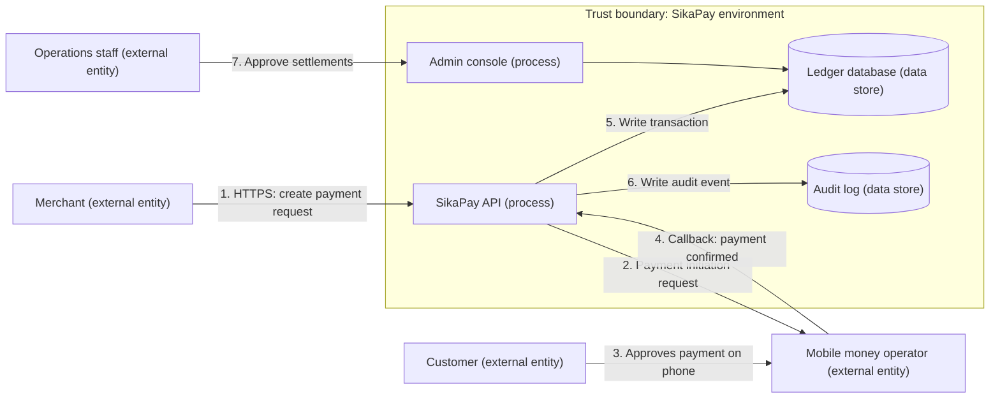

## Introduction

Most of this course has examined security after a system exists: testing it, configuring it, monitoring it and responding when it fails. Threat modelling asks the same questions earlier, while the system is still a design on a whiteboard. It is a structured way of thinking about *what could go wrong* before code is written or a vendor is selected, when changes are cheapest. Teams that threat model routinely tend to find whole classes of design flaws, such as a missing authorisation check between two services or an unverified callback from a payment provider, that testing finds late or not at all.

This lesson teaches a practical, repeatable method. You will draw a data flow diagram (DFD) of a system, mark its trust boundaries, and systematically apply STRIDE, a mnemonic for six categories of threat. You will then rate and prioritise the threats and record mitigations. The method is simple enough for a two-hour workshop with business analysts and developers, yet rigorous enough to support architecture decisions and audit evidence.

## Learning Objectives

- Explain the purpose of threat modelling and the four-question framework.
- Construct a data flow diagram with external entities, processes, data stores, data flows and trust boundaries.
- Apply STRIDE to the elements of a data flow diagram to identify specific threats.
- Map each STRIDE category to the security property it violates and to typical mitigations.
- Prioritise threats and produce a threat model record suitable for a development team.

## Prerequisite Knowledge

- The CIA triad, authentication and authorisation concepts.
- Secure SDLC and where design review fits within it.
- Web application vulnerabilities from Module 5.

## Key Terminology

- **Threat modelling**: A structured analysis of a system's design to identify potential threats, evaluate them and decide on mitigations.
- **Data flow diagram (DFD)**: A diagram showing how data moves between external entities, processes and data stores, used as the basis for threat analysis.
- **Trust boundary**: A line on a DFD where the level of trust changes, such as between the internet and an application, or between an application and a third-party service; threats concentrate here.
- **STRIDE**: A threat classification mnemonic: Spoofing, Tampering, Repudiation, Information disclosure, Denial of service and Elevation of privilege.
- **Repudiation**: The ability of a user or system to deny having performed an action because there is insufficient evidence to prove otherwise.
- **Elevation of privilege**: Gaining capabilities beyond those that were authorised, such as a customer obtaining administrator functions.
- **Attack surface**: The set of points where an attacker can try to enter data into or extract data from a system.
- **Mitigation**: A design or operational control that reduces the likelihood or impact of a threat.

## Detailed Explanation

### The four-question framework

Adam Shostack (2014), who helped develop threat modelling practice at Microsoft, frames threat modelling around four questions:

1. **What are we working on?** Model the system, usually with a DFD.
2. **What can go wrong?** Use a structured technique such as STRIDE to find threats.
3. **What are we going to do about it?** Decide on mitigations, or consciously accept, transfer or avoid each risk.
4. **Did we do a good job?** Review the model for completeness, check that mitigations were implemented and update the model as the system changes.

The framework is deliberately technique-neutral. STRIDE is one way to answer question two; attack trees, attack libraries and privacy-focused methods are others.

### Building the data flow diagram

DFDs use five elements:

| Element | Represents | Example |
|---|---|---|
| External entity | People or systems outside your control | Customer, mobile network operator, payment gateway |
| Process | Code that transforms or routes data | Web API, loan scoring service |
| Data store | Where data rests | Customer database, log store, file bucket |
| Data flow | Movement of data | HTTPS request, message queue, database query |
| Trust boundary | Change in trust level | Internet edge, boundary to a partner's API |

The diagram should be at the level of detail where meaningful security decisions are made. Too little detail hides threats; too much makes the workshop unmanageable. A useful rule is to show every place data crosses a trust boundary.

### STRIDE and the properties it protects

| Threat | Violates | Typical example | Typical mitigations |
|---|---|---|---|
| **S**poofing | Authentication | Attacker poses as a legitimate user or service | Strong authentication, MFA, mutual TLS, signed tokens |
| **T**ampering | Integrity | Altering a payment amount in transit or in storage | TLS, digital signatures, integrity checks, database permissions |
| **R**epudiation | Non-repudiation (accountability) | Staff member denies approving a refund | Tamper-evident audit logs, signed transactions, individual accounts |
| **I**nformation disclosure | Confidentiality | Leaking customer data through an API or error message | Access control, encryption, data minimisation, error handling |
| **D**enial of service | Availability | Flooding an API so legitimate users cannot transact | Rate limiting, DDoS protection, capacity planning, timeouts |
| **E**levation of privilege | Authorisation | Customer accesses an administration function | Server-side authorisation, least privilege, input validation, sandboxing |

### STRIDE per element

A practical refinement is to ask only the STRIDE questions that apply to each element type. External entities can be spoofed and can repudiate; processes are exposed to all six; data stores face tampering, information disclosure and denial of service (and repudiation where they hold logs); data flows face tampering, information disclosure and denial of service. This keeps the analysis focused and systematic.

### Recording and prioritising

Each identified threat should be recorded with: an identifier, the affected element, the STRIDE category, a description, a rating (for example using the likelihood × impact matrix from Module 7), the agreed mitigation, an owner and a status. Threats become backlog items or security requirements, which links threat modelling directly to the secure SDLC.

## Theories, Frameworks and Models

### Alternatives and complements to STRIDE

- **Attack trees** decompose an attacker's goal (for example "steal funds from a merchant wallet") into sub-goals and alternatives, useful for analysing specific high-value scenarios.
- **PASTA** (Process for Attack Simulation and Threat Analysis) is a risk-centric, seven-stage methodology that links business objectives to technical threat analysis.
- **LINDDUN** focuses on privacy threats such as linkability, identifiability and non-compliance, complementing STRIDE where personal data is central.
- **Threat intelligence and attacker technique catalogues** inform realistic likelihood ratings by showing what attackers actually do.

STRIDE's strength is coverage and teachability; its weakness is that it can generate long, generic lists if the team does not tie threats to specific elements and realistic attackers.

## Worked Example

**Illustrative scenario.** *SikaPay Merchant* (fictional) is designing a service that lets small shops in Kumasi accept mobile money. A shopkeeper uses a mobile app to create a payment request; the customer approves it on their phone through the mobile money operator; the operator sends a callback to SikaPay confirming payment; SikaPay updates the merchant's ledger and the merchant can request settlement to a bank account.

**Step 1: What are we working on?** The DFD below shows the main elements and trust boundaries.

**Step 2: What can go wrong? (STRIDE per element, selected threats)**

| ID | Element | STRIDE | Threat | L | I | Score |
|---|---|---|---|---|---|---|
| T1 | Flow 4 (callback) | Spoofing | Attacker sends a forged "payment confirmed" callback, crediting a merchant without real payment | 4 | 5 | 20 |
| T2 | API | Elevation of privilege | Merchant changes merchant ID in a request to view or settle another merchant's funds | 3 | 5 | 15 |
| T3 | Flow 1 | Tampering | Payment amount altered between app and API | 2 | 4 | 8 |
| T4 | Operations staff | Repudiation | A staff member approves a fraudulent settlement and later denies it | 3 | 4 | 12 |
| T5 | Ledger database | Information disclosure | Backup of the ledger exposed through misconfigured storage | 2 | 4 | 8 |
| T6 | API | Denial of service | Automated requests flood payment creation during market days | 3 | 3 | 9 |
| T7 | Merchant | Spoofing | Attacker takes over a merchant account through credential stuffing | 4 | 4 | 16 |

**Step 3: What are we going to do about it?**

- **T1**: verify every callback cryptographically (signature or mutual TLS as supported by the operator), accept callbacks only from the operator's documented endpoints, and confirm status by querying the operator's API before crediting. Make callback handling idempotent so replays have no effect.
- **T2**: enforce server-side object-level authorisation on every request, deriving the merchant identity from the authenticated session, never from a client-supplied parameter.
- **T7**: MFA for merchants, breached-password screening and rate limiting of login attempts.
- **T4**: individual named staff accounts, dual approval for settlements above a threshold and tamper-evident audit logging to the separate audit store.
- **T6**: rate limiting per merchant and a provider-level DDoS service.
- **T3 and T5**: TLS everywhere with certificate validation; account-level blocking of public storage and encryption of backups.

**Step 4: Did we do a good job?** The team checks that every flow crossing the trust boundary has been analysed, links each mitigation to a backlog item with a test case, and schedules a review when the settlement feature changes. The highest-rated threats (T1, T7, T2) become release-blocking requirements.

## Ghanaian Business Application

Ghana's digital payments ecosystem involves many parties: banks, mobile money operators, payment service providers, aggregators, merchants and customers. Each integration creates trust boundaries, and some of the most consequential threats sit at those boundaries, especially forged or replayed callbacks, weak merchant authentication and insider abuse of administrative consoles. Threat modelling gives Ghanaian fintechs a structured way to demonstrate to partners and regulators that these risks have been considered at design time.

For organisations designated as operating Critical Information Infrastructure under the Cybersecurity Act, 2020 (Act 1038), and for those processing personal data under the Data Protection Act, 2012 (Act 843), a documented threat model is useful evidence that security and privacy were designed in. Combining STRIDE with a privacy-focused method helps where systems handle Ghana Card numbers or health data.

## International Case Study

**Bangladesh Bank and the SWIFT fraud, 2016.** In February 2016 attackers who had compromised systems at Bangladesh Bank, the country's central bank, used the bank's access to the SWIFT interbank messaging network to send fraudulent payment instructions to its account at the Federal Reserve Bank of New York. Instructions worth close to US$1 billion were sent; most were blocked or not executed, but around US$81 million was transferred to accounts in the Philippines and largely not recovered. A further transfer to Sri Lanka was halted, reportedly after a spelling error in the beneficiary's name attracted scrutiny. Public analyses reported that the attackers' malware manipulated the bank's local SWIFT-related software and records, including suppressing printed confirmations, to delay discovery, and that the timing exploited weekends and holidays across time zones.

Viewed through STRIDE, the case is instructive. **Spoofing**: messages appeared to come legitimately from Bangladesh Bank because they originated from its own compromised environment. **Tampering**: local records and confirmation outputs were altered. **Repudiation and detection**: tampering with logs and printouts weakened the bank's ability to see and evidence what had happened. **Elevation of privilege**: attackers obtained the operator credentials needed to issue payment messages. SWIFT subsequently introduced its Customer Security Programme, setting mandatory security controls for users' local environments, a recognition that the trust boundary between a bank's own systems and the network required explicit protection.

## Common Misconceptions

- **"Threat modelling requires security experts and weeks of effort."** A lightweight session with developers, a business analyst and a facilitator can produce valuable results in a few hours; depth can grow over time.
- **"STRIDE is a list of attacks to test."** STRIDE is a set of threat categories to prompt thinking; specific threats must be tied to elements in the system's design.
- **"Once the threat model is written, it is finished."** Systems change; threat models should be reviewed when features, integrations or threats change.
- **"Threats only matter at the internet edge."** Trust boundaries also exist between internal services, partners and administrative consoles, where many serious threats occur.

## Common Examination Mistakes

- Listing the six STRIDE categories without mapping each to the security property it violates.
- Drawing a DFD without trust boundaries, or with no data stores or external entities.
- Identifying generic threats ("hackers attack the system") rather than element-specific ones.
- Failing to prioritise threats or to state concrete mitigations and owners.
- Confusing repudiation (denying an action) with spoofing (pretending to be someone else).

## Critical Thinking Questions

1. Why do so many serious threats cluster at trust boundaries, and how should that influence where security budgets are spent?
2. How would you adapt a STRIDE workshop for a team that includes non-technical business stakeholders?
3. In the Bangladesh Bank case, which single mitigation, if designed in advance, might have most reduced the loss? Justify your choice.

## Practical Exercises

1. **DFD and STRIDE.** Draw a DFD for a system you know (for example a university course registration portal) with at least two trust boundaries. *Expected output:* the diagram and a table of at least eight STRIDE threats with element, category, rating and mitigation.
2. **OWASP Threat Dragon.** Install the free OWASP Threat Dragon tool and recreate the SikaPay DFD from this lesson. *Expected output:* an exported threat model with threats recorded against each element.
3. **Attack tree.** Build an attack tree for the goal "obtain settlement of funds not owed to a merchant" for the SikaPay system. *Expected output:* a tree with at least three levels and the cheapest attack path highlighted with its mitigation.

## Key Takeaways

- Threat modelling analyses designs early, when fixing problems is cheapest.
- The four questions are: what are we working on, what can go wrong, what are we going to do about it, and did we do a good job?
- DFDs model external entities, processes, data stores, data flows and trust boundaries.
- STRIDE maps threats to authentication, integrity, non-repudiation, confidentiality, availability and authorisation.
- Prioritised threats with owners and mitigations should feed directly into the development backlog and tests.

## Further Reading

- Shostack, A. (2014). *Threat modeling: Designing for security*. Wiley.
- Howard, M., & Lipner, S. (2006). *The security development lifecycle*. Microsoft Press.
- OWASP Foundation. (n.d.). *Threat modeling*. <https://owasp.org/www-community/Threat_Modeling>
- Stallings, W., & Brown, L. (2018). *Computer security: Principles and practice* (4th ed.). Pearson.

## Video Resources

- [OWASP Threat Dragon](https://owasp.org/www-project-threat-dragon/): OWASP Foundation. Official project page for a free threat modelling tool that supports STRIDE and data flow diagrams.
- [OWASP Threat Modeling](https://owasp.org/www-community/Threat_Modeling): OWASP Foundation. Official community page explaining threat modelling concepts and approaches.
- [Microsoft Learn](https://learn.microsoft.com/en-us/training/): Microsoft. Official free training portal; search for threat modelling security fundamentals modules.

## Revision Summary

Threat modelling finds design flaws before they are built. Model the system with a DFD, mark trust boundaries, apply STRIDE per element, rate threats and assign mitigations, then review. The four questions frame the work.

- STRIDE: Spoofing (authentication), Tampering (integrity), Repudiation (non-repudiation), Information disclosure (confidentiality), Denial of service (availability), Elevation of privilege (authorisation).
- DFD elements: external entities, processes, data stores, data flows, trust boundaries.
- Threats concentrate at trust boundaries, including partner callbacks and admin consoles.
- Record ID, element, category, rating, mitigation, owner and status.
- Complements: attack trees, PASTA, LINDDUN.
- Bangladesh Bank (2016): spoofed SWIFT messages and tampered local records.
