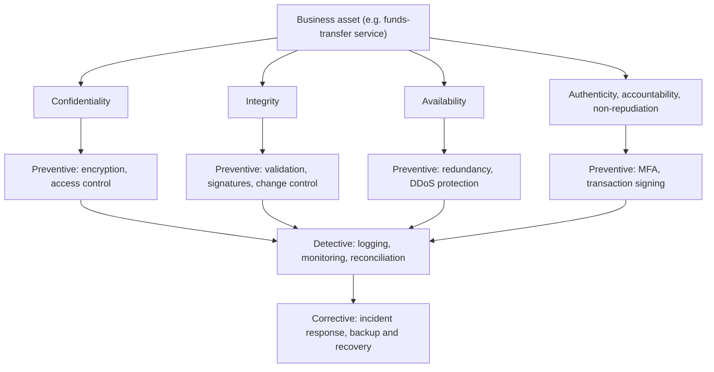

## Introduction

Every security decision an organisation makes, from buying a firewall to writing a password policy, is ultimately an attempt to protect something of value against something that could go wrong. Without a shared vocabulary, those decisions become a shopping list of products rather than a reasoned strategy. The confidentiality, integrity and availability (CIA) triad, together with a small set of long-established design principles, gives managers, auditors and engineers that common language.

This lesson builds the foundation for the rest of CSIT 605. You will learn what each property of the triad really means in practice, why authenticity, accountability and non-repudiation are needed alongside it, and how classic principles such as least privilege, defence in depth and fail-safe defaults turn abstract objectives into design choices. Throughout, the emphasis is on judgement: real systems involve trade-offs, and a postgraduate practitioner must be able to justify which property matters most for a given asset and why.

## Learning Objectives

- Define confidentiality, integrity and availability and give a business example of a failure of each.
- Explain why authenticity, accountability and non-repudiation extend the CIA triad.
- Apply the Saltzer and Schroeder design principles, including least privilege and fail-safe defaults, to a system design.
- Analyse trade-offs between security objectives for a specific information asset.
- Evaluate an organisation's security objectives against its business context and regulatory obligations.

## Prerequisite Knowledge

- None beyond general familiarity with business information systems, networks and the internet.
- Helpful: a basic understanding of how users log in to systems and how data is stored in databases.

## Key Terminology

- **Asset**: Anything of value to the organisation that needs protection, such as customer data, a payment system, a brand or staff time.
- **Confidentiality**: The property that information is not disclosed to individuals, processes or systems that are not authorised to see it.
- **Integrity**: The property that data and systems are accurate, complete and have not been altered in an unauthorised or undetected way.
- **Availability**: The property that information and services are accessible and usable by authorised users when they are needed.
- **Authenticity**: Assurance that a user, message or data source is genuinely who or what it claims to be.
- **Non-repudiation**: Assurance that a party cannot credibly deny having performed an action, such as sending a message or approving a payment.
- **Accountability**: The ability to trace actions on a system uniquely to the entity that performed them, normally through identification, authentication and logging.
- **Security control**: A safeguard or countermeasure (technical, administrative or physical) that reduces risk to an asset.
- **Defence in depth**: The strategy of layering multiple independent controls so that the failure of one does not expose the asset.

## Detailed Explanation

### Why principles before products

Security is the protection of assets against harm caused by deliberate or accidental actions. The word "cybersecurity" usually refers to the protection of networked digital systems and the information they process. Organisations often begin with technology purchases, but a firewall bought without a clear objective may block the wrong traffic or be configured to allow everything. Principles force the prior question: *what are we protecting, and which properties of it matter?*

### Confidentiality

Confidentiality means keeping information away from those not authorised to see it. Examples of failure include a leaked customer database, an email containing salary data sent to the wrong recipient, or an eavesdropper reading unencrypted Wi-Fi traffic. Typical controls are access control lists, encryption of data at rest and in transit, data classification and need-to-know policies. Note that privacy is related but distinct: privacy concerns an individual's rights over personal data, whereas confidentiality is a property of information that may or may not be personal. In Ghana, the Data Protection Act, 2012 (Act 843) turns the confidentiality of personal data into a legal obligation as well as a security objective.

### Integrity

Integrity concerns the correctness and trustworthiness of data and systems. It has two aspects: **data integrity** (records have not been changed improperly) and **system integrity** (the system performs its intended function without unauthorised manipulation). A changed account balance, a tampered software update or a falsified audit log are integrity failures. Controls include input validation, cryptographic hashes and message authentication codes, digital signatures, segregation of duties, change management and database constraints. Integrity failures are often more damaging than confidentiality failures because they can go unnoticed: a stolen file is gone, but a silently altered file continues to be trusted.

### Availability

Availability means authorised users can access information and services when required. Failures include ransomware encrypting servers, a distributed denial-of-service (DDoS) attack overwhelming a website, a power cut at a data centre or an expired certificate that stops a mobile app connecting. Controls include redundancy, backups, capacity planning, DDoS protection, patching and business continuity planning. Availability is frequently the property that business leaders notice first, because downtime is immediately visible to customers.

### Beyond the triad

The CIA triad is a useful starting point but does not capture everything. Three extensions are widely used:

- **Authenticity** asks whether a message or user is genuine. A payment instruction can be confidential and unaltered yet still be fraudulent if it came from an impostor.
- **Accountability** requires that actions be traceable to an individual. Shared administrator accounts defeat accountability because no one can say who made a change.
- **Non-repudiation** goes further: the evidence must be strong enough that the actor cannot plausibly deny the action. Digital signatures with properly protected private keys are the standard technical mechanism.

Donn Parker's "Parkerian hexad" is a well-known alternative model that adds possession (control), authenticity and utility to the triad. You do not need to memorise competing models, but you should recognise that the triad is a simplification and be able to argue when it is insufficient.

## Theories, Frameworks and Models

### Saltzer and Schroeder's design principles

In 1975, Jerome Saltzer and Michael Schroeder published a set of design principles for protecting information in computer systems. Their principles remain remarkably relevant and are frequently cited in textbooks:

| Principle | Meaning | Modern example |
|---|---|---|
| Economy of mechanism | Keep the design as simple and small as possible | A minimal container image with only required packages |
| Fail-safe defaults | Base access decisions on permission rather than exclusion; deny by default | A firewall whose final rule denies all traffic not explicitly allowed |
| Complete mediation | Check every access to every object | Re-checking authorisation on every API call, not only at login |
| Open design | Security should not depend on secrecy of the design | Using published, peer-reviewed algorithms such as AES |
| Separation of privilege | Require more than one condition to grant access | Two approvers for high-value payments; multi-factor authentication |
| Least privilege | Give each user and program only the rights needed for its task | A teller account that cannot alter interest rates |
| Least common mechanism | Minimise shared mechanisms between users | Separate service accounts for each application |
| Psychological acceptability | Security must be usable or people will bypass it | Single sign-on combined with phishing-resistant MFA |

### Defence in depth and the security objectives

Defence in depth layers administrative controls (policies, training), physical controls (locks, guards) and technical controls (encryption, firewalls, monitoring). It also layers *types* of control: **preventive** (stop the event), **detective** (identify it quickly) and **corrective** or **recovery** (limit damage and restore service). A mature design for any important asset should contain at least one control of each type.

The NIST Cybersecurity Framework 2.0 organises outcomes into six functions: Govern, Identify, Protect, Detect, Respond and Recover. These map naturally onto defence in depth: preventive controls sit mainly within Protect, detective controls within Detect, and corrective controls within Respond and Recover, all directed by Govern.

## Worked Example

### Setting security objectives for a mobile banking platform

**Illustrative scenario.** *Adom Community Bank* (a fictional institution in Accra) is launching a mobile banking app that lets customers view balances, transfer funds to mobile money wallets and pay utility bills. The board asks the IT manager to set security objectives.

**Step 1: identify assets.** Customer personal data; account balances and transaction records; the funds-transfer function; the bank's reputation; the app's signing keys.

**Step 2: rate each property for each asset (High / Medium / Low).**

| Asset | Confidentiality | Integrity | Availability | Authenticity / non-repudiation |
|---|---|---|---|---|
| Customer personal data | High | Medium | Medium | Medium |
| Account balances | Medium | High | High | Medium |
| Funds-transfer function | Medium | High | High | High |
| App signing keys | High | High | Low | High |
| Public branch locator | Low | Medium | Medium | Low |

**Step 3: justify.** The funds-transfer function is rated High for integrity and authenticity because the main harm is fraudulent or altered transfers. Availability is High because customers expect to send money at any time and outages drive them to competitors. The branch locator is public, so confidentiality is Low, though integrity still matters because an attacker who altered it could direct customers to a fake branch or phone number.

**Step 4: derive controls.** For funds transfer: multi-factor authentication with device binding; transaction signing so each transfer is cryptographically linked to the customer's device; velocity limits; real-time fraud monitoring (detective); and an incident playbook for reversing fraudulent transfers (corrective). For the signing keys: storage in a hardware security module and two-person control (separation of privilege).

**Step 5: identify trade-offs.** Aggressive fraud checks may delay legitimate transfers (an availability and usability cost). The bank must decide its risk appetite, ideally at board level, rather than leaving the choice to engineers.

## Ghanaian Business Application

Ghana's digital economy relies heavily on mobile money, internet banking and digital government services linked to the Ghana Card. Each of the CIA properties has a distinctive local dimension:

- **Confidentiality**: Mobile money agents handle customers' phone numbers, names and transaction histories. Leaked customer lists give fraudsters the context they need for convincing social engineering calls ("I can see you received GH₵ 500 yesterday…").
- **Integrity**: Fraudsters frequently attempt to trick customers into "reversing" a payment that was never made, exploiting customers' trust in SMS messages that mimic genuine transaction alerts. The integrity and authenticity of notifications is therefore a business problem, not only a technical one.
- **Availability**: Outages of a telecom operator's mobile money platform halt trade for traders who depend on it. Small and medium enterprises (SMEs) often have no alternative payment channel, so availability planning should include manual fallback procedures.
- **Authenticity**: SIM-swap fraud, in which a criminal persuades or bribes someone to transfer a victim's number to a new SIM, defeats SMS-based one-time passwords. This shows why authenticity cannot rest on a single factor that the customer does not physically control.

The Cybersecurity Act, 2020 (Act 1038) established the Cyber Security Authority, and sector regulators such as the Bank of Ghana have issued security expectations for the institutions they supervise. Practitioners should consult the current official texts rather than relying on summaries, because requirements change over time.

## International Case Study

### The 2016 Bangladesh Bank SWIFT fraud

In February 2016, attackers who had compromised systems at Bangladesh Bank, the country's central bank, used the bank's SWIFT credentials to send fraudulent payment instructions to the Federal Reserve Bank of New York, where Bangladesh Bank held an account. Most of the instructions were blocked, but around 81 million US dollars was transferred to accounts in the Philippines and much of it was never recovered. Investigators reported that the attackers had also used malware to interfere with the bank's local records and printed confirmations, delaying discovery.

**Analysis through the CIA lens:**

- The confidentiality of SWIFT operator credentials was lost, which enabled the attack.
- The decisive failure was of **authenticity**: the messages were genuine in format and came through the correct channel, so the receiving bank treated them as legitimate.
- **Integrity** of local records was undermined, which hindered **detection**.
- The case shows that strong cryptography on the messaging channel is not enough if the endpoint that creates messages is compromised. Defence in depth needed endpoint hardening, separation of privilege for high-value payments, out-of-band confirmation and independent reconciliation.

The incident prompted SWIFT to introduce its Customer Security Programme, which set mandatory baseline controls for member institutions.

## Diagram

The diagram reads top-down: start with the asset, decide which properties matter, then layer preventive, detective and corrective controls for each.

## Common Misconceptions

- "Security means confidentiality." In many business systems, integrity and availability matter more; a hospital or payment platform can tolerate brief disclosure risks better than wrong or unavailable data.
- "Encryption solves integrity." Encryption alone does not prove that data has not been altered or that it came from the claimed sender; integrity needs hashes, MACs or signatures, and authenticity needs key management and identity verification.
- "Least privilege is a one-off configuration." Privileges accumulate as staff change roles; least privilege requires periodic access reviews and prompt removal of rights.
- "Security through obscurity is a valid main defence." Hiding a design can add a small delay, but the open design principle holds that security must survive the attacker knowing how the system works.
- "The CIA triad is a complete model." It omits authenticity, accountability and non-repudiation, which are essential for financial transactions and legal evidence.

## Common Examination Mistakes

- Defining the three properties correctly but giving no business example of a failure of each.
- Treating all three properties as equally important for every asset instead of justifying a priority.
- Confusing authentication (verifying identity) with authorisation (deciding what an identity may do).
- Listing Saltzer and Schroeder principles without applying them to the scenario in the question.
- Describing only preventive controls and ignoring detection and recovery.

## Critical Thinking Questions

1. For a Ghanaian hospital's electronic patient record, rank confidentiality, integrity and availability. Would your ranking change during a public health emergency?
2. Is non-repudiation achievable when customers authenticate with SMS one-time passwords that could be intercepted through SIM swap? What would stronger evidence look like?
3. When does psychological acceptability conflict with least privilege, and how should a manager resolve the conflict?
4. The Bangladesh Bank case involved valid messages sent through a secure channel. What does this imply about the limits of network-level security controls?
5. Should security objectives be set by the IT department or by the board? Justify your answer with reference to governance.

## Practical Exercises

1. **Asset objective table.** Choose a system you use at work or study (for example a student portal). Produce a table of at least four assets rated High/Medium/Low for confidentiality, integrity, availability and authenticity, with a one-line justification for each rating. Expected output: a completed table and a short paragraph on the most important trade-off.
2. **Principle audit of your own device.** On a laptop or phone you own, check whether you use a standard (non-administrator) account for daily work, whether automatic updates are enabled and whether the screen locks automatically. Map each finding to a Saltzer and Schroeder principle. Expected output: a list of findings, the principle each relates to and one improvement you implemented.
3. **Control layering.** For the Illustrative scenario bank's funds-transfer function, propose two preventive, two detective and two corrective controls. Expected output: a six-row table stating the control, its type and the CIA property it protects.
4. **Guided learning.** Complete the introductory cybersecurity course on Cisco Skills for All (a legal, free learning environment) and note how it defines the CIA triad. Expected output: a 150-word comparison with the definitions in this lesson.

## Key Takeaways

- Confidentiality, integrity and availability are distinct properties; each asset needs its own justified priority among them.
- Authenticity, accountability and non-repudiation are essential extensions, especially for financial transactions.
- Saltzer and Schroeder's principles, notably least privilege, fail-safe defaults and complete mediation, still guide modern design.
- Defence in depth layers preventive, detective and corrective controls so that one failure does not expose an asset.
- Security objectives are business decisions about risk and should be owned by leadership, not left solely to technologists.

## Further Reading

- Anderson, R. (2020). *Security engineering: A guide to building dependable distributed systems* (3rd ed.). Wiley.
- National Institute of Standards and Technology. (2024). *The NIST Cybersecurity Framework (CSF) 2.0* (NIST CSWP 29). <https://www.nist.gov/cyberframework>
- Saltzer, J. H., & Schroeder, M. D. (1975). The protection of information in computer systems. *Proceedings of the IEEE, 63*(9), 1278-1308.
- Stallings, W., & Brown, L. (2018). *Computer security: Principles and practice* (4th ed.). Pearson.

## Video Resources

- [Cisco Skills for All](https://skillsforall.com/): Cisco Networking Academy. Free self-paced courses, including an introduction to cybersecurity that covers the CIA triad with interactive activities.
- [NIST Cybersecurity Framework](https://www.nist.gov/cyberframework): National Institute of Standards and Technology. Official CSF 2.0 page with overview material and resources explaining the six core functions.

## Revision Summary

Security protects assets by preserving confidentiality (no unauthorised disclosure), integrity (no unauthorised or undetected change) and availability (access when needed), extended by authenticity, accountability and non-repudiation. Saltzer and Schroeder's principles translate objectives into design, and defence in depth layers preventive, detective and corrective controls.

- C = disclosure; I = alteration; A = access when needed.
- Authenticity: is it genuine? Non-repudiation: can it be denied?
- Least privilege, fail-safe defaults, complete mediation, separation of privilege.
- Prioritise properties per asset and justify the ranking.
- Layer preventive, detective and corrective controls.
- Bangladesh Bank 2016: authentic-looking messages from a compromised endpoint.
