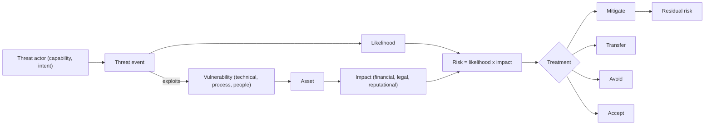

## Introduction

No organisation can protect everything perfectly. Budgets, staff time and management attention are limited, so security work must be prioritised. Risk is the concept that makes prioritisation possible: it combines *how likely* something harmful is with *how bad* it would be, and so allows a bank, a ministry or a small business to decide where the next cedi of security spending should go.

Students often use "threat", "vulnerability" and "risk" interchangeably, which leads to muddled analysis and weak examination answers. This lesson separates the three ideas precisely, introduces the risk equation, works through a full qualitative risk matrix for a Ghanaian SME and explains the four classic risk treatment options. You will also see, through the 2017 Equifax breach, how a single known vulnerability that was left unaddressed became a very large organisational risk.

## Learning Objectives

- Define threat, threat actor, vulnerability, exploit and risk, and explain how they relate.
- Classify threat sources as adversarial, accidental, structural or environmental.
- Apply the risk equation (risk = likelihood × impact) to score and rank risks in a 5 × 5 matrix.
- Compare the four risk treatment options and justify a choice for a given risk.
- Evaluate the difference between inherent and residual risk when presenting risks to management.

## Prerequisite Knowledge

- The CIA triad and the idea of security controls, from the previous lesson.
- Basic arithmetic and comfort reading tables.

## Key Terminology

- **Threat**: Any circumstance or event with the potential to cause harm to an asset through unauthorised access, destruction, disclosure, modification or denial of service.
- **Threat actor**: The person, group or force behind a threat, such as a criminal gang, a careless employee or a flood.
- **Vulnerability**: A weakness in a system, process, control or person that a threat could exploit.
- **Exploit**: A specific technique or piece of code that takes advantage of a vulnerability.
- **Likelihood**: An estimate of how probable it is that a threat will exploit a vulnerability within a given period.
- **Impact**: The magnitude of harm to the organisation if the event occurs, including financial, operational, legal and reputational harm.
- **Risk**: The combination of the likelihood of an adverse event and its impact; often expressed as risk = likelihood × impact.
- **Inherent risk**: The level of risk before any controls are applied.
- **Residual risk**: The level of risk that remains after controls have been implemented.
- **Risk appetite**: The amount and type of risk an organisation is willing to pursue or retain in pursuit of its objectives.

## Detailed Explanation

### Three distinct ideas

A useful way to keep the terms apart is a simple analogy. A shop in Makola Market holds cash (the **asset**). A thief operating in the area is a **threat actor**, and theft is the **threat**. A back door with a broken lock is a **vulnerability**. Picking that lock is the **exploit**. The **risk** is the combination of how likely it is that the thief will try the back door this month and how much would be lost if they did.

Notice three consequences of this model:

1. A vulnerability with no credible threat produces little risk. An unpatched server that is physically isolated and holds no valuable data may be a low priority.
2. A threat with no vulnerability produces little risk. A ransomware gang cannot easily exploit a system that is fully patched, segmented and backed up offline.
3. Risk changes when *either* side changes. A new exploit published online raises likelihood overnight even though the system itself has not changed.

### Classifying threat sources

NIST Special Publication 800-30 Revision 1, the US government's guide for conducting risk assessments, classifies threat sources into four broad groups:

| Threat source type | Description | Examples |
|---|---|---|
| Adversarial | Individuals, groups or states seeking to exploit dependence on cyber resources | Organised fraud rings, hacktivists, malicious insiders, nation-state groups |
| Accidental | Erroneous actions by people with legitimate access | An administrator deleting a production table; misaddressed email |
| Structural | Failures of equipment, software or environmental controls | Disk failure, software bugs, air-conditioning failure in a server room |
| Environmental | Natural or human-made disasters outside the organisation's control | Flooding in parts of Accra during heavy rains, fire, prolonged power outages |

Adversarial threats are further characterised by **capability** (skills and resources), **intent** (what they want) and **targeting** (whether they pick specific victims or attack opportunistically). Opportunistic attackers scan the whole internet for a known weakness; targeted attackers research a specific organisation.

### Types of vulnerability

Vulnerabilities are not only software bugs. A comprehensive assessment considers:

- **Technical** vulnerabilities: unpatched software, default passwords, misconfigured cloud storage, weak encryption.
- **Process** vulnerabilities: no approval step for supplier bank-detail changes, no off-boarding checklist for departing staff.
- **People** vulnerabilities: lack of awareness of phishing, staff under pressure to bypass controls.
- **Physical** vulnerabilities: unlocked server cabinets, laptops left in vehicles.

Publicly known software vulnerabilities are catalogued in the Common Vulnerabilities and Exposures (CVE) system, and their technical severity is often expressed using the Common Vulnerability Scoring System (CVSS). A CVSS score describes how severe a flaw is in general; it is *not* a risk score for your organisation, because it does not know how important the affected system is to you or whether it is exposed.

## Theories, Frameworks and Models

### The risk equation

The simplest formulation is:

`Risk = Likelihood × Impact`

Some texts expand it as `Risk = Threat × Vulnerability × Impact`, which makes explicit that likelihood depends on both the presence of a capable, motivated threat and the existence of an exploitable weakness. In qualitative assessments each factor is scored on an ordinal scale, commonly 1 to 5.

| Score | Likelihood (within 12 months) | Impact |
|---|---|---|
| 1 | Rare: not expected to occur | Negligible: minor inconvenience |
| 2 | Unlikely: could occur but not expected | Minor: small financial loss, brief disruption |
| 3 | Possible: might occur | Moderate: noticeable loss, regulatory query |
| 4 | Likely: will probably occur | Major: significant loss, customer harm, regulatory sanction |
| 5 | Almost certain: expected to occur | Severe: threatens survival or licence |

The product gives a score from 1 to 25, usually banded: **1-4 Low**, **5-9 Medium**, **10-16 High**, **20-25 Critical**. Organisations must define these scales in writing so that different assessors score consistently.

### Qualitative versus quantitative analysis

Quantitative methods attempt to express risk in money. A classic formulation is annualised loss expectancy: `ALE = SLE × ARO`, where the single loss expectancy (SLE) is the cost of one occurrence and the annualised rate of occurrence (ARO) is the expected number of occurrences per year. For example, if a laptop theft costs GH₵ 15,000 including data-breach handling and the organisation expects two thefts a year, ALE = GH₵ 30,000. A control costing less than the reduction in ALE it produces is, on this narrow measure, cost-justified. Quantitative analysis looks precise, but its inputs are often guesses; qualitative matrices are quicker and more common, provided their limitations are acknowledged.

### Risk treatment options

Once risks are ranked, each is treated in one of four ways:

1. **Mitigate (reduce)**: apply controls to lower likelihood or impact, such as patching or multi-factor authentication.
2. **Transfer (share)**: shift part of the financial impact to another party, such as through cyber insurance or a contract with a managed service provider. Accountability for protecting customers cannot be transferred.
3. **Avoid**: stop the activity that creates the risk, such as declining to store card numbers at all.
4. **Accept (retain)**: knowingly tolerate the risk because it is within appetite or treatment costs more than the risk. Acceptance must be a documented decision by an accountable owner, not neglect.

## Worked Example

### A risk matrix for a pharmacy chain

**Illustrative scenario.** *Nkabom Pharmacy* is a fictional chain of six pharmacies in Accra and Kumasi. It runs a cloud-hosted stock and point-of-sale system, accepts mobile money payments through a merchant wallet, and stores customer prescription records. The owner asks for a top-five risk register.

**Step 1: identify risk scenarios** (each pairs a threat with a vulnerability and an asset).

| # | Risk scenario |
|---|---|
| R1 | Fraudster performs SIM swap on the owner's phone, intercepts one-time passwords and empties the merchant wallet |
| R2 | Ransomware delivered by phishing email encrypts the back-office PC that holds local prescription records |
| R3 | Staff member shares the shared POS login with a friend who records sales off the books |
| R4 | Prolonged power outage stops tills at a branch with no backup power |
| R5 | Cloud provider's data centre suffers a multi-day outage |

**Step 2: score inherent risk.**

| # | Likelihood | Impact | Score | Band |
|---|---|---|---|---|
| R1 | 3 | 5 | 15 | High |
| R2 | 4 | 4 | 16 | High |
| R3 | 4 | 3 | 12 | High |
| R4 | 4 | 2 | 8 | Medium |
| R5 | 1 | 4 | 4 | Low |

**Step 3: justify the scores.** R2 is rated likely (4) because phishing is a constant, opportunistic threat and staff have had no awareness training. Impact is major (4) because prescription records are sensitive personal data under the Data Protection Act, 2012 (Act 843), and loss would disrupt dispensing. R1 is only "possible" (3) because it requires a targeted attack, but its impact is severe (5) because the wallet holds several days' takings.

**Step 4: select treatments and estimate residual risk.**

| # | Treatment | Control(s) | Residual L | Residual I | Residual score |
|---|---|---|---|---|---|
| R1 | Mitigate | Move wallet authentication to an app-based PIN plus device binding; ask the telco about SIM-swap protection; daily sweep of funds to the bank | 2 | 3 | 6 (Medium) |
| R2 | Mitigate | Awareness training, email filtering, removing local admin rights, encrypted offline backups tested monthly | 2 | 3 | 6 (Medium) |
| R3 | Mitigate | Individual logins, daily stock reconciliation, manager review of voids | 2 | 2 | 4 (Low) |
| R4 | Mitigate / accept | Uninterruptible power supply for tills; accept short outages | 3 | 1 | 3 (Low) |
| R5 | Accept / transfer | Accept, review provider's service commitments, keep a manual sales book | 1 | 4 | 4 (Low) |

**Step 5: present to management.** The owner sees that two High risks fall to Medium with modest spending, that R5 is accepted with a documented rationale, and that residual risks R1 and R2 remain at Medium and must be monitored. This is the essence of risk-based security: decisions are explicit, justified and owned.

## Ghanaian Business Application

Several features of Ghana's business environment shape risk assessments in practice:

- **Mobile money dependence.** For many SMEs the merchant wallet is the business's main bank account. Social engineering calls that impersonate telecom staff, and SIM-swap fraud that defeats SMS-based verification, are therefore high-impact risks for small firms.
- **Ghana Card and SIM registration.** The national SIM re-registration exercise linked mobile numbers to Ghana Card identities. This can strengthen identity assurance, but it also means that identity data held by agents and operators becomes a valuable target, so confidentiality risks shift rather than disappear.
- **Power and connectivity.** Environmental and structural threats, including power interruptions, are realistic and should appear in any availability assessment.
- **Regulation.** Banks, payment service providers and critical information infrastructure owners face sector-specific expectations from regulators such as the Bank of Ghana and the Cyber Security Authority established under the Cybersecurity Act, 2020 (Act 1038). A risk register that ignores regulatory impact will underestimate consequences.

A practical lesson for Ghanaian managers is that the most likely risks are often not exotic hacking but fraud, social engineering, weak access practices and power or connectivity failure.

## International Case Study

### The 2017 Equifax breach

Equifax, one of the major US consumer credit reporting agencies, announced in September 2017 that attackers had obtained personal data on a very large number of consumers (around 147 million people, according to later official accounts). Reports by the US Government Accountability Office and a US House of Representatives committee documented the main facts:

- In March 2017 a critical vulnerability in the Apache Struts web framework (CVE-2017-5638) was publicly disclosed and a fix was released.
- Equifax's online dispute portal used the vulnerable component and was not patched. Attackers exploited it from May 2017.
- An expired digital certificate on a network monitoring device meant that encrypted traffic was not being inspected, so the attackers' data extraction went undetected for weeks.
- Once inside, the attackers found credentials stored insecurely, which helped them reach further databases.

**Risk analysis.** The *threat* (opportunistic attackers scanning for Struts) was widespread after disclosure; the *vulnerability* was known and patchable; the *asset* was extremely sensitive. Likelihood rose sharply the day the vulnerability was published, but the organisation's risk process did not respond in time. The case also shows how one weakness combined with several others (failed detection, poor credential storage, limited segmentation) to produce a severe impact: a textbook failure of defence in depth.

## Diagram

## Common Misconceptions

- "A high CVSS score means high risk for us." CVSS measures the generic severity of a flaw; organisational risk also depends on asset value, exposure and existing controls.
- "Buying insurance removes the risk." Insurance transfers part of the financial impact, but the organisation still suffers disruption and reputational harm and remains accountable to customers and regulators.
- "Accepting a risk means ignoring it." Acceptance is a documented, time-limited decision by an accountable owner, with the risk still monitored.
- "Threats and vulnerabilities are the same thing." A threat is a potential cause of harm; a vulnerability is the weakness it exploits. You can reduce vulnerabilities directly but rarely threats.
- "Qualitative scores can be added up like money." Ordinal scores show ranking; a risk scored 16 is not exactly twice as bad as one scored 8.

## Common Examination Mistakes

- Calling a phishing email a "vulnerability" rather than a threat (the vulnerability is the untrained user or missing email filter).
- Producing a risk matrix without stating the scales or justifying the scores.
- Recommending controls without stating whether they reduce likelihood, impact or both.
- Forgetting to estimate residual risk after treatment.
- Choosing "transfer" for risks to personal data and claiming the organisation is no longer responsible.

## Critical Thinking Questions

1. Why might two competent assessors give the same risk different scores, and how should an organisation reduce that inconsistency?
2. Equifax's vulnerability was public and patchable. What organisational, rather than technical, factors might explain delays in patching critical systems?
3. Should a small Ghanaian business invest first in cyber insurance or in basic controls such as backups and MFA? Justify your answer.
4. How does the publication of a proof-of-concept exploit change the likelihood component of risk for organisations that use the affected software?
5. Is a 5 × 5 qualitative matrix adequate for a bank's board, or should it insist on quantitative estimates? Discuss.

## Practical Exercises

1. **Personal risk register.** For your own digital life (phone, email, mobile money wallet, laptop), identify five risk scenarios, score likelihood and impact on a 1-5 scale and propose one treatment for each. Expected output: a table with scenario, L, I, score, treatment and residual score.
2. **Classify threat sources.** List ten events that could disrupt your workplace's IT (for example a burst pipe, a disgruntled employee, a ransomware campaign). Classify each as adversarial, accidental, structural or environmental. Expected output: a ten-row classification table with one sentence of justification per row.
3. **ALE calculation.** A company estimates that a website outage costs GH₵ 8,000 per occurrence and expects three per year. A redundant hosting service would cost GH₵ 12,000 per year and reduce outages to one per year. Calculate ALE before and after and decide whether the control is cost-justified. Expected output: before ALE GH₵ 24,000; after ALE GH₵ 8,000; reduction GH₵ 16,000, which exceeds the GH₵ 12,000 cost, so the control is justified on this measure, with a note on non-financial factors.
4. **Read a vulnerability record.** Look up CVE-2017-5638 in a public vulnerability database such as the US National Vulnerability Database. Do not attempt to test it on any system. Expected output: a short note recording the affected product, the published severity and why severity alone does not determine organisational risk.

## Key Takeaways

- A threat is a potential cause of harm, a vulnerability is a weakness, and risk combines likelihood with impact.
- Threat sources can be adversarial, accidental, structural or environmental; all belong in a risk assessment.
- Qualitative 5 × 5 matrices rank risks quickly, but scales must be defined and scores justified.
- Risks are mitigated, transferred, avoided or accepted; acceptance must be documented and owned.
- Residual risk after controls, not inherent risk, is what management ultimately accepts.

## Further Reading

- Joint Task Force Transformation Initiative. (2012). *Guide for conducting risk assessments* (NIST Special Publication 800-30 Rev. 1). National Institute of Standards and Technology. <https://doi.org/10.6028/NIST.SP.800-30r1>
- National Institute of Standards and Technology. (2024). *The NIST Cybersecurity Framework (CSF) 2.0* (NIST CSWP 29). <https://www.nist.gov/cyberframework>
- Stallings, W., & Brown, L. (2018). *Computer security: Principles and practice* (4th ed.). Pearson.
- Anderson, R. (2020). *Security engineering: A guide to building dependable distributed systems* (3rd ed.). Wiley.

## Video Resources

- [NIST Computer Security Resource Center](https://csrc.nist.gov/): National Institute of Standards and Technology. Official home of NIST security publications, including SP 800-30, with project pages and presentations on risk management.
- [Cisco Skills for All](https://skillsforall.com/): Cisco Networking Academy. Free cybersecurity courses whose modules explain threats, vulnerabilities and risk with interactive examples.

## Revision Summary

Risk arises when a threat can exploit a vulnerability in a valuable asset; it is estimated as likelihood × impact, ranked in a defined matrix, and treated by mitigation, transfer, avoidance or documented acceptance, leaving residual risk that management must own.

- Threat = potential harm; vulnerability = weakness; risk = likelihood × impact.
- Threat sources: adversarial, accidental, structural, environmental.
- 5 × 5 matrix: define scales, justify scores, band results.
- ALE = SLE × ARO for quantitative comparisons.
- Treatments: mitigate, transfer, avoid, accept.
- Equifax 2017: known, patchable flaw left unaddressed plus failed detection.
