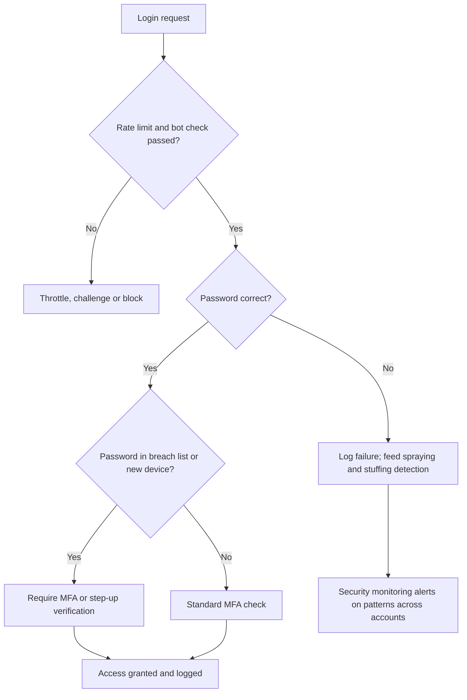

## Introduction

Two families of attack threaten almost every online service, from a university portal to a mobile banking app. The first, **denial of service**, attacks availability: it tries to make a service unusable for legitimate users by exhausting its bandwidth, processing capacity or application resources. The second, **credential attacks**, attacks authentication: it tries to obtain or guess valid usernames and passwords so that the attacker can simply log in as a legitimate user.

These attacks are often underestimated because they seem crude. Yet large botnets built from insecure internet-connected devices have disrupted major internet infrastructure, and a single reused password on a remote access account has been reported as the entry point for a ransomware attack that halted fuel supplies in the United States. This lesson explains how the attacks work at a conceptual level, quantifies password strength with worked calculations and develops a defensive design that a Ghanaian bank or e-commerce firm could apply.

## Learning Objectives

- Classify denial-of-service attacks as volumetric, protocol or application-layer and explain the role of botnets and reflection.
- Distinguish brute force, dictionary, credential stuffing and password spraying attacks by their patterns.
- Apply search-space calculations to compare password policies.
- Analyse authentication logs to recognise signs of spraying and stuffing.
- Evaluate defensive designs combining rate limiting, MFA, breached-password screening and DDoS mitigation services.

## Prerequisite Knowledge

- The CIA triad, particularly availability and authenticity.
- Basic familiarity with how web logins and IP addresses work.

## Key Terminology

- **Denial of service (DoS)**: An attack that prevents legitimate users from accessing a service by exhausting or disrupting its resources.
- **Distributed denial of service (DDoS)**: A DoS attack launched from many sources at once, typically a botnet.
- **Botnet**: A network of compromised devices remotely controlled by an attacker.
- **Reflection and amplification**: Techniques in which attackers send small requests with a spoofed source address to third-party servers, which send much larger responses to the victim.
- **Brute force attack**: Systematically trying all possible combinations of characters until the correct password is found.
- **Dictionary attack**: Trying likely passwords from lists of common words, leaked passwords and predictable patterns.
- **Credential stuffing**: Automatically testing username and password pairs leaked from one service against other services, exploiting password reuse.
- **Password spraying**: Trying a small number of common passwords against many accounts to avoid triggering per-account lockouts.
- **Rate limiting**: Restricting the number of requests a client can make in a given time window.

## Detailed Explanation

### Denial of service

A service becomes unavailable when some resource it depends on is exhausted. Attacks are commonly grouped into three categories:

| Category | Resource targeted | Conceptual example | Main defences |
|---|---|---|---|
| Volumetric | Network bandwidth | Flooding a link with more traffic than it can carry, often via reflection and amplification | Upstream scrubbing by ISP or DDoS mitigation provider; content delivery networks |
| Protocol (state exhaustion) | Connection tables in servers, firewalls and load balancers | SYN floods that leave many half-open TCP connections | SYN cookies, connection limits, hardened network devices |
| Application layer | Server CPU, memory, database | Repeated expensive requests such as searches or login attempts | Rate limiting, caching, web application firewalls, CAPTCHA or challenge pages |

**Botnets** make DDoS cheap. Devices such as poorly secured cameras and routers, often still using default passwords, can be compromised in bulk and directed to send traffic. **Reflection** relies on internet services that respond to unauthenticated requests over UDP; because UDP does not verify the source address, an attacker can forge the victim's address so that responses flood the victim. Where the response is much larger than the request, the attack is **amplified**.

Not all denial of service is malicious. A legitimate surge of users on a salary day or during a promotion can overwhelm a system in the same way. Capacity planning and graceful degradation therefore protect availability against both attacks and success.

### Credential attacks

Credential attacks target the weakest part of most authentication systems: human-chosen, reused passwords.

- **Online guessing** sends attempts to the live login service. It is slow and detectable, so attackers use spraying or stuffing to stay under thresholds.
- **Offline cracking** happens after an attacker steals a database of password hashes. The attacker can then make guesses at the speed of their own hardware, without lockouts. How the passwords were hashed (covered in Module 4) then determines how long they survive.
- **Credential stuffing** exploits reuse. Billions of leaked credentials circulate, and automated tools test them against banks, retailers and email providers. Success rates per attempt are low, but volume makes the attack profitable.
- **Password spraying** exploits predictable choices. The attacker tries a handful of passwords such as a season and year or the organisation's name followed by "123" against every account, perhaps one attempt per account per hour, never triggering lockout.
- **Credential theft** by phishing, keylogging infostealers or interception (covered in the previous lesson) bypasses guessing entirely.
- Inside a compromised Windows network, attackers may also reuse captured password hashes or authentication tickets directly ("pass-the-hash"), which is why privileged credentials must not be exposed on ordinary workstations.

### The lockout dilemma

Account lockout after a few failures stops naive brute force against one account, but it creates a new denial-of-service risk: an attacker can lock out every customer deliberately. It also does little against spraying, which uses one or two attempts per account. Modern guidance, including NIST SP 800-63B, therefore favours **rate limiting and throttling** combined with MFA and screening of new passwords against lists of breached and commonly used values, rather than relying on aggressive lockout or forced frequent password changes.

## Theories, Frameworks and Models

### Password search space

The number of possible passwords of length `L` drawn from an alphabet of `N` characters is `N^L`. On average, a brute-force attacker finds the password after searching half the space. This model applies only to truly random passwords; human-chosen passwords are far weaker than their length suggests because they follow patterns that dictionary attacks exploit.

### Layered authentication defence

A defensible login design combines:

1. **Prevention of guessing**: per-account and per-source rate limits, progressive delays, bot detection.
2. **Reduction of guessable passwords**: minimum length (NIST SP 800-63B recommends allowing long passphrases and requiring a reasonable minimum), screening against breached-password lists, no arbitrary composition rules that push users towards predictable patterns.
3. **Making passwords insufficient**: multi-factor authentication, ideally phishing-resistant.
4. **Detection**: monitoring for many failures across many accounts, logins from unusual locations and successful logins that follow bursts of failures.
5. **Response**: forcing password resets for accounts found in breach data, notifying users of new device logins.

## Worked Example

### Part A: comparing password policies

Assume, purely for illustration, an offline attacker who can test 10 billion (10^10) guesses per second against a fast, unsalted hash. (Real speeds vary greatly with hardware and hashing algorithm.)

| Policy | Alphabet N | Length L | Search space N^L | Worst-case time at 10^10/s |
|---|---|---|---|---|
| 8 lowercase letters | 26 | 8 | about 2.1 × 10^11 | about 21 seconds |
| 8 characters, all printable ASCII | 95 | 8 | about 6.6 × 10^15 | about 7.7 days |
| 12 lowercase letters | 26 | 12 | about 9.5 × 10^16 | about 110 days |
| 16 lowercase letters | 26 | 16 | about 4.4 × 10^22 | about 140,000 years |

**Calculation check for row 2:** 95^8 ≈ 6.63 × 10^15. Dividing by 10^10 gives 6.63 × 10^5 seconds; dividing by 86,400 seconds per day gives about 7.7 days.

**Interpretation.** Length increases the search space faster than character variety: a 12-character lowercase random password is stronger than an 8-character complex one. However, these figures assume randomness. "Password@2024" technically uses all four character types but would fall quickly to a dictionary attack. Two lessons follow: encourage long passphrases, and use slow, salted password hashing (bcrypt or Argon2) so that each guess costs the attacker far more.

### Part B: reading the logs

**Illustrative scenario.** The security analyst at *Sankofa Online*, a fictional Accra e-commerce firm, reviews one hour of login logs.

| Pattern | Observation | Likely attack |
|---|---|---|
| A | 1,200 failed logins for 1,200 different usernames from 15 IP addresses, all using the same password; three successes | Password spraying |
| B | 40,000 attempts for 40,000 different username-password pairs from thousands of IP addresses, many usernames not registered on the site; 0.5% succeed | Credential stuffing with leaked pairs from another service |
| C | 3,000 failed attempts against one administrator account from one IP address | Online brute force or dictionary attack |

**Recommended responses:** For A, block or challenge the source addresses, force resets for the three compromised accounts and add the sprayed password to the blocked list. For B, enable bot detection, require MFA or step-up verification for logins from new devices, and screen all customer passwords against breach data. For C, confirm rate limiting is working, restrict administrator login to the corporate VPN and require phishing-resistant MFA for privileged accounts.

## Ghanaian Business Application

- **Peak-period availability.** Ghanaian banks, telecom operators and government portals experience predictable surges, such as at month-end salary payments, examination result releases or tax deadlines. Capacity planning, content delivery networks and DDoS mitigation services from upstream providers protect against both attacks and legitimate surges. Many local organisations depend on a small number of international connectivity routes and data centres, so availability planning should consider upstream dependencies too.
- **PIN-based mobile money.** Four- or five-digit PINs have tiny search spaces (10,000 or 100,000 combinations), so their security depends entirely on strict attempt limits and on binding the wallet to the SIM and device. This makes the integrity of SIM replacement processes critical, since a SIM swap can let an attacker reset a PIN.
- **Password reuse among staff.** Staff often reuse the same password across personal email, social media and work systems. When a public service is breached, credential stuffing against corporate webmail or VPN follows. Ghanaian SMEs can reduce this risk cheaply by enabling MFA on email and remote access, which many cloud email platforms include at no extra cost.
- **IoT devices.** Low-cost CCTV systems and routers installed in shops and offices are often left with default credentials and can be recruited into botnets. Changing default passwords and keeping firmware updated are basic responsibilities of installers and owners.

## International Case Study

### Mirai and the 2016 Dyn attack; Colonial Pipeline 2021

**Mirai (2016).** The Mirai malware infected internet-connected devices such as cameras and home routers by trying a short list of factory default usernames and passwords over remote administration services. Infected devices formed a large botnet. In October 2016 a Mirai-based DDoS attack against Dyn, a major provider of Domain Name System (DNS) services, caused widespread disruption in reaching popular websites for users in parts of North America and Europe, because those sites depended on Dyn to resolve their names. The case links credential weakness (default passwords) to availability failure at internet scale, and demonstrates **dependency risk**: the target websites were not attacked directly, but their DNS provider was.

**Colonial Pipeline (2021).** In May 2021, Colonial Pipeline, which operates a major fuel pipeline in the United States, was hit by ransomware attributed to the DarkSide group and shut down pipeline operations for several days as a precaution. In testimony to the US Congress, the company's chief executive stated that the attackers had entered through a legacy VPN account that was no longer in use but still active, protected only by a password and without multi-factor authentication. The password was reported to have been found among leaked credentials.

**Lessons:**

- Default and reused credentials are an entry point for both botnet recruitment and targeted intrusions.
- Dormant accounts must be removed; access reviews are a basic control.
- MFA on all remote access is a minimum standard.
- Critical services should avoid single points of failure in external dependencies such as DNS.

## Diagram

## Common Misconceptions

- "Account lockout solves password attacks." Lockout does little against spraying and can itself be abused to deny service; rate limiting, MFA and breached-password screening are more effective.
- "Complex character rules make passwords strong." Composition rules often produce predictable patterns; length and randomness matter more.
- "A DDoS attack means we were hacked." A DDoS disrupts availability but does not necessarily involve any intrusion; however, it is sometimes used as a distraction during other attacks.
- "Credential stuffing is the victim site's fault alone." It exploits passwords leaked elsewhere; the defending site must still detect and block it, and users must stop reusing passwords.
- "Forcing password changes every 30 days improves security." Frequent forced changes encourage predictable increments; NIST SP 800-63B advises changing passwords when there is evidence of compromise.

## Common Examination Mistakes

- Confusing password spraying (one password, many accounts) with credential stuffing (many leaked pairs, many accounts).
- Calculating search space as `L^N` instead of `N^L`.
- Treating search-space calculations as valid for human-chosen passwords.
- Recommending only firewalls against volumetric DDoS, when bandwidth must be protected upstream.
- Ignoring the business impact of lockout policies on legitimate customers.

## Critical Thinking Questions

1. Should manufacturers of internet-connected devices be legally required to eliminate default passwords? Consider the Ghanaian market for low-cost imported devices.
2. How would you design login protection for a mobile money service whose customers mainly use basic phones and USSD rather than smartphone apps?
3. When an organisation detects credential stuffing, what responsibilities does it have towards customers whose accounts were accessed with correct passwords?
4. Is it reasonable for a small business to rely on its cloud or hosting provider for DDoS protection? What should it verify in the contract?
5. How should the trade-off between security and customer friction differ between a bank and a news website?

## Practical Exercises

1. **Search-space calculations.** Calculate `N^L` and worst-case time at an assumed 10^9 guesses per second for: a 6-digit PIN, a 10-character lowercase password and a passphrase of four words chosen randomly from a 7,776-word list (`7776^4`). Expected output: 10^6 combinations (about 0.001 s), about 1.4 × 10^14 (about 39 hours) and about 3.7 × 10^15 (about 42 days), with a sentence on why randomness matters.
2. **Check your own exposure.** Using a reputable breach-notification service, check whether your own email address appears in known breaches, and enable MFA on any account where it does. Check only addresses you own. Expected output: a short record of results and the accounts on which MFA is now enabled.
3. **Log analysis design.** Write three detection rules in plain English for spotting spraying, stuffing and single-account brute force in a login log. Expected output: three rules, each stating the fields used, the threshold and the response.
4. **Legal lab practice.** Complete the authentication labs in the PortSwigger Web Security Academy, which provides deliberately vulnerable practice applications intended for learning. Never test login pages of real organisations. Expected output: a summary of two lab findings and the defensive control that would have prevented each.

## Key Takeaways

- Denial of service targets availability through volumetric, protocol or application-layer exhaustion; botnets and reflection amplify attacks.
- Credential attacks include brute force, dictionary attacks, credential stuffing and password spraying, each with a recognisable log pattern.
- Search space `N^L` shows length matters more than complexity, but only for random passwords.
- Rate limiting, MFA, breached-password screening and monitoring outperform aggressive lockout and forced periodic changes.
- Mirai and Colonial Pipeline show how default, reused and dormant credentials enable large-scale harm.

## Further Reading

- National Institute of Standards and Technology. (2017). *Digital identity guidelines: Authentication and lifecycle management* (NIST Special Publication 800-63B). <https://doi.org/10.6028/NIST.SP.800-63b>
- Stallings, W., & Brown, L. (2018). *Computer security: Principles and practice* (4th ed.). Pearson.
- Anderson, R. (2020). *Security engineering: A guide to building dependable distributed systems* (3rd ed.). Wiley.

## Video Resources

- [PortSwigger Web Security Academy](https://portswigger.net/web-security): PortSwigger. Free learning materials and legal practice labs, including authentication vulnerabilities and defences.
- [OWASP](https://owasp.org/): OWASP Foundation. Official site of the open community project, with guidance on authentication, credential stuffing and automated threats to web applications.
- [CISA cybersecurity resources](https://www.cisa.gov/): Cybersecurity and Infrastructure Security Agency. Official guidance on DDoS preparedness and multi-factor authentication.

## Revision Summary

Denial-of-service attacks exhaust bandwidth, connection state or application resources, usually via botnets; credential attacks guess, reuse or steal passwords. Strong defence combines upstream DDoS mitigation and capacity planning with rate limiting, long passwords screened against breach lists, MFA and log-based detection.

- DoS types: volumetric, protocol, application layer.
- Spraying = one password, many accounts; stuffing = leaked pairs, many accounts.
- Search space = `N^L`; length beats complexity for random passwords.
- Lockout can itself cause denial of service; prefer throttling and MFA.
- Mirai 2016: default passwords built a botnet that hit DNS provider Dyn.
- Colonial 2021: dormant VPN account, password only, no MFA.
