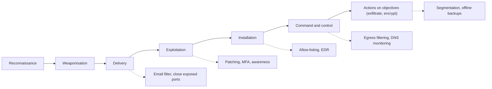

## Introduction

Malicious software, or malware, has evolved from pranks written by hobbyists into a professional criminal industry. Today's most damaging variant, ransomware, can halt hospitals, ports and banks within hours, and criminal groups increasingly combine encryption of systems with theft and public exposure of data. For a business manager, malware is no longer simply an "IT problem": it is a business continuity, legal and reputational risk.

This lesson classifies malware families by how they spread and what they do, explains the modern ransomware business model, and introduces two attack lifecycle models used by defenders: the Lockheed Martin Cyber Kill Chain and MITRE ATT&CK. You will apply these models to the WannaCry and NotPetya outbreaks of 2017 and to an illustrative Ghanaian scenario, and you will learn why tested, offline backups remain the single most important ransomware control.

## Learning Objectives

- Classify malware types (virus, worm, Trojan, ransomware, spyware, rootkit, botnet agent) by propagation method and payload.
- Explain the stages of the Lockheed Martin Cyber Kill Chain and the structure of MITRE ATT&CK at overview level.
- Analyse a ransomware incident by mapping attacker actions to kill chain stages and corresponding defences.
- Compare WannaCry and NotPetya in terms of propagation, intent and lessons for defenders.
- Evaluate a ransomware resilience plan for an organisation, including backup design and the decision whether to pay.

## Prerequisite Knowledge

- The CIA triad and the threat–vulnerability–risk model from Module 1.
- Basic understanding of operating systems, file sharing and email.

## Key Terminology

- **Malware**: Software intentionally designed to harm, exploit or gain unauthorised control of a device, network or data.
- **Virus**: Malware that attaches to a host file or program and spreads when that host is executed or shared.
- **Worm**: Self-propagating malware that spreads across networks by exploiting vulnerabilities without user action.
- **Trojan**: Malware disguised as legitimate software, relying on the user to install or run it.
- **Ransomware**: Malware that encrypts or locks data or systems and demands payment for restoration, often combined with data theft.
- **Double extortion**: A ransomware tactic in which attackers steal data before encrypting it and threaten to publish it if the ransom is not paid.
- **Rootkit**: Malware that hides its presence by subverting the operating system or firmware.
- **Command and control (C2)**: The communication channel attackers use to send instructions to compromised systems.
- **Indicator of compromise (IOC)**: Observable evidence, such as a file hash, domain or IP address, suggesting a system has been compromised.
- **Lateral movement**: Techniques attackers use to move from an initially compromised system to other systems within a network.

## Detailed Explanation

### Classifying malware

Malware is best classified on two independent dimensions: **how it spreads** (propagation) and **what it does** (payload).

| Type | Propagation | Typical payload | Defensive focus |
|---|---|---|---|
| Virus | Infects host files; spreads when files are shared or run | Varies: corruption, backdoor | Endpoint protection, application control |
| Worm | Self-propagates via network vulnerabilities | Often carries other payloads | Patching, network segmentation, disabling legacy protocols |
| Trojan | User installs disguised software | Backdoor, credential theft | User awareness, allow-listing, least privilege |
| Spyware / infostealer | Usually Trojan or exploit delivery | Captures credentials, keystrokes, browser data | MFA, endpoint detection, credential hygiene |
| Rootkit | Installed after compromise | Concealment, persistence | Secure boot, integrity monitoring, rebuild after compromise |
| Botnet agent | Any delivery method | Joins a remotely controlled network for DDoS, spam or fraud | Egress filtering, monitoring for C2 traffic |
| Ransomware | Phishing, exposed remote access, worms, supply chain | Encryption, data theft, extortion | Backups, MFA on remote access, segmentation, detection |

Real campaigns blend types. A phishing attachment (Trojan) may install an infostealer, which gives attackers credentials; they then deploy ransomware manually across the network.

### The ransomware business model

Modern ransomware is frequently run as **ransomware-as-a-service (RaaS)**: developers maintain the malware and payment infrastructure, while "affiliates" break into victims and share the proceeds. Some criminals specialise as **initial access brokers**, selling footholds in organisations to others. This division of labour means that even small organisations are targeted opportunistically.

Typical stages of a human-operated ransomware attack are:

1. **Initial access**: phishing, stolen credentials for remote desktop or VPN services without MFA, or exploitation of an unpatched internet-facing system.
2. **Establish foothold and escalate privileges**: harvest passwords, exploit local weaknesses.
3. **Discovery and lateral movement**: map the network, find domain controllers, file servers and backups.
4. **Exfiltration**: copy valuable data to attacker-controlled storage (enabling double extortion).
5. **Impact**: delete or encrypt backups, then encrypt systems and display a ransom note.

The gap between initial access and encryption can range from hours to weeks. That window is the defender's opportunity: detection of lateral movement or unusual data transfer can stop an attack before impact.

### Why "pay or not pay" is a governance question

Paying a ransom does not guarantee decryption, may fund further crime, may breach sanctions laws in some jurisdictions and marks the victim as willing to pay. Many government agencies, including the US Cybersecurity and Infrastructure Security Agency (CISA), advise against payment. Yet a board facing a halted business may still consider it. The decision must be prepared *in advance* in an incident response plan, with legal advice, rather than improvised under pressure.

## Theories, Frameworks and Models

### The Lockheed Martin Cyber Kill Chain

In 2011, Hutchins, Cloppert and Amin of Lockheed Martin described intrusions as a chain of seven stages. The key insight is that the attacker must succeed at *every* stage, while the defender needs to break only one link.

| Stage | Attacker activity | Example defences |
|---|---|---|
| 1. Reconnaissance | Research targets: staff names, email formats, exposed services | Limit public information, monitor for scanning |
| 2. Weaponisation | Build a payload, such as a malicious document | Threat intelligence on current lures |
| 3. Delivery | Send the payload: email, website, USB, exposed service | Email filtering, web filtering, closing exposed ports |
| 4. Exploitation | Trigger the vulnerability or trick the user | Patching, disabling macros, user awareness |
| 5. Installation | Install persistent malware | Application allow-listing, endpoint detection and response |
| 6. Command and control | Establish remote control channel | Egress filtering, DNS monitoring |
| 7. Actions on objectives | Steal, encrypt, destroy | Segmentation, data loss prevention, offline backups |

Critics note that the model is perimeter-centric and fits external malware intrusions better than insider threats or cloud identity attacks, which is one reason more granular models have emerged.

### MITRE ATT&CK at overview level

MITRE ATT&CK is a publicly available knowledge base of adversary behaviour based on real-world observations. It is organised as a matrix of **tactics** (the attacker's goal at a stage, such as Initial Access, Persistence, Privilege Escalation, Credential Access, Lateral Movement, Exfiltration and Impact) and **techniques** (how the goal is achieved, such as phishing or valid accounts). Each technique page lists detection and mitigation ideas. Defenders use ATT&CK to:

- map their detections and identify coverage gaps;
- describe incidents in a common language;
- prioritise controls against techniques used by groups that target their sector.

Where the Kill Chain gives a simple linear story suitable for executives, ATT&CK provides the detailed vocabulary security teams use day to day. Note that ATT&CK describes behaviour for defensive purposes; it is not a guide to conducting attacks.

## Worked Example

### Mapping a ransomware incident to the kill chain

**Illustrative scenario.** *Akwaaba Clinic* is a fictional private clinic in Kumasi with a small network: reception PCs, a file server holding patient records, and a remote desktop service exposed to the internet so the administrator can work from home.

**Timeline of the (fictional) incident and mapping:**

| Day | Event | Kill chain stage | ATT&CK tactic | Missed defence |
|---|---|---|---|---|
| 1 | Internet scan finds the exposed remote desktop port | Reconnaissance | Reconnaissance | Remote access exposed without VPN or MFA |
| 2 | Attacker logs in using a password reused from a breached website | Delivery / Exploitation | Initial Access (valid accounts) | No MFA; no password reuse checks |
| 2 | Attacker creates a new administrator account | Installation | Persistence | No alerting on new privileged accounts |
| 3–9 | Attacker explores network and finds the file server and a backup drive mapped as a network share | Command and control / Actions | Discovery, Lateral Movement | Flat network; backups reachable from user systems |
| 10 | Patient records copied out | Actions on objectives | Exfiltration | No egress monitoring |
| 11 | Backups deleted, files encrypted, ransom note displayed | Actions on objectives | Impact | No offline or immutable backup |

**Analysis.** Breaking any one link would have changed the outcome. MFA on remote access would probably have prevented initial access. Alerting on new administrator accounts would have given eight days' warning. An offline backup would have turned a crisis into a recovery exercise. Because patient data was exfiltrated, the clinic also faces obligations under the Data Protection Act, 2012 (Act 843) regardless of whether it restores its systems.

**Prioritised recommendations:** remove direct internet exposure of remote desktop and require VPN with MFA; adopt the 3-2-1 backup rule with at least one offline or immutable copy and regular restore tests; individual administrator accounts with alerting; segmentation separating reception PCs from the records server; patching and endpoint detection; an incident response plan with contact details for the Cyber Security Authority's incident reporting channels.

## Ghanaian Business Application

Ghanaian organisations share the global ransomware risk but have particular exposures:

- **SMEs with limited IT staff** often rely on a single external technician, use pirated or unsupported software that cannot be updated and expose remote access for convenience.
- **Mobile money and banking malware** on Android phones can include fake apps that request accessibility permissions in order to read SMS codes or overlay login screens. Installing apps only from official stores and reviewing permissions are simple defences that customers can be taught.
- **Removable media** remain common for sharing files between offices, so traditional viruses spread via USB drives still matter.
- **Critical information infrastructure**: The Cybersecurity Act, 2020 (Act 1038) provides for the designation of critical information infrastructure and incident reporting to the Cyber Security Authority. Hospitals, utilities and financial institutions should check whether these provisions apply to them.

A practical recommendation for Ghanaian SMEs is a "ransomware minimum": licensed and updated operating systems, MFA on email and remote access, no daily use of administrator accounts and a weekly backup taken offline and test-restored.

## International Case Study

### WannaCry and NotPetya (2017)

**WannaCry (May 2017).** WannaCry was ransomware with worm capability. It spread by exploiting a vulnerability in the Server Message Block version 1 (SMBv1) protocol in Microsoft Windows, for which Microsoft had released a patch (MS17-010) in March 2017. The exploit, known as EternalBlue, had been leaked publicly the previous month. Infected machines scanned for other vulnerable systems, so the malware spread rapidly through networks with unpatched machines and SMB exposed. The UK's National Health Service was severely disrupted: the UK National Audit Office later reported cancelled appointments and diverted ambulances. The spread slowed when a security researcher registered a domain name that the malware checked, which acted as a "kill switch". The UK and US governments later publicly attributed WannaCry to North Korean actors.

**NotPetya (June 2017).** NotPetya first spread through a compromised software update for M.E.Doc, an accounting package widely used in Ukraine, which made it a **supply chain attack**. It then moved laterally using the EternalBlue exploit and stolen credentials. Although it displayed a ransom note, it was designed so that recovery through payment was not realistically possible, so it behaved as a destructive **wiper**. Multinationals with operations in Ukraine, including the shipping company Maersk and the pharmaceutical company Merck, suffered major disruption. The UK and US governments attributed NotPetya to the Russian military in 2018.

**Lessons:**

- Patch management and disabling legacy protocols such as SMBv1 directly reduce worm propagation.
- Network segmentation limits how far self-propagating malware can travel.
- Trusted software updates can become delivery channels; supplier risk management matters.
- Credential theft enables spread even to patched machines, so privileged account protection is essential.
- Offline backups and rebuild procedures determine how quickly an organisation recovers.

## Diagram

Solid arrows show the attacker's progression; dotted arrows show the defences that can break each link.

## Common Misconceptions

- "Antivirus is enough to stop ransomware." Human-operated ransomware often uses legitimate tools and stolen credentials that signature-based antivirus does not flag; layered controls and behavioural detection are needed.
- "If we restore from backup, the incident is over." Modern ransomware often steals data first, so restoration does not address the confidentiality breach, legal notification duties or persistence the attacker may have left.
- "Backups on a network share are safe." Attackers deliberately seek and delete reachable backups; at least one copy must be offline or immutable.
- "Only large companies are targeted." Opportunistic scanning and RaaS affiliates target any organisation with exposed weaknesses, including small clinics and shops.
- "NotPetya was just ransomware." Its design made recovery through payment unrealistic, so it functioned as destructive malware disguised as ransomware.

## Common Examination Mistakes

- Confusing worms (self-propagating) with viruses (needing a host and user action).
- Listing the kill chain stages without linking each to a specific defence.
- Treating MITRE ATT&CK as a linear model rather than a matrix of tactics and techniques.
- Describing WannaCry as a zero-day attack, when a patch had been available for about two months.
- Recommending "pay the ransom" or "never pay" without discussing governance, legal advice and business impact.

## Critical Thinking Questions

1. Why might an organisation that had applied the March 2017 patch still have been affected by NotPetya?
2. Is the Cyber Kill Chain still useful for cloud-based organisations whose staff work from home? What would you add or change?
3. Should governments prohibit ransom payments? Consider the positions of victims, insurers and law enforcement.
4. How would you persuade the owner of a small Ghanaian business, who sees backups as an unnecessary expense, to invest in them?
5. What are the ethical and practical limits of sharing indicators of compromise publicly after an incident?

## Practical Exercises

1. **Kill chain mapping.** Using public reporting on WannaCry (for example the UK National Audit Office's investigation), map the attack to the seven kill chain stages and state one defence per stage. Expected output: a seven-row table of stage, attacker action and defence.
2. **Explore ATT&CK safely.** Visit the MITRE ATT&CK website and open the Enterprise matrix. Choose three techniques under Initial Access and note the mitigations listed for each. Expected output: a table of technique, short description and two mitigations.
3. **Backup audit of your own data.** For a computer you own, document where your important files are stored, how many copies exist, whether one is offline and when you last restored a file. Expected output: a 3-2-1 assessment with one improvement implemented and a successful test restore recorded.
4. **Lab practice.** Complete the endpoint security or cyber threat management material on Cisco Skills for All, which provides a legal learning environment. Never download or run real malware samples on any system you do not own and control for that purpose. Expected output: a short reflection listing three detection techniques you learned.

## Key Takeaways

- Malware is classified by propagation (virus, worm, Trojan) and payload (ransomware, spyware, rootkit, botnet agent).
- Human-operated ransomware involves initial access, privilege escalation, lateral movement, exfiltration and impact, giving defenders a detection window.
- The Cyber Kill Chain shows that breaking one link stops an attack; MITRE ATT&CK supplies detailed tactics and techniques.
- WannaCry and NotPetya demonstrate the importance of patching, segmentation, supplier security and credential protection.
- Offline or immutable, tested backups are the decisive ransomware recovery control, but they do not undo data theft.

## Further Reading

- Hutchins, E. M., Cloppert, M. J., & Amin, R. M. (2011). *Intelligence-driven computer network defense informed by analysis of adversary campaigns and intrusion kill chains*. Lockheed Martin Corporation.
- National Audit Office. (2017). *Investigation: WannaCry cyber attack and the NHS*. National Audit Office.
- Stallings, W., & Brown, L. (2018). *Computer security: Principles and practice* (4th ed.). Pearson.
- The MITRE Corporation. (n.d.). *MITRE ATT&CK*. <https://attack.mitre.org/>

## Video Resources

- [MITRE ATT&CK](https://attack.mitre.org/) — The MITRE Corporation. Official knowledge base with explanatory resources and training material on using adversary tactics and techniques for defence.
- [CISA cybersecurity resources](https://www.cisa.gov/) — Cybersecurity and Infrastructure Security Agency. Official agency site with ransomware guidance, advisories and awareness material for organisations.
- [Cisco Skills for All](https://skillsforall.com/) — Cisco Networking Academy. Free courses that cover malware types and endpoint defence in a structured, legal learning environment.

## Revision Summary

Malware is classified by how it spreads and what it does; ransomware now combines encryption with data theft in a professional criminal ecosystem. The Cyber Kill Chain and MITRE ATT&CK help defenders map and break attacks, and WannaCry and NotPetya show the value of patching, segmentation, supplier assurance and offline backups.

- Virus = host file; worm = self-propagating; Trojan = disguised.
- Ransomware stages: access, escalate, move laterally, exfiltrate, encrypt.
- Kill Chain: recon, weaponise, deliver, exploit, install, C2, actions.
- ATT&CK: tactics (why) and techniques (how).
- WannaCry: SMBv1 worm, patch available; NotPetya: supply chain wiper.
- 3-2-1 backups with an offline or immutable copy, tested regularly.
