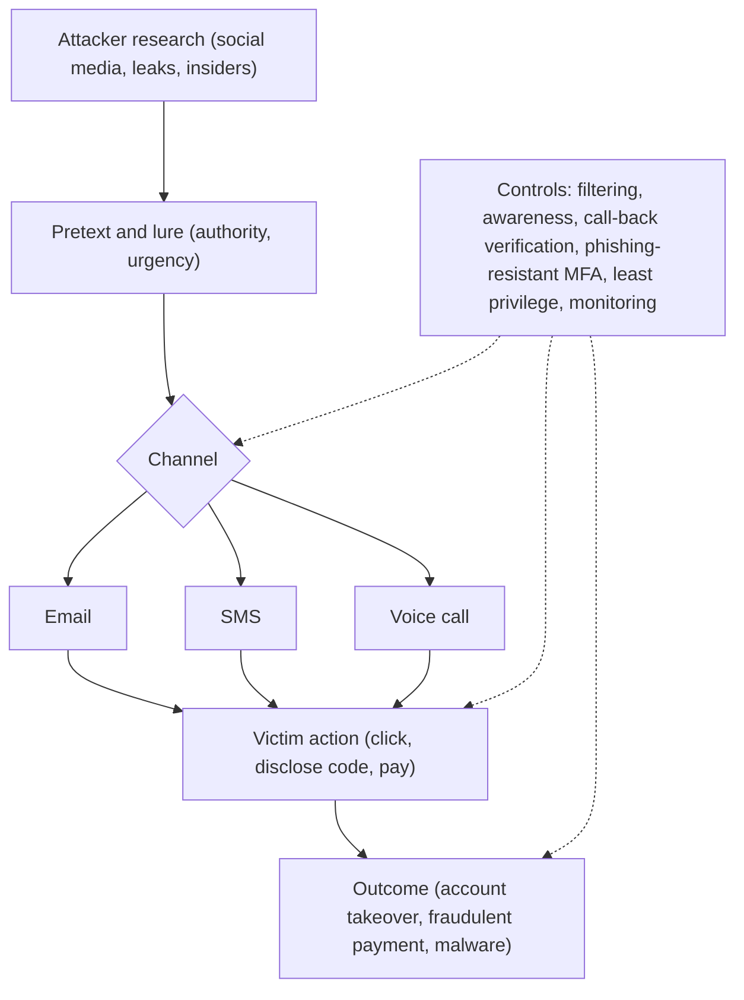

## Introduction

Many of the most damaging security incidents begin not with clever code but with a convincing message or phone call. Attackers have learned that persuading a person to open a door is usually cheaper than breaking it down. Phishing emails, fraudulent calls claiming to be from a telecom operator, fake invoices and impersonated chief executives all exploit the same human tendencies: trust, helpfulness, fear and respect for authority.

The same organisational trust that social engineers exploit from outside can be abused from inside by employees, contractors and partners. Insider threats are difficult precisely because insiders already have legitimate access. This lesson explains the psychology of social engineering, the main phishing variants, the specifically Ghanaian patterns of mobile money fraud and SIM-swap abuse, and the design of insider threat controls that protect the organisation without creating a culture of suspicion.

## Learning Objectives

- Explain the psychological principles that make social engineering effective.
- Distinguish phishing, spear phishing, whaling, smishing, vishing and business email compromise.
- Analyse a mobile money social engineering scheme and identify control points for the provider, the agent and the customer.
- Compare malicious, negligent and compromised insiders and recommend controls for each.
- Evaluate a security awareness programme against measurable outcomes rather than attendance.

## Prerequisite Knowledge

- The threat, vulnerability and risk concepts from Module 1.
- General familiarity with email, SMS and mobile money services.

## Key Terminology

- **Social engineering**: Manipulating people into performing actions or disclosing information that benefits the attacker.
- **Phishing**: Fraudulent messages, usually email, designed to trick recipients into revealing credentials, paying money or running malware.
- **Spear phishing**: Phishing tailored to a specific individual or organisation using researched details.
- **Smishing and vishing**: Phishing conducted by SMS (smishing) or by voice call (vishing).
- **Business email compromise (BEC)**: Fraud in which an attacker impersonates or takes over a business email account to redirect payments or obtain sensitive data.
- **Pretexting**: Creating a fabricated scenario, such as posing as IT support, to justify a request for information or action.
- **SIM swap**: Fraudulently transferring a victim's mobile number to a SIM card controlled by the attacker, allowing interception of calls and SMS codes.
- **Insider threat**: The potential for a person with authorised access to harm the organisation, deliberately or unintentionally.
- **Segregation of duties**: Dividing a sensitive task between people so that no single person can complete it alone.

## Detailed Explanation

### Why social engineering works

Social engineering exploits predictable features of human judgement. The psychologist Robert Cialdini described principles of persuasion that attackers routinely abuse:

| Principle | How attackers exploit it | Example |
|---|---|---|
| Authority | Impersonate a manager, regulator or bank official | "This is the MD; process this transfer before the board meeting." |
| Urgency and scarcity | Force fast decisions that bypass reflection | "Your wallet will be blocked in 30 minutes unless you verify." |
| Liking | Build rapport or use a familiar name | A friendly caller who knows your branch and your manager's name |
| Reciprocity | Offer help, then ask for something | "I have fixed your account; just read me the code I sent." |
| Social proof | Suggest that others have already complied | "All staff in your department have updated their passwords here." |
| Commitment and consistency | Obtain small agreements before a larger request | A survey that ends by asking for login details |

Attackers also exploit **context**: busy end-of-month periods, public holidays, news events and organisational change. A message that would look suspicious on a calm Tuesday may seem plausible during payroll week.

### The phishing family

- **Bulk phishing** casts a wide net with generic lures (parcel delivery, account suspension).
- **Spear phishing** uses research from social media, company websites and earlier breaches to target named individuals.
- **Whaling** targets senior executives, whose authority makes successful compromise especially valuable.
- **Smishing** uses SMS, where links are short and sender names can be spoofed; it is particularly relevant where mobile phones are the primary internet device.
- **Vishing** uses voice calls and is often combined with smishing ("we sent you a code; please read it back to confirm your identity").
- **Business email compromise** typically either spoofs a lookalike domain or uses a genuinely compromised mailbox to send convincing payment instructions, often by inserting itself into an existing email thread about an invoice.
- **Credential harvesting sites** imitate login pages; increasingly, attackers use "adversary-in-the-middle" proxies that relay the victim's credentials and one-time code to the real site in real time, defeating SMS or app codes. Phishing-resistant authentication, such as FIDO2 security keys or passkeys that are bound to the genuine website's domain, counters this.

### Insider threats

Insiders fall into three broad categories:

1. **Malicious insiders** deliberately misuse access for financial gain, revenge or ideology, for example a staff member who sells customer data or colludes in fraudulent transfers.
2. **Negligent insiders** cause harm through carelessness, such as emailing data to a personal account or falling for phishing.
3. **Compromised insiders** are legitimate users whose accounts or devices have been taken over by an external attacker.

Insider risk increases when access exceeds need, when activity is not logged or reviewed, and when grievances, financial pressure or departures go unmanaged. Controls must therefore combine technical measures (least privilege, monitoring, data loss prevention) with human-resources processes (screening, clear policies, exit procedures) and culture (a safe way to report concerns).

## Theories, Frameworks and Models

### A layered model of anti-phishing controls

No single control stops phishing. A defensible design layers controls across the attack path:

| Layer | Purpose | Example controls |
|---|---|---|
| Email and SMS infrastructure | Reduce delivery of malicious messages | SPF, DKIM and DMARC email authentication; filtering; sandboxing attachments; operator SMS sender controls |
| User interface | Help users notice risk | External-sender banners; warnings on lookalike domains |
| People | Recognise and report | Role-based awareness training; simple "report phishing" button; positive reinforcement |
| Process | Make a single deception insufficient | Call-back verification on payment detail changes; dual approval; "never share codes" rules |
| Authentication | Make stolen credentials less useful | Phishing-resistant MFA; conditional access |
| Detection and response | Limit damage quickly | Monitoring for impossible travel and new mailbox rules; rapid account suspension |

The **process** layer is often the most cost-effective: if every change to supplier bank details requires a call to a number already on file, a convincing BEC email alone cannot redirect money.

### Measuring awareness

Attendance at an annual lecture is a weak measure. Better metrics include the **reporting rate** (proportion of staff who report a simulated or real phishing message), **time to first report** and **repeat click rate**. Simulated phishing must be run ethically: with leadership approval, without humiliating individuals and with immediate constructive feedback. A rising reporting rate is generally a better sign of culture than a falling click rate alone.

## Worked Example

### Dissecting a mobile money "wrong transfer" scheme

**Illustrative scenario.** Ama, a trader in Kumasi, receives an SMS that appears to be a mobile money credit alert for GH₵ 800. Minutes later a caller says, "Madam, I sent money to you by mistake; it was my child's school fees. Please send it back." Ama checks her phone, sees the "alert" and sends GH₵ 800 to the caller. Her actual balance had never increased; the SMS was a fake from an ordinary phone number formatted to look like an operator message.

**Step 1: identify the principles exploited.** Urgency (school fees), liking and sympathy (a distressed parent), and authority of the apparent system message.

**Step 2: identify the vulnerability.** Ama trusted the SMS text rather than verifying her balance through the official menu or app.

**Step 3: identify control points.**

| Party | Control | Type |
|---|---|---|
| Customer | Always check balance through the official USSD menu or app before acting on an SMS; reversals are handled by the operator, not by sending money back | Process / awareness |
| Operator | Clear, consistent alert formats and education campaigns; a formal reversal process through customer service | Process |
| Operator | Analytics to detect numbers that repeatedly receive "returned" funds from many customers | Detective |
| Agent | Never disclose customers' names or balances to callers | Policy |

**Step 4: extend to SIM swap.** A related scheme targets account takeover: a fraudster gathers personal details (perhaps from a leaked customer list or a corrupt insider), persuades or bribes someone to issue a replacement SIM, then resets the victim's wallet PIN using SMS codes. The control points are the operator's SIM replacement process (strong identity verification against the Ghana Card, notifications to the old SIM, a cooling-off period before high-value transactions) and insider controls on staff who can issue replacements (individual accounts, logging, review of unusual volumes).

This analysis shows how a single fraud pattern crosses social engineering, process weakness and insider risk.

## Ghanaian Business Application

Social engineering is arguably the most common cyber-enabled fraud affecting ordinary Ghanaians and SMEs. Practical applications include:

- **Banks and payment providers** should communicate a short, repeated message: staff will never ask for a PIN or one-time code. Consistency matters; if the institution's own staff sometimes ask for codes, customers cannot distinguish legitimate from fraudulent calls.
- **SMEs** paying suppliers by bank transfer or mobile money should adopt call-back verification for any change of payment details and dual approval above a threshold.
- **Recruitment and off-boarding**: Organisations should remove system access on an employee's last day and review the access of staff who move roles, reducing malicious and negligent insider risk.
- **Data minimisation**: Agents and customer service staff should see only the customer data they need. This limits the value of any insider who is bribed and reduces exposure under the Data Protection Act, 2012 (Act 843).
- **Reporting**: Victims and organisations can report cyber incidents to national channels, including the Cyber Security Authority, and to the police. Organisations should publish internal reporting routes that staff can use without fear of blame.

## International Case Study

### The July 2020 Twitter compromise

In July 2020, the Twitter accounts of many prominent individuals and companies posted messages promoting a cryptocurrency scam. Investigations, including a report by the New York State Department of Financial Services, found that attackers had used **phone-based spear phishing (vishing)**: they called Twitter employees while posing as internal IT staff and persuaded some to enter their credentials on a fake internal login page. With these credentials the attackers reached internal account-management tools and took over high-profile accounts. Several individuals were later charged.

**Analysis:**

- **Initial access** was purely social: authority and pretexting (claiming to be IT support during a period of remote working).
- **Insider dimension**: the employees were *compromised insiders*; their legitimate access to powerful tools was the real prize.
- **Least privilege**: many staff had access to tools capable of altering any account, which magnified the impact.
- **Lessons**: phishing-resistant MFA tied to genuine domains, tighter limits on who can use high-impact administrative tools, additional approval for sensitive actions on high-profile accounts and verified channels for IT support contacts.

The case demonstrates that a technologically sophisticated company can be compromised through people and process, and that limiting the blast radius of any single account is as important as preventing the initial deception.

## Diagram

## Common Misconceptions

- "Phishing only happens by email." SMS, voice calls, messaging apps, social media and even QR codes are widely used channels.
- "Clever people do not fall for phishing." Well-crafted, targeted lures succeed against experienced professionals, especially under time pressure; controls must not depend on perfect human vigilance.
- "Any multi-factor authentication stops phishing." SMS and app codes can be relayed in real time or captured via SIM swap; phishing-resistant methods bound to the genuine domain are far stronger.
- "Insider threat means malicious employees." Most insider incidents involve negligence or compromised accounts rather than deliberate malice.
- "Punishing staff who click improves security." Blame discourages reporting; rapid, safe reporting is what limits damage.

## Common Examination Mistakes

- Describing phishing in general terms without naming the psychological principle exploited in the scenario.
- Recommending only "training" and omitting process controls such as call-back verification and dual approval.
- Treating SIM swap purely as a technical failure and ignoring the insider and identity-verification dimensions.
- Failing to distinguish malicious, negligent and compromised insiders when proposing controls.
- Proposing intrusive monitoring without considering proportionality, privacy law and staff trust.

## Critical Thinking Questions

1. How should a bank balance customer convenience against stronger identity checks for SIM replacement and PIN resets?
2. Is it ethical to send simulated phishing emails to staff? Under what conditions would you approve such a programme?
3. To what extent should employers monitor employees' email and file activity to detect insider threats, given data protection obligations?
4. The Twitter attackers relied on employees working remotely. What changes to IT support processes would reduce vishing risk in a hybrid workplace?
5. Why might a rising number of reported phishing messages indicate improving, rather than worsening, security?

## Practical Exercises

1. **Phishing anatomy.** Collect three suspicious messages you have personally received (email or SMS). Without clicking any links, annotate each with the sender, the lure, the psychological principle and the red flags. Expected output: three annotated screenshots or transcripts with a short analysis of each.
2. **Payment verification procedure.** Draft a one-page procedure for an SME that requires call-back verification before changing supplier payment details. Expected output: a numbered procedure specifying who verifies, which phone number is used and how the check is recorded.
3. **Insider control matrix.** For a fictional bank branch, list five roles and, for each, state the access needed, a malicious, negligent and compromised insider risk, and one control. Expected output: a role-by-risk table.
4. **Guided practice.** Explore the OWASP project pages on authentication and session risks and the CISA guidance on phishing-resistant MFA. Do not set up phishing pages or contact real organisations. Expected output: a 200-word note explaining why phishing-resistant MFA defeats credential relay attacks.

## Key Takeaways

- Social engineering exploits authority, scarcity and urgency, liking, reciprocity, social proof and commitment, often amplified by context.
- Phishing variants include spear phishing, whaling, smishing, vishing and business email compromise.
- Process controls such as call-back verification and dual approval are often the most cost-effective defences.
- Insider threats may be malicious, negligent or compromised; least privilege, monitoring and HR processes all matter.
- Mobile money fraud and SIM swap in Ghana combine social engineering, process weakness and insider risk.

## Further Reading

- Cialdini, R. B. (2021). *Influence, new and expanded: The psychology of persuasion*. Harper Business.
- Mitnick, K. D., & Simon, W. L. (2002). *The art of deception: Controlling the human element of security*. Wiley.
- Anderson, R. (2020). *Security engineering: A guide to building dependable distributed systems* (3rd ed.). Wiley.
- Stallings, W., & Brown, L. (2018). *Computer security: Principles and practice* (4th ed.). Pearson.

## Video Resources

- [CISA cybersecurity resources](https://www.cisa.gov/) — Cybersecurity and Infrastructure Security Agency. Official guidance and awareness material on phishing, social engineering and phishing-resistant MFA.
- [Cisco Skills for All](https://skillsforall.com/) — Cisco Networking Academy. Free cybersecurity courses that include modules on social engineering and protecting personal data.

## Revision Summary

Social engineering manipulates people through predictable persuasion principles across email, SMS and voice. Effective defence layers infrastructure filtering, awareness, process controls, phishing-resistant authentication and rapid response. Insider threats, whether malicious, negligent or compromised, require least privilege, monitoring and good HR processes.

- Cialdini principles: authority, scarcity (urgency), liking, reciprocity, social proof, commitment.
- Phishing family: spear, whaling, smishing, vishing, BEC.
- Call-back verification and dual approval stop many payment frauds.
- Phishing-resistant MFA counters real-time credential relay and SIM swap.
- Insiders: malicious, negligent, compromised.
- Twitter 2020: vishing of staff plus over-broad admin tool access.
