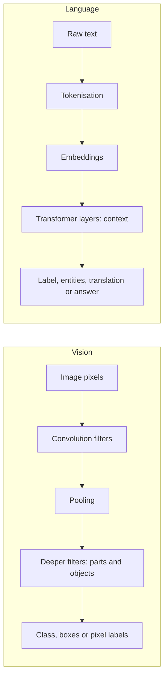

## Introduction

Much of the information that businesses handle is not neatly arranged in database columns. It arrives as scanned invoices, photographs of damaged goods, CCTV footage, X-ray images, customer emails, WhatsApp messages, call-centre recordings and social media posts. Two branches of AI make this unstructured information usable: **computer vision**, which enables machines to interpret images and video, and **natural language processing (NLP)**, which enables them to process and generate human language.

Both fields were transformed by deep learning. Hand-crafted rules and features have largely given way to neural networks that learn directly from pixels and text. This lesson explains the core ideas in each field: convolutions and the tasks of classification, detection and segmentation in vision; tokenisation, embeddings and the main NLP tasks in language. You will compute a convolution and an embedding similarity by hand, and then evaluate applications, with particular attention to the challenge of building language technology for Ghana's multilingual population.

## Learning Objectives

- Explain how convolutional neural networks process images and distinguish image classification, object detection, segmentation and optical character recognition.
- Apply a convolution filter to a small image grid and interpret the result.
- Explain tokenisation, word embeddings and contextual embeddings, and compute cosine similarity between embedding vectors.
- Compare major NLP tasks such as sentiment analysis, named entity recognition, translation and text classification.
- Evaluate computer vision and NLP applications for business value, data requirements and risks, including bias and low-resource languages.

## Prerequisite Knowledge

- Neural networks, training and transfer learning from the previous lesson.
- Basic arithmetic with multiplication tables and square roots.

## Key Terminology

- **Computer vision**: The field of AI concerned with enabling machines to extract information from images and video.
- **Pixel**: The smallest unit of a digital image; a colour image stores red, green and blue intensity values for each pixel.
- **Convolution**: An operation that slides a small filter (kernel) across an image, multiplying and summing values to produce a feature map.
- **Convolutional neural network (CNN)**: A neural network that uses learned convolution filters and pooling to detect spatial patterns.
- **Object detection**: Identifying and locating multiple objects in an image, usually with bounding boxes and class labels.
- **Image segmentation**: Assigning a class label to every pixel to outline the exact shape of objects or regions.
- **Optical character recognition (OCR)**: Converting images of printed or handwritten text into machine-readable text.
- **Natural language processing (NLP)**: The field of AI concerned with analysing, understanding and generating human language.
- **Tokenisation**: Splitting text into units (tokens) such as words, subwords or characters that a model processes.
- **Word embedding**: A dense numerical vector representing a word so that words with similar meanings have similar vectors.
- **Contextual embedding**: A vector representation of a word that depends on its surrounding words, so "bank" in "river bank" and "bank loan" differ.
- **Named entity recognition (NER)**: Identifying names of people, organisations, places, dates and amounts in text.
- **Low-resource language**: A language with relatively little digital text and labelled data available for training AI models.

## Detailed Explanation

### How computers see

To a computer an image is a grid of numbers. A greyscale image of 100 by 100 pixels is 10,000 intensity values; a colour image has three such grids. Early computer vision relied on hand-designed feature detectors for edges and corners. Convolutional neural networks changed this by *learning* their filters.

A **convolution** slides a small filter, for example 3 by 3, across the image. At each position it multiplies the filter values by the underlying pixel values and sums them, producing one value in a **feature map**. A filter that responds strongly to vertical edges produces high values where the image contains vertical edges. A CNN layer contains many filters, each learning to detect a different pattern. **Pooling** layers then reduce the size of feature maps, for example by keeping the maximum value in each 2 by 2 region, which makes the representation more compact and somewhat robust to small shifts. Stacking layers allows the network to build from edges to textures to object parts to whole objects. Because the same filter is reused across the image (**weight sharing**), CNNs need far fewer parameters than fully connected networks.

### Core vision tasks

- **Image classification** assigns one label to a whole image ("ripe", "unripe").
- **Object detection** finds and labels multiple objects with bounding boxes ("three cartons of milk, one missing price tag").
- **Segmentation** labels every pixel, useful when exact boundaries matter, as in measuring a tumour or a flooded area in satellite imagery.
- **OCR and document AI** extract text and structure from scanned documents, such as invoice numbers, dates and totals.
- **Face recognition and verification** compare facial images, a high-risk application because of privacy and documented accuracy differences across demographic groups.

More recently, **vision transformers** apply the transformer architecture to patches of an image, and **multimodal** models process images and text together, for example answering questions about a photograph.

### How computers read

Language is harder to represent numerically than images because meaning depends on word choice, order, context and culture. The NLP pipeline begins with **tokenisation**. Early systems split text into words; modern models typically use **subword tokenisation**, which breaks rare or unfamiliar words into smaller pieces. This allows a fixed vocabulary to represent any word, including names, slang and misspellings, and is particularly helpful for languages with rich word formation.

Tokens must then become numbers. Simple approaches such as **bag of words** count how often each word appears, ignoring order; **TF-IDF** weights words by how distinctive they are to a document. These remain useful baselines for text classification. **Word embeddings**, popularised by methods such as word2vec (Mikolov and colleagues, 2013), represent each word as a dense vector learned from the contexts in which it appears, so that words used in similar contexts, such as "loan" and "credit", end up close together. **Contextual embeddings**, produced by transformer models, go further: the vector for a word depends on the entire sentence, resolving ambiguity.

### Core NLP tasks

- **Text classification**: routing emails, tagging complaints by topic, detecting spam.
- **Sentiment analysis**: estimating whether text expresses positive, negative or neutral opinion.
- **Named entity recognition**: extracting names, places, amounts and dates, for example from contracts.
- **Machine translation**: converting text between languages.
- **Speech recognition and synthesis**: converting speech to text and text to speech, essential for voice channels and for users with limited literacy.
- **Question answering and summarisation**: increasingly performed by large language models, covered in the next lesson.

## Worked Example

### 1. A convolution by hand

A tiny 4 by 4 greyscale image has a bright vertical stripe on its right edge (0 = black, 9 = bright):

| | Col 1 | Col 2 | Col 3 | Col 4 |
|---|---|---|---|---|
| Row 1 | 0 | 0 | 0 | 9 |
| Row 2 | 0 | 0 | 0 | 9 |
| Row 3 | 0 | 0 | 0 | 9 |
| Row 4 | 0 | 0 | 0 | 9 |

A 3 by 3 vertical-edge filter has each row equal to (−1, 0, 1): it subtracts the left column of the window and adds the right column.

**Position 1 (rows 1–3, columns 1–3).** Each row of the window is (0, 0, 0). Sum = 3 × (−1 × 0 + 0 × 0 + 1 × 0) = **0**.

**Position 2 (rows 1–3, columns 2–4).** Each row is (0, 0, 9). Sum = 3 × (−1 × 0 + 0 × 0 + 1 × 9) = **27**.

Sliding down one row gives the same two values, so the 2 by 2 feature map is:

| | Output col 1 | Output col 2 |
|---|---|---|
| Output row 1 | 0 | 27 |
| Output row 2 | 0 | 27 |

The filter "fires" only where the dark-to-bright vertical edge occurs. In a CNN, the filter values are not hand-chosen like this; they are learned by backpropagation, and a trained network contains many filters responding to different patterns.

### 2. Tokenisation

Consider a customer message to a mobile money operator: "Momo transfer failed pls help". A word tokeniser yields five tokens: `Momo | transfer | failed | pls | help`. A subword tokeniser might split it as `Mo | mo | transfer | fail | ed | pl | s | help` (the exact split depends on the tokeniser's learned vocabulary and is shown here only for illustration). Subwords let the model handle "Momo" and "pls", which may be rare in formal training text. Text in Twi, Ga, Ewe or Dagbani, or mixed with English as is common in Ghanaian messaging, is often split into many more tokens than equivalent English text, which can increase processing cost and reduce model quality.

### 3. Embedding similarity

Suppose a model represents three words with simplified three-dimensional embeddings (real embeddings have hundreds of dimensions):

- loan = (0.8, 0.2, 0.1)
- credit = (0.7, 0.3, 0.2)
- banana = (0.1, 0.9, 0.4)

**Cosine similarity** measures the angle between vectors: `cos = (a · b) / (|a| × |b|)`.

*loan and credit*: dot product = 0.8 × 0.7 + 0.2 × 0.3 + 0.1 × 0.2 = 0.56 + 0.06 + 0.02 = 0.64. |loan| = √0.69 ≈ 0.831; |credit| = √0.62 ≈ 0.787. Cosine = 0.64 / (0.831 × 0.787) ≈ 0.64 / 0.654 ≈ **0.98**.

*loan and banana*: dot product = 0.08 + 0.18 + 0.04 = 0.30. |banana| = √0.98 ≈ 0.990. Cosine = 0.30 / (0.831 × 0.990) ≈ 0.30 / 0.822 ≈ **0.36**.

"Loan" is far closer in meaning to "credit" than to "banana". This is the mechanism behind semantic search: a customer typing "borrow money" can be matched with an FAQ titled "How to apply for a loan" even though no words overlap.

## Ghanaian Business Application

**Computer vision.** *Illustrative scenario.* A supermarket chain in Accra trials shelf-monitoring cameras to detect empty shelf spaces and missing price labels. An object-detection model pre-trained on retail images is fine-tuned using a few thousand photographs from its own stores, because local packaging, lighting and shelf layouts differ from the original training data. Staff receive alerts on handheld devices. The chain posts clear notices, positions cameras to capture shelves rather than shoppers' faces and limits retention of footage, in line with data protection principles.

*Illustrative scenario.* A health insurer processes large numbers of paper claim forms from clinics. An OCR and document-AI pipeline extracts patient identifiers, procedure codes and amounts, routing low-confidence fields to human clerks. Accuracy is measured field by field, not just per document.

**NLP and Ghana's languages.** Ghana is multilingual, with English as the official language and many widely spoken languages including Akan (Twi and Fante), Ewe, Ga and Dagbani. Customers often mix languages in a single message. These are low-resource languages in AI terms: far less digital text and labelled data exist than for English. A telecom deploying sentiment analysis on customer messages would find that English-only models misread code-switched text. Practical responses include collecting and labelling local data with consent, using multilingual pre-trained models and fine-tuning them, offering voice channels for customers who prefer speaking to typing, and evaluating separately for each language. Universities, start-ups and open-source communities across Africa have been building datasets and models for African languages, and organisations can contribute to and benefit from such efforts.

## International Case Study

### Neural machine translation at Google

In 2016 Google announced that Google Translate was moving from phrase-based statistical translation to a neural machine translation system, described in a research paper on Google's Neural Machine Translation system (GNMT). Rather than translating phrase by phrase, the neural system processed entire sentences, producing more fluent output. The transformer architecture, introduced by Google researchers in 2017, subsequently became the dominant approach to translation and to NLP generally.

The case demonstrates three lessons. First, deep learning replaced decades of hand-engineered linguistic pipelines once data and computing allowed it. Second, quality depends heavily on training data: translation quality is generally strongest for languages with abundant parallel text and weaker for low-resource languages. Third, even fluent output can be wrong, so high-stakes uses such as legal or medical translation still require human review. For Ghanaian businesses, machine translation can help with internal understanding and drafting, but customer-facing content in local languages should be checked by fluent speakers.

### Computer vision in cashierless retail

Amazon opened its first Amazon Go store to the public in Seattle in 2018, using cameras, sensors and computer vision to track which items shoppers took so that they could leave without passing through a checkout. The concept illustrates the ambition of applied vision: object detection and tracking in a cluttered, dynamic environment. It also illustrates the cost: extensive camera and sensor infrastructure, and significant privacy considerations. Retailers elsewhere must weigh such systems against simpler options, such as self-checkout or mobile scanning.

## Diagram

## Common Misconceptions

- **Misconception**: Computer vision systems "see" images as humans do. **Correction**: They detect statistical patterns in pixel values and can be fooled by changes humans ignore, such as unusual lighting or small perturbations.
- **Misconception**: A model trained on international images will work equally well locally. **Correction**: Differences in products, environments and populations require local testing and often fine-tuning.
- **Misconception**: Tokens are always words. **Correction**: Modern models typically use subword tokens; one word may be several tokens, especially in low-resource languages.
- **Misconception**: Embeddings capture objective meaning. **Correction**: Embeddings reflect patterns, including social biases, in the text they were trained on.
- **Misconception**: Machine translation is now solved. **Correction**: Quality varies widely by language pair and domain, and fluent output can contain serious errors.

## Common Examination Mistakes

- Confusing object detection (locating objects with boxes) with image classification (one label per image).
- Computing a convolution by multiplying matrices instead of summing element-wise products over each window.
- Forgetting to divide by vector lengths when computing cosine similarity.
- Discussing NLP only in English, ignoring multilingual and code-switched contexts relevant to Ghana.
- Failing to address privacy and bias when proposing face recognition or CCTV analytics.

## Critical Thinking Questions

1. Should a Ghanaian bank use facial verification for account opening? What evidence of accuracy and fairness would you require?
2. How could a telecom operator build useful NLP for customers who write in a mix of English and Twi with limited labelled data?
3. Embeddings learned from news and web text may associate certain professions with one gender. What harm could this cause in a CV-screening system, and how might it be detected?
4. When does a simpler approach, such as TF-IDF with logistic regression, outperform a large deep learning model for business text classification?

## Practical Exercises

1. **Convolution practice.** Apply the same vertical-edge filter to a 4 by 4 image whose columns are (9, 9, 0, 0) in every row. *Expected output*: the 2 by 2 feature map and an explanation of why the values are negative.
2. **Cosine similarity.** Using the vectors in this lesson, add "mortgage" = (0.75, 0.15, 0.3) and compute its cosine similarity with "loan" and "banana". *Expected output*: two similarity values and a ranking.
3. **Hands-on with pre-trained models.** Using the free Hugging Face Learn NLP course, run a sentiment-analysis pipeline on ten sample customer messages, including some written in Ghanaian English or code-switched text that you write yourself. *Expected output*: a table of messages, predicted labels and your judgement of whether each prediction is correct, with a paragraph on where the model struggled.

## Key Takeaways

- Images are grids of numbers; CNNs learn convolution filters that build from edges to objects.
- Key vision tasks are classification, detection, segmentation and OCR; local fine-tuning and testing are essential.
- NLP converts text to tokens and then to embeddings; contextual embeddings capture meaning in context.
- Cosine similarity between embeddings underpins semantic search and matching.
- Ghana's multilingual, code-switched communication makes low-resource language support a central design issue; bias and privacy must be managed in both fields.

## Further Reading

- Goodfellow, I., Bengio, Y., & Courville, A. (2016). *Deep learning*. MIT Press. <https://www.deeplearningbook.org/>
- Jurafsky, D., & Martin, J. H. (2009). *Speech and language processing* (2nd ed.). Pearson Prentice Hall. Draft chapters of a later edition are available at <https://web.stanford.edu/~jurafsky/slp3/>
- Mikolov, T., Chen, K., Corrado, G., & Dean, J. (2013). *Efficient estimation of word representations in vector space* (arXiv:1301.3781). arXiv. <https://arxiv.org/abs/1301.3781>
- LeCun, Y., Bengio, Y., & Hinton, G. (2015). Deep learning. *Nature, 521*(7553), 436–444.
- Vaswani, A., Shazeer, N., Parmar, N., Uszkoreit, J., Jones, L., Gomez, A. N., Kaiser, Ł., & Polosukhin, I. (2017). Attention is all you need. *Advances in Neural Information Processing Systems, 30*.

## Video Resources

- [Hugging Face Learn](https://huggingface.co/learn) — Hugging Face. Free courses on NLP, computer vision and transformers using open models.
- [Machine Learning Crash Course](https://developers.google.com/machine-learning/crash-course) — Google for Developers. Includes material on embeddings and working with categorical and text data.
- [Kaggle Learn](https://www.kaggle.com/learn) — Kaggle. Free micro-courses including computer vision.

## Revision Summary

Computer vision treats images as grids of numbers; CNNs slide learned filters across them to build feature maps that capture edges, textures and objects, supporting classification, detection, segmentation and OCR. NLP tokenises text, often into subwords, and represents tokens as embeddings whose geometry reflects meaning; transformers produce contextual embeddings. Both fields need local data and testing, and Ghana's low-resource and code-switched languages are a key challenge.

- Convolution: multiply filter by each window and sum to form a feature map.
- Tasks: classification (one label), detection (boxes), segmentation (pixels), OCR (text).
- Tokenisation: words, subwords or characters; low-resource languages often need more tokens.
- Cosine similarity: `(a · b) / (|a| × |b|)`; near 1 means similar meaning.
- Embeddings can encode social bias; evaluate per language and group.
- Neural machine translation (Google, 2016) and transformers (2017) reshaped NLP.
