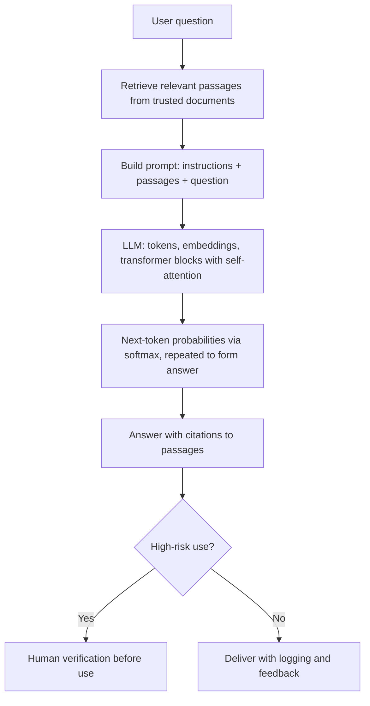

## Introduction

Generative AI moved from research laboratories to everyday business tools with remarkable speed. Employees now draft emails, summarise reports, write code, translate documents and create images using systems built on large language models (LLMs) and related generative techniques. For many organisations in Ghana and elsewhere, these tools are the first AI they use directly, often without any formal project, procurement or governance.

This creates both opportunity and risk. LLMs can make knowledge work faster, but they can also produce fluent, confident text that is false, a behaviour widely called **hallucination**. Using them well requires understanding what they actually do: predict likely continuations of text using patterns learned from vast training data, through the transformer architecture introduced in 2017. This lesson explains generative AI conceptually, walks through the mechanics of attention and next-token prediction with small numerical examples, and sets out practical strategies, especially **grounding** through retrieval, for deploying LLMs responsibly in business.

## Learning Objectives

- Distinguish generative from discriminative models and describe the main families of generative models.
- Explain the transformer architecture, including tokens, embeddings, self-attention and next-token prediction.
- Apply the softmax function to compute attention weights and next-token probabilities, and explain the effect of temperature.
- Explain how LLMs are pre-trained, instruction-tuned and refined with human feedback, and what a context window is.
- Evaluate the causes of hallucination and the effectiveness of grounding strategies such as retrieval-augmented generation for business use cases.

## Prerequisite Knowledge

- Neural networks, embeddings and tokenisation from the previous two lessons.
- Self-supervised learning from the lesson on learning paradigms.

## Key Terminology

- **Generative AI**: AI systems that create new content, such as text, images, audio or code, resembling the data they were trained on.
- **Discriminative model**: A model that predicts a label or value from inputs, such as a fraud classifier, rather than generating new data.
- **Large language model (LLM)**: A very large neural network, usually a transformer, trained on extensive text to predict the next token and adaptable to many language tasks.
- **Transformer**: A neural network architecture, introduced by Vaswani et al. (2017), that uses attention to relate every token in a sequence to every other token.
- **Self-attention**: A mechanism in which each token computes weights over all tokens in the context to decide which ones are most relevant to its representation.
- **Softmax**: A function that converts a list of scores into positive probabilities summing to one.
- **Temperature**: A setting that sharpens (low temperature) or flattens (high temperature) the probability distribution over next tokens, affecting randomness.
- **Context window**: The maximum number of tokens a model can consider at once, covering both the prompt and the generated output.
- **Fine-tuning**: Further training a pre-trained model on a smaller, task-specific dataset.
- **Reinforcement learning from human feedback (RLHF)**: Refining a model using human preference judgements converted into a reward signal.
- **Hallucination**: Generated content that is fluent and plausible but factually incorrect, unsupported or fabricated.
- **Grounding**: Constraining a model's output to verifiable sources, such as retrieved documents or databases.
- **Retrieval-augmented generation (RAG)**: An approach that retrieves relevant documents and supplies them to the model as context so that answers draw on those sources.

## Detailed Explanation

### What makes a model generative

Discriminative models learn the boundary between categories: given a transaction, is it fraud? Generative models learn the structure of the data itself well enough to produce new examples. Several families matter:

- **Autoregressive language models** generate text one token at a time, each conditioned on the tokens before it. LLMs belong here.
- **Generative adversarial networks (GANs)**, introduced by Goodfellow and colleagues in 2014, train a generator and a discriminator against each other; they were influential for realistic image synthesis.
- **Variational autoencoders (VAEs)** learn a compressed representation from which new samples can be decoded.
- **Diffusion models** learn to reverse a gradual noising process, starting from random noise and refining it into an image; they underpin many current image generators.

### The transformer

Before 2017, sequence tasks relied heavily on recurrent networks, which process tokens one after another and struggle with long-range dependencies. The transformer, described in "Attention is all you need", replaced recurrence with **attention**, allowing all tokens to be processed in parallel and any token to draw directly on any other.

The simplified flow of a decoder-style LLM is:

1. **Tokenise** the input text and map each token to an **embedding** vector.
2. Add **positional information**, because attention by itself does not know word order.
3. Pass the vectors through many **transformer blocks**. In each block, **self-attention** lets each token build a context-aware representation by weighting other tokens; a **feed-forward network** then transforms each token's representation. Residual connections and normalisation help training.
4. At the final layer, convert the representation of the last position into a **score for every token in the vocabulary**, apply softmax to obtain probabilities and **select the next token**.
5. Append that token and repeat until a stopping condition is reached.

In self-attention, each token is projected into three vectors: a **query** (what it is looking for), a **key** (what it offers) and a **value** (the information it carries). The attention score between two tokens is based on the dot product of one token's query with the other's key; softmax turns scores into weights; and the token's new representation is the weighted sum of value vectors. Running several attention computations in parallel (**multi-head attention**) lets the model capture different kinds of relationships at once.

### How LLMs are built

1. **Pre-training**: the model learns to predict the next token over a very large corpus of text through self-supervised learning. This is where it absorbs grammar, facts, styles and reasoning patterns, along with errors and biases in the data.
2. **Instruction tuning**: fine-tuning on examples of instructions and good responses so that the model follows requests rather than merely continuing text.
3. **Preference alignment**: methods such as RLHF, described for instruction-following models by Ouyang and colleagues (2022), use human rankings of responses to train the model towards helpful, harmless outputs.
4. **Deployment adaptations**: system instructions, tool use (calling search, calculators or databases), retrieval and safety filters.

Two practical constraints follow. A model's knowledge is limited to its training data up to a cut-off date, unless it is connected to current sources. And the **context window** limits how much text it can consider at once, which affects how many documents can be supplied in a single request.

### Why hallucination happens

An LLM is trained to produce *plausible* continuations, not *verified* ones. When the training data lack a fact, contain conflicting information or the prompt pushes for a specific answer, the most probable continuation can be a confident fabrication, such as an invented citation, a non-existent policy clause or a wrong figure. Contributing factors include gaps in training data, the cut-off date, ambiguous prompts, pressure to answer rather than decline, sampling randomness and the model's lack of an internal mechanism for checking truth against the world.

### Grounding and mitigation

- **Retrieval-augmented generation (RAG)**: described by Lewis and colleagues (2020), RAG retrieves relevant passages, typically using embedding similarity, from a trusted document store and instructs the model to answer only from them, ideally with citations to the passages used.
- **Tool use and structured data**: route numerical questions to databases or calculators rather than relying on the model's memory.
- **Prompt design**: instruct the model to say "I do not know" when sources are insufficient, and specify format and scope.
- **Lower temperature** for factual tasks to reduce randomness.
- **Human review** proportional to risk, especially for legal, medical, financial and customer-facing outputs.
- **Evaluation**: test the system on a set of representative questions with known answers and measure accuracy, citation correctness and refusal behaviour before and after deployment.

Grounding reduces but does not eliminate hallucination: retrieval can fetch the wrong passage, and models can still misread or embellish sources.

## Worked Example

### 1. Self-attention weights

**Illustrative example.** In the sentence fragment "customer agent yesterday paid", suppose the token "paid" computes raw attention scores of 2.0 for "customer", 1.0 for "agent" and 0.1 for "yesterday".

**Softmax.** `e^2.0 ≈ 7.389`, `e^1.0 ≈ 2.718`, `e^0.1 ≈ 1.105`; sum ≈ 11.212. Weights: customer ≈ 7.389 / 11.212 ≈ **0.66**, agent ≈ **0.24**, yesterday ≈ **0.10**.

**Weighted values.** If the simplified value vectors are customer = (1, 0), agent = (0, 1) and yesterday = (0.5, 0.5), the new representation of "paid" is `0.66 × (1, 0) + 0.24 × (0, 1) + 0.10 × (0.5, 0.5) ≈ (0.71, 0.29)`. The representation of "paid" now mainly reflects *who* paid. Real models do this with hundreds of dimensions and many attention heads across many layers.

### 2. Next-token probabilities and temperature

Suppose that after the prompt "Your mobile money transfer was", the model's scores for three candidate next tokens are: "successful" = 2.0, "delayed" = 1.0, "reversed" = 0.1.

| Temperature | Scaled scores | Probabilities (successful, delayed, reversed) |
|---|---|---|
| 1.0 | 2.0, 1.0, 0.1 | 0.66, 0.24, 0.10 |
| 0.5 | 4.0, 2.0, 0.2 | 0.86, 0.12, 0.02 |
| 2.0 | 1.0, 0.5, 0.05 | 0.50, 0.30, 0.19 |

To apply temperature, divide each score by it before softmax. At temperature 0.5, `e^4 ≈ 54.60`, `e^2 ≈ 7.39`, `e^0.2 ≈ 1.22`, sum ≈ 63.21, giving 0.86, 0.12 and 0.02. Lower temperature makes the most likely token dominate, giving more consistent output, suitable for factual answers. Higher temperature spreads probability, giving more varied, creative but less reliable output.

Notice the business implication: the model chooses *likely* words, not *true* ones. Whether the transfer actually succeeded is a fact in the operator's database, not something the model can know unless that data is supplied. This is why a customer-service assistant must be grounded in transaction systems.

### 3. Designing a grounded assistant: steps

1. Define the scope (for example, questions about the bank's published product terms).
2. Collect and clean the authoritative documents; assign owners and update schedules.
3. Split documents into passages, compute embeddings and store them in a searchable index.
4. At query time, retrieve the most similar passages and supply them with instructions to answer only from them and to cite them.
5. Evaluate on a test set of real questions; measure correct answers, unsupported claims and appropriate refusals.
6. Deploy with logging, human escalation and periodic re-evaluation.

## Ghanaian Business Application

**Illustrative scenario.** A Ghanaian commercial bank wants staff to query internal credit policies, product terms and Bank of Ghana directives that the bank has received. A general-purpose chatbot without grounding invents plausible but non-existent policy clauses in early tests. The bank therefore builds a RAG assistant over its approved document repository, displays the source passage beside every answer, instructs the model to decline when no relevant passage is found, and restricts access by staff role. Customer data are excluded from prompts unless strictly necessary, and the bank reviews where prompts and documents are processed and stored, considering its obligations under the Data Protection Act, 2012 (Act 843) and its contractual and regulatory duties of confidentiality. Before rollout, compliance officers test the assistant with a set of questions whose correct answers they know.

**Illustrative scenario.** A marketing agency in Accra uses image-generation tools for campaign drafts. It adopts rules that generated images of real people are not created without consent, that outputs are reviewed for cultural accuracy and stereotypes, and that clients are told when content is AI-generated.

## International Case Study

### Mata v. Avianca: fabricated legal citations

In 2023, in the case of *Mata v. Avianca, Inc.* before the United States District Court for the Southern District of New York, lawyers representing the plaintiff filed a brief citing several court decisions that did not exist. The citations had been generated using ChatGPT, and the lawyers had not verified them. When the opposing side and the court could not locate the cases, the court examined the matter and imposed sanctions on the lawyers involved.

The case has become a widely cited illustration of hallucination risk in professional settings. The model produced realistic case names, citations and even quoted passages because these are plausible continuations of legal text, not because the cases existed. The failure was as much organisational as technical: there was no verification step. The lessons for business are clear. LLM outputs that will be relied upon must be checked against authoritative sources; tools should be grounded in verified databases where possible; and professional accountability remains with the people who use the outputs.

## Diagram

## Common Misconceptions

- **Misconception**: LLMs look up answers in a database of facts. **Correction**: They generate likely token sequences from learned patterns; unless connected to sources, they have no lookup and no built-in truth check.
- **Misconception**: Hallucination is a rare bug that will soon be fixed. **Correction**: It stems from how generative models work; it can be reduced through grounding and design but must be managed, not assumed away.
- **Misconception**: RAG guarantees correct answers. **Correction**: Retrieval can fail and models can misread sources; evaluation and citations remain necessary.
- **Misconception**: A larger context window means the model reads and understands everything perfectly. **Correction**: Models may overlook or mis-weight information in long contexts; relevant retrieval still matters.
- **Misconception**: Anything typed into a public chatbot is private. **Correction**: Data handling depends on the provider's terms and settings; organisations must assess confidentiality and data protection before use.

## Common Examination Mistakes

- Describing transformers without explaining attention or next-token prediction.
- Forgetting to exponentiate before normalising when computing softmax.
- Applying temperature by multiplying rather than dividing scores.
- Treating hallucination solely as a technical problem, without process controls such as verification and accountability.
- Recommending generative AI for a high-stakes use case without discussing grounding, evaluation and human oversight.

## Critical Thinking Questions

1. Should a Ghanaian hospital allow clinicians to use a general-purpose chatbot to draft discharge summaries? What controls would make this acceptable, if any?
2. If an LLM is trained mostly on English web text, what are the implications for users who communicate in Twi, Ewe or Ga?
3. Who should be accountable when an employee relies on a hallucinated output: the employee, the organisation or the tool provider? Justify your position.
4. How would you measure whether a RAG assistant is "good enough" to deploy to customers?

## Practical Exercises

1. **Softmax and temperature.** For candidate tokens with scores 3.0, 1.5 and 0.5, compute probabilities at temperatures 1.0 and 0.5. *Expected output*: two probability distributions and a sentence on which setting suits a factual assistant.
2. **Hallucination audit.** Using any free LLM interface, ask five questions about a topic you know well, including one about a Ghanaian organisation's policy that the model is unlikely to know. Record answers and verify each against an authoritative source. *Expected output*: a table showing question, answer, verification source and whether the answer was correct, partially correct or fabricated.
3. **Explore transformers.** Complete the introductory chapters of the Hugging Face LLM course on Hugging Face Learn and run a free text-generation pipeline with different temperature settings. *Expected output*: three generated outputs for the same prompt at different temperatures and a paragraph comparing them.

## Key Takeaways

- Generative models create new content; LLMs are autoregressive transformers that predict the next token.
- Self-attention weights every token against every other using queries, keys, values and softmax; this enables context-aware representations.
- LLMs are pre-trained by self-supervision, instruction-tuned and aligned with human feedback; knowledge is bounded by training data and context windows.
- Hallucination arises because models optimise plausibility, not truth; temperature, prompting and especially grounding reduce it.
- Business deployment needs retrieval or tool grounding, evaluation, data protection review and human verification proportional to risk.

## Further Reading

- Vaswani, A., Shazeer, N., Parmar, N., Uszkoreit, J., Jones, L., Gomez, A. N., Kaiser, Ł., & Polosukhin, I. (2017). Attention is all you need. *Advances in Neural Information Processing Systems, 30*.
- Brown, T. B., Mann, B., Ryder, N., Subbiah, M., Kaplan, J., Dhariwal, P., Neelakantan, A., Shyam, P., Sastry, G., Askell, A., Agarwal, S., Herbert-Voss, A., Krueger, G., Henighan, T., Child, R., Ramesh, A., Ziegler, D. M., Wu, J., Winter, C., … Amodei, D. (2020). Language models are few-shot learners. *Advances in Neural Information Processing Systems, 33*.
- Lewis, P., Perez, E., Piktus, A., Petroni, F., Karpukhin, V., Goyal, N., Küttler, H., Lewis, M., Yih, W., Rocktäschel, T., Riedel, S., & Kiela, D. (2020). Retrieval-augmented generation for knowledge-intensive NLP tasks. *Advances in Neural Information Processing Systems, 33*.
- Goodfellow, I., Pouget-Abadie, J., Mirza, M., Xu, B., Warde-Farley, D., Ozair, S., Courville, A., & Bengio, Y. (2014). Generative adversarial nets. *Advances in Neural Information Processing Systems, 27*.
- Ouyang, L., Wu, J., Jiang, X., Almeida, D., Wainwright, C. L., Mishkin, P., Zhang, C., Agarwal, S., Slama, K., Ray, A., Schulman, J., Hilton, J., Kelton, F., Miller, L., Simens, M., Askell, A., Welinder, P., Christiano, P., Leike, J., & Lowe, R. (2022). Training language models to follow instructions with human feedback. *Advances in Neural Information Processing Systems, 35*.

## Video Resources

- [Hugging Face Learn](https://huggingface.co/learn) — Hugging Face. Free LLM and NLP courses explaining transformers with hands-on notebooks.
- [Google Cloud Training](https://cloud.google.com/learn/training) — Google Cloud. Official training catalogue including introductory generative AI learning paths.
- [Google AI](https://ai.google/) — Google. Official portal with resources on generative AI research and responsible use.

## Revision Summary

Generative AI produces new content; LLMs are transformer models that repeatedly predict the next token. Self-attention uses queries, keys and values with softmax weights to build context-aware representations. LLMs are pre-trained on vast text by self-supervision, then instruction-tuned and aligned with human feedback. Because they optimise plausibility rather than truth, they hallucinate; grounding with retrieval and tools, careful prompting, low temperature, evaluation and human verification reduce the risk.

- Transformer (2017): attention replaces recurrence; parallel processing of tokens.
- Softmax: exponentiate scores, divide by their sum; temperature divides scores first.
- Low temperature = consistent; high temperature = varied but less reliable.
- Hallucination: fluent but false; caused by training objective, data gaps and lack of truth checking.
- RAG: retrieve trusted passages, answer from them, cite them.
- Mata v. Avianca (2023): unverified fabricated citations led to court sanctions.
