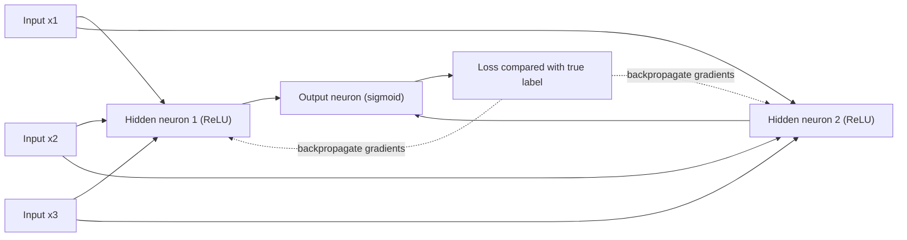

## Introduction

Deep learning is the technology behind most of the AI breakthroughs that business leaders hear about: speech recognition on phones, face matching for identity checks, machine translation, medical image analysis and large language models. At its core, however, sits a surprisingly simple building block, the artificial neuron, which computes a weighted sum of its inputs and passes it through a non-linear function. Stack many neurons in layers, train their weights on large amounts of data, and the network can learn remarkably rich patterns.

Business students do not need to derive every equation, but they do need to understand what a neural network is doing well enough to judge vendor claims, specify data requirements, anticipate costs and recognise risks. This lesson builds that understanding from the ground up. You will compute a single neuron's output by hand, perform one step of gradient-based learning, see how backpropagation extends this to deep networks, and consider when deep learning is, and is not, the right tool for an organisation.

## Learning Objectives

- Explain the structure of an artificial neuron, including weights, bias and activation function.
- Apply a forward pass through a single neuron and compute its output with sigmoid and ReLU activations.
- Explain how gradient descent and backpropagation train a network, and perform one weight update by hand.
- Compare feed-forward, convolutional, recurrent and transformer architectures at a conceptual level.
- Evaluate the business suitability of deep learning relative to simpler models in terms of data, cost, accuracy and explainability.

## Prerequisite Knowledge

- Logistic regression and the sigmoid function from the Machine Learning module.
- Training, loss functions, overfitting and validation from the lesson on model training and evaluation.

## Key Terminology

- **Artificial neuron**: A computational unit that multiplies inputs by weights, adds a bias and applies an activation function.
- **Weight**: A learned parameter that scales the contribution of an input to a neuron.
- **Bias**: A learned constant added to a neuron's weighted sum, shifting its activation.
- **Activation function**: A non-linear function applied to a neuron's weighted sum, such as sigmoid, tanh or ReLU.
- **ReLU (rectified linear unit)**: The activation `max(0, z)`, widely used in hidden layers because it trains efficiently.
- **Hidden layer**: A layer of neurons between the input and output layers whose outputs are intermediate representations.
- **Forward pass**: Computing a network's output by passing inputs through each layer in turn.
- **Backpropagation**: An algorithm that uses the chain rule of calculus to compute how the loss changes with respect to every weight, working backwards from the output.
- **Learning rate**: A hyperparameter that sets the size of each weight update in gradient descent.
- **Epoch**: One complete pass through the training dataset during training.
- **Deep learning**: Machine learning with neural networks that have many layers, which learn hierarchical representations from raw data.
- **Dropout**: A regularisation technique that randomly deactivates neurons during training to reduce overfitting.

## Detailed Explanation

### From neuron to network

An artificial neuron receives inputs `x1, x2, …, xn`, multiplies each by a weight, adds a bias and applies an activation function: `output = f(w1x1 + w2x2 + … + wnxn + b)`. If f is the sigmoid function, a single neuron is exactly logistic regression. The power of neural networks comes from connecting many neurons in **layers**. The input layer holds the features; one or more **hidden layers** transform them; the output layer produces the prediction, for example a single sigmoid output for a yes/no outcome, or a **softmax** layer producing probabilities across several classes.

The activation function must be non-linear. Without non-linearity, any stack of layers collapses mathematically into a single linear model, however deep. With it, networks can approximate highly complex functions; a well-known theoretical result (the universal approximation theorem) shows that even one sufficiently wide hidden layer can approximate a broad class of functions, although deep networks often learn such functions far more efficiently.

### Representation learning

The defining advantage of deep learning is **representation learning**. In traditional machine learning, analysts spend much effort on *feature engineering*: deciding, for example, which edge or texture measurements describe an image of a damaged product. A deep network learns its own features. In image tasks, early layers tend to detect simple patterns such as edges, middle layers combine them into textures and parts, and later layers respond to whole objects. In language tasks, layers progressively capture word meanings, syntax and context. This is why deep learning dominates tasks involving raw, unstructured data: images, audio, video and text.

### How networks learn

Training adjusts weights to reduce a loss function using **gradient descent**. The gradient tells us, for each weight, how much the loss would change if that weight increased slightly. Each update moves every weight a small step against its gradient: `new weight = old weight − learning rate × gradient`.

For a network with millions of weights, computing gradients efficiently is essential. **Backpropagation**, popularised by Rumelhart, Hinton and Williams in 1986, applies the chain rule of calculus layer by layer from the output backwards, reusing intermediate results so that all gradients are computed in roughly the time of one extra forward pass. In practice, training uses **mini-batch stochastic gradient descent**, updating weights after each small batch of examples, often with adaptive optimisers such as Adam. Training repeats over many epochs, with validation performance monitored to decide when to stop.

### Why deep learning took off when it did

Neural networks were studied for decades but became dominant in the 2010s for three reasons: **data** (large labelled datasets such as ImageNet, and vast digital text), **computing** (graphics processing units that perform the matrix arithmetic of neural networks in parallel) and **algorithmic improvements** (ReLU activations, better initialisation, dropout, batch normalisation and residual connections that allow very deep networks to train). AlexNet's 2012 ImageNet win brought these together and marked the resurgence.

### Training challenges

Deep networks have many parameters, so they can overfit badly without enough data. Common safeguards include **dropout**, **weight decay** (a penalty on large weights), **data augmentation** (creating varied copies of training images by flipping, cropping or adjusting brightness), and **early stopping** (halting training when validation loss stops improving). Very deep networks can also suffer from vanishing gradients, where gradients become too small to update early layers; ReLU activations and residual connections help. Finally, **transfer learning**, which starts from a network pre-trained on a large dataset and fine-tunes it on a smaller task-specific one, allows organisations with modest data to benefit from deep learning.

## Worked Example

### 1. Forward pass through a single neuron

**Illustrative scenario.** A telecom churn neuron receives three standardised inputs for a customer: change in data usage `x1 = 2`, number of complaints `x2 = 1`, and days since last top-up `x3 = 3`. Its weights are `w1 = 0.5`, `w2 = −1.0`, `w3 = 0.25` and bias `b = 0.1`.

**Step 1: weighted sum.** `z = 0.5 × 2 + (−1.0) × 1 + 0.25 × 3 + 0.1 = 1.0 − 1.0 + 0.75 + 0.1 = 0.85`.

**Step 2a: sigmoid activation.** `output = 1 / (1 + e^−0.85) = 1 / (1 + 0.427) ≈ 0.70`. Read as a 70 per cent estimated churn probability.

**Step 2b: ReLU activation (if this were a hidden neuron).** `max(0, 0.85) = 0.85`. Had z been −0.4, ReLU would output 0, meaning this neuron would be inactive for this customer.

### 2. One gradient-descent update

Suppose the customer did *not* churn, so the true label is `y = 0`. With a sigmoid output and log-loss, the gradient of the loss with respect to each weight has a simple form: `(output − y) × input`. The error term is `0.70 − 0 = 0.70`.

| Parameter | Gradient | Update with learning rate 0.1 | New value |
|---|---|---|---|
| w1 | 0.70 × 2 = 1.40 | 0.5 − 0.1 × 1.40 | 0.36 |
| w2 | 0.70 × 1 = 0.70 | −1.0 − 0.1 × 0.70 | −1.07 |
| w3 | 0.70 × 3 = 2.10 | 0.25 − 0.1 × 2.10 | 0.04 |
| b | 0.70 | 0.1 − 0.1 × 0.70 | 0.03 |

**Check.** New `z = 0.36 × 2 − 1.07 × 1 + 0.04 × 3 + 0.03 = 0.72 − 1.07 + 0.12 + 0.03 = −0.20`. New output `= 1 / (1 + e^0.20) ≈ 0.45`. Log loss falls from `−ln(1 − 0.70) ≈ 1.20` to `−ln(1 − 0.45) ≈ 0.60`. One update moved the prediction towards the correct answer. Training repeats this across thousands or millions of examples so that the weights reflect general patterns rather than one customer.

### 3. What backpropagation adds

In a network with a hidden layer, the output error must be attributed to hidden neurons too. Backpropagation computes, for each hidden neuron, how much it contributed to the output error (via the weight connecting it to the output and the slope of its activation function) and then updates its incoming weights in the same way as above. Repeating this layer by layer allows every weight in a deep network to learn.

## Theories, Frameworks and Models

### Main neural network architectures

| Architecture | Key idea | Typical data | Business examples |
|---|---|---|---|
| Feed-forward (multi-layer perceptron) | Fully connected layers | Tabular features | Risk scoring, demand prediction |
| Convolutional neural network (CNN) | Shared local filters detect spatial patterns | Images, video | Document scanning, product inspection, X-ray triage |
| Recurrent neural network (RNN, LSTM) | Maintains a state across a sequence | Time series, text | Earlier speech and text models, sensor sequences |
| Transformer | Attention relates every element of a sequence to every other | Text, code, also images and audio | Large language models, translation, summarisation |

### Deep learning versus other methods: a decision framework

Deep learning is not automatically the best choice. Consider:

- **Data type**: for images, audio and free text, deep learning is usually superior. For structured tabular data typical of banks and retailers, gradient-boosted trees frequently match or beat neural networks with less tuning.
- **Data volume**: deep networks need large datasets unless transfer learning from pre-trained models is possible.
- **Explainability**: deep networks are harder to interpret, which matters in lending, hiring and healthcare.
- **Cost and infrastructure**: training needs GPUs or cloud services; inference at scale has ongoing costs and energy use.
- **Maintenance skills**: organisations need staff who can monitor, retrain and debug such systems.

## Ghanaian Business Application

**Illustrative scenario.** A Ghanaian mobile money operator must verify the identity of new subscribers remotely. It considers a deep learning system that compares a customer's selfie with the photograph on their national identity document. Training a face-recognition network from scratch would require enormous labelled datasets, so the operator evaluates pre-trained models through transfer learning and fine-tunes them on consented local data. Crucially, it tests accuracy separately across skin tones, ages and lighting conditions common in its markets, because models trained mostly on other populations can perform unevenly. It keeps a human review queue for low-confidence matches and treats facial images as sensitive personal data under the Data Protection Act, 2012 (Act 843).

**Illustrative scenario.** A bank's analytics team proposes a deep neural network for credit scoring on tabular application data. After a fair comparison on a time-based validation set, a gradient-boosted tree performs as well and is easier to explain to the credit committee, so the bank retains it. The lesson: deep learning is powerful for unstructured data but is not automatically superior on spreadsheets.

## International Case Study

### Neural networks reading handwritten cheques

One of the earliest large-scale commercial uses of neural networks came from Yann LeCun and colleagues at AT&T Bell Laboratories. Their convolutional neural networks, described in the 1998 paper "Gradient-based learning applied to document recognition", recognised handwritten digits and were deployed in systems that read the amounts on bank cheques in the United States during the 1990s.

The case is instructive for three reasons. First, it shows that the core ideas of convolutional networks and gradient-based training were commercially valuable decades before the 2012 resurgence, when data and computing finally allowed far larger networks. Second, the application succeeded because the task was narrow and well defined (digits), large labelled datasets of handwriting could be assembled, and errors could be routed to human operators. Third, the system was part of a wider document-processing pipeline, which remains the pattern today: deep learning components succeed when embedded in processes with checks, fallbacks and clear performance targets.

## Diagram

## Common Misconceptions

- **Misconception**: Neural networks work like human brains. **Correction**: They are loosely inspired by biological neurons but are mathematical function approximators trained by gradient descent; the analogy is limited.
- **Misconception**: Deep learning is always more accurate than other methods. **Correction**: On structured tabular data, simpler models such as gradient-boosted trees often perform as well or better.
- **Misconception**: More layers always improve performance. **Correction**: Deeper networks need more data and careful training and can overfit or fail to train without techniques like residual connections.
- **Misconception**: Neural networks need no data preparation. **Correction**: They still require clean, representative, appropriately scaled data and careful splitting; they reduce manual feature engineering, not data work.
- **Misconception**: Backpropagation is a type of neural network. **Correction**: It is the algorithm used to compute gradients for training networks.

## Common Examination Mistakes

- Omitting the bias term or the activation function when computing a neuron's output.
- Applying the weight update in the wrong direction (adding rather than subtracting the gradient).
- Explaining deep learning without mentioning representation learning or the roles of data and GPUs.
- Recommending deep learning for every business problem without weighing data type, volume and explainability.
- Confusing an epoch (one pass through all training data) with a single weight update.

## Critical Thinking Questions

1. If a single sigmoid neuron is equivalent to logistic regression, what exactly do hidden layers add, and at what cost?
2. When a vendor offers a deep learning model trained on foreign data, what evidence should a Ghanaian hospital demand before using it on local patients?
3. How should an organisation weigh the energy and infrastructure costs of deep learning against its accuracy benefits?
4. Is transfer learning a solution to data scarcity in African languages and contexts, or does it import new biases?

## Practical Exercises

1. **Forward pass practice.** For the neuron in the worked example, compute the sigmoid output for a customer with inputs (0, 2, 1) and for one with inputs (3, 0, 4). *Expected output*: z values and probabilities to two decimal places, with one sentence interpreting each.
2. **Gradient update.** Starting from the original weights, perform one update for a customer with inputs (1, 0, 2) who *did* churn (y = 1), using learning rate 0.1. *Expected output*: a table of gradients and new weights, plus the new output showing movement towards 1.
3. **Interactive exploration.** Work through the neural networks module of the Google Machine Learning Crash Course, including its interactive exercises on hidden layers and activation functions. *Expected output*: a 150-word note on how adding hidden layers and non-linear activations changed what the model could learn.

## Key Takeaways

- A neuron computes `f(weighted sum + bias)`; a sigmoid neuron alone is logistic regression.
- Non-linear activations and hidden layers let networks learn complex functions and their own representations.
- Training uses gradient descent; backpropagation efficiently computes gradients for all weights.
- The deep learning resurgence was driven by data, GPUs and algorithmic advances; overfitting is controlled with dropout, augmentation, weight decay and early stopping.
- Deep learning excels on images, audio and text; for tabular business data, simpler models are often competitive and easier to explain.

## Further Reading

- Goodfellow, I., Bengio, Y., & Courville, A. (2016). *Deep learning*. MIT Press. <https://www.deeplearningbook.org/>
- LeCun, Y., Bengio, Y., & Hinton, G. (2015). Deep learning. *Nature, 521*(7553), 436-444.
- Rumelhart, D. E., Hinton, G. E., & Williams, R. J. (1986). Learning representations by back-propagating errors. *Nature, 323*(6088), 533-536.
- LeCun, Y., Bottou, L., Bengio, Y., & Haffner, P. (1998). Gradient-based learning applied to document recognition. *Proceedings of the IEEE, 86*(11), 2278-2324.

## Video Resources

- [Machine Learning Crash Course](https://developers.google.com/machine-learning/crash-course): Google for Developers. Includes a neural networks module with interactive visualisations.
- [Hugging Face Learn](https://huggingface.co/learn): Hugging Face. Free courses that apply pre-trained deep learning models.
- [Deep Learning (book website)](https://www.deeplearningbook.org/): Goodfellow, Bengio and Courville. Free online version of the standard deep learning textbook.

## Revision Summary

A neural network is layers of neurons, each computing an activation of a weighted sum plus bias. Non-linear activations let deep networks learn hierarchical representations from raw data. Training minimises a loss by gradient descent, with backpropagation computing gradients via the chain rule. Deep learning dominates unstructured data tasks but needs large data or transfer learning, significant computing and careful regularisation, and it is less explainable.

- Neuron: `output = f(Σ wi xi + b)`; sigmoid for probabilities, ReLU `max(0, z)` for hidden layers.
- Update rule: `new w = w − learning rate × gradient`; for sigmoid with log loss, gradient = `(output − y) × input`.
- Backpropagation (1986) made multi-layer training practical.
- Architectures: feed-forward, CNN, RNN/LSTM, transformer.
- Regularise with dropout, augmentation, weight decay, early stopping; use transfer learning when data are limited.
- On tabular data, compare against gradient-boosted trees before choosing deep learning.
