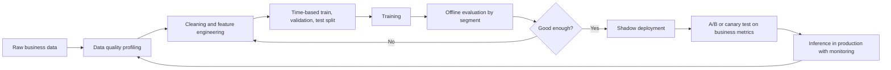

## Introduction

A recurring observation in industry is that most of the effort in a successful AI project goes into data rather than algorithms. Models learn whatever patterns exist in their training data, including errors, gaps and historical biases, and then reproduce them confidently in production. An MSc graduate who can choose between a random forest and a neural network but cannot judge whether a dataset is fit for purpose will build systems that look impressive in a notebook and disappoint in operation.

This lesson opens the AI engineering module. It covers three linked ideas: how to assess **data quality**; the difference between **training** (learning model parameters from historical data) and **inference** (using the trained model to make predictions on new data); and how **offline evaluation** on historical data differs from **online evaluation** in the live business. Together they explain why a model's notebook score is only the beginning of the evidence that it will work.

## Learning Objectives

- Explain the main dimensions of data quality and apply them to profile a business dataset.
- Distinguish training from inference in terms of purpose, compute, latency and failure modes.
- Identify data leakage and training-serving skew and explain how to prevent them.
- Compare offline evaluation methods with online evaluation methods such as A/B testing and shadow deployment.
- Evaluate whether evaluation evidence is sufficient to justify deploying a model.

## Prerequisite Knowledge

- Train, validation and test splits; overfitting; classification and regression metrics (Module 2).
- Basic familiarity with tabular data in spreadsheets or pandas.

## Key Terminology

- **Data quality**: The degree to which data is fit for its intended use, assessed across dimensions such as accuracy, completeness, consistency, timeliness, validity and uniqueness.
- **Representativeness**: The extent to which training data reflects the population and conditions in which the model will be used.
- **Label**: The recorded outcome a supervised model learns to predict, such as "defaulted" or "churned".
- **Training**: The process of fitting model parameters to historical data by minimising a loss function.
- **Inference**: Applying a trained model to new inputs to produce predictions, in batch or in real time.
- **Data leakage**: The presence in training data of information that would not be available at prediction time, producing unrealistically good evaluation results.
- **Training-serving skew**: A difference between how features are computed during training and during inference, causing degraded production performance.
- **Offline evaluation**: Measuring model performance on historical held-out data before deployment.
- **Online evaluation**: Measuring the effect of a model on real users or processes after deployment, for example through A/B tests.

## Detailed Explanation

### Dimensions of data quality

Data quality is not a single property; it is multidimensional and always relative to a purpose. Wang and Strong (1996) showed that data consumers judge quality on many dimensions beyond accuracy, including relevance, timeliness and accessibility. For machine learning, the following dimensions are especially useful.

| Dimension | Question | Business example of failure |
|---|---|---|
| Accuracy | Does the value correctly describe reality? | Customer age entered as 199 |
| Completeness | Are required values present? | Income missing for many loan applicants |
| Consistency | Do values agree across records and systems? | Branch codes differ between core banking and CRM |
| Timeliness | Is the data recent enough for the decision? | Stock levels updated only weekly for daily reordering |
| Validity | Do values conform to formats and rules? | Phone numbers with the wrong number of digits |
| Uniqueness | Is each real-world entity recorded once? | The same customer registered under three IDs |
| Representativeness | Does the data reflect the deployment population? | Training only on urban customers for a national product |
| Label quality | Are outcomes correctly and consistently recorded? | "Churned" defined differently by two departments |

The last two dimensions are specific to machine learning and frequently decide success. A dataset can be accurate, complete and valid yet unrepresentative, in which case the model will perform poorly on the groups it has not seen. Label quality matters because a supervised model can be no better than the definition of the outcome it learns.

### Common data problems in ML projects

- **Missing data** may be random or systematic. If income is missing more often for informal workers, simply dropping incomplete rows removes exactly the customers a product may be meant to serve.
- **Selection bias** arises when the data reflects past decisions. A lender only observes repayment for applicants it approved, so it has no labels for rejected applicants (the *selective labels* problem).
- **Data leakage** occurs when a feature encodes the outcome. A churn model that uses "account closure reason" will look perfect offline and fail in production, because the reason is recorded only after the customer leaves. Leakage also happens through careless splitting, for example random splits on time-series data that let the model learn from the future.
- **Duplicates across splits** inflate test scores when the same customer or near-identical record appears in both training and test sets.

### Training versus inference

Training and inference are distinct phases with different engineering concerns.

| Aspect | Training | Inference |
|---|---|---|
| Purpose | Learn parameters from historical labelled data | Produce predictions for new cases |
| Frequency | Occasional (one-off, scheduled or triggered retraining) | Continuous or on demand |
| Compute | Often heavy; may use GPUs; tolerates hours | Usually light per prediction; must be fast and reliable |
| Key metric | Validation loss and offline metrics | Latency, throughput, availability, cost per prediction and business outcomes |
| Main failure modes | Overfitting, leakage, poor data | Skew, drift, outages, unexpected inputs |

For large language models the asymmetry is extreme: training a foundation model requires enormous compute and is done by a few providers, while businesses mainly perform inference, sometimes after lightweight fine-tuning. For classic tabular models, both phases can run on a laptop or a free Google Colab notebook.

**Training-serving skew** is a classic engineering failure. Suppose a feature "average transaction value over the last 30 days" is computed in training from a cleaned data warehouse, but in production from a live system that includes reversed transactions. The model receives inputs it was never trained on. Prevention includes computing features with shared code for both phases, using a feature store, and logging production inputs for comparison.

### Offline and online evaluation

**Offline evaluation** uses historical data. Good practice includes a held-out test set that is touched only once, cross-validation for small datasets, and **time-based splits** (backtesting) for anything that changes over time, so that the model is always tested on a period later than it was trained on. Metrics should be chosen to reflect business costs: recall and precision for fraud, mean absolute error for forecasts, calibration for risk scores. Offline evaluation should also be *disaggregated* by segment (region, product, customer group) to reveal uneven performance.

Offline results answer "how well does the model reproduce past outcomes?" They cannot fully answer "what happens when we act on the model?", because acting changes behaviour. A recommendation engine changes what customers see; a fraud model changes how fraudsters behave; a credit model changes who receives loans and therefore what labels are collected in future.

**Online evaluation** measures effects in the live environment:

- **Shadow deployment**: the model receives live inputs and makes predictions that are logged but not acted on, testing technical reliability and live accuracy without business risk.
- **A/B testing**: users or cases are randomly assigned to the existing process (control) or the model-driven process (treatment) and a business metric is compared.
- **Canary release**: the model serves a small fraction of traffic first, expanding only if metrics remain healthy.
- **Human review sampling**: experts review a random sample of live decisions to estimate real-world error rates.

A mature team links model metrics (precision, MAE) to **business metrics** (fraud losses, waste, revenue) and **guardrail metrics** (complaints, fairness gaps, latency) that must not deteriorate.

## Theories, Frameworks and Models

### Fitness for use

The guiding principle of data quality management is **fitness for use**: data is high quality if it is good enough for a specific decision. A customer database that is adequate for monthly marketing summaries may be inadequate for real-time credit scoring. This means data quality requirements should be written as part of the AI use case, for example "income field at least 95% complete for the target population, updated monthly".

### Data-centric AI and documentation

The data-centric view argues that, for many business problems, systematically improving data (consistent labels, better coverage of rare cases, cleaner features) yields larger gains than changing algorithms. Documentation practices support this. **Datasheets for datasets** (Gebru et al., 2021) propose recording why a dataset was created, how it was collected, what it contains, and its recommended and inappropriate uses. These records make quality and representativeness visible to later users and auditors.

### The evaluation evidence ladder

Evaluation evidence can be thought of as a ladder, each rung giving stronger grounds for deployment:

1. Training performance (weak: may reflect overfitting).
2. Validation performance used for tuning.
3. Untouched test performance, ideally time-split and disaggregated by segment.
4. Shadow deployment on live data.
5. Controlled online experiment (A/B or canary) on business metrics.
6. Ongoing monitoring after full deployment.

Deployment decisions for high-impact systems should rest on the upper rungs, not on a single offline score.

## Worked Example

**Illustrative scenario.** A fictional Ghanaian microfinance institution wants to predict loan default. Its extract has 2,000 loan records with the following profile.

| Field | Missing values | Invalid values | Notes |
|---|---|---|---|
| customer_id | 0 | 0 | 60 IDs appear twice |
| monthly_income | 300 | 20 negative | Missing mostly for market traders |
| phone_number | 40 | 90 wrong length | |
| region | 0 | 0 | 85% Greater Accra |
| defaulted (label) | 0 | 0 | Recorded only for disbursed loans |

**Step 1: Completeness of income.** `(2,000 − 300) / 2,000 = 1,700 / 2,000 = 85%` complete.

**Step 2: Validity of income.** Of the 1,700 present values, 20 are negative, so validity `= 1,680 / 1,700 ≈ 98.8%`.

**Step 3: Uniqueness.** 60 duplicated IDs means 60 extra rows; unique customers `= 2,000 − 60 = 1,940`, uniqueness `= 1,940 / 2,000 = 97%`.

**Step 4: Phone validity.** Present phone numbers `= 1,960`; valid `= 1,960 − 90 = 1,870`; validity `≈ 95.4%`.

**Step 5: Interpretation.** The headline figures look acceptable, but two problems are serious. Income is missing *systematically* for market traders, so imputing a single average would distort the very segment the lender wants to grow; a better approach is a "missing" indicator plus segment-aware imputation, or collecting alternative income evidence. Second, 85% of records come from Greater Accra, so the model's performance in other regions must be reported separately before any national rollout. Duplicates must be removed *before* splitting into training and test sets to avoid leakage, and the split should be by disbursement date so that the test period is later than the training period.

## Ghanaian Business Application

Ghanaian organisations often hold data across disconnected systems: a core banking or ERP platform, spreadsheets maintained by branches, mobile money statements and paper forms. Common quality issues include inconsistent spellings of locations, multiple registrations of the same customer, and manual entry errors. The Ghana Card national identification number can, where lawfully used, help with uniqueness and identity matching, but processing must respect the Data Protection Act, 2012 (Act 843), including purpose specification and data security.

Infrastructure also shapes the training-inference split. A retailer may train models centrally in the cloud or on a free Colab notebook, but run inference at stores where connectivity is intermittent, which favours batch predictions pushed overnight or lightweight models that run locally. Online evaluation can be designed around branch or store structures: for example, randomly assigning some branches to use a new collections-prioritisation model while comparable branches continue current practice, then comparing recovery rates.

## International Case Study

### Zillow Offers and the limits of offline evaluation

Zillow, a United States property marketplace, operated a home-buying business called Zillow Offers that used algorithmic price estimates to make offers on homes, renovate them and resell them. In November 2021 the company announced that it would wind down the business, stating publicly that it had been unable to forecast future home prices accurately enough to operate the model at scale, and it reported significant losses on homes it had purchased.

The case is widely discussed because it illustrates several themes of this lesson. A price-estimation model can perform well offline on historical sales, yet when the business *acts* on its predictions at scale, conditions change: the market moved quickly, and buying decisions based on estimates exposed the company to errors in a way that displaying estimates on a website had not. The gap between offline accuracy and online business outcomes, sensitivity to changing conditions, and the consequences of automated decisions at scale are precisely why staged online evaluation and continuous monitoring are required.

## Diagram

## Common Misconceptions

- **Misconception:** More data always beats better data. **Correction:** Large but unrepresentative or mislabelled data reproduces errors at scale; quality and coverage often matter more.
- **Misconception:** A high test score proves the model will work in production. **Correction:** Leakage, skew, unrepresentative data and behavioural feedback can all break a model that scored well offline.
- **Misconception:** Random train-test splits are always correct. **Correction:** Time-ordered problems require time-based splits; random splits let the model learn from the future.
- **Misconception:** Inference is trivial once training is done. **Correction:** Inference must meet latency, cost, reliability and consistency requirements and is where most failures appear.
- **Misconception:** Dropping rows with missing values is a neutral cleaning step. **Correction:** If missingness is systematic, dropping rows biases the dataset against particular groups.

## Common Examination Mistakes

- Listing data quality dimensions without applying them to the case data.
- Confusing validation data (used for tuning) with test data (used once for final evaluation).
- Describing A/B testing without stating the business metric and randomisation unit.
- Ignoring the selective labels problem in credit and similar decisions.
- Treating training and inference as the same activity with the same requirements.

## Critical Thinking Questions

1. In a credit model, labels exist only for previously approved applicants. How does this limit what offline evaluation can tell you, and what could a lender do about it?
2. When is an A/B test unethical or impractical for an AI system, and what alternatives exist?
3. Should data quality targets be set by data scientists, business owners or data protection officers? Justify the allocation of responsibility.
4. How might a model that is accurate on average still be unfit for use for a particular region or customer group?

## Practical Exercises

1. **Data profiling in Python.** In Google Colab, load any public tabular dataset and use pandas to compute missingness, duplicates and invalid values per column. *Expected output:* a data quality table covering at least five dimensions with a short interpretation.
2. **Detect leakage.** Review the feature list of a churn dataset and identify any features that would not be known at prediction time. *Expected output:* a list of suspected leaking features with reasons and a corrected feature list.
3. **Design an online evaluation.** For a model that prioritises overdue loans for collection calls, design an A/B test. *Expected output:* randomisation unit, control and treatment, primary business metric, guardrail metrics and duration rationale.

## Key Takeaways

- Data quality is multidimensional and judged by fitness for a specific use.
- Representativeness and label quality are decisive for machine learning.
- Training learns parameters; inference applies them under latency, cost and reliability constraints.
- Leakage and training-serving skew are common causes of models that look good offline and fail in production.
- Offline evaluation should be time-based and disaggregated; online evaluation tests real business impact.

## Further Reading

- Wang, R. Y., & Strong, D. M. (1996). Beyond accuracy: What data quality means to data consumers. *Journal of Management Information Systems, 12*(4), 5-33.
- Gebru, T., Morgenstern, J., Vecchione, B., Vaughan, J. W., Wallach, H., Daumé III, H., & Crawford, K. (2021). Datasheets for datasets. *Communications of the ACM, 64*(12), 86-92.
- Huyen, C. (2022). *Designing machine learning systems*. O'Reilly Media.
- Kohavi, R., Tang, D., & Xu, Y. (2020). *Trustworthy online controlled experiments: A practical guide to A/B testing*. Cambridge University Press.

## Video Resources

- [Google Machine Learning Crash Course](https://developers.google.com/machine-learning/crash-course): Google for Developers. Free course with modules on data preparation, splitting data and production ML systems.
- [Kaggle Learn](https://www.kaggle.com/learn): Kaggle. Free micro-courses including data cleaning and feature engineering with runnable notebooks.

## Revision Summary

Data quality is fitness for use across accuracy, completeness, consistency, timeliness, validity, uniqueness, representativeness and label quality. Training fits parameters to history, while inference serves predictions under operational constraints; leakage and training-serving skew undermine both. Offline evaluation estimates past performance, but online evaluation measures actual business impact.

- Profile data before modelling and treat systematic missingness carefully.
- Use time-based splits and remove duplicates before splitting.
- Compute features identically in training and inference.
- Report metrics by segment, not just overall.
- Climb the evidence ladder: test set, shadow, A/B or canary, monitoring.
- Zillow Offers shows that offline accuracy may not survive acting on predictions at scale.
