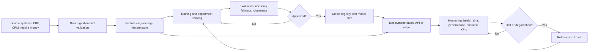

## Introduction

A model that lives only in a data scientist's notebook creates no business value. Value appears when predictions reach a decision: a fraud score blocks a transaction, a forecast becomes a purchase order, a churn score triggers a retention call. **Deployment** is the act of making a model available to those decisions, and **MLOps** (machine learning operations) is the discipline of doing so repeatedly, reliably and safely.

Deployment is also where many projects stall. Sculley et al. (2015) famously argued that in real-world ML systems the model code is a small part of a much larger system of data collection, feature extraction, configuration, serving and monitoring, and that this surrounding system accumulates "hidden technical debt". This lesson explains the main deployment patterns, the stages of an AI pipeline, rollout strategies, and how to monitor models once they are live, including a worked drift calculation.

## Learning Objectives

- Compare batch, real-time API, streaming and edge deployment patterns and select one for a business scenario.
- Explain the stages of an MLOps pipeline and the purpose of components such as a model registry and feature store.
- Distinguish data drift, concept drift and prediction drift, and explain how each is detected.
- Apply the population stability index to quantify drift in a feature.
- Evaluate rollout strategies such as shadow, canary and blue-green deployment in terms of risk.

## Prerequisite Knowledge

- Training versus inference, offline versus online evaluation and training-serving skew (previous lesson).
- A general idea of web APIs and databases.

## Key Terminology

- **Deployment pattern**: The way a model is made available for inference, such as batch scoring, a real-time API, streaming or on-device (edge) execution.
- **MLOps**: Practices and tooling that combine machine learning, software engineering and operations to build, deploy, monitor and improve models reliably.
- **Model registry**: A versioned store of trained models with their metadata, metrics and approval status.
- **Feature store**: A system that computes, stores and serves features consistently for both training and inference.
- **Continuous training (CT)**: Automated retraining of a model on new data, triggered by schedule, data volume or detected performance decline.
- **Data drift**: A change in the distribution of model inputs compared with the training data.
- **Concept drift**: A change in the relationship between inputs and the target, so the same inputs now imply different outcomes.
- **Canary release**: Releasing a new model to a small share of traffic first and expanding only if monitored metrics remain healthy.
- **Rollback**: Returning to a previous model version when a new version misbehaves.

## Detailed Explanation

### Deployment patterns

| Pattern | How it works | Typical latency | Good for | Watch-outs |
|---|---|---|---|---|
| Batch | Model scores a whole dataset on a schedule; results are written to a table or file | Hours | Weekly demand forecasts, monthly churn lists, overnight credit limit reviews | Predictions can be stale; failures may go unnoticed until users see old data |
| Real-time API | Model sits behind a web service; applications send a request and receive a prediction | Milliseconds to seconds | Fraud checks at payment, loan decisions in an app, chatbots | Must be highly available; features must be available instantly |
| Streaming | Model consumes an event stream and scores each event as it arrives | Seconds | Monitoring sensor streams, transaction monitoring | More complex infrastructure |
| Edge | Model runs on a device such as a phone, camera or factory controller | Very low | Quality inspection on a line, offline field apps | Limited compute; updating many devices is hard |

The choice follows the decision, not fashion. If a supermarket places orders once a week, a nightly batch forecast is entirely sufficient and far cheaper to operate than a real-time API. If a mobile money transfer must be approved in seconds, real-time scoring is unavoidable. Where connectivity is unreliable, edge or hybrid designs (batch scores cached on the device) are often more robust.

A model behind a real-time API is typically packaged with its dependencies (often in a container), exposed through an endpoint that accepts input fields and returns a prediction with a model version, and protected by authentication, input validation and rate limiting. Each request and response should be logged for monitoring and audit.

### The MLOps pipeline

A mature pipeline automates the path from data to monitored service.

1. **Data ingestion and validation**: data is pulled from source systems and checked against expectations (schema, ranges, missingness).
2. **Feature engineering**: features are computed with code shared between training and serving, ideally via a feature store.
3. **Training and tuning**: experiments are tracked with parameters, data versions and metrics.
4. **Evaluation and approval**: the candidate is compared with the current production model on a fixed test set and on fairness and robustness checks; a human approver signs off high-impact models.
5. **Registration**: the approved model is stored in a model registry with its documentation, for example a model card.
6. **Deployment**: the model is released with a rollout strategy.
7. **Monitoring**: inputs, outputs, performance, latency and business metrics are tracked, with alerts.
8. **Retraining or rollback**: drift or degradation triggers investigation, retraining or rollback.

Software engineering practices carry over: version control for code, **continuous integration** (automated tests on every change), and **continuous delivery** (automated packaging and deployment). MLOps adds versioning of *data* and *models* and **continuous training**. Free and open-source tools such as Git, MLflow for experiment tracking and model registry, and scikit-learn pipelines are enough for a student or small business to practise these ideas.

### Rollout strategies

- **Shadow deployment**: the new model scores live traffic, but only the old model's decisions are used. It is the lowest-risk way to test live behaviour.
- **Canary release**: a small percentage of traffic goes to the new model; metrics are compared, and traffic is increased stepwise.
- **Blue-green deployment**: two identical environments run side by side; traffic is switched from the old (blue) to the new (green) at once, enabling instant rollback.
- **A/B test**: randomised allocation designed to measure a business effect, not only technical health.

### Monitoring and drift

Monitoring covers four layers:

1. **Service health**: uptime, latency, error rates, cost.
2. **Data quality and drift**: are inputs missing, out of range or differently distributed?
3. **Model performance**: once labels arrive, are precision, recall or forecast error deteriorating?
4. **Business and fairness outcomes**: are losses, complaints or segment gaps changing?

Three kinds of drift are commonly distinguished:

- **Data (covariate) drift**: input distributions shift. A lender expands to a new region and applicant incomes change.
- **Concept drift**: the input-outcome relationship changes. After inflation rises, the same income level implies a higher default risk; fraudsters change tactics so old patterns stop indicating fraud.
- **Prediction drift**: the distribution of model outputs changes, for example a sudden rise in the share of transactions flagged.

Because labels often arrive late (a loan defaults months after approval), teams monitor input and prediction drift as early warnings and confirm with performance metrics when labels become available. Statistical tools include the **population stability index (PSI)**, the Kolmogorov-Smirnov test for continuous features, and the chi-squared test for categorical features.

## Theories, Frameworks and Models

### Hidden technical debt

Sculley et al. (2015) identified recurring sources of debt in ML systems: **entanglement** (changing one feature changes everything, "changing anything changes everything"), **undeclared consumers** (other systems silently using a model's outputs), **data dependencies** that are less visible than code dependencies, **glue code** and **pipeline jungles**, **feedback loops** where a model influences its own future training data, and configuration complexity. The managerial implication is that the cost of an AI system is dominated by maintenance, not initial development, and budgets and staffing should reflect this.

### MLOps maturity

Practitioners often describe maturity in levels:

| Level | Characteristics |
|---|---|
| 0: Manual | Notebooks, manual hand-over of model files, no monitoring |
| 1: Pipeline automation | Automated training pipeline, continuous training, model registry, basic monitoring |
| 2: CI/CD for ML | Automated testing and deployment of pipelines themselves, systematic monitoring and governance |

An organisation should aim for the level justified by the number and criticality of its models, not the highest level by default.

## Diagram

The arrow from the feature store directly to deployment emphasises that serving must use the same feature logic as training, preventing training-serving skew.

## Worked Example

### Population stability index

The PSI compares the distribution of a variable at training time (expected, `E`) with its distribution in production (actual, `A`), across bins:

`PSI = Σ (A_i − E_i) × ln(A_i / E_i)`

**Illustrative scenario.** A fictional Ghanaian digital lender's model uses applicant monthly income. At training, applicants were divided into four income bands of equal share. Three months after launch, a marketing campaign targeting younger customers has changed the mix.

| Income band | Expected share `E` | Actual share `A` | `A − E` | `ln(A/E)` | Contribution |
|---|---|---|---|---|---|
| Band 1 (lowest) | 0.25 | 0.35 | 0.10 | ln(1.40) = 0.3365 | 0.0337 |
| Band 2 | 0.25 | 0.30 | 0.05 | ln(1.20) = 0.1823 | 0.0091 |
| Band 3 | 0.25 | 0.20 | −0.05 | ln(0.80) = −0.2231 | 0.0112 |
| Band 4 (highest) | 0.25 | 0.15 | −0.10 | ln(0.60) = −0.5108 | 0.0511 |

Note that each contribution is positive, because `A − E` and `ln(A/E)` always share the same sign.

`PSI = 0.0337 + 0.0091 + 0.0112 + 0.0511 = 0.1051`

A rule of thumb used in credit-risk practice treats a PSI below about 0.1 as little change, 0.1-0.25 as moderate change worth investigating, and above 0.25 as a significant shift. These are conventions, not statistical laws. Here the PSI of about 0.105 signals a moderate shift towards lower-income applicants. The team should check whether performance on lower-income applicants was validated, monitor early repayment indicators by band, and consider whether the approval threshold or the model needs recalibration. Drift alone does not prove the model is wrong; it tells the team where to look.

## Ghanaian Business Application

For many Ghanaian organisations, the right starting point is a simple, well-run batch pipeline rather than complex real-time infrastructure. **Illustrative scenario:** a fictional pharmaceutical distributor in Kumasi trains a demand forecasting model monthly in a free Google Colab notebook, saves the model with a version number, and runs a scheduled batch job each Sunday night that writes forecasts to a spreadsheet or database used by buyers on Monday. Monitoring consists of a weekly report comparing forecasts with actual sales by product category, and an alert if error rises above an agreed threshold.

Real-time APIs are justified where decisions are instant, as in mobile money fraud screening or app-based lending. In such cases, operational resilience matters: power interruptions and connectivity issues mean the business must define a **fallback** (for example, rule-based checks if the model service is unavailable). Teams should also consider data residency and data protection obligations under the Data Protection Act, 2012 (Act 843) when choosing cloud hosting for personal data, and document who is accountable for approving each model version.

## International Case Study

### Hidden technical debt in Google's ML systems

Sculley et al. (2015), a group of engineers at Google, published "Hidden technical debt in machine learning systems", which has become one of the most cited papers in ML engineering. Drawing on experience of building and maintaining production systems, they argued that ML systems have a special capacity for incurring technical debt because they combine the maintenance problems of ordinary code with additional ML-specific issues.

Their illustration of a production ML system shows the model code as a small box surrounded by much larger components: configuration, data collection, data verification, feature extraction, resource management, serving infrastructure, analysis tools and monitoring. They highlighted that hidden feedback loops (a model shaping the data it is later retrained on) and undeclared consumers can make systems fragile, and that teams should measure and pay down debt deliberately.

The case matters for business students because it reframes AI investment. A proposal that budgets only for model development underestimates the true cost. A credible AI business case includes data pipelines, monitoring, retraining, documentation and staff to maintain them, and it plans for the model's eventual retirement.

## Common Misconceptions

- **Misconception:** Real-time deployment is always better. **Correction:** Batch scoring is cheaper, simpler and sufficient when decisions are periodic.
- **Misconception:** Once deployed, a model keeps its accuracy. **Correction:** Data and concept drift erode performance; monitoring and retraining are required.
- **Misconception:** Data drift always means the model must be retrained. **Correction:** Drift is a signal to investigate; performance and business impact determine the response.
- **Misconception:** MLOps is only for large technology firms. **Correction:** Small organisations benefit from basic versioning, scheduled pipelines, monitoring and rollback plans.
- **Misconception:** Retraining fixes every problem. **Correction:** Retraining on biased or leaked data, or after concept changes that require new features, can make things worse.

## Common Examination Mistakes

- Choosing a deployment pattern without linking it to decision frequency, latency and infrastructure.
- Confusing data drift with concept drift.
- Drawing a pipeline without monitoring, feedback or rollback.
- Making sign errors in PSI calculations or forgetting that each bin's contribution is non-negative.
- Ignoring fallback behaviour when a model service is unavailable.

## Critical Thinking Questions

1. For a model whose outcomes take six months to observe, how would you design monitoring to detect problems early?
2. When might a blue-green deployment be preferable to a canary release, and what risks does it carry?
3. How can feedback loops arise in a fraud or credit model, and what design choices reduce them?
4. Who in an organisation should have authority to roll back a model, and how quickly should they be able to act?

## Practical Exercises

1. **Choose a pattern.** For (a) weekly supermarket replenishment, (b) instant mobile money transfer screening and (c) bottle-cap inspection on a line, select a deployment pattern and justify it. *Expected output:* a three-row table with pattern, latency need, infrastructure assumptions and fallback.
2. **Compute PSI.** Calculate the PSI for expected shares 0.4, 0.4, 0.2 and actual shares 0.3, 0.4, 0.3. *Expected output:* each bin's contribution and the total (about 0.069), with an interpretation.
3. **Build a mini pipeline.** In Google Colab, create a scikit-learn `Pipeline` with preprocessing and a model, save it with `joblib` including a version string, reload it and score a new batch. *Expected output:* a notebook that demonstrates reproducible training and batch inference.

## Key Takeaways

- Deployment patterns (batch, real-time API, streaming, edge) should follow the decision's timing and infrastructure.
- MLOps pipelines automate ingestion, validation, features, training, evaluation, registration, deployment and monitoring.
- Rollout strategies such as shadow and canary reduce deployment risk; rollback must be planned.
- Data, concept and prediction drift require continuous monitoring; PSI is a simple drift measure.
- Most of an ML system's cost lies outside the model code, as hidden technical debt shows.

## Further Reading

- Sculley, D., Holt, G., Golovin, D., Davydov, E., Phillips, T., Ebner, D., Chaudhary, V., Young, M., Crespo, J.-F., & Dennison, D. (2015). Hidden technical debt in machine learning systems. In *Advances in Neural Information Processing Systems 28*.
- Huyen, C. (2022). *Designing machine learning systems*. O'Reilly Media.
- Kreuzberger, D., Kühl, N., & Hirschl, S. (2023). Machine learning operations (MLOps): Overview, definition, and architecture. *IEEE Access, 11*, 31866-31879.
- Mitchell, M., Wu, S., Zaldivar, A., Barnes, P., Vasserman, L., Hutchinson, B., Spitzer, E., Raji, I. D., & Gebru, T. (2019). Model cards for model reporting. In *Proceedings of the Conference on Fairness, Accountability, and Transparency* (pp. 220-229). ACM.

## Video Resources

- [Google Machine Learning Crash Course](https://developers.google.com/machine-learning/crash-course): Google for Developers. Includes material on production ML systems, deployment and monitoring.
- [MLflow Documentation](https://mlflow.org/docs/latest/index.html): MLflow project. Official documentation and tutorials for experiment tracking and the model registry.

## Revision Summary

Deployment connects models to decisions through batch, real-time API, streaming or edge patterns chosen to fit timing and infrastructure. MLOps pipelines automate the journey from data validation to monitored service, with registries, shared feature logic, staged rollouts and rollback. Models degrade through data, concept and prediction drift, so monitoring is continuous.

- Batch for periodic decisions; API for instant decisions; edge for low latency or poor connectivity.
- Pipeline: ingest, validate, features, train, evaluate, approve, register, deploy, monitor, retrain.
- Shadow, canary and blue-green reduce release risk.
- PSI = Σ (A − E) × ln(A/E); about 0.1-0.25 is commonly treated as moderate drift.
- Hidden technical debt means maintenance dominates lifetime cost.
- Always define a fallback when the model is unavailable.
