## Introduction

"Artificial intelligence" is one of the most used and least defined phrases in modern business. Vendors attach it to spreadsheet macros, chatbots, credit-scoring engines and image generators alike. A manager in Accra who is asked to approve an "AI-powered" procurement system needs to know what the phrase actually promises, what kind of reasoning or learning sits behind it, and how mature the underlying technique is. Without a precise vocabulary, organisations overpay for rebranded automation or, just as damaging, dismiss genuinely useful tools because an earlier wave of hype disappointed them.

This lesson gives you that vocabulary. It sets out the classic ways of defining AI, traces the history of the field from Alan Turing's 1950 paper to the deep learning and transformer era, and explains why AI has moved through repeated cycles of optimism and disappointment. Understanding this history is not nostalgia: the same patterns of overclaiming, data limitations and computing constraints that caused the "AI winters" still shape which AI projects succeed today.

## Learning Objectives

- Define artificial intelligence and compare the four approaches described by Russell and Norvig.
- Explain the significance of the Turing test and the 1956 Dartmouth workshop in the formation of the field.
- Describe the major phases of AI history, including symbolic AI, expert systems, the AI winters and the deep learning resurgence.
- Distinguish narrow AI from general AI, and symbolic from statistical (machine learning) approaches.
- Evaluate a business product claim by identifying which kind of AI, if any, it actually uses.

## Prerequisite Knowledge

- None beyond general familiarity with computers, software and business information systems.
- Helpful but not essential: basic awareness of what an algorithm is and how databases store records.

## Key Terminology

- **Artificial intelligence (AI)**: The study and engineering of computer systems that perform tasks which, when done by people, are associated with intelligence, such as perceiving, reasoning, learning, planning and using language.
- **Rational agent**: A system that perceives its environment and acts so as to achieve the best expected outcome given its knowledge and goals.
- **Turing test**: A behavioural test proposed by Alan Turing in 1950 in which a machine is judged intelligent if an interrogator cannot reliably distinguish its text responses from a human's.
- **Symbolic AI**: An approach in which knowledge is represented explicitly as symbols and rules that a program manipulates through logical inference.
- **Machine learning (ML)**: A subfield of AI in which systems improve their performance on a task by learning patterns from data rather than following only hand-written rules.
- **Expert system**: A rule-based program that encodes the knowledge of human specialists in a narrow domain to give advice or diagnoses.
- **AI winter**: A period of reduced funding, interest and confidence in AI research following unmet expectations.
- **Narrow AI**: A system designed to perform a specific task or limited set of tasks, such as fraud scoring or speech recognition.
- **Artificial general intelligence (AGI)**: A hypothetical system with broad, flexible intelligence comparable to or exceeding human capability across most tasks.
- **Deep learning**: Machine learning using neural networks with many layers, which learn layered representations directly from raw data.

## Detailed Explanation

### Why defining AI is difficult

AI is defined partly by its goals and partly by a moving target. Tasks that once seemed to require intelligence, such as playing chess or routing delivery vans, become "just software" once they are solved. This so-called *AI effect* means that the label tends to attach to whatever is new and impressive. For business analysis, a better approach is to ask what capability a system has (perception, prediction, reasoning, language, planning, action) and how it obtained that capability (programmed rules, learned from data, or a combination).

### Russell and Norvig's four approaches

The most widely used textbook in the field, Russell and Norvig's *Artificial Intelligence: A Modern Approach*, organises definitions of AI along two dimensions. The first asks whether we judge a system by its **thought processes** or by its **behaviour**. The second asks whether we measure success against **human performance** or against an ideal standard of **rationality**. This yields four approaches:

1. **Thinking humanly** – the cognitive modelling approach. The aim is to build programs whose internal reasoning resembles human thinking, tested against psychological experiments. This connects AI with cognitive science.
2. **Acting humanly** – the Turing test approach. A system is intelligent if its observable behaviour is indistinguishable from a person's. To pass, a system would need natural language processing, knowledge representation, automated reasoning and learning.
3. **Thinking rationally** – the "laws of thought" approach. Intelligence is the ability to draw correct conclusions using formal logic. Its weakness is that much real-world knowledge is uncertain and informal, and logical inference over large problems can be computationally intractable.
4. **Acting rationally** – the rational agent approach. A system is intelligent if it acts to achieve the best expected outcome. Russell and Norvig adopt this as their main framing because rationality is mathematically well defined and more general than either logic or human imitation.

The rational agent view is particularly useful for business. Organisations rarely care whether a demand-forecasting model "thinks like" a planner; they care whether its decisions lead to better outcomes, such as lower stock-outs and less waste. The rational agent framing also forces designers to specify a performance measure explicitly, which exposes hidden value judgements.

### Narrow versus general AI

Every commercially deployed AI system today is narrow: it performs well within a defined task and data distribution. Even large language models, which appear general because they handle many text tasks, have well-known failure modes outside their training data and cannot reliably act in the physical world. AGI remains a research aspiration and a subject of debate. When a vendor implies general intelligence, treat it as a red flag that warrants scrutiny.

### Symbolic and statistical traditions

Two broad traditions run through AI history. The **symbolic** tradition represents knowledge explicitly ("IF the customer is in arrears for more than 90 days THEN classify as non-performing") and reasons with it. It is transparent and easy to audit but brittle and expensive to maintain, because experts must articulate every rule. The **statistical or connectionist** tradition learns from examples, adapting numerical parameters so that a model fits data. It copes with noisy, high-dimensional inputs such as images and speech but is harder to explain. Modern systems frequently combine both: a bank may use a learned fraud score and then apply explicit business rules for regulatory compliance.

## Theories, Frameworks and Models

### The Turing test

In "Computing machinery and intelligence" (1950), Alan Turing replaced the vague question "Can machines think?" with an operational one, the *imitation game*. An interrogator exchanges typed messages with a hidden human and a hidden machine; if the interrogator cannot reliably tell which is which, the machine is said to exhibit intelligent behaviour. Turing also anticipated objections, including the argument that machines can only do what they are programmed to do, and he proposed that machines might *learn* like children. The test remains influential as a thought experiment, but critics note that it rewards imitation, including deception, rather than understanding, and that it focuses narrowly on conversation.

### Mitchell's definition of learning

Tom Mitchell's widely quoted framing describes a program as learning from experience E with respect to a task T and performance measure P if its performance on T, as measured by P, improves with E. This formulation is practical: for a supermarket churn model, T is predicting which loyalty-card holders will lapse, E is historical customer data, and P might be recall on lapsed customers.

### The hype cycle of AI research

AI history displays a repeated pattern: a breakthrough, confident predictions, investment, a collision with the limits of data, computing power or knowledge engineering, and then disillusionment. Recognising this pattern helps managers set realistic expectations for current generative AI projects.

## Worked Example

### Timeline of milestones

| Period | Milestone | Why it matters |
|---|---|---|
| 1950 | Turing publishes "Computing machinery and intelligence" | Frames machine intelligence as a testable, behavioural question |
| 1956 | Dartmouth summer research project, organised by John McCarthy, Marvin Minsky, Nathaniel Rochester and Claude Shannon | The term "artificial intelligence" is adopted and AI becomes a named research field |
| Late 1950s–1960s | Early programs for logic, games and language; Rosenblatt's perceptron | Optimism that general intelligence is near |
| 1970s | First AI winter | Early systems fail to scale; funding is cut in the UK and USA |
| 1980s | Commercial expert systems | Rule-based systems deliver business value in narrow domains |
| Late 1980s–early 1990s | Second AI winter | Expert systems prove costly to maintain and brittle |
| 1986 | Backpropagation popularised by Rumelhart, Hinton and Williams | Makes training of multi-layer neural networks practical |
| 1997 | IBM's Deep Blue defeats world chess champion Garry Kasparov | Shows the power of search plus specialised hardware |
| 2012 | AlexNet wins the ImageNet image-recognition challenge by a wide margin | Triggers the deep learning resurgence, enabled by GPUs and large labelled datasets |
| 2016 | DeepMind's AlphaGo defeats Lee Sedol at Go | Demonstrates deep reinforcement learning in a vast search space |
| 2017 | Vaswani et al. publish "Attention is all you need" | Introduces the transformer, the architecture behind modern large language models |

### Applying the definitions to products

**Illustrative scenario.** A procurement officer at a Ghanaian supermarket chain receives three proposals, each described as "AI-powered". Classify each.

1. *System A* reorders stock when shelf quantity falls below a fixed threshold set by the manager. **Analysis**: this is conventional rule-based automation. There is no learning and no reasoning beyond a single condition. Calling it AI is marketing.
2. *System B* uses three years of daily sales, holidays and promotions to forecast weekly demand per product and adjusts its forecasts as new sales arrive. **Analysis**: this is machine learning (narrow AI) judged by the "acting rationally" standard; its performance measure should be forecast error and stock-out rate.
3. *System C* answers supplier questions in English and Twi through a chat interface built on a large language model. **Analysis**: this is narrow AI that approaches the "acting humanly" standard in conversation, but it needs grounding in the company's actual supplier policies to avoid confidently wrong answers.

The step-by-step method is: (a) identify the capability claimed; (b) identify how it was obtained (rules, learning, or both); (c) identify the performance measure; (d) assess the risk if it fails.

## Ghanaian Business Application

AI history matters for Ghanaian organisations because the conditions that ended earlier AI winters, namely abundant data and affordable computing, are unevenly distributed. Mobile money platforms, telecommunications operators and banks generate large digital transaction records, which makes data-driven machine learning feasible for fraud detection, credit assessment and customer analytics. By contrast, many small and medium-sized enterprises still keep paper or fragmented spreadsheet records, so the limiting factor is not algorithms but data.

**Illustrative scenario.** A mid-sized Kumasi hospital is offered an "AI diagnosis" product. Its managers apply the lessons of the expert-system era: they ask what knowledge the system encodes, whether it was learned from local patient populations, how often it is updated and who is accountable for errors. Expert systems in the 1980s often failed because knowledge went out of date and nobody owned maintenance; asking these questions early protects the hospital from repeating that history. They also note that patient data processed by the system is personal data under Ghana's Data Protection Act, 2012 (Act 843), which shapes how any data-driven system may be trained and deployed.

## International Case Study

### From Deep Blue to AlexNet: two kinds of success

In 1997 IBM's Deep Blue defeated Garry Kasparov in a six-game chess match. Deep Blue relied on massive search through possible moves using specialised hardware and an evaluation function crafted with expert chess knowledge. It was a triumph of engineering in a well-defined, fully observable environment, but its approach did not transfer to messy perceptual tasks.

In 2012 a deep convolutional neural network developed by Alex Krizhevsky, Ilya Sutskever and Geoffrey Hinton, later known as AlexNet, won the ImageNet Large Scale Visual Recognition Challenge with an error rate far lower than competing approaches. Rather than relying on hand-crafted features, it learned visual features from more than a million labelled images, trained on graphics processing units (GPUs). The contrast is instructive: Deep Blue showed what search and expert knowledge can achieve in a closed world; AlexNet showed that learning from large data could solve open-ended perception problems. The latter insight underpins most business AI today.

## Diagram

```mermaid
flowchart LR
  A["1950 Turing test"] --> B["1956 Dartmouth: AI named"]
  B --> C["1960s symbolic optimism"]
  C --> D["1970s first AI winter"]
  D --> E["1980s expert systems"]
  E --> F["Late 1980s second AI winter"]
  F --> G["1990s-2000s statistical ML"]
  G --> H["2012 AlexNet: deep learning"]
  H --> I["2017 transformers"]
  I --> J["Generative AI and LLMs"]
```

## Common Misconceptions

- **Misconception**: AI and machine learning are the same thing. **Correction**: Machine learning is one subfield of AI; AI also includes search, planning, logic-based reasoning and knowledge representation.
- **Misconception**: The Turing test is the accepted scientific standard for intelligence. **Correction**: It is an influential thought experiment, but it rewards imitation of conversation and says little about understanding or competence in other tasks.
- **Misconception**: AI is a recent invention of technology companies. **Correction**: The field was named in 1956 and has roots in Turing's work from 1950; current systems build on decades of research.
- **Misconception**: AI winters happened because the ideas were wrong. **Correction**: Many ideas, such as neural networks, were sound but lacked sufficient data and computing power; overpromising also damaged credibility.
- **Misconception**: Any system that automates a decision is AI. **Correction**: Fixed rules and threshold triggers are conventional automation unless they involve learning, reasoning under uncertainty or perception.

## Common Examination Mistakes

- Listing the four Russell and Norvig approaches without explaining the two dimensions (thought versus behaviour; human versus rational) that generate them.
- Giving dates without explaining why a milestone mattered, for example naming Dartmouth 1956 without saying it established AI as a named field.
- Treating large language models as artificial general intelligence.
- Confusing the causes of the AI winters with the absence of good ideas, instead of discussing data, computing and overpromising.
- Failing to apply definitions to a business case when the question asks for evaluation.

## Critical Thinking Questions

1. Why might the "acting rationally" approach be more useful to a bank than the "acting humanly" approach? Are there situations where acting humanly matters more?
2. Is the current enthusiasm for generative AI likely to be followed by another AI winter? Justify your answer using the causes of previous winters.
3. If a task stops being called "AI" once it is solved, what does this imply for how organisations should budget for and evaluate AI projects?
4. Turing proposed that machines might learn like children. To what extent does modern machine learning fulfil that vision?

## Practical Exercises

1. **Classify five products.** Choose five products or services advertised in Ghana as "AI" or "smart" (for example, a banking app feature, a telecom chatbot, a ride-hailing pricing feature). For each, state the claimed capability, whether it uses rules, learning or both, and which Russell and Norvig approach best describes it. *Expected output*: a five-row table with a one-sentence justification per row.
2. **Build an annotated timeline.** Using the milestones in this lesson, create a timeline of at least eight events. For each, add one sentence on the enabling factor (data, algorithms, computing, funding). *Expected output*: a one-page timeline you can use for revision.
3. **Explore an introduction course.** Complete the first chapter of the free Elements of AI course and write 200 words comparing its definition of AI with Russell and Norvig's four approaches. *Expected output*: a short comparative paragraph.

## Key Takeaways

- AI is best defined by the capability a system has and how it acquired it, rather than by marketing labels.
- Russell and Norvig's four approaches arise from two dimensions: thinking versus acting, and human versus rational standards; the rational agent approach dominates modern AI.
- Key milestones include Turing (1950), Dartmouth (1956), expert systems (1980s), the AI winters, AlexNet (2012) and the transformer (2017).
- AI winters were caused by overpromising combined with limits of data, computing and hand-coded knowledge.
- All deployed AI today is narrow AI; claims of general intelligence deserve scepticism.

## Further Reading

- Russell, S., & Norvig, P. (2020). *Artificial intelligence: A modern approach* (4th ed.). Pearson.
- Turing, A. M. (1950). Computing machinery and intelligence. *Mind, 59*(236), 433–460.
- Mitchell, T. M. (1997). *Machine learning*. McGraw-Hill.
- Krizhevsky, A., Sutskever, I., & Hinton, G. E. (2012). ImageNet classification with deep convolutional neural networks. *Advances in Neural Information Processing Systems, 25*.
- Vaswani, A., Shazeer, N., Parmar, N., Uszkoreit, J., Jones, L., Gomez, A. N., Kaiser, Ł., & Polosukhin, I. (2017). Attention is all you need. *Advances in Neural Information Processing Systems, 30*.

## Video Resources

- [Elements of AI](https://www.elementsofai.com/) — University of Helsinki and MinnaLearn. A free introductory online course on what AI is and how it developed.
- [IBM Think: What is artificial intelligence?](https://www.ibm.com/think/topics/artificial-intelligence) — IBM. An explainer page on AI definitions and types, with linked video material.
- [Google AI](https://ai.google/) — Google. Official portal describing Google's AI research and educational resources.

## Revision Summary

Artificial intelligence is the engineering of systems that perceive, reason, learn and act in ways associated with intelligence. Russell and Norvig classify definitions by thinking versus acting and human versus rational standards, favouring the rational agent. The field was framed by Turing in 1950, named at Dartmouth in 1956, and has passed through cycles of optimism and AI winters before the data- and GPU-driven deep learning resurgence of 2012 and the transformer architecture of 2017.

- Four approaches: thinking humanly, acting humanly (Turing test), thinking rationally (logic), acting rationally (rational agent).
- Turing 1950: the imitation game replaces "Can machines think?"
- Dartmouth 1956: AI becomes a named field.
- Expert systems (1980s) were valuable but brittle; maintenance costs contributed to the second AI winter.
- AlexNet 2012 and transformers 2017 underpin today's AI.
- All current commercial AI is narrow AI.
