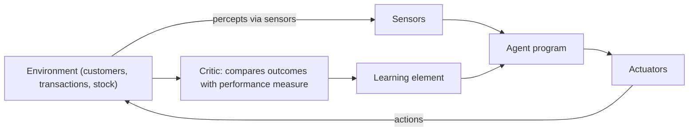

## Introduction

When an organisation says it wants "an AI solution", the most useful first question is: what will the system perceive, what will it be allowed to do, and how will we know whether it did well? The intelligent agent framework, central to modern AI textbooks, provides a disciplined way to answer exactly those questions. It treats any AI system, from a spam filter to a warehouse robot, as an *agent* that receives inputs from an *environment* and takes actions that change it.

This lesson uses that framework to analyse intelligent systems in business. You will learn to specify a system using the PEAS description (performance measure, environment, actuators, sensors), to classify environments by properties that determine how hard the problem is, and to choose between agent designs ranging from simple reflex rules to learning, utility-based agents. You will then map the main families of AI capability (perception, prediction, language, recommendation, optimisation and automation) to applications in Ghanaian and international organisations.

## Learning Objectives

- Explain the concepts of agent, environment, percept, action and performance measure.
- Apply the PEAS framework to specify an intelligent system for a business problem.
- Classify task environments by observability, determinism, dynamism and other properties, and explain how each property affects system design.
- Compare simple reflex, model-based, goal-based, utility-based and learning agents.
- Evaluate which AI capability families suit given business applications and identify their main risks.

## Prerequisite Knowledge

- The definitions of AI and the rational agent approach from the previous lesson.
- General familiarity with business processes such as sales, customer service and payments.

## Key Terminology

- **Agent**: Anything that perceives its environment through sensors and acts upon it through actuators.
- **Percept**: The input an agent receives at a given moment, such as a transaction record or a camera frame; the percept sequence is the complete history of inputs.
- **Agent function**: The mapping from percept sequences to actions; the agent program is its concrete implementation.
- **Performance measure**: The criterion, chosen by the designer, by which the success of an agent's behaviour is judged.
- **PEAS**: A specification of a task environment in terms of Performance measure, Environment, Actuators and Sensors.
- **Partially observable environment**: One in which the agent's sensors do not give access to the complete relevant state of the world.
- **Stochastic environment**: One in which the next state is not completely determined by the current state and the agent's action.
- **Utility function**: A function that assigns a numerical desirability to outcomes, allowing an agent to trade off competing goals.
- **Learning agent**: An agent that improves its performance over time using feedback on the results of its actions.
- **Intelligent system**: An information system that incorporates AI components to perceive, reason, learn or act with some autonomy.

## Detailed Explanation

### Agents and environments

The agent view separates three things that are often confused in business discussions. The **environment** is the part of the world the system interacts with: customers, transactions, stock levels, a road network. The **sensors** are how information reaches the system: database feeds, API calls, sensors, text messages. The **actuators** are how the system acts: sending an alert, blocking a payment, adjusting a price, replying to a customer. Between them sits the agent program, which decides what to do.

A rational agent selects, for each possible percept sequence, the action expected to maximise its performance measure given its built-in knowledge and what it has perceived. Rationality is not omniscience. A fraud-detection agent that approves a transaction which later proves fraudulent may still have been rational if the evidence available at the time pointed to legitimacy. This distinction matters for accountability: we should judge AI systems by the quality of their decision process and the information they had, not only by hindsight.

### Designing the performance measure

The performance measure is where business strategy enters AI. Russell and Norvig advise designing performance measures according to what one actually wants in the environment, rather than according to how one thinks the agent should behave. A customer-service bot rewarded for "short conversations" may learn to end chats quickly without solving problems. A better measure might combine resolution rate, customer satisfaction and escalation accuracy. Poorly specified measures are one of the most common causes of AI systems that technically "work" while harming the business.

### Properties of task environments

The difficulty of an AI problem depends heavily on the environment. The standard dimensions are:

- **Fully versus partially observable**: Can the agent see everything relevant? A chess program sees the whole board; a credit-scoring system cannot observe an applicant's future income shocks.
- **Deterministic versus stochastic**: Is the outcome of an action certain? Pricing decisions in retail are stochastic because customer responses vary.
- **Episodic versus sequential**: Is each decision independent, or do current actions affect future ones? Classifying a single scanned invoice is episodic; managing inventory is sequential.
- **Static versus dynamic**: Does the world change while the agent deliberates? Financial markets and mobile money networks are dynamic.
- **Discrete versus continuous**: Are states and actions countable (a set of loan decisions) or continuous (vehicle speed, steering angle)?
- **Single-agent versus multi-agent**: Are other agents present, and are they cooperative or competitive? Fraudsters are adversarial agents who adapt to detection systems.
- **Known versus unknown**: Does the designer know the rules governing outcomes? In new markets the "physics" of customer behaviour may be largely unknown.

Most business environments are partially observable, stochastic, sequential, dynamic and multi-agent, which is why simple rule-based systems tend to degrade and why learning and monitoring are essential.

### Agent architectures

Five classic agent designs form a ladder of sophistication:

1. **Simple reflex agents** act on the current percept using condition–action rules ("IF the transaction exceeds the daily limit THEN decline"). They are fast and transparent but fail when the right action depends on history.
2. **Model-based reflex agents** maintain an internal state that tracks aspects of the world they cannot currently see, such as a customer's recent transaction pattern.
3. **Goal-based agents** consider the future consequences of actions and choose those that achieve a goal, for example route-planning for deliveries.
4. **Utility-based agents** go further by weighing how desirable different outcomes are, trading off speed, cost and risk through a utility function.
5. **Learning agents** contain a performance element (which chooses actions), a critic (which provides feedback against the performance standard), a learning element (which improves the performance element) and a problem generator (which suggests exploratory actions).

In practice, enterprise AI often combines these: a learned model estimates probabilities, a utility calculation weighs costs, and reflex rules enforce regulatory constraints.

## Theories, Frameworks and Models

### A capability map of AI applications

A practical way to scan AI opportunities is to group applications by capability:

| Capability | What the system does | Typical business applications |
|---|---|---|
| Perception | Interprets images, video, audio | Document scanning, quality inspection, speech-to-text in call centres |
| Prediction | Estimates unknown or future values | Demand forecasting, churn prediction, credit risk |
| Language | Understands and generates text or speech | Chatbots, email triage, summarisation, translation |
| Recommendation | Ranks options for a user | Product suggestions, content feeds, next-best offer |
| Optimisation and planning | Searches for the best plan under constraints | Delivery routing, staff rostering, pricing |
| Anomaly detection | Flags unusual patterns | Fraud detection, network intrusion, equipment faults |
| Autonomous action | Acts with limited human oversight | Robotic process automation with AI, autonomous vehicles, AI agents |

The map helps managers match a problem to a technique and, equally importantly, to the type of data required: perception needs labelled images or audio; prediction needs historical outcomes; recommendation needs interaction histories.

### Human-in-the-loop design

Intelligent systems differ in autonomy. A system can *advise* (show a risk score to an officer), *recommend with default* (pre-select an action that a person approves), or *act autonomously* (block a transaction). The appropriate level depends on the cost of errors, the reversibility of actions, regulatory requirements and the system's demonstrated reliability.

## Worked Example

### PEAS specification for a mobile money fraud agent

**Illustrative scenario.** A Ghanaian mobile money operator wants an intelligent system to reduce fraudulent transfers without frustrating legitimate customers.

| PEAS element | Specification |
|---|---|
| Performance measure | Fraud losses prevented, proportion of legitimate transactions wrongly blocked, customer complaints, time to decision (must be within the payment window) |
| Environment | Subscriber wallets, agents and merchants, transaction network, SIM and device records, adversarial fraudsters, regulatory requirements |
| Actuators | Approve, hold for one-time PIN verification, decline, alert the fraud team, temporarily freeze a wallet |
| Sensors | Transaction amount and time, sender and receiver history, device and SIM-change events, location of cell tower, customer complaint reports |

**Environment classification**: partially observable (intent cannot be seen), stochastic, sequential (blocking affects future behaviour), dynamic, discrete actions with continuous features, multi-agent and adversarial, partly unknown (new fraud schemes emerge).

**Design consequence**: a simple reflex agent (fixed limits) will be gamed by fraudsters who keep transfers just below thresholds. A model-based agent tracking recent behaviour, combined with a learned risk score and a utility calculation that weighs the expected fraud loss against the cost of inconveniencing a genuine customer, is more appropriate. Because the environment is adversarial, the system must also be a learning agent that is retrained as patterns change.

A simple utility calculation illustrates the decision. Suppose a transfer of GHS 2,000 has an estimated fraud probability of 0.05, and holding it for verification costs the operator an estimated GHS 20 in customer friction. The expected loss from approving is 0.05 × 2,000 = GHS 100, which exceeds GHS 20, so holding for verification is the rational action. For a GHS 200 transfer with the same probability, the expected loss is GHS 10, below the friction cost, so approving is rational. (All figures are illustrative.)

## Ghanaian Business Application

Ghana's digital economy offers clear agent-shaped problems. Telecommunications operators run networks that must detect faults and balance load; banks assess loan applications and monitor transactions; supermarkets manage stock across branches; hospitals schedule staff and triage patients.

**Illustrative scenario.** A supermarket chain with branches in Accra, Tema and Takoradi uses the capability map to prioritise. It finds that its strongest data asset is several years of point-of-sale records, which supports *prediction* (demand forecasting) and *recommendation* (bundled promotions). It has few labelled images, so *perception* projects such as automated shelf monitoring would require new data collection. By specifying each candidate using PEAS, the chain discovers that the performance measure for forecasting must include perishable waste, not only stock-outs, because fresh produce losses are significant. The analysis leads it to start with forecasting, where data, measurability and business value align.

## International Case Study

### The Netflix Prize and the limits of a single performance measure

In 2006 Netflix launched a public competition offering a one million US dollar prize to any team that could improve the accuracy of its film-rating prediction algorithm by ten per cent, measured by root mean squared error on held-out ratings. The prize was awarded in 2009 to a team called BellKor's Pragmatic Chaos, whose solution blended many models.

The case is widely discussed for two lessons. First, it demonstrated the power of open competition and of combining (ensembling) many models for prediction. Second, Netflix publicly explained that it did not deploy the full winning ensemble, in part because the engineering effort was not justified by the additional gains and because its business had shifted towards streaming, where the relevant signals and goals differed. In agent terms, the performance measure used in the competition (rating-prediction error) had drifted away from what the business actually valued. Competitions and benchmarks are useful, but the performance measure must track real business outcomes.

## Diagram

## Common Misconceptions

- **Misconception**: An agent must be a robot. **Correction**: An agent is any system that perceives and acts; most business agents are software acting on data and digital channels.
- **Misconception**: A rational agent never makes mistakes. **Correction**: Rationality means choosing the best expected action given available information; outcomes can still be bad because the environment is uncertain.
- **Misconception**: The performance measure is a technical detail for data scientists. **Correction**: It encodes business values and trade-offs and must be set with managers and stakeholders.
- **Misconception**: More autonomy is always better. **Correction**: Autonomy should match error costs, reversibility and regulation; many high-stakes decisions should keep a human in the loop.
- **Misconception**: Business environments can be treated as static once a model is built. **Correction**: Customer behaviour, competition and fraud tactics change, so models must be monitored and updated.

## Common Examination Mistakes

- Writing a PEAS description that lists technologies (for example "Python, cloud") instead of sensors and actuators in the environment.
- Classifying an environment as fully observable when key variables, such as customer intent, are hidden.
- Describing agent types as a list without explaining when each is appropriate.
- Ignoring the adversarial, multi-agent nature of fraud and security problems.
- Proposing an AI application without linking it to the data required and to a measurable business outcome.

## Critical Thinking Questions

1. For a hospital appointment-scheduling system, what would be an appropriate performance measure? What unintended behaviour might a poorly chosen measure produce?
2. Should a bank's loan-approval system ever act fully autonomously? Under what conditions, if any, would you accept that?
3. How does the presence of adversarial agents, such as fraudsters, change the way an AI system should be evaluated and maintained?
4. The Netflix Prize optimised a measure that later diverged from business goals. How can an organisation detect such divergence early?

## Practical Exercises

1. **Write two PEAS specifications.** Produce a PEAS table for (a) a telecom customer-service chatbot and (b) an automated invoice-processing system for a Ghanaian distributor. *Expected output*: two completed PEAS tables with at least three entries per element.
2. **Classify environments.** For each of the systems above, classify the environment on all seven dimensions and state one design implication of each classification. *Expected output*: a 7-row table per system.
3. **Opportunity scan.** Using the capability map, list three AI opportunities for an organisation you know (your employer or a familiar business). For each, state the capability, the data needed, the performance measure and the appropriate level of autonomy. *Expected output*: a short opportunity register with a recommendation on which to pursue first.

## Key Takeaways

- The agent framework separates environment, sensors, actuators and decision logic, clarifying what an AI system can know and do.
- PEAS is a practical specification tool; the performance measure encodes business values and must be designed carefully.
- Most business environments are partially observable, stochastic, sequential, dynamic and multi-agent.
- Agent designs range from simple reflex to learning agents; real systems typically combine learned models, utility trade-offs and rules.
- Mapping AI capabilities to data and measurable outcomes helps organisations prioritise realistic projects.

## Further Reading

- Russell, S., & Norvig, P. (2020). *Artificial intelligence: A modern approach* (4th ed.). Pearson.
- Provost, F., & Fawcett, T. (2013). *Data science for business: What you need to know about data mining and data-analytic thinking*. O'Reilly Media.
- Davenport, T. H., & Harris, J. G. (2007). *Competing on analytics: The new science of winning*. Harvard Business School Press.

## Video Resources

- [Elements of AI](https://www.elementsofai.com/) — University of Helsinki and MinnaLearn. Free course whose early chapters cover AI problem-solving and real-world applications.
- [Google AI](https://ai.google/) — Google. Official overview of AI research areas and applied examples.
- [IBM Think: Artificial intelligence](https://www.ibm.com/think/topics/artificial-intelligence) — IBM. Explainer on AI types and business applications.

## Revision Summary

An intelligent system can be modelled as an agent that perceives its environment through sensors and acts through actuators to maximise a performance measure. PEAS makes this specification explicit. Environment properties such as observability, determinism, dynamism and the presence of adversaries determine how hard the problem is and which agent design suits it. Business applications cluster into capability families, each with distinct data requirements and risks.

- PEAS: Performance measure, Environment, Actuators, Sensors.
- Rational does not mean omniscient: judge decisions by information available at the time.
- Seven environment dimensions: observable, deterministic, episodic, static, discrete, single-agent, known.
- Agent ladder: simple reflex, model-based, goal-based, utility-based, learning.
- Capability map: perception, prediction, language, recommendation, optimisation, anomaly detection, autonomy.
- Choose autonomy by error cost, reversibility and regulation.
