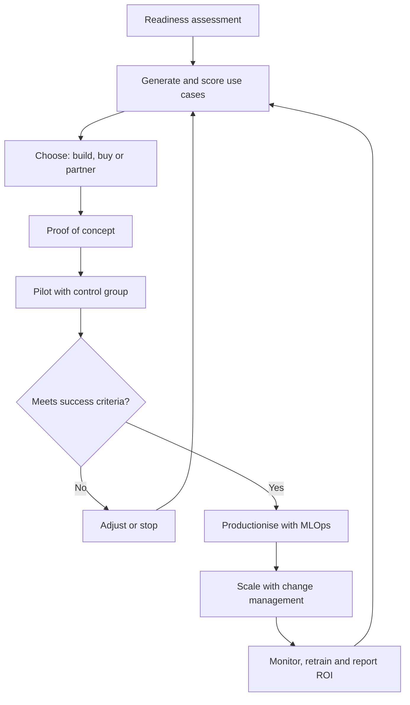

## Introduction

Many organisations can point to an impressive AI prototype, but far fewer can point to an AI system that is used daily, trusted by staff and delivering measurable value. The gap between a promising demonstration and a working business capability is where most AI initiatives struggle. The reasons are seldom purely technical. Data may be scattered across systems, the people who understand the process may not have been involved, nobody may own the model after the project team disbands, and the expected savings may never be measured.

This lesson treats AI adoption as a management problem as much as a technology problem. It identifies the common barriers, shows how to assess whether an organisation is ready, offers a structured way to choose which use cases to pursue first, compares the options of building, buying and partnering, and sets out how to move from pilot to production with proper governance, change management and financial evaluation. It closes with a practical roadmap that students can adapt to a Ghanaian organisation.

## Learning Objectives

- Analyse the principal barriers to AI adoption in organisations, including data, skills, cost, culture, legacy systems, trust and regulation.
- Assess an organisation's AI readiness using a maturity framework and identify the gaps that limit progress.
- Prioritise candidate AI use cases using a weighted value-feasibility scoring method.
- Evaluate build, buy and partner options against cost, control, speed and capability criteria.
- Calculate a risk-adjusted return on investment and payback period for an AI project.
- Construct a phased implementation roadmap covering pilot, scale-up, MLOps and governance hand-offs, and change management.

## Prerequisite Knowledge

- The AI applications covered earlier in this module: analytics, customer analytics, support automation and recommendation.
- Basic project management and cost-benefit concepts from information systems management.

## Key Terminology

- **AI readiness**: The extent to which an organisation has the data, technology, skills, leadership and governance needed to adopt AI successfully.
- **Maturity model**: A staged description of capability levels, used to locate where an organisation stands and what to improve next.
- **Use case**: A specific business problem to which AI is applied, with a defined user, decision and measure of success.
- **Proof of concept (PoC)**: A small experiment that tests whether an idea is technically feasible, usually on limited data and without production integration.
- **Pilot**: A limited real-world deployment with actual users, intended to test value, usability and operations before wider rollout.
- **Pilot purgatory**: The condition in which many pilots are launched but few progress into production.
- **MLOps**: Practices and tooling for deploying, monitoring, retraining and governing machine learning models in production.
- **Model drift**: The decline in model performance as the data or the world changes after deployment.
- **Technical debt**: The accumulated future cost of shortcuts in building and maintaining systems, which in machine learning includes tangled data dependencies and undocumented pipelines.
- **Change management**: The structured approach to preparing, supporting and equipping people to adopt new ways of working.
- **Total cost of ownership (TCO)**: The full cost of a solution over its life, including build or licence, integration, running, support and retraining.
- **Return on investment (ROI)**: Net benefit divided by cost, usually expressed as a percentage over a stated period.
- **Payback period**: The time taken for cumulative net benefits to repay the initial investment.

## Detailed Explanation

### Why adoption fails: the main barriers

The barriers below recur across industries. Diagnosing which ones apply is the first step to a credible plan.

**Data.** Models learn from data, so the quality, availability and accessibility of data set a ceiling on what is possible. Typical problems are records spread across disconnected systems, inconsistent definitions (what counts as an "active customer"?), missing or biased history, paper-based processes that never generated digital data, and unclear ownership. In many Ghanaian organisations, data may be held in spreadsheets, branch-level systems or messaging applications, and linking customer identities across them is difficult.

**Skills and talent.** Successful adoption needs more than data scientists. It needs data engineers who build pipelines, product owners who define the problem, domain experts who judge the results, and managers who can interpret model output. Skilled staff are scarce and mobile, so organisations must decide what to develop internally and what to source externally, and invest in broad AI literacy so that non-specialists can ask good questions.

**Cost.** Costs are wider than model development: data preparation, cloud or hardware, integration into existing systems, security, monitoring and ongoing retraining. Currency exposure matters when cloud services and licences are priced in foreign currency, and so does unreliable power or connectivity where systems run on-premises. Underestimating run costs is a frequent reason projects stall after the pilot.

**Culture and leadership.** Staff may fear job loss, distrust a "black box", or simply prefer established routines. If leaders treat AI as an IT project rather than a business change, frontline users are likely to ignore or work around the tool. Sponsorship from a senior executive who owns the business outcome is a consistent success factor in practitioner literature.

**Legacy systems and integration.** An accurate model is useless if its output cannot reach the point of decision. Older core systems may lack interfaces, batch-process overnight, or hold data in formats that are hard to extract. Integration frequently costs more than modelling.

**Trust, ethics and explainability.** Customers, regulators and staff need confidence that the system is accurate, fair and safe. Opaque models, visible errors and unclear accountability undermine trust quickly, and trust is far harder to rebuild than to build.

**Regulation and compliance.** Personal data use is governed in Ghana by the Data Protection Act, 2012 (Act 843), administered by the Data Protection Commission, and regulated sectors such as banking and insurance have their own supervisory expectations. Organisations should seek current guidance from qualified advisers, since AI-specific policy in many jurisdictions is evolving. Cross-border data flows, vendor hosting locations and automated decision-making deserve particular attention.

### Assessing AI readiness

A readiness assessment asks where the organisation stands across several dimensions, so that investment goes to the weakest link. A common structure covers strategy and leadership, data, technology and infrastructure, people and skills, processes and governance, and culture. Each dimension can be scored on a maturity scale.

| Level | Description | Typical evidence |
|---|---|---|
| 1. Ad hoc | Isolated experiments; no strategy | Individual enthusiasts, spreadsheets, no data owner |
| 2. Opportunistic | A few pilots; limited reuse | Departmental projects, vendor-led demos |
| 3. Systematic | Agreed priorities, shared data platform, defined roles | Data governance in place, first production models |
| 4. Scaled | Multiple production systems, MLOps, measured value | Model monitoring, reusable pipelines, product teams |
| 5. Embedded | AI is part of strategy and operations; continuous improvement | Funded portfolio, ethical review, widespread literacy |

This five-level table is a teaching device in the style of capability maturity models, not an official standard, and different consultancies use different scales. The value lies in the conversation: for each dimension, what evidence supports the score, and what is the next realistic step? An organisation at level 1 for data should resist ambitious predictive projects and first invest in data quality and governance.

### Prioritising use cases

Organisations typically generate more ideas than they can fund. A simple prioritisation method scores each candidate on **value** (revenue gain, cost saving, risk reduction, customer benefit, strategic fit) and **feasibility** (data availability and quality, technical complexity, integration effort, skills, regulatory and ethical risk, time to deliver). Scores from 1 to 5 are weighted and combined, then plotted on a value-feasibility grid. High-value, high-feasibility projects are "quick wins" to do first; high-value, low-feasibility projects are "strategic bets" that need enabling investment; low-value, high-feasibility items are "fill-ins"; and low-value, low-feasibility items are dropped.

Good use-case definitions name the user, the decision to be improved, the metric, the baseline and the data needed. "Use AI in lending" is not a use case; "reduce time to decision on small-business loan applications from five days to one by pre-scoring applications for the credit officer" is.

### Build, buy or partner

| Option | Advantages | Disadvantages | Fits when |
|---|---|---|---|
| Build in-house | Control, tailored fit, retained intellectual property, capability growth | Slow, requires scarce skills, higher upfront and maintenance cost | The capability is a source of competitive advantage and data are proprietary |
| Buy a product or use an API | Fast, lower upfront cost, vendor maintains the model | Less customisation, vendor lock-in, recurring fees, data-sharing and sovereignty questions | The problem is generic (translation, speech, standard chatbots, fraud screening) |
| Partner or co-develop | Access to expertise while building know-how; shared risk | Dependence on partner, unclear ownership of outputs, coordination overhead | The organisation has domain data but lacks skills, or needs a bespoke solution quickly |

Assessing options should include total cost of ownership over several years, exit plans if a vendor fails or raises prices, contractual rights over data and model outputs, security and compliance review, and the ability to explain and audit the system. Many organisations adopt a hybrid: buy commodity capabilities and build only where differentiation matters.

### From pilot to scale

Pilot purgatory arises because pilots are designed to impress rather than to scale. They use hand-cleaned data, a dedicated team, and no integration, so none of the conditions of real operation are tested. A scalable approach treats the pilot as a test of the whole system: real data feeds, real users, an agreed success metric and a stop-or-go decision rule decided in advance.

Key steps are: define the success criteria and baseline; run the pilot in a representative but contained setting; measure outcomes against a control or the previous process; document operational requirements (who monitors, who fixes, who retrains); and decide whether to scale, adjust or stop. Stopping a pilot that does not deliver is a success of governance, not a failure.

### MLOps and governance hand-offs

Once a model is in production it is a living asset. Data change, customer behaviour shifts and performance decays. The influential 2015 paper by Sculley and colleagues argued that machine learning systems carry hidden technical debt, because the model code is a small part of a system whose data dependencies, configuration and monitoring are costly to maintain. MLOps responds by treating models like other production software: version control for data, code and models; automated testing and deployment; monitoring of accuracy, drift and fairness; defined retraining triggers; and rollback capability.

Hand-offs are where accountability is often lost. Typical transitions are from the project team to the operations team, from the data science team to the business owner, and from the vendor to the internal support team. Each needs a written agreement: who owns performance, who responds to an incident, who approves model changes, and who answers to customers and regulators. A model register recording purpose, data, owner, validation results and review dates supports this, together with human-in-the-loop controls for high-stakes decisions.

### Change management

People, not algorithms, determine whether value is realised. Change management for AI follows general principles, such as those in Kotter's well-known eight-step model: create urgency, build a guiding coalition, communicate a clear vision, empower action, generate short-term wins and embed the change. Specific practices include involving frontline users in design, explaining plainly what the system does and does not do, training with real examples, redesigning roles and incentives so staff are rewarded for using the tool wisely, and creating channels for feedback and error reports. Where roles will change, honest communication and reskilling plans build trust. Rogers' diffusion of innovations work reminds us that adoption spreads through early adopters and visible peers, so choosing credible champions matters.

### Measuring value and ROI

Value should be measured against a baseline, using metrics tied to the original use case, for example handling time, loss rate, conversion, forecast error, or customer satisfaction. Benefits may be direct (cost savings, revenue) or indirect (better decisions, risk reduction), and indirect benefits should be translated into money cautiously or reported separately. Costs must include build or licence, integration, data work, cloud, staff time, training, monitoring and retraining. Because benefits are uncertain, a prudent analysis applies a realisation factor and a sensitivity test.

## Worked Example

**Illustrative scenario**: a Ghanaian microfinance company has four candidate AI projects and a budget for one. Its leadership scores each from 1 to 5 on value and feasibility, giving value a weight of 0.6 and feasibility 0.4.

| Use case | Value | Feasibility | Weighted score |
|---|---|---|---|
| Customer churn prediction | 4 | 4 | (0.6 x 4) + (0.4 x 4) = 4.0 |
| Credit scoring for informal borrowers | 5 | 2 | (0.6 x 5) + (0.4 x 2) = 3.8 |
| Demand forecasting for cash needs at branches | 4 | 3 | (0.6 x 4) + (0.4 x 3) = 3.6 |
| Customer service chatbot | 3 | 4 | (0.6 x 3) + (0.4 x 4) = 3.4 |

**Reading the result.** Churn prediction ranks first and is the quick win. Credit scoring has the highest value but the lowest feasibility, because data on informal borrowers are thin; it is a strategic bet, and the sensible response is to start data collection and governance work now so that it becomes feasible later, rather than rushing a weak model into lending decisions. The ranking is also sensitive to the weights: with weights of 0.8 on value and 0.2 on feasibility, credit scoring scores (0.8 x 5) + (0.2 x 2) = 4.4 and churn scores 4.0, so the choice of weights is itself a leadership decision to be made explicit.

**ROI for the chosen project.** Suppose the company evaluates churn prediction as a build project over three years, using figures that are purely illustrative.

- One-off build and integration cost: GH₵400,000.
- Annual running cost (cloud, monitoring, retraining, support): GH₵100,000.
- Expected annual benefit from retained customers: GH₵350,000.

Step 1, three-year total cost = 400,000 + (3 x 100,000) = GH₵700,000.
Step 2, three-year total benefit = 3 x 350,000 = GH₵1,050,000.
Step 3, net benefit = 1,050,000 - 700,000 = GH₵350,000.
Step 4, ROI = 350,000 / 700,000 = 50 percent over three years.
Step 5, annual net benefit after build = 350,000 - 100,000 = GH₵250,000, so payback = 400,000 / 250,000 = 1.6 years.

**Risk adjustment.** Pilots often over-promise, so test a 70 percent realisation factor on the benefit. Annual benefit becomes 0.7 x 350,000 = GH₵245,000. Three-year benefit = 735,000, net benefit = 735,000 - 700,000 = GH₵35,000, ROI = 35,000 / 700,000 = 5 percent, and annual net after build = 245,000 - 100,000 = GH₵145,000, giving payback = 400,000 / 145,000 = 2.76 years.

**Interpretation.** The project remains marginally positive but is far less attractive than the headline figure, and its viability depends heavily on whether the retention benefit materialises. This is why the pilot should measure retention uplift against a control group before full funding is committed, and why the company might consider buying a churn tool rather than building if a vendor option has lower upfront cost. Currency, tax and time-value effects are ignored here for simplicity; a full appraisal would discount future cash flows.

## Theories, Frameworks and Models

### Implementation roadmap

| Phase | Typical duration | Key activities | Exit criterion |
|---|---|---|---|
| 1. Foundations | 2-4 months | Executive sponsor, AI principles, readiness assessment, data inventory, governance roles | Agreed priorities and owners |
| 2. Prove | 2-4 months | PoC and one or two pilots on top-ranked use cases, baseline and control group | Pilot meets pre-agreed success criteria |
| 3. Productionise | 3-6 months | Integration, security review, MLOps pipeline, monitoring, runbooks, training | Stable service with named operational owner |
| 4. Scale | 6-12 months | Roll out to more users or branches, reuse components, extend to next use cases | Measured value in several areas |
| 5. Optimise and govern | Continuous | Retraining, drift and fairness audits, benefit tracking, portfolio review, retire weak systems | Regular review cycle in place |

Durations are indicative planning assumptions, not benchmarks, and vary widely with organisation size and data quality.

### Technology adoption perspectives

Two ideas from information systems research help explain user behaviour. Davis's technology acceptance model proposes that people adopt a system when they find it useful and easy to use. Rogers' diffusion of innovations explains the spread of new practices through adopter categories and social influence. Both imply that adoption is earned through relevance, usability and visible peer success, not mandated by announcement.

## Ghanaian Business Application

Ghanaian banks, insurers, telecom operators, microfinance institutions, retailers and public bodies all face the barriers above, in forms shaped by local conditions. Data may be fragmented between mobile money platforms, core banking systems and branch records. Skilled data staff are in demand and may be tempted abroad, which strengthens the case for partnerships with universities, training programmes and vendors that transfer knowledge. Foreign-currency pricing of cloud services affects cost forecasts, and connectivity and power reliability influence whether to run services on-premises or in the cloud. Data protection obligations under Act 843 and sector supervisory expectations affect vendor selection, particularly where data are hosted outside Ghana.

**Illustrative scenario**: a regional rural bank wants to improve loan officer productivity. Using the roadmap, it begins with a readiness review and discovers that loan histories are on paper in half its branches. Rather than commissioning a scoring model, it first digitises records and defines data ownership. It then buys a standard document-processing tool (a commodity capability) for application intake, and pilots a simple pre-screening model in two branches with loan officers retaining final authority. Officers are trained using real cases and encouraged to log disagreements with the model, which become input to retraining. The bank reports results against the previous turnaround time and defers a full credit-scoring build until enough clean data exist. The sequence respects feasibility, builds trust and keeps accountability with humans.

Public-sector and small-business adopters can also start with low-cost, high-value steps such as shared analytics tools, process automation of routine paperwork and staff AI literacy, before pursuing custom models. Students should check current national policy and regulatory guidance directly from official sources, as the AI policy environment in Ghana and elsewhere is developing.

## International Case Study

**Zillow Offers.** Zillow, the US property-listing company, ran a home-buying programme called Zillow Offers in which it used algorithmic valuations to buy homes and resell them. In November 2021 the company announced it would wind down the programme, reported substantial write-downs on its housing inventory, and said it had been unable to forecast home prices with the accuracy needed to run the business profitably in a volatile market. These facts were widely reported and come from the company's own announcements.

The case is instructive for several reasons, with the caveat that outside commentators disagree about the relative weight of the causes. First, it shows the difference between a model that predicts well in general and a business model that is robust to prediction error: when an organisation commits capital on the strength of a forecast, errors translate directly into losses, so risk limits and human oversight matter. Second, it illustrates model drift and changing conditions: a forecasting model trained on past market behaviour may perform poorly when the market moves sharply. Third, it reinforces the importance of aligning the use case with feasibility: forecasting individual property prices is intrinsically uncertain, so the decision to automate purchases at scale needed explicit uncertainty handling and staged scaling. For students, the lesson is that scaling an AI-driven decision process should be conditional on evidence from controlled stages, with monitoring and stop rules, rather than on confidence in a single model.

## Diagram

## Common Misconceptions

- **"AI adoption is mainly a technology purchase."** Technology is one of several dimensions; data, skills, process redesign, governance and culture usually decide success.
- **"A successful pilot proves the project will succeed at scale."** Pilots often use curated data and extra support. Scale needs integration, monitoring, ownership and user adoption, which pilots seldom test.
- **"Buying a vendor product removes the need for internal capability."** Buyers still need data readiness, integration skills, vendor management, and the ability to evaluate and monitor the system.
- **"The highest-value use case should always go first."** If feasibility is low, the project is likely to fail; the value-feasibility balance and enabling investments matter.
- **"ROI is the model's accuracy."** Accuracy is a technical measure. ROI depends on whether decisions and behaviour change enough to produce net financial or strategic benefit after all costs.

## Common Examination Mistakes

- Listing barriers without explaining how each one would affect a specific organisation or how to mitigate it.
- Presenting a maturity model as an official, universally agreed standard.
- Calculating ROI using benefits only and omitting running, integration and retraining costs.
- Choosing build, buy or partner without stating criteria or considering total cost of ownership and lock-in.
- Recommending a pilot without a control group, baseline or success criteria.
- Ignoring data protection and accountability when describing governance hand-offs.

## Critical Thinking Questions

1. A senior manager says: "We should do AI because competitors are." Construct a response that redirects the conversation to specific use cases, readiness and measurable value.
2. Under what circumstances is it better for a Ghanaian bank to buy an AI capability than to build it, and what contractual safeguards would you require?
3. Why might the people who benefit least from an AI tool be the ones whose cooperation is most needed, and how would you address this in the change plan?
4. A pilot shows impressive accuracy, but the operations team refuses to take ownership of the model. What does this reveal, and what should have been done earlier?
5. How would your ROI analysis change if a model's benefits depended on the behaviour of customers who might not respond as expected?

## Practical Exercises

1. Choose an organisation you know (for example a bank branch, a university department or a retailer) and score it from 1 to 5 on strategy, data, technology, people, governance and culture, giving one sentence of evidence per score. Expected output: a six-row table and a one-paragraph statement of the weakest dimension and the next step.
2. List five candidate AI use cases for the same organisation and score them on value and feasibility with weights you justify. Expected output: a ranked table and a short note on one quick win and one strategic bet.
3. Recalculate the worked-example ROI using a one-off cost of GH₵300,000, annual running cost of GH₵80,000, annual benefit of GH₵260,000 and a 60 percent realisation factor. Expected output: three-year ROI and payback, with a comment on whether you would proceed (three-year cost 540,000; adjusted benefit 156,000 per year, 468,000 over three years; net -72,000; ROI about -13 percent; the project does not pay back within three years).
4. Draft a one-page hand-off agreement for a model moving from a project team to operations. Expected output: named owners for performance monitoring, incident response, retraining approval and regulator or customer queries.

## Key Takeaways

- AI adoption fails mostly for organisational reasons: weak data, scarce skills, hidden costs, cultural resistance, legacy integration, low trust and regulatory risk.
- A readiness assessment locates the weakest dimension so investment targets the real constraint.
- Rank use cases by weighted value and feasibility, and make the weights explicit; high-value, low-feasibility projects need enabling investment first.
- Build, buy or partner should be decided on control, speed, cost over the life of the solution, skills and lock-in, and many organisations blend the three.
- Pilots must test real conditions with a baseline, control and stop-or-go rule; production needs MLOps, monitoring and named owners at every hand-off.
- ROI must include all costs and a risk-adjusted benefit; change management determines whether benefits are realised.

## Further Reading

- Davenport, T. H., & Ronanki, R. (2018). Artificial intelligence for the real world. *Harvard Business Review, 96*(1), 108-116.
- Sculley, D., Holt, G., Golovin, D., Davydov, E., Phillips, T., Ebner, D., Chaudhary, V., Young, M., Crespo, J.-F., & Dennison, D. (2015). Hidden technical debt in machine learning systems. In *Advances in Neural Information Processing Systems 28*. Curran Associates.
- Kotter, J. P. (1996). *Leading change*. Harvard Business School Press.
- Rogers, E. M. (2003). *Diffusion of innovations* (5th ed.). Free Press.
- Davis, F. D. (1989). Perceived usefulness, perceived ease of use, and user acceptance of information technology. *MIS Quarterly, 13*(3), 319-340.
- Provost, F., & Fawcett, T. (2013). *Data science for business*. O'Reilly Media.

## Video Resources

- [Google Machine Learning Education](https://developers.google.com/machine-learning): Google. Learning pathways including material on production machine learning systems and responsible practice.
- [IBM Think: Artificial intelligence](https://www.ibm.com/think/topics/artificial-intelligence): IBM. Explainer pages on AI topics, including enterprise adoption.
- [Kaggle Learn](https://www.kaggle.com/learn): Kaggle. Free micro-courses on data science and machine learning fundamentals.

## Revision Summary

AI adoption succeeds when organisations treat it as business change. The main barriers are data, skills, cost, culture, legacy systems, trust and regulation. A readiness assessment across strategy, data, technology, people, governance and culture shows the weakest link. Use cases are ranked by weighted value and feasibility, then sourced by build, buy or partner on the basis of control, speed, total cost and lock-in. Pilots need baselines, control groups and stop-or-go rules; production needs MLOps, monitoring and clear ownership; change management secures adoption; and ROI must be risk-adjusted and include every cost.

- Barriers: data, skills, cost, culture, legacy, trust, regulation (Act 843 in Ghana).
- Score use cases on weighted value and feasibility; state the weights.
- Build for differentiation, buy for commodity, partner to gain skills and speed.
- Avoid pilot purgatory: design pilots to test real operating conditions.
- ROI = net benefit divided by total cost; apply a realisation factor and compute payback.
- Hand-offs need named owners for monitoring, incidents, retraining and accountability.
