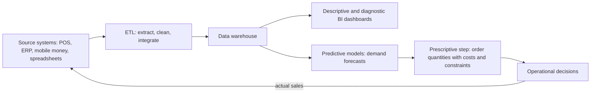

## Introduction

Every organisation that keeps records can look backwards: last month's sales, this quarter's complaints, the number of patients treated last year. Business intelligence (BI) turns these records into reports and dashboards that tell managers what happened. Predictive analytics goes further, using statistical and machine learning models to estimate what is likely to happen next. Demand forecasting is perhaps the most valuable and widespread predictive application: almost every business that holds stock, schedules staff or plans capacity depends on some estimate of future demand.

This lesson positions AI within the broader analytics landscape. You will learn how BI differs from predictive and prescriptive analytics, how a modern analytics stack is organised, and how to compute and compare simple forecasting methods by hand, including moving averages and exponential smoothing. These simple methods are not obsolete; they are the baselines that any sophisticated AI forecast must beat, and in many Ghanaian businesses with limited data, they may be the right tool.

## Learning Objectives

- Distinguish descriptive, diagnostic, predictive and prescriptive analytics, and explain where business intelligence and AI fit.
- Describe the components of a BI architecture, including data sources, ETL, data warehouse and dashboards.
- Apply moving-average and simple exponential smoothing methods to compute forecasts by hand.
- Calculate forecast error using MAE and MAPE and use them to compare methods.
- Evaluate when machine learning forecasting adds value over simple statistical methods, considering data, seasonality and business context.

## Prerequisite Knowledge

- Regression and evaluation metrics (MAE, RMSE) from the Machine Learning module.
- Basic familiarity with spreadsheets and averages.

## Key Terminology

- **Business intelligence (BI)**: The technologies and practices for collecting, integrating, analysing and presenting historical and current business data to support decisions.
- **Descriptive analytics**: Analysis that summarises what has happened, such as sales by region last month.
- **Diagnostic analytics**: Analysis that explores why something happened, such as drilling down into a sales decline.
- **Predictive analytics**: The use of statistical and machine learning models to estimate future or unknown outcomes.
- **Prescriptive analytics**: Analysis that recommends actions, often by combining predictions with optimisation.
- **Data warehouse**: A central repository of integrated, cleaned historical data organised for analysis and reporting.
- **ETL (extract, transform, load)**: The process of extracting data from source systems, transforming it into consistent formats and loading it into an analytical store.
- **Key performance indicator (KPI)**: A measurable value that indicates progress towards a business objective.
- **Moving average forecast**: A forecast equal to the average of the most recent n observations.
- **Exponential smoothing**: A forecasting method in which the new forecast is a weighted average of the latest actual value and the previous forecast, with weights set by a smoothing constant alpha.
- **Seasonality**: A regular, repeating pattern in data linked to the calendar, such as higher sales before Christmas or at the start of school terms.
- **MAPE (mean absolute percentage error)**: The average of absolute errors expressed as percentages of actual values.

## Detailed Explanation

### The analytics continuum

Analytics is often described as a progression of four questions:

1. **Descriptive**: *What happened?* Reports and dashboards showing sales, costs, transactions and KPIs.
2. **Diagnostic**: *Why did it happen?* Drill-downs, comparisons and root-cause analysis.
3. **Predictive**: *What is likely to happen?* Forecasts, risk scores and propensity models.
4. **Prescriptive**: *What should we do?* Optimisation and decision rules that use predictions to recommend actions, such as order quantities or staff rosters.

Traditional BI covers the first two stages. AI and machine learning are most associated with the last two, though AI increasingly appears inside BI tools as well, for example automated anomaly alerts on dashboards or natural-language querying ("show me sales of cooking oil in Kumasi last quarter"). The stages are not a strict ladder; an organisation needs sound descriptive reporting and trustworthy data before predictive models can be relied upon.

### BI architecture

A typical BI architecture has four layers. **Source systems** include point-of-sale terminals, enterprise resource planning (ERP) systems, mobile money platforms, hospital information systems and spreadsheets. **ETL or ELT pipelines** extract data, clean it (standardising product codes, resolving duplicates, handling missing values) and load it into a **data warehouse** or data lakehouse, where it is organised into fact tables (transactions) and dimension tables (products, stores, dates, customers). The **presentation layer** provides dashboards, reports and self-service analysis. Data governance, covering definitions, ownership, quality and access, spans all layers. A recurring practical lesson is that most of the effort in analytics lies in data integration and quality rather than in modelling.

### From BI to predictive analytics

Predictive analytics uses the same integrated data but asks forward-looking questions. Common business applications include demand forecasting, churn prediction, credit risk, predictive maintenance and patient-flow prediction. The key difference from BI is uncertainty: a dashboard reports a fact, while a forecast is an estimate with error. Good predictive analytics therefore communicates **uncertainty** (for example, prediction intervals) and is continuously **evaluated** against actual outcomes.

### Demand forecasting methods

Forecasting methods range from simple to complex:

- **Naive forecast**: next period equals the last observed value. A surprisingly strong baseline for volatile series.
- **Moving average**: the average of the last n periods. Smooths noise but lags behind trends.
- **Weighted moving average**: recent periods receive larger weights.
- **Simple exponential smoothing (SES)**: `F(t+1) = α × A(t) + (1 − α) × F(t)`, where A is actual and F is forecast, and α (between 0 and 1) controls responsiveness. High α reacts quickly to change but is noisier; low α is smoother but slower.
- **Holt's method** adds a trend component, and **Holt–Winters** adds seasonality.
- **Regression and machine learning models** incorporate drivers such as price, promotions, holidays, weather and local events, and can learn patterns across many products and stores simultaneously. Gradient-boosted trees and neural networks are widely used for large retail forecasting problems.

The choice depends on data length, the presence of trend and seasonality, the number of items to forecast and the availability of explanatory variables. A widely accepted principle in forecasting practice is to compare any sophisticated model against simple benchmarks on out-of-sample data before adopting it.

## Worked Example

**Illustrative scenario.** A supermarket branch in Kumasi records weekly sales of 5 kg bags of rice:

| Week | 1 | 2 | 3 | 4 | 5 | 6 |
|---|---|---|---|---|---|---|
| Actual sales (bags) | 120 | 130 | 125 | 140 | 135 | 150 |

### 1. Three-week moving average

- Forecast for week 4 = (120 + 130 + 125) / 3 = **125.00**
- Forecast for week 5 = (130 + 125 + 140) / 3 = **131.67**
- Forecast for week 6 = (125 + 140 + 135) / 3 = **133.33**
- Forecast for week 7 = (140 + 135 + 150) / 3 = **141.67**

### 2. Simple exponential smoothing with α = 0.3

Initialise the forecast for week 2 as the week-1 actual, F2 = 120.

- F3 = 0.3 × 130 + 0.7 × 120 = 39 + 84 = **123.00**
- F4 = 0.3 × 125 + 0.7 × 123 = 37.5 + 86.1 = **123.60**
- F5 = 0.3 × 140 + 0.7 × 123.6 = 42 + 86.52 = **128.52**
- F6 = 0.3 × 135 + 0.7 × 128.52 = 40.5 + 89.96 = **130.46**
- F7 = 0.3 × 150 + 0.7 × 130.46 = 45 + 91.32 = **136.32**

### 3. Comparing errors over weeks 4–6

| Week | Actual | MA forecast | MA absolute error | SES forecast | SES absolute error |
|---|---|---|---|---|---|
| 4 | 140 | 125.00 | 15.00 | 123.60 | 16.40 |
| 5 | 135 | 131.67 | 3.33 | 128.52 | 6.48 |
| 6 | 150 | 133.33 | 16.67 | 130.46 | 19.54 |

- MA: MAE = (15.00 + 3.33 + 16.67) / 3 = **11.67** bags. MAPE = (15/140 + 3.33/135 + 16.67/150) / 3 = (10.71% + 2.47% + 11.11%) / 3 ≈ **8.10%**.
- SES (α = 0.3): MAE = (16.40 + 6.48 + 19.54) / 3 ≈ **14.14** bags.

**Interpretation.** Both methods under-forecast every week because sales are trending upwards, and both smooth the trend away. The three-week moving average performs better here, partly because it "forgets" old low values faster than SES with α = 0.3. A higher α or a method with an explicit trend term (Holt's method) would likely do better. With only six weeks of data, however, no strong conclusion should be drawn; the comparison should be repeated over a longer evaluation period.

### 4. From forecast to decision (prescriptive step)

Suppose the branch adopts the moving-average forecast of about 142 bags for week 7, with recent absolute errors averaging about 12 bags. If the cost of a stock-out (lost sales and disappointed customers) is judged higher than the cost of holding extra rice, the manager might order the forecast plus a safety buffer, say 142 + 12 = 154 bags, adjusted for current stock and supplier lead time. This illustrates how a prediction becomes a decision only when combined with costs and constraints.

## Theories, Frameworks and Models

### Choosing a forecasting approach

| Situation | Suitable approach |
|---|---|
| Short history, stable demand | Naive, moving average, simple exponential smoothing |
| Clear trend | Holt's method or regression on time |
| Strong seasonality (festive periods, school terms) | Holt–Winters or seasonal models |
| Many products and stores, rich drivers (price, promotions, holidays) | Machine learning models across series, compared with statistical benchmarks |
| New products with no history | Analogous products, judgement, market research |

### Forecasting principles

- **Forecast at the level of the decision**: forecast per product per store if that is how orders are placed.
- **Measure error consistently** with MAE, RMSE or MAPE on held-out periods; note that MAPE is undefined when actual values are zero and can be distorted for small volumes.
- **Combine statistics with judgement** carefully: managers know about upcoming events, but undocumented overrides often add bias.
- **Communicate uncertainty**: provide ranges, not just point forecasts.
- **Monitor and update**: demand patterns shift with prices, competitors and economic conditions.

## Ghanaian Business Application

Demand forecasting is directly relevant to Ghanaian supermarkets, pharmacies, distributors and manufacturers. Ghanaian retail demand shows calendar effects such as Christmas, Easter, Eid celebrations and the start of school terms, as well as payday cycles and weather-related patterns, all of which a forecast should account for. Imported goods face lead times and exchange-rate effects, so over-ordering ties up working capital while under-ordering loses sales.

**Illustrative scenario.** A pharmaceutical distributor serving pharmacies across the Greater Accra and Ashanti regions currently orders based on the previous month's sales. It builds a BI layer first: a data warehouse combining warehouse dispatches, pharmacy orders and product master data, with dashboards of stock-outs and expiries by product. Only once the data are reliable does it pilot forecasting, comparing a seasonal exponential smoothing model with a gradient-boosted model using promotion and seasonal features. For fast-moving products, the machine learning model reduces error compared with the benchmark; for slow-moving, intermittent products, simple methods perform as well. The distributor uses each where it works best and reviews forecast error monthly.

**Illustrative scenario.** A hospital uses predictive analytics to forecast outpatient attendance by day of week and month, helping managers schedule nursing staff and plan pharmacy stock.

## International Case Study

### Walmart and hurricane demand

In 2004 *The New York Times* reported how Walmart analysed its large store of historical sales data ahead of Hurricane Frances in the United States. By examining what customers had bought in the period before an earlier hurricane, the company identified that demand rose not only for obvious items such as torches and bottled water but also for unexpected products, with strawberry Pop-Tarts and beer cited in the report. Stores in the storm's projected path were stocked accordingly.

The case illustrates how descriptive and diagnostic analysis of historical data can feed predictive decisions. It also illustrates the importance of **event-specific drivers**: an ordinary weekly forecast would miss hurricane-driven spikes unless the model includes information about the event. For Ghanaian businesses, analogous drivers include festive seasons, school calendars, major sporting events and disruptions to supply, which should be captured as explicit features or adjustments in forecasting models.

## Diagram

## Common Misconceptions

- **Misconception**: BI and AI are competing alternatives. **Correction**: BI provides the integrated, trustworthy data and descriptive insight that predictive AI depends on; they are complementary.
- **Misconception**: More sophisticated forecasting models are always more accurate. **Correction**: Simple methods are often competitive, especially with short or noisy series; complex models must beat them out of sample.
- **Misconception**: A forecast is a commitment to a precise number. **Correction**: Forecasts are uncertain estimates and should be presented with error measures or ranges.
- **Misconception**: Exponential smoothing with a high alpha is always better because it reacts faster. **Correction**: High alpha also reacts to random noise; the best alpha is chosen by testing on historical data.
- **Misconception**: Forecasting is purely a technical task. **Correction**: Good forecasting integrates business knowledge of promotions, events and supply constraints, and links predictions to decisions.

## Common Examination Mistakes

- Starting the moving average too early or including the period being forecast in its own average.
- Mixing up the order of terms in exponential smoothing; the formula weights the *latest actual* by α and the *previous forecast* by 1 − α.
- Computing MAPE without dividing by the actual values.
- Comparing methods on different periods, making the comparison unfair.
- Recommending a complex AI model without discussing data quality, benchmarks or how the forecast will be used.

## Critical Thinking Questions

1. Why might a Ghanaian SME benefit more from investing in clean descriptive BI than from adopting machine learning forecasting immediately?
2. How should a supermarket treat a sudden one-off spike in sales caused by a supply shortage at a competitor when training its forecasting model?
3. When managers override forecasts with judgement, how can the organisation learn whether those overrides improve or worsen accuracy?
4. Is MAPE an appropriate measure for products that sell only one or two units a week? What alternatives would you use?

## Practical Exercises

1. **Forecast by hand.** Using the rice data, compute SES forecasts with α = 0.6 for weeks 3–7 and the MAE over weeks 4–6. *Expected output*: a table and a comparison with α = 0.3 and the moving average, with a recommendation.
2. **Dashboard design.** Sketch a one-page BI dashboard for a Ghanaian supermarket's branch manager showing five KPIs (for example, sales versus target, stock-outs, waste of fresh produce, average basket value, forecast error). *Expected output*: a labelled sketch with a definition and data source for each KPI.
3. **Hands-on forecasting.** Using a free notebook and any public retail sales dataset available through Kaggle Learn or Kaggle datasets, compare a naive forecast, a moving average and a machine learning model on the last eight weeks held out. *Expected output*: an error table (MAE and RMSE) and a 150-word conclusion.

## Key Takeaways

- Analytics progresses from descriptive and diagnostic (BI) to predictive and prescriptive (often AI-driven); each depends on trustworthy integrated data.
- BI architecture comprises sources, ETL, a data warehouse and presentation, all under data governance.
- Moving averages and exponential smoothing are simple, transparent forecasting baselines; both lag trends unless extended.
- Compare methods with MAE, RMSE or MAPE on the same held-out periods; adopt complex models only when they beat benchmarks.
- Forecasts become value only when linked to decisions through costs, constraints and uncertainty.

## Further Reading

- Hyndman, R. J., & Athanasopoulos, G. (2021). *Forecasting: Principles and practice* (3rd ed.). OTexts. <https://otexts.com/fpp3/>
- Davenport, T. H., & Harris, J. G. (2007). *Competing on analytics: The new science of winning*. Harvard Business School Press.
- Provost, F., & Fawcett, T. (2013). *Data science for business*. O'Reilly Media.

## Video Resources

- [Forecasting: Principles and Practice](https://otexts.com/fpp3/) — OTexts. Free online forecasting textbook covering exponential smoothing and evaluation.
- [Google Cloud Training](https://cloud.google.com/learn/training) — Google Cloud. Official training catalogue including data analytics and BI learning paths.
- [Kaggle Learn](https://www.kaggle.com/learn) — Kaggle. Free micro-courses including time series and data visualisation.

## Revision Summary

Business intelligence integrates and presents historical data to answer what happened and why; predictive analytics estimates what is likely to happen; prescriptive analytics recommends actions. Demand forecasting ranges from naive and moving-average methods through exponential smoothing to machine learning models with business drivers. Methods must be compared using consistent error measures on held-out periods, and forecasts must be turned into decisions using costs and uncertainty.

- Four stages: descriptive, diagnostic, predictive, prescriptive.
- BI stack: sources → ETL → data warehouse → dashboards, with governance.
- Moving average: mean of last n actuals; lags trends.
- SES: `F(t+1) = αA(t) + (1 − α)F(t)`.
- MAE = mean absolute error; MAPE = mean of |error| / actual × 100%.
- Always beat simple benchmarks before adopting complex models.
