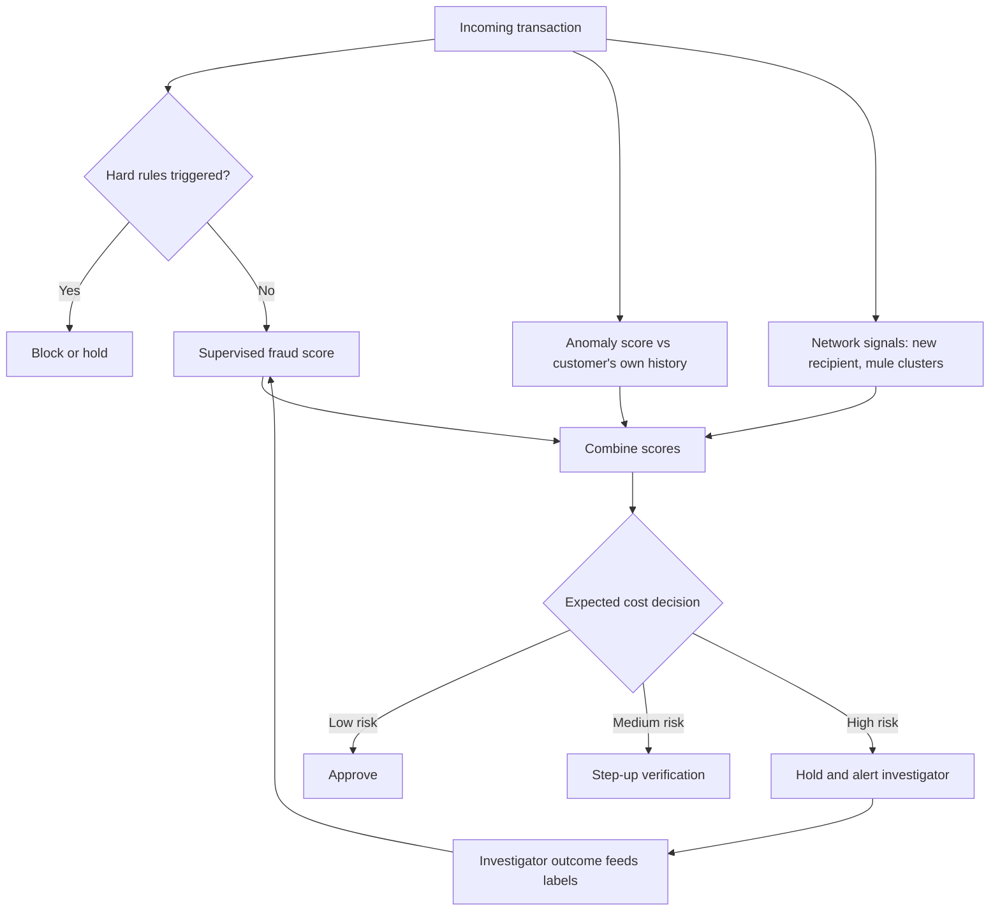

## Introduction

Two of the most commercially important uses of AI sit at opposite ends of the customer relationship. **Customer analytics** asks how to understand, retain and grow valuable customers: who buys most, who is drifting away, who would respond to an offer. **Fraud detection** asks how to protect the business and its customers from people who abuse its services: stolen cards, account takeovers, fake identities and mobile money scams. Both draw on the same transaction data, and both rely on the techniques you met in the Machine Learning module, from segmentation and classification to anomaly detection.

In Ghana, where mobile money, digital banking and loyalty programmes are widespread, these applications have direct relevance. A supermarket that understands its customers can design better promotions; a mobile money operator that detects fraud quickly protects both its revenue and public trust in digital finance. This lesson teaches the core methods, including a worked RFM analysis and an anomaly-scoring example, explains why fraud is a class-imbalance problem, and examines the ethical boundaries of using customer data.

## Learning Objectives

- Apply RFM (recency, frequency, monetary) analysis to score and segment customers, and interpret the segments for marketing action.
- Explain customer lifetime value and churn propensity and how they guide retention investment.
- Explain rule-based, supervised and unsupervised (anomaly detection) approaches to fraud detection and compute a simple anomaly score.
- Analyse the class-imbalance problem in fraud and evaluate techniques such as resampling, class weighting and cost-sensitive thresholds.
- Evaluate the privacy, fairness and customer-experience implications of customer and fraud analytics.

## Prerequisite Knowledge

- Clustering, classification, precision and recall from the Machine Learning module.
- The agent framework, especially adversarial environments, from the AI Foundations module.

## Key Terminology

- **Customer analytics**: The use of customer data to understand behaviour, predict outcomes and personalise actions across the customer life cycle.
- **RFM analysis**: A segmentation method that scores customers on recency of last purchase, frequency of purchases and monetary value spent.
- **Customer lifetime value (CLV)**: An estimate of the total net value a customer will generate over the relationship with a business.
- **Churn propensity**: The predicted probability that a customer will stop doing business with the organisation within a given period.
- **Next-best action**: A recommendation of the most valuable action for a specific customer at a given moment, such as an offer or a service call.
- **Fraud detection**: Identifying transactions, accounts or claims that are likely to be fraudulent so that they can be blocked or investigated.
- **Anomaly detection**: Identifying observations that deviate markedly from the normal pattern, without necessarily having fraud labels.
- **Z-score**: The number of standard deviations an observation lies from the mean: `(x − mean) / standard deviation`.
- **Class imbalance**: A situation in which one class (for example, fraud) is far rarer than the other, causing naive models to ignore it.
- **Oversampling and undersampling**: Rebalancing training data by duplicating or synthesising minority examples, or removing majority examples.
- **Concept drift**: A change over time in the relationship between features and outcomes, for instance when fraudsters change tactics.
- **Money mule**: A person whose account is used, knowingly or not, to receive and move fraudulent funds.

## Detailed Explanation

### Customer analytics across the life cycle

Customer analytics follows the customer journey: **acquisition** (which prospects are likely to become valuable customers), **development** (cross-selling and upselling), **retention** (predicting and preventing churn) and **win-back** (re-engaging lapsed customers). The core analytical tools are:

- **Segmentation**, using rules such as RFM or clustering, to group customers for differentiated treatment.
- **Propensity models**, typically supervised classifiers, estimating the probability that a customer will churn, buy a product or respond to an offer.
- **Customer lifetime value**, estimating long-term worth so that acquisition and retention spending can be prioritised.
- **Recommendation systems**, suggesting products based on purchase histories and similar customers.

A key managerial insight is that predicting churn is not the same as preventing it. The most useful retention models identify customers who are both likely to leave *and* likely to respond to an intervention. Offering discounts to customers who would have stayed anyway wastes money; this is why mature organisations test interventions with control groups (uplift modelling) rather than relying on propensity alone.

### RFM analysis

RFM is a transparent, widely used segmentation technique, especially suited to organisations with transaction data but limited data science capacity. Each customer is scored on:

- **Recency (R)**: how recently they purchased; more recent customers are more likely to buy again.
- **Frequency (F)**: how often they purchased in a defined period.
- **Monetary (M)**: how much they spent in that period.

Each dimension is usually scored from 1 to 5 by ranking customers into quintiles, and the three digits form an RFM code. Customers scoring 5-5-5 are the most engaged and valuable; those scoring 1-1-1 are dormant. Codes can then be grouped into named segments with tailored actions.

### Customer lifetime value

A simple CLV estimate multiplies average margin per period by the expected number of periods the customer remains: `CLV ≈ margin per year × expected years retained`, often discounted to present value. More advanced probabilistic models estimate CLV from RFM-type inputs. CLV helps answer questions such as "how much can we afford to spend to retain this customer?"

### Approaches to fraud detection

Fraud detection systems typically combine three layers:

1. **Rules**: expert-written conditions such as "decline transfers above a set limit from a wallet whose SIM was replaced in the last 24 hours". Rules are transparent and fast to deploy but easy for fraudsters to learn and evade.
2. **Supervised models**: classifiers trained on historical transactions labelled as fraud or legitimate. They capture complex patterns but depend on labels, which are delayed (fraud may be reported days later) and incomplete (undetected fraud is labelled legitimate).
3. **Unsupervised anomaly detection**: methods that flag unusual behaviour without labels, such as statistical outlier scores, clustering-based distances, isolation forests (which isolate unusual points with few random splits) or autoencoders (which flag records they cannot reconstruct well). These help detect new fraud patterns not seen in historical labels.

Modern systems add **network (graph) analysis**, linking accounts, devices, phone numbers and agents to uncover rings of money mules, and **real-time scoring** so that decisions are made within the payment window.

### Class imbalance

Fraud is rare relative to legitimate activity. If only a tiny fraction of transactions are fraudulent, a model can achieve very high accuracy by predicting "legitimate" for everything, as shown in the earlier lesson on evaluation. Techniques to address imbalance include:

- **Resampling**: undersampling the majority class, oversampling the minority class, or generating synthetic minority examples with methods such as SMOTE (Chawla et al., 2002). Resampling must be applied only to training data, never to validation or test data.
- **Class weights**: penalising errors on the minority class more heavily during training.
- **Cost-sensitive thresholds**: choosing the decision threshold that minimises expected business cost.
- **Appropriate metrics**: precision, recall, F1 and the area under the precision-recall curve rather than accuracy.

### The adversarial dimension

Fraud is a multi-agent, adversarial environment. When a bank tightens rules on one channel, fraudsters shift to another. This produces **concept drift**, so models must be monitored, retrained and complemented by investigator intelligence. Fraud teams also need feedback loops: every confirmed or rejected alert should feed back into labels.

## Worked Example

### 1. RFM scoring

**Illustrative scenario.** An Accra supermarket's loyalty programme analyses five customers over the last six months.

| Customer | Days since last purchase | Purchases | Spend (GHS) |
|---|---|---|---|
| C1 | 2 | 12 | 2,400 |
| C2 | 45 | 3 | 450 |
| C3 | 10 | 6 | 3,000 |
| C4 | 90 | 1 | 80 |
| C5 | 5 | 9 | 900 |

With five customers, each quintile holds one customer, so scores equal ranks (5 = best). For recency, fewer days is better.

| Customer | R | F | M | RFM code | Suggested segment and action |
|---|---|---|---|---|---|
| C1 | 5 | 5 | 4 | 554 | Champion: reward, early access, referral invitation |
| C2 | 2 | 2 | 2 | 222 | At risk: personalised reminder or targeted offer |
| C3 | 3 | 3 | 5 | 335 | High spender, moderate frequency: encourage more frequent visits |
| C4 | 1 | 1 | 1 | 111 | Dormant: low-cost win-back message or no action |
| C5 | 4 | 4 | 3 | 443 | Loyal, moderate basket: cross-sell to raise basket value |

**Simple CLV illustration.** C1 spends GHS 2,400 per six months, about GHS 4,800 per year. At an assumed 20 per cent gross margin, annual margin is GHS 960. If C1 is expected to remain for three years, undiscounted CLV ≈ GHS 2,880. Spending, say, GHS 100 a year on rewards to retain C1 is easily justified; spending the same on C4 may not be.

### 2. Anomaly scoring for a mobile money transfer

**Illustrative scenario.** A subscriber's past transfers have a mean of GHS 150 and a standard deviation of GHS 50.

- A new transfer of GHS 220: z = (220 − 150) / 50 = **1.4**, within normal variation.
- A new transfer of GHS 900: z = (900 − 150) / 50 = **15**, extremely unusual for this customer.

The GHS 900 transfer is not automatically fraud: the customer may be paying school fees. A good system combines the anomaly score with other signals, such as a recent SIM replacement, a new device, a first-time recipient or an unusual location, and then applies a cost-sensitive decision: approve, request verification, or hold for review. Note that the score is *personalised*; GHS 900 might be normal for a trader.

### 3. Handling imbalance in training

Suppose a training set has 100,000 transactions of which 200 are confirmed fraud (illustrative). A team might: (a) split by time into training, validation and test sets; (b) in the training set only, undersample legitimate transactions or apply class weights; (c) train a gradient-boosted classifier; (d) choose the threshold on the validation set by minimising expected cost; and (e) report precision, recall and alert volume on the untouched test set. Investigators' capacity, for example how many alerts they can review per day, sets a practical constraint on the threshold.

## Ghanaian Business Application

Mobile money is widely used in Ghana for transfers, merchant payments and bill payments, which makes fraud prevention a matter of public trust in digital finance. Common fraud patterns discussed by operators and regulators include social-engineering scams that trick customers into sending money or revealing PINs, SIM-swap account takeovers and the use of mule wallets to move proceeds.

**Illustrative scenario.** A mobile money operator layers its defences: rules block transfers from wallets with very recent SIM replacements above a modest value; a supervised model scores each transaction in real time using features such as amount relative to the customer's history, recipient novelty, device change and time of day; an unsupervised model flags wallets whose network of counterparties suddenly expands; and graph analysis identifies clusters of newly registered wallets that receive funds from many victims and cash out quickly. Customer communication complements the technology: SMS warnings explain that staff will never ask for a PIN.

**Illustrative scenario.** A bank uses churn propensity and CLV together. Instead of offering fee waivers to all customers predicted to leave, it runs a controlled test and finds that offers are effective mainly for salaried customers with recent service complaints. It targets that group and fixes the underlying service issues.

Both cases involve personal data. Under Ghana's Data Protection Act, 2012 (Act 843), organisations must process personal data lawfully and for specified purposes, keep it secure and respect data subjects' rights. Customer and fraud analytics should therefore be documented, proportionate and subject to access controls.

## International Case Study

### Target and the limits of customer prediction

In 2012 *The New York Times Magazine* published an article by Charles Duhigg, "How Companies Learn Your Secrets", describing how the United States retailer Target had developed a model to identify customers who were likely to be pregnant based on changes in their purchases of certain products, so that it could send relevant offers early. The article recounted an anecdote in which a father complained about baby-related offers sent to his teenage daughter, only to learn later that she was indeed pregnant. The article also reported that Target adjusted how it presented such offers, mixing them with unrelated products so that they seemed less targeted.

Whether or not every detail of the anecdote generalises, the case became a landmark in discussions of customer analytics because it shows that accurate prediction can itself be a harm. Inferring sensitive characteristics, such as health status, from ordinary purchases can feel intrusive and may breach expectations of privacy even when no data were "leaked". For Ghanaian organisations, the lesson is to define in advance which inferences are acceptable, avoid inferring sensitive categories without a clear lawful basis and consent, and consider how customers would feel if they knew how a recommendation was produced.

## Diagram

## Common Misconceptions

- **Misconception**: Predicting churn means you can prevent it. **Correction**: Retention value comes from targeting customers who will respond to an intervention; this requires testing with control groups.
- **Misconception**: High-spending customers are always the most valuable. **Correction**: Value depends on margin, frequency, retention and cost to serve; RFM and CLV give a fuller picture.
- **Misconception**: A fraud model with 99.9 per cent accuracy is excellent. **Correction**: With rare fraud, a model predicting no fraud at all can match that accuracy; precision and recall matter.
- **Misconception**: Anomalies are fraud. **Correction**: Anomalies are unusual, not necessarily illegitimate; they require context and review.
- **Misconception**: Once trained, a fraud model remains effective. **Correction**: Fraudsters adapt, causing concept drift; continuous monitoring and retraining are essential.

## Common Examination Mistakes

- Scoring recency so that *more* days since the last purchase receive a higher score.
- Applying oversampling before splitting data, which leaks synthetic copies of test cases into training.
- Recommending accuracy as the evaluation metric for fraud detection.
- Ignoring the customer experience costs of false positives, such as blocked legitimate payments.
- Omitting privacy and data protection considerations when proposing customer analytics.

## Critical Thinking Questions

1. Should a mobile money operator automatically block a large, unusual transfer, or ask the customer to verify it? How does the answer depend on the customer and the context?
2. What inferences from purchase data would you consider unacceptable for a Ghanaian supermarket to make, even if technically possible?
3. How can fraud teams obtain reliable labels when much fraud is never reported?
4. Is RFM still useful when machine learning propensity models are available? Justify your answer.

## Practical Exercises

1. **RFM in a spreadsheet.** Create a table of 20 fictitious customers with recency, frequency and monetary values. Score each dimension into quintiles, form RFM codes and define four named segments with one action each. *Expected output*: the scored table and a segment-action summary.
2. **Anomaly scoring.** For a customer with past transfers of GHS 100, 120, 80, 150, 110 and 140, compute the mean and standard deviation and the z-scores of new transfers of GHS 130, 300 and 1,000. *Expected output*: calculations and a proposed action for each transfer with justification.
3. **Imbalanced classification lab.** Using the scikit-learn documentation and a public, anonymised fraud dataset available on Kaggle, train a classifier with and without class weights and compare precision, recall and F1 on a held-out set. *Expected output*: a comparison table and a recommendation on the threshold given an assumed alert capacity.

## Key Takeaways

- Customer analytics spans acquisition, development, retention and win-back, using segmentation, propensity models, CLV and recommendations.
- RFM scores recency, frequency and monetary value into codes that support transparent, actionable segments.
- Fraud detection layers rules, supervised models, anomaly detection and network analysis, with real-time cost-sensitive decisions.
- Fraud is highly imbalanced and adversarial; use resampling or class weights on training data only, appropriate metrics and continuous monitoring.
- Accurate prediction can itself harm privacy; organisations must set ethical limits and comply with Act 843.

## Further Reading

- Provost, F., & Fawcett, T. (2013). *Data science for business*. O'Reilly Media.
- Fader, P. S., Hardie, B. G. S., & Lee, K. L. (2005). RFM and CLV: Using iso-value curves for customer base analysis. *Journal of Marketing Research, 42*(4), 415-430.
- Chandola, V., Banerjee, A., & Kumar, V. (2009). Anomaly detection: A survey. *ACM Computing Surveys, 41*(3), Article 15.
- Chawla, N. V., Bowyer, K. W., Hall, L. O., & Kegelmeyer, W. P. (2002). SMOTE: Synthetic minority over-sampling technique. *Journal of Artificial Intelligence Research, 16*, 321-357.
- He, H., & Garcia, E. A. (2009). Learning from imbalanced data. *IEEE Transactions on Knowledge and Data Engineering, 21*(9), 1263-1284.
- Liu, F. T., Ting, K. M., & Zhou, Z.-H. (2008). Isolation forest. In *2008 Eighth IEEE International Conference on Data Mining* (pp. 413-422). IEEE.

## Video Resources

- [scikit-learn documentation](https://scikit-learn.org/stable/): scikit-learn. The user guide covers outlier and novelty detection, including isolation forests.
- [Kaggle Learn](https://www.kaggle.com/learn): Kaggle. Free micro-courses on machine learning and feature engineering applicable to customer and fraud data.
- [IBM Think: Artificial intelligence](https://www.ibm.com/think/topics/artificial-intelligence): IBM. Explainer pages on AI topics, including business applications.

## Revision Summary

Customer analytics uses segmentation, propensity models and lifetime value to acquire, grow and retain customers; RFM gives a simple, transparent segmentation based on recency, frequency and spend. Fraud detection combines rules, supervised classifiers, anomaly detection and network analysis in real time. Fraud's rarity requires imbalance-aware training and metrics, and its adversarial nature requires monitoring for drift. Both uses must respect privacy and fairness.

- RFM: score R, F, M from 1 to 5; recent, frequent, high-spend customers score highest.
- CLV ≈ annual margin × expected years retained (discount for rigour).
- Z-score `(x − mean) / sd` gives a simple personalised anomaly score.
- Imbalance: resample or weight training data only; judge with precision, recall, PR-AUC.
- Fraud is adversarial: expect concept drift and feed investigator outcomes back as labels.
- Target case: accurate inference of sensitive traits can itself be harmful.
