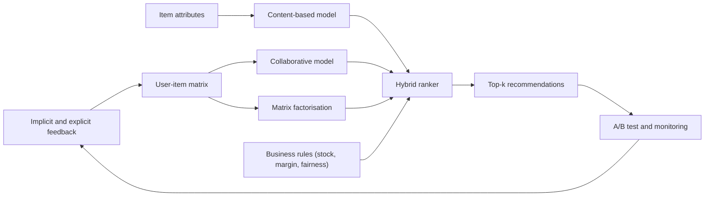

## Introduction

Every time a streaming service suggests a film, an online shop shows "customers also bought", or a music app builds a playlist, a recommender system is working behind the screen. Recommenders solve a problem of abundance: when a catalogue holds thousands or millions of items, customers cannot browse everything, and a business that cannot help them find relevant items loses sales, engagement and loyalty. Recommendation is therefore one of the most commercially mature applications of machine learning, and it is a good case for studying how data, algorithms and business objectives interact.

This lesson explains the main families of recommender technique, works through a small similarity calculation so that the mechanics are concrete, and then turns to the questions a business analyst must ask: how do we know the recommender works, what happens for new users and new items, and what risks does personalisation create for customers and for society? The treatment is conceptual and quantitative rather than code-based, in line with the module's focus on business application.

## Learning Objectives

- Explain how content-based, user-based collaborative, item-based collaborative, matrix factorisation and hybrid recommenders generate suggestions.
- Calculate cosine similarity between users and use it to predict a missing rating.
- Evaluate a recommender using precision@k, recall@k and a controlled A/B test, distinguishing offline from online evaluation.
- Analyse the cold-start, sparsity and popularity-bias problems and propose mitigation strategies.
- Assess the business value and the ethical risks of recommendation, including filter bubbles, unfairness to providers and privacy.

## Prerequisite Knowledge

- Basic vector and average calculations, and the idea of supervised versus unsupervised learning from earlier modules.
- Customer analytics concepts (segmentation, behavioural data) from the previous lessons in this module.

## Key Terminology

- **Recommender system**: A system that predicts which items a user is likely to value and presents a ranked shortlist of them.
- **Explicit feedback**: Ratings, likes or reviews that users deliberately provide to state their preferences.
- **Implicit feedback**: Behavioural signals such as clicks, purchases, watch time or skips, from which preference is inferred.
- **User-item matrix**: A table whose rows are users, columns are items and cells hold ratings or interactions; most cells are empty.
- **Sparsity**: The condition in which only a tiny fraction of user-item cells are observed, making similarity estimates unreliable.
- **Content-based filtering**: Recommending items whose attributes resemble items the user has liked before.
- **Collaborative filtering**: Recommending items based on the behaviour or ratings of similar users or of users who liked similar items, without needing item attributes.
- **Cosine similarity**: A measure of how closely two vectors point in the same direction, ranging from 0 to 1 for non-negative ratings.
- **Matrix factorisation**: A technique that approximates the user-item matrix as the product of two smaller matrices of latent factors for users and items.
- **Latent factor**: A hidden dimension learned from data that summarises a taste or item property, such as a leaning towards family films.
- **Cold start**: The difficulty of recommending for a new user or a new item for which little or no interaction data exist.
- **Precision@k**: The proportion of the top k recommended items that are relevant to the user.
- **Recall@k**: The proportion of all relevant items that appear in the top k recommendations.
- **Filter bubble**: A narrowing of the content a user sees as personalisation repeatedly reinforces existing preferences.

## Detailed Explanation

### The recommendation problem

Formally, a recommender estimates a score for each user-item pair that has not yet been observed and then ranks the items by that score. The data come in two forms. Explicit feedback, such as star ratings, is clear but scarce, because most users rarely rate anything. Implicit feedback, such as purchases and clicks, is abundant but ambiguous: a click may mean interest or may be an accident, and the absence of a purchase may mean disinterest or simply that the user never saw the item. Most production systems rely heavily on implicit feedback for this reason.

Notice that the business goal is rarely "predict ratings accurately". It is to raise conversion, basket size, retention or satisfaction. This distinction between a prediction metric and a business outcome returns in the evaluation section.

### Content-based filtering

A content-based recommender builds a profile of the user from the attributes of items they have liked, then recommends items with similar attributes. For books, attributes might be genre, author and keywords from the description; for a mobile data bundle, they might be price band, validity period and size. Similarity between the profile and each candidate is computed, often using cosine similarity on attribute vectors or text representations.

Strengths: it can recommend brand-new items as soon as their attributes are known, it needs no data from other users (helpful for privacy and for small platforms), and its reasons are easy to explain ("because you read books on microfinance"). Weaknesses: it can only recommend more of the same, so it tends towards over-specialisation; it depends on good attribute data; and it struggles with items such as music or fashion whose appeal is hard to capture in attributes.

### User-based collaborative filtering

Collaborative filtering reasons from the crowd. The user-based version finds users whose past ratings resemble the target user (the neighbours), then predicts the target's rating for an unseen item as a similarity-weighted average of the neighbours' ratings for it. The idea was central to early systems such as GroupLens, which applied it to the filtering of online news articles. The method needs no knowledge of what items are, only who liked what, which is why it can surface surprising, cross-category suggestions.

Weaknesses are practical. User behaviour changes, there may be millions of users to compare, and sparsity means two users often share very few co-rated items, so similarity can be computed from thin evidence.

### Item-based collaborative filtering

The item-based version flips the viewpoint: instead of finding similar users, it finds similar items, meaning items that tend to be rated or bought by the same people. To recommend for a user, the system looks at the items they liked and suggests the items most similar to those. Item similarities are more stable than user similarities (an item's audience changes slowly) and can be precomputed offline, which makes serving fast. Amazon's well-known "item-to-item" approach, published in 2003, is the standard illustration of why this scales to very large catalogues and many customers.

### Matrix factorisation intuition

Neighbourhood methods compare raw rows or columns of a sparse matrix. Matrix factorisation takes a different route. It assumes that a few hidden factors explain people's tastes, for example how much a film is a comedy, how serious it is, how suitable for children. Each user is described by a short vector saying how much they care about each factor, and each item by a vector saying how much it has of each factor. The predicted rating is the dot product of the two vectors: high when a user's strong preferences align with an item's strong properties.

The factors are not designed by hand; they are learned by adjusting the vectors so that predictions match the observed ratings as closely as possible, with regularisation to prevent overfitting to the few observed cells. Because each user and item is compressed to a handful of numbers, the method handles sparsity better than raw neighbourhoods and can capture subtle patterns. Matrix factorisation became widely known through the Netflix Prize, a public competition launched by Netflix in 2006 that offered a prize for improving the accuracy of its rating predictions by a set margin; factorisation models were prominent in the leading entries. Latent factors are, however, hard to interpret, which affects explainability.

### Hybrid systems

Real deployments rarely use one technique. A hybrid recommender combines methods to offset their weaknesses. Common designs include weighting the scores of several models, switching between methods depending on the situation (content-based for new items, collaborative for established ones), and feeding content attributes into a learned model alongside interaction data. Modern systems also add context such as time of day, device and location, and typically split work into two stages: a fast candidate-generation step that narrows millions of items to hundreds, and a ranking step that orders them using richer features and business rules such as stock availability or margin.

### Cold start, sparsity and popularity bias

Cold start comes in three forms: a new user with no history, a new item with no interactions, and a new system with no data at all. Mitigations include asking new users to select a few interests during onboarding, using content-based or popularity-based recommendations until behaviour accumulates, using demographic or context signals where lawful and appropriate, and giving new items a managed exposure budget so they can gather data. Sparsity is addressed by factorisation, by using implicit signals, and by pooling information.

Popularity bias is a subtler problem: popular items collect more interactions, so they are recommended more, so they collect still more. Long-tail products are starved of exposure, which hurts both small suppliers and customers who would have valued niche items.

### Evaluation

Offline evaluation holds back part of the historical data and checks whether the model can predict it. For rating prediction, an error measure such as root mean squared error is used. For ranking, which is what users actually see, precision@k and recall@k are more relevant. If a list of k items is shown, precision@k is the number of relevant items in it divided by k; recall@k is the number of relevant items in the list divided by the total number of relevant items for that user. Raising k generally lowers precision and raises recall, so the two are reported together. Other useful measures include coverage (what share of the catalogue ever gets recommended), diversity and novelty.

Offline metrics have a serious limitation: they judge the model against past behaviour that was itself shaped by the previous recommender, and they cannot show whether recommendations change what people do. The decisive test is therefore online: an A/B test randomly assigns users to the existing experience (control) or the new recommender (treatment) and compares a business metric such as conversion rate, revenue per visitor or retention. Good practice includes deciding the metric and sample size in advance, running for full weekly cycles, checking statistical significance, and watching guardrail metrics such as complaint rates or returns.

## Worked Example

**Illustrative scenario**: an online bookshop in Accra holds ratings (1 to 5) from three customers for four books, and wants to predict whether Ama, who has not read Book C, would enjoy it.

| Customer | Book A | Book B | Book C | Book D |
|---|---|---|---|---|
| Ama | 5 | 3 | ? | 4 |
| Kofi | 4 | 3 | 5 | 4 |
| Esi | 1 | 5 | 2 | 1 |

**Step 1: similarity on co-rated items.** Ama and Kofi both rated A, B and D, so the calculation uses those three books.

- Dot product Ama and Kofi: (5 x 4) + (3 x 3) + (4 x 4) = 20 + 9 + 16 = 45.
- Length of Ama's vector: square root of (25 + 9 + 16) = square root of 50 = 7.071.
- Length of Kofi's vector: square root of (16 + 9 + 16) = square root of 41 = 6.403.
- Cosine similarity = 45 / (7.071 x 6.403) = 45 / 45.28 = 0.994.

For Ama and Esi on the same three books: dot product = (5 x 1) + (3 x 5) + (4 x 1) = 24; Esi's length = square root of (1 + 25 + 1) = 5.196; cosine = 24 / (7.071 x 5.196) = 24 / 36.74 = 0.653.

**Step 2: weighted prediction.** Kofi rated Book C as 5 and Esi as 2. The predicted rating for Ama is the similarity-weighted average:

(0.994 x 5 + 0.653 x 2) / (0.994 + 0.653) = (4.970 + 1.306) / 1.647 = 6.276 / 1.647 = 3.81.

**Interpretation.** Ama's tastes are very close to Kofi's, so the prediction leans towards Kofi's high rating, giving about 3.8 out of 5. If other unread books score lower, Book C would rank near the top of her list. Two cautions apply. First, plain cosine on raw ratings ignores that some people rate generously and others harshly; practical systems often subtract each user's average rating first. Second, three customers and three co-rated books is far too little evidence; real systems require a minimum overlap before trusting a similarity.

**Evaluating a list.** Suppose the system shows Ama 5 books, of which 2 are ones she later buys or rates highly, and she has 4 relevant books in her held-out data. Precision@5 = 2 / 5 = 0.40; recall@5 = 2 / 4 = 0.50.

**Evaluating online.** Suppose 10,000 visitors see the old homepage and 10,000 see the new recommender. Conversion is 4.0 percent (400 buyers) in control and 4.6 percent (460 buyers) in treatment. The absolute lift is 0.6 percentage points and the relative lift is 15 percent. A two-proportion z-test uses the pooled rate of 4.3 percent: standard error = square root of (0.043 x 0.957 x 2 / 10,000) = 0.00287, so z = 0.006 / 0.00287 = 2.09, which exceeds the conventional 1.96 threshold for the 5 percent level. The result is statistically significant, but the business should still ask whether revenue per visitor and returns also improved, and whether the effect persists beyond the novelty period.

## Theories, Frameworks and Models

### Choosing a technique

| Technique | Needs item attributes | Needs other users' data | Handles new item | Handles new user | Main risk |
|---|---|---|---|---|---|
| Content-based | Yes | No | Yes | Needs some history | Over-specialisation |
| User-based CF | No | Yes | No | No | Sparsity, scale |
| Item-based CF | No | Yes | No | Partly (needs one interaction) | Popularity bias |
| Matrix factorisation | No | Yes | No | No | Opaque factors |
| Hybrid | Often | Often | Yes | Yes | Complexity, governance |

### Business value

Recommendation creates value through higher conversion, larger baskets, cross-selling, longer engagement and better retention, and through lower search effort for customers. For a subscription service, relevant suggestions reduce the chance a subscriber decides that "there is nothing to watch" and cancels. For a retailer, the long tail of products can become commercially viable if customers can actually find it. However, the metric must match the objective: optimising for clicks can reward sensational or trivial items, and optimising for short-term revenue can erode trust.

### Risks and responsibilities

- **Filter bubbles and homogenisation**: Pariser popularised the idea that personalisation can wrap users in content that confirms their existing views. The strength of this effect in practice is debated and varies by platform, so students should treat it as a recognised risk rather than a settled quantitative fact. Mitigations include diversity and serendipity objectives and giving users control over their feeds.
- **Fairness**: Recommenders allocate attention, which is an economic resource. Popularity bias can disadvantage small sellers, and models trained on historical data can reproduce inequalities, for example by showing certain job or credit offers less often to some groups.
- **Privacy**: Personalisation uses behavioural data that can reveal sensitive attributes. In Ghana, the Data Protection Act, 2012 (Act 843) governs personal data processing; principles such as lawful purpose, minimisation and transparency apply to recommendation data, and organisations should confirm their obligations with qualified advisers.
- **Manipulation and transparency**: Customers should be able to understand why they see a suggestion and to turn personalisation down or off. Sponsored placements should be distinguished from organic recommendations.

## Ghanaian Business Application

Online marketplaces operating in Ghana, mobile-first media and music platforms, and the digital arms of banks and telecom operators all face the recommendation problem, even if they do not call it that. A mobile money or banking app, for example, can suggest relevant products such as savings, insurance or bill-payment shortcuts, and a telecom operator can suggest the data bundle that fits a subscriber's usage pattern.

**Illustrative scenario**: a mid-sized Kumasi retailer with a small web shop and a WhatsApp catalogue has about two thousand products, many bought rarely, and a mix of customers who register and customers who check out as guests. A pragmatic path is staged. Start with a "frequently bought together" item-based rule computed from past baskets, which needs no registration and works from implicit purchase data. Add content-based "similar items" using category, price band and brand so that new stock appears immediately. Only when enough repeat customers exist should the shop consider personalised collaborative recommendations. Each stage is measured with an A/B test on conversion and basket value.

Local conditions shape design. Many customers use shared or low-cost phones, so a single device may represent several people, which weakens user-level personalisation. Mobile data costs favour lightweight recommendations that do not require heavy page loads. Data may be incomplete, with customers who pay by mobile money or cash on delivery and never create accounts. Trust matters too: customers should be told plainly what data are used, consistent with Act 843, and should be able to opt out. A Ghanaian business can also use recommendation to promote local suppliers deliberately, adding a fairness objective that a purely global algorithm would not.

## International Case Study

**Netflix and the Netflix Prize.** Netflix is a widely documented example of recommendation as a core business capability. In 2006 it launched the Netflix Prize, an open competition offering a million-dollar award to any team that could beat its then-current rating-prediction system by ten percent in root mean squared error, and it released a large dataset of anonymised ratings for the purpose. A team known as BellKor's Pragmatic Chaos won in 2009 with a blend of many models, and matrix factorisation techniques featured prominently in the leading solutions, which is how the approach became widely taught.

Three lessons stand out, all based on publicly reported facts. First, accuracy on a rating-prediction benchmark is not the same as business value: Netflix later explained publicly that it had not deployed the winning ensemble in full, citing the engineering effort relative to the gain and noting that its business was shifting from DVD rental towards streaming, where viewing behaviour (implicit feedback) and context mattered more than star ratings. Second, privacy risk is real: researchers showed that the released "anonymised" data could be partly re-identified by linking it with public movie reviews, and a planned second competition was cancelled following privacy concerns. Third, a recommender is a system, not a model: Netflix has described personalising many parts of the interface, not just ranking titles, and evaluating changes through online A/B testing.

For students, the case illustrates the gap between offline metrics and deployment, the value of online experimentation, and the need to treat data release and personalisation as governance issues from the start.

## Diagram

## Common Misconceptions

- **"Collaborative filtering understands the items."** It does not; it only detects patterns in who interacted with what. This is why it can fail for brand-new items, which have no interactions yet.
- **"The most accurate offline model is the best product."** Offline accuracy ignores the effect of the recommender on behaviour, serving cost and user experience. Only an online test against a business metric shows real value.
- **"Recommenders only need ratings."** Most platforms rely mainly on implicit signals, which are noisier but far more plentiful than explicit ratings.
- **"A filter bubble is proven to be caused by every recommender."** It is a recognised risk whose size varies by platform and design; diversity objectives and user controls can reduce it.
- **"Anonymised data are safe to share."** Combining anonymised behavioural records with other sources can re-identify individuals, as the Netflix Prize data showed.

## Common Examination Mistakes

- Describing collaborative and content-based filtering as the same thing, or failing to state what data each requires.
- Computing cosine similarity using items that only one of the two users has rated, rather than co-rated items (or treating missing as zero without saying so).
- Confusing precision@k with recall@k, in particular using the wrong denominator.
- Declaring an A/B test successful from a difference in conversion without mentioning sample size or statistical significance.
- Treating cold start as only a new-user problem and ignoring new items.
- Discussing risks in general terms without linking them to a concrete mitigation or to data protection obligations.

## Critical Thinking Questions

1. A streaming service optimises its recommender for watch time. What business gains might this produce, what unintended effects might it have on customers, and which additional metrics would you add as guardrails?
2. A recommender trained on historical purchases keeps recommending the same few bestsellers. Diagnose the likely cause and propose two interventions, explaining how you would test whether they help.
3. Should a bank use a customer's mobile money transaction history to recommend loan products? Discuss benefits, fairness and privacy considerations, with reference to Ghana's data protection principles.
4. Explain why item-based collaborative filtering is often preferred to user-based filtering when a retailer has many more customers than products.
5. An offline evaluation shows a new model improves precision@10 by 8 percent, but an A/B test shows no revenue gain. Suggest at least three explanations.

## Practical Exercises

1. Using the ratings table in the worked example, compute the cosine similarity between Kofi and Esi on Books A, B and D, then explain in two sentences whether Esi would be a useful neighbour for Kofi. Expected output: a similarity value near 0.69 (23 / 33.27) with a short interpretation.
2. A list of 10 recommended items contains 3 relevant items, and the user has 6 relevant items in total. Calculate precision@10 and recall@10, and state what happens to each if the list is extended to 20 items and 2 more relevant items are found. Expected output: 0.30 and 0.50, then 0.25 and 0.83 (5 of 20, 5 of 6).
3. Design a cold-start plan for a new campus-based food delivery app with no purchase history. Expected output: a one-page plan covering onboarding questions, initial popularity or content-based rules, data to collect, and the point at which you would introduce collaborative filtering.
4. Draft an A/B test plan for a new "recommended for you" panel in a bank's mobile app. Expected output: hypothesis, primary metric, guardrail metrics, sample and duration considerations, and a decision rule.

## Key Takeaways

- Recommenders rank unseen items for each user using content similarity, patterns across users, learned latent factors, or a hybrid of these.
- Cosine similarity and a weighted average of neighbours' ratings give a transparent first prediction method; matrix factorisation compresses sparse data into latent factors.
- Cold start, sparsity and popularity bias are the main practical obstacles, and hybrid designs with managed exposure address them.
- Evaluate ranking with precision@k and recall@k offline, but confirm business value with a randomised online A/B test.
- Personalisation creates risks of filter bubbles, unfair exposure and privacy harm that must be managed through design, governance and compliance with data protection law.

## Further Reading

- Aggarwal, C. C. (2016). *Recommender systems: The textbook*. Springer.
- Resnick, P., Iacovou, N., Suchak, M., Bergstrom, P., & Riedl, J. (1994). GroupLens: An open architecture for collaborative filtering of netnews. In *Proceedings of the 1994 ACM Conference on Computer Supported Cooperative Work* (pp. 175-186). ACM.
- Sarwar, B., Karypis, G., Konstan, J., & Riedl, J. (2001). Item-based collaborative filtering recommendation algorithms. In *Proceedings of the 10th International Conference on World Wide Web* (pp. 285-295). ACM.
- Linden, G., Smith, B., & York, J. (2003). Amazon.com recommendations: Item-to-item collaborative filtering. *IEEE Internet Computing, 7*(1), 76-80.
- Koren, Y., Bell, R., & Volinsky, C. (2009). Matrix factorization techniques for recommender systems. *Computer, 42*(8), 30-37.
- Pariser, E. (2011). *The filter bubble: What the Internet is hiding from you*. Penguin Press.

## Video Resources

- [Kaggle Learn](https://www.kaggle.com/learn): Kaggle. Free micro-courses on machine learning, with material relevant to building and evaluating recommendation models.
- [Google Machine Learning Education](https://developers.google.com/machine-learning): Google. Learning pathways that include a recommendation systems course covering candidate generation, scoring and matrix factorisation.
- [IBM Think: Artificial intelligence](https://www.ibm.com/think/topics/artificial-intelligence): IBM. Explainer pages on AI topics, including business applications of personalisation.

## Revision Summary

A recommender ranks unseen items for each user. Content-based filtering matches item attributes to a user profile; collaborative filtering uses patterns of ratings or behaviour across users (user-based) or across items (item-based); matrix factorisation learns latent factors whose dot product predicts preference; hybrids combine these and add business rules. Cold start, sparsity and popularity bias are the standard problems. Offline metrics such as precision@k and recall@k guide development, but only a randomised A/B test shows business impact. Personalisation must be governed against filter bubbles, unfair exposure and privacy harm.

- Cosine similarity on co-rated items, then similarity-weighted average, predicts a missing rating.
- Precision@k = relevant in top k divided by k; recall@k = relevant in top k divided by all relevant.
- New users and new items both cause cold start; use content, popularity and onboarding.
- Offline accuracy does not guarantee online value; run A/B tests with guardrail metrics.
- Manage risks: diversity, fairness for providers, and compliance with Act 843.
- The Netflix Prize shows both the power of factorisation and the limits of benchmark accuracy and anonymisation.
