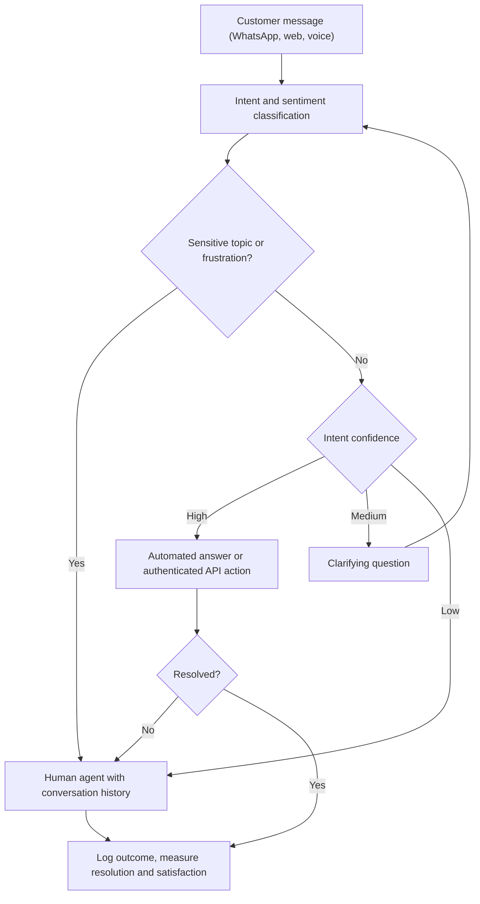

## Introduction

Customer service is often the first place an organisation deploys AI visibly. Telecom operators, banks, mobile money providers, airlines and hospitals receive enormous volumes of repetitive questions: "What is my balance?", "Why did my transfer fail?", "When is the clinic open?" Chatbots, voice assistants and automated ticket routing promise faster answers at lower cost. Done well, they free human agents for complex cases; done badly, they trap frustrated customers in loops and give confidently wrong answers that damage trust and create legal liability.

Behind the scenes, AI also supports decisions made by managers and professionals: how much stock to order, which loan applications to approve, how to schedule nurses, which supplier to choose. **Decision support systems (DSS)** have a long history in information systems, and AI is now enriching them with predictions, recommendations and natural-language interfaces. This lesson examines both themes, because they share a central design question: how should automated intelligence and human judgement be combined?

## Learning Objectives

- Compare rule-based, intent-based and LLM-based chatbot architectures and identify suitable uses for each.
- Apply containment rate, resolution rate and cost-per-contact calculations to evaluate a support-automation deployment.
- Design escalation and confidence-threshold rules that hand conversations to humans appropriately.
- Explain the structure of a decision support system using Simon's intelligence–design–choice model and the data, model and interface components.
- Apply an expected-value payoff table as a model-driven decision support technique and evaluate its limitations.

## Prerequisite Knowledge

- Natural language processing and large language models, including hallucination and grounding, from the Advanced AI module.
- Demand forecasting and the distinction between predictive and prescriptive analytics from the previous lessons.

## Key Terminology

- **Chatbot**: A software application that conducts a conversation with users in text or voice to answer questions or complete tasks.
- **Intent**: The goal behind a user's message, such as "check balance" or "report failed transfer", which an intent classifier tries to identify.
- **Entity (slot)**: A specific piece of information needed to fulfil an intent, such as an amount, date or transaction reference.
- **Containment rate**: The proportion of conversations handled entirely by the automated system without transfer to a human.
- **Resolution rate**: The proportion of contacts in which the customer's issue is actually solved, often checked by the absence of repeat contact.
- **Escalation (handover)**: Transferring a conversation from an automated system to a human agent, ideally with context preserved.
- **Agent assist**: AI tools that support human agents during interactions, for example by suggesting answers or summarising conversations.
- **Decision support system (DSS)**: An interactive information system that helps decision-makers use data and models to solve semi-structured or unstructured problems.
- **Semi-structured decision**: A decision in which some parts can be handled by standard procedures or models but human judgement is still required.
- **Expected value**: The probability-weighted average of the outcomes of a decision alternative.
- **Human-in-the-loop**: A design in which humans review, approve or override AI outputs before they take effect.

## Detailed Explanation

### A short history of conversational systems

Conversational programs are older than many people realise. Joseph Weizenbaum's ELIZA, described in 1966, imitated a psychotherapist using simple pattern-matching rules, yet some users attributed understanding to it. This early observation, that people readily ascribe intelligence to fluent conversation, remains relevant: customers may trust a chatbot's answers more than its actual competence warrants.

### Chatbot architectures

| Architecture | How it works | Strengths | Weaknesses | Suitable uses |
|---|---|---|---|---|
| Rule-based (menu or decision tree) | Predefined menus, buttons and scripted flows; USSD-style menus are a related pattern | Predictable, auditable, cheap | Rigid; fails on unexpected phrasing | Balance checks, simple FAQs, form filling |
| Intent-based NLP | Classifier maps messages to intents, extracts entities, triggers scripted responses or API calls | Handles varied phrasing; controlled answers | Needs labelled training phrases per intent; limited to designed intents | Transactional service: failed transfers, bill payments, appointments |
| LLM-based with grounding | LLM generates responses from retrieved knowledge and tool calls | Flexible, natural, handles long-tail questions | Hallucination risk; harder to test exhaustively; data protection questions | Knowledge-heavy queries, agent assist, summarisation |
| Hybrid | Intents and rules for transactions; grounded LLM for open questions; human escalation | Balances control and flexibility | More complex to build and govern | Most mature enterprise deployments |

In practice, transactional actions such as reversing a payment should be executed through controlled, authenticated APIs with explicit confirmation, never purely from free-text generation.

### Beyond chatbots: the support automation toolkit

AI supports service operations in several other ways: **ticket triage** (classifying and routing emails or complaints to the right team and priority); **sentiment and urgency detection** (flagging angry or vulnerable customers); **speech analytics** (transcribing and analysing calls); **agent assist** (suggesting knowledge-base articles and drafting replies); and **conversation summarisation** for handovers and records. Agent-assist tools often deliver value with lower risk than fully customer-facing bots, because a trained human reviews the output.

### Measuring support automation

The most common headline metric, **containment**, can be misleading. A bot that refuses to transfer customers achieves high containment but low satisfaction. Balanced evaluation includes resolution rate (verified by absence of repeat contact), customer satisfaction, average handling time for escalated cases, accuracy of answers on a test set, escalation appropriateness, complaint volumes and cost per resolved contact. Measures should be segmented by language, channel and customer group, so that automation does not work well for some customers and poorly for others.

### Designing escalation

Good escalation design is the difference between helpful and harmful automation. Principles include: offer a clear route to a human at any point; escalate automatically when intent confidence is low, when the customer repeats themselves or expresses frustration, or when the topic is sensitive (fraud, bereavement, health, complaints); pass the conversation history to the agent so the customer does not repeat everything; and be transparent that the customer is talking to an automated system.

### Decision support systems

A DSS helps people make decisions; it does not replace their accountability. Herbert Simon's model describes decision-making in three phases: **intelligence** (recognising and understanding the problem), **design** (generating and analysing alternatives) and **choice** (selecting an alternative), with implementation and review following. Classic DSS research, such as Keen and Scott Morton's work in the 1970s, emphasised support for **semi-structured** decisions, where models help but judgement remains essential.

A DSS typically has three components: a **data management** component (internal and external data, often from the data warehouse), a **model management** component (forecasting models, optimisation, simulation, what-if analysis, and increasingly machine learning predictions) and a **user interface** (dashboards, scenario tools and now conversational interfaces). Commonly described types include data-driven, model-driven, knowledge-driven (expert-system-like), document-driven and communication-driven (group) DSS.

AI enriches each phase: anomaly detection and alerts support *intelligence*; predictive models and generative tools help *design* alternatives; optimisation and expected-value calculations support *choice*. The risk is **automation bias**, the tendency of people to over-rely on system recommendations, even when they are wrong. DSS design should show the basis of recommendations, highlight uncertainty and make it easy for users to question them.

## Worked Example

### 1. Evaluating a chatbot deployment

**Illustrative scenario.** A Ghanaian telecom deploys a WhatsApp chatbot. In its first month:

- Total conversations: 10,000.
- Handled without human transfer: 6,000, so **containment = 6,000 / 10,000 = 60%**.
- Of those 6,000, 900 customers contacted the call centre again within 48 hours about the same issue, so **verified resolution by the bot = (6,000 − 900) / 10,000 = 51%**.
- Escalated to humans: 4,000.

Assume (illustratively) that a human-handled contact costs GHS 8 and a bot conversation costs GHS 1.

- Cost before automation: 10,000 × 8 = **GHS 80,000**.
- Cost after: bot conversations 10,000 × 1 = 10,000, plus human handling of 4,000 escalations and 900 repeat contacts, (4,000 + 900) × 8 = 39,200. Total **GHS 49,200**.
- Saving ≈ **GHS 30,800**, but the 900 failed "contained" conversations represent frustrated customers. Reporting 60 per cent containment without the 51 per cent resolution figure would overstate success.

### 2. Confidence-threshold routing

An intent classifier returns probabilities for each message:

| Message | Top intent | Confidence | Routing rule | Action |
|---|---|---|---|---|
| "my balance pls" | Check balance | 0.92 | ≥ 0.80: automate | Authenticate and show balance |
| "money gone but not received" | Failed transfer | 0.55 | 0.40–0.79: clarify | Ask for the transaction reference and confirm intent |
| "someone called me and I gave my PIN" | Fraud report | 0.88 | Sensitive intent: always escalate | Immediate transfer to fraud team with security steps |
| "eii this thing" | Unclear | 0.25 | < 0.40: human | Offer a human agent |

Thresholds are set by testing on labelled conversations and by weighing the cost of wrong automated answers against agent workload.

### 3. Expected-value decision support for ordering

**Illustrative scenario.** A supermarket's DSS helps a fresh-produce buyer decide how many crates of tomatoes to order for the weekend. The forecasting model provides demand probabilities: low (100 crates) 0.3, medium (150) 0.5, high (200) 0.2. Each crate sold earns GHS 40 profit; each unsold crate loses GHS 25 because tomatoes spoil.

| Order | Demand low (p = 0.3) | Demand medium (p = 0.5) | Demand high (p = 0.2) | Expected value |
|---|---|---|---|---|
| 100 | 4,000 | 4,000 | 4,000 | **4,000** |
| 150 | 4,000 − 50 × 25 = 2,750 | 6,000 | 6,000 | 0.3 × 2,750 + 0.5 × 6,000 + 0.2 × 6,000 = **5,025** |
| 200 | 4,000 − 100 × 25 = 1,500 | 6,000 − 50 × 25 = 4,750 | 8,000 | 0.3 × 1,500 + 0.5 × 4,750 + 0.2 × 8,000 = **4,425** |

The DSS recommends ordering **150 crates**, with the highest expected profit. The buyer, however, may know something the model does not, for instance a festival in the town this weekend that makes high demand more likely. The DSS should let the buyer adjust the probabilities and see the recommendation change. This is the essence of decision support: the model structures the decision; the human contributes context and remains accountable. The table also omits factors such as customer goodwill lost from stock-outs, which the buyer may weigh qualitatively.

## Ghanaian Business Application

**Illustrative scenario.** A mobile money operator's customers contact it through USSD, voice calls and WhatsApp, in English, Twi, Ga, Ewe and other languages. The operator designs a hybrid service: USSD menus remain for basic functions, because they work on feature phones without data; an intent-based WhatsApp bot handles common transactional queries via authenticated APIs; a grounded LLM answers general questions about fees and services from an approved knowledge base; and any mention of fraud, a PIN, or a disputed transaction triggers immediate human escalation. Voice support in local languages remains human-led, with speech analytics used to identify common issues. Success is measured by resolution, complaint trends and satisfaction per language, not just containment.

**Illustrative scenario.** A teaching hospital uses a DSS for bed management. It combines admission forecasts by ward, current occupancy and expected discharges, and displays scenarios to the duty manager each morning. The system recommends where to admit patients, but clinicians make final decisions. Because health data are sensitive personal data, access is restricted by role and logged, consistent with the Data Protection Act, 2012 (Act 843).

## International Case Study

### Moffatt v. Air Canada: accountability for chatbot answers

In February 2024 the Civil Resolution Tribunal of British Columbia, Canada, decided a small-claims dispute between a customer, Jake Moffatt, and Air Canada. Mr Moffatt had used the airline's website chatbot to ask about bereavement fares after a relative's death. The chatbot told him he could book a full-price ticket and apply for a bereavement discount retrospectively, which contradicted the airline's actual policy on another page of its website. When the refund was refused, he brought a claim. Air Canada argued, among other points, that it could not be held responsible for information provided by its chatbot. The tribunal rejected this, finding that the airline was responsible for all information on its website, including from the chatbot, and ordered it to pay the customer compensation.

The case is significant for every organisation deploying customer-facing AI. First, a chatbot speaks for the organisation; disclaimers and arguments that it is a separate entity are unlikely to shield the business. Second, inconsistency between a bot's answers and official policy creates liability, so bots must be grounded in, and tested against, current authoritative policies. Third, sensitive situations such as bereavement call for careful design, accurate information and easy access to human staff.

## Diagram

## Common Misconceptions

- **Misconception**: High containment means a chatbot is successful. **Correction**: Containment can hide unresolved issues and frustrated customers; resolution and satisfaction must also be measured.
- **Misconception**: An LLM chatbot can safely replace scripted flows for transactions. **Correction**: Transactions should run through authenticated, controlled APIs with confirmation; generation alone risks errors.
- **Misconception**: Organisations are not responsible for what their chatbot says. **Correction**: As the Air Canada decision illustrates, organisations can be held responsible for chatbot information.
- **Misconception**: A DSS makes the decision. **Correction**: A DSS supports human decision-makers, who remain accountable and contribute context the model lacks.
- **Misconception**: The highest expected value is always the right choice. **Correction**: Expected value ignores risk attitude, unmodelled factors and the reliability of probability estimates; judgement remains necessary.

## Common Examination Mistakes

- Reporting containment as if it were resolution.
- Describing chatbots generically without distinguishing rule-based, intent-based and LLM-based designs.
- Omitting escalation design and human handover in proposals for customer-facing AI.
- Miscalculating payoffs by forgetting the cost of unsold units when supply exceeds demand.
- Describing a DSS without linking it to Simon's intelligence–design–choice phases or its data, model and interface components.

## Critical Thinking Questions

1. Should customers always be told when they are talking to a chatbot? What are the arguments for and against?
2. How should a Ghanaian bank design support automation that serves both smartphone users and feature-phone users who rely on USSD and voice?
3. What forms of automation bias might affect a loan officer using an AI recommendation, and how could the DSS interface reduce them?
4. After the Air Canada decision, what testing and governance would you require before launching a customer-facing chatbot?

## Practical Exercises

1. **Chatbot evaluation.** A bank's chatbot handled 20,000 conversations; 12,000 were not transferred, of which 2,000 led to repeat contact within 48 hours. Human contacts cost GHS 10 and bot conversations GHS 1.50 (illustrative). Compute containment, verified resolution, total cost before and after, and saving. *Expected output*: calculations and a 100-word assessment.
2. **Escalation policy.** Write an escalation policy for a hospital appointment chatbot, listing at least six triggers for human handover and the information passed to staff. *Expected output*: a one-page policy.
3. **Payoff table.** Repeat the tomato example with an unsold-crate loss of GHS 10 instead of GHS 25. Recompute expected values and explain why the recommendation changes. *Expected output*: a new table and a short explanation.

## Key Takeaways

- Support automation ranges from rule-based menus to intent-based NLP and grounded LLMs; hybrids with human escalation are most robust.
- Evaluate with resolution, satisfaction, accuracy and cost per resolved contact, not containment alone, and segment by language and channel.
- Escalation design and transparency are essential; organisations remain accountable for what their bots say.
- Decision support systems combine data, models and interfaces to support Simon's intelligence, design and choice phases.
- Expected-value models structure choices, but humans add context, weigh unmodelled factors and must guard against automation bias.

## Further Reading

- Simon, H. A. (1960). *The new science of management decision*. Harper & Row.
- Keen, P. G. W., & Scott Morton, M. S. (1978). *Decision support systems: An organizational perspective*. Addison-Wesley.
- Power, D. J. (2002). *Decision support systems: Concepts and resources for managers*. Quorum Books.
- Weizenbaum, J. (1966). ELIZA: A computer program for the study of natural language communication between man and machine. *Communications of the ACM, 9*(1), 36–45.
- Russell, S., & Norvig, P. (2020). *Artificial intelligence: A modern approach* (4th ed.). Pearson.

## Video Resources

- [Google Cloud Training](https://cloud.google.com/learn/training) — Google Cloud. Official training catalogue including conversational AI and generative AI learning paths.
- [Hugging Face Learn](https://huggingface.co/learn) — Hugging Face. Free courses on building language applications with open models.
- [IBM Think: Artificial intelligence](https://www.ibm.com/think/topics/artificial-intelligence) — IBM. Explainer pages covering AI in customer service and decision-making.

## Revision Summary

Customer support automation uses rule-based, intent-based and grounded LLM chatbots, plus triage, speech analytics and agent assist. Success requires balanced metrics (resolution, satisfaction, accuracy, cost per resolved contact), careful escalation and recognition that the organisation is accountable for its bot's answers. Decision support systems combine data, models and interfaces to support Simon's intelligence, design and choice phases, with humans retaining judgement and accountability.

- Containment ≠ resolution; check repeat contacts.
- Route by intent confidence; always escalate sensitive topics.
- Transactions via authenticated APIs, not free-text generation.
- Air Canada (2024): airline liable for its chatbot's misinformation.
- DSS components: data, models, user interface; supports semi-structured decisions.
- Expected value = Σ probability × payoff; watch for automation bias.
