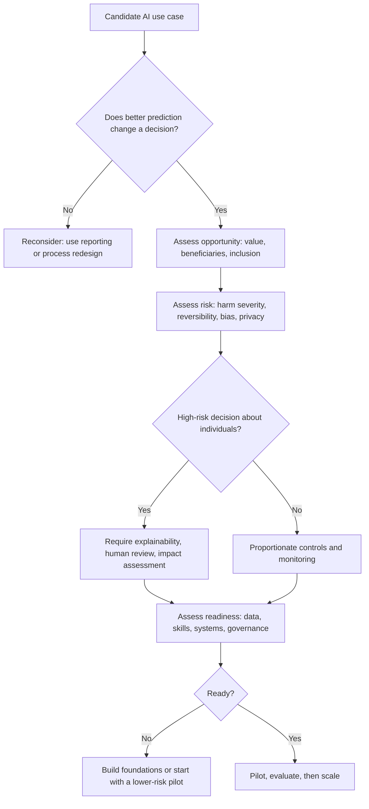

## Introduction

Earlier modules explained what machine learning, deep learning and generative AI can do in principle. This lesson asks a harder, more managerial question: *where, in real sectors, does AI create value, and under what conditions does it fail?* Finance, healthcare and education are useful sectors to study together. All three make high-stakes decisions about individuals (who receives a loan, which patient is seen first, how a student is assessed), all three hold sensitive personal data, and all three are regulated. They are also sectors in which Ghana has seen visible digital change, from mobile money and digital lending to electronic health records and online learning.

The lesson is organised around a simple but demanding analytical habit: for every AI application, ask what the **opportunity** is, what the **risks** are, and whether the organisation is **ready**. Examiners and employers rarely reward lists of applications; they reward the ability to judge whether a particular application is appropriate for a particular organisation at a particular time.

## Learning Objectives

- Explain the main AI applications in finance, healthcare and education, including credit scoring, fraud detection, diagnostic support, triage and adaptive learning.
- Analyse the opportunities and risks of each application using the opportunity–risk–readiness lens.
- Apply a structured readiness assessment to a Ghanaian organisation considering an AI investment.
- Evaluate why technically accurate AI systems can still fail when deployed in real clinical, financial or educational settings.
- Compare the regulatory and ethical sensitivities of AI in the three sectors.

## Prerequisite Knowledge

- Classification, regression and evaluation metrics such as precision and recall (Module 2).
- A conceptual understanding of computer vision, NLP and large language models (Module 3).
- The business applications of predictive analytics and fraud detection introduced in Module 4.

## Key Terminology

- **Credit scoring**: Estimating the probability that a borrower will repay, usually expressed as a score used to approve, price or limit credit.
- **Alternative data**: Non-traditional data, such as mobile money transaction histories or airtime top-up patterns, used to assess people with little formal credit history.
- **Fraud detection**: Identifying transactions or accounts that are likely to be fraudulent, typically using anomaly detection or supervised classification on transaction streams.
- **Clinical decision support**: Software that provides clinicians with information or recommendations to support, not replace, diagnosis and treatment decisions.
- **Triage**: Prioritising patients according to the urgency of their condition so that the sickest are treated first.
- **Adaptive learning**: Educational systems that adjust content, pace or difficulty to an individual learner's demonstrated performance.
- **AI readiness**: The degree to which an organisation has the data, infrastructure, skills, governance and culture required to deploy and sustain an AI system.
- **Human-in-the-loop**: A design in which a person reviews, approves or can override an AI system's output before it affects an individual.

## Detailed Explanation

### Finance

Financial services were among the earliest adopters of statistical prediction, and they remain one of the most mature sectors for AI.

**Credit scoring.** Traditional scorecards use logistic regression on bureau data (repayment history, outstanding debt, length of credit history). Machine learning extends this in two ways. First, models such as gradient-boosted trees can capture non-linear interactions between variables. Second, *alternative data* can be used to score people who are "thin-file" or have no formal credit history. In markets where mobile money is widely used, transaction regularity, wallet balances and repayment of earlier micro-loans can become predictive signals. The opportunity is financial inclusion: lenders can serve traders, farmers and informal workers who would otherwise be invisible to the formal system. The risks are equally significant: proxies for protected characteristics can enter the model unnoticed, the lender may not be able to explain a refusal, and aggressive digital lending can push vulnerable borrowers into over-indebtedness.

**Fraud detection.** Card, mobile money and insurance fraud are detected using a combination of rules (for example, "block transfers above a threshold to a newly registered number") and machine learning models that score each transaction in real time. Fraud is a rare-event problem, so accuracy is a misleading metric; precision, recall and the cost of false positives (blocked legitimate customers) matter far more. Fraud is also *adversarial*: fraudsters adapt when they are detected, so models degrade faster than in most other domains.

**Other applications** include anti-money-laundering transaction monitoring, customer-service chatbots, document processing for account opening (know-your-customer checks), insurance claims triage and algorithmic trading. Each of these sits under the supervision of financial regulators, which shapes how explainable and auditable the models must be.

### Healthcare

**Diagnostic support.** Deep learning models for medical images (retinal photographs, chest X-rays, skin lesions, pathology slides) can, in controlled studies, detect certain conditions with performance comparable to specialists. The key word is *support*: in a responsible design the system flags, prioritises or offers a second opinion, while a qualified clinician makes and owns the decision. The opportunity is especially attractive where specialists are scarce, because a model can screen large numbers of images and refer only suspicious cases.

**Triage.** AI can help prioritise patients by combining symptoms, vital signs and history into a risk score, or by powering symptom-checker chatbots that advise whether a person should self-care, visit a clinic or seek emergency care. Triage errors are asymmetric: under-triaging a seriously ill patient is far more harmful than over-triaging a well one, so the decision threshold must be set to favour high recall (sensitivity) for serious conditions.

**Operational AI** includes forecasting bed occupancy, predicting appointment no-shows, optimising stock of medicines and blood products, and transcribing or summarising clinical notes. These applications are often lower-risk than diagnosis and can be a sensible starting point for an organisation with limited AI experience.

The central risks in healthcare are patient harm from errors, *distribution shift* (a model trained on images from one hospital's equipment and population performing worse elsewhere), automation bias (clinicians trusting the system too much), and the confidentiality of health data, which data protection law treats as particularly sensitive.

### Education

**Adaptive learning and tutoring.** Intelligent tutoring systems model what a learner knows and choose the next exercise accordingly. Generative AI has widened this to conversational tutors that explain concepts, generate practice questions and give feedback on drafts.

**Assessment and feedback.** AI can mark objective items, give formative feedback on writing, and flag possible academic misconduct. High-stakes automated grading, however, raises serious fairness and validity concerns, and AI-text detectors are known to be unreliable enough that they should not be the sole basis for misconduct decisions.

**Institutional analytics.** Learning analytics can identify students at risk of dropping out from attendance, engagement and grade patterns, enabling earlier support. Administrative automation (timetabling, admissions document processing, student enquiries) is another common use.

Education's specific risks include widening the digital divide (learners without reliable devices or data bundles benefit least), over-reliance that undermines genuine learning, profiling of minors, and the use of AI in admissions or assessment decisions that shape life chances.

## Theories, Frameworks and Models

### The opportunity–risk–readiness lens

A practical way to evaluate any sector application is to assess three dimensions in turn.

| Dimension | Guiding questions |
|---|---|
| Opportunity | What decision or process improves? Who benefits? Is the gain in cost, speed, quality, reach or inclusion? Is prediction actually the bottleneck? |
| Risk | Who could be harmed and how severely? Are errors reversible? Could the system discriminate, leak data or be manipulated? What are the regulatory consequences? |
| Readiness | Does the organisation have relevant, good-quality data; infrastructure; skilled people; governance and accountability; user trust; and the budget to maintain the system? |

Agrawal, Gans and Goldfarb (2018) offer a complementary economic view: AI makes *prediction* cheaper, so its value is greatest where better prediction changes a decision and where human *judgement* about the consequences of errors can be clearly specified. Credit decisions and triage fit this pattern well, because the cost of a false negative and a false positive can be explicitly discussed.

### Readiness dimensions

Readiness is usually the binding constraint in practice. A useful checklist has six elements:

1. **Data readiness** – Are historical outcomes recorded (repayments, diagnoses, grades)? Are they complete, representative and lawfully usable?
2. **Technical readiness** – Is there connectivity, compute and integration with core systems (core banking, hospital information systems, learning management systems)?
3. **Skills readiness** – Are there data scientists, but also domain experts and managers able to interpret model outputs?
4. **Governance readiness** – Who owns the model, approves deployment and handles complaints?
5. **Regulatory readiness** – Does the use comply with data protection law and sector regulators' expectations?
6. **Cultural readiness** – Will loan officers, nurses or teachers trust and appropriately use the tool?

### Risk tiering across sectors

Not all uses are equally sensitive. Regulatory frameworks such as the European Union's AI Act classify credit scoring of individuals, access to education and assessment, and certain medical uses as higher-risk categories that attract stronger obligations. Even outside the EU, this tiering is a useful mental model: an AI that suggests reading material is low-risk; an AI that influences who is admitted to a programme or receives a loan is high-risk and needs stronger oversight.

## Diagram

## Worked Example

**Illustrative scenario.** A fictional Ghanaian savings and loans company is considering three AI projects and has budget for one. A cross-functional team scores each project from 1 (poor) to 5 (strong) on opportunity and readiness, and from 1 (low) to 5 (severe) on risk.

| Project | Opportunity | Risk | Readiness |
|---|---|---|---|
| A. ML credit scoring using mobile money data for new micro-loan customers | 5 | 4 | 2 |
| B. Chatbot answering balance and branch-hours questions | 3 | 2 | 4 |
| C. Fraud alerts on agent-network transactions | 4 | 3 | 4 |

A simple prioritisation score is `opportunity + readiness − risk`:

- Project A: `5 + 2 − 4 = 3`
- Project B: `3 + 4 − 2 = 5`
- Project C: `4 + 4 − 3 = 5`

Projects B and C tie on the score, but the team should not stop at arithmetic. Project C has higher opportunity and the company already holds labelled fraud cases, so it is likely the stronger investment. Project A has the largest strategic opportunity but is not ready: the company has no consent framework for using mobile money data and only a short history of micro-loan outcomes. The defensible recommendation is to implement C now and to treat A as a medium-term project, beginning with data governance and lawful data-sharing agreements. The lesson is that scoring frameworks structure discussion; they do not replace judgement.

## Ghanaian Business Application

Ghana provides clear examples of each sector's opportunity and constraint.

- **Finance.** Mobile money is widely used in Ghana and is supervised by the Bank of Ghana. Digital micro-lending products offered through mobile money platforms rely on automated scoring of transaction behaviour. For a Ghanaian lender, the key readiness issues are lawful processing under the Data Protection Act, 2012 (Act 843), transparent communication of loan terms, and fraud controls on agent networks.
- **Healthcare.** A district hospital (illustrative scenario) with limited specialist cover might pilot AI-assisted screening of retinal images in diabetic patients, with suspicious cases referred to an ophthalmologist. Readiness questions include whether images are captured consistently, whether results reach referral points, and whether the model has been validated on local patients rather than only on data from other countries.
- **Logistics in health.** Drone delivery of blood and medical supplies to health facilities has operated in Ghana since 2019, illustrating how optimisation and automation can extend reach in health systems.
- **Education.** Universities and schools are experimenting with generative AI for tutoring and feedback. A responsible institution would publish clear guidance on acceptable use, protect student data, and avoid relying on AI detectors as sole evidence of misconduct. Readiness is uneven because device ownership and data costs vary across learners.

## International Case Study

### Deploying diabetic retinopathy screening in Thailand

Beede et al. (2020) reported a human-centred evaluation of a deep learning system for detecting diabetic retinopathy deployed in clinics in Thailand. The model had shown strong accuracy in earlier validation studies, yet the field study found that real-world conditions created problems the laboratory had not. Some images captured in clinics with variable lighting were judged ungradable and rejected, which frustrated nurses and patients who then had to be referred elsewhere. Internet connectivity affected how quickly results were returned, and clinic workflows had to change to accommodate the system.

The case illustrates three points central to this lesson. First, **accuracy is not readiness**: a model's performance on curated test images says little about performance with local equipment, staff and patients. Second, **socio-technical design matters**: nurses' workflows, patient journeys and referral pathways determine whether an accurate model produces health benefits. Third, **evaluation must happen in context**, through pilots that measure outcomes such as time to referral and patient experience, not only sensitivity and specificity. For a Ghanaian hospital, the case argues for a staged pilot with local validation before any scale-up.

## Common Misconceptions

- **Misconception:** If a medical AI matches specialist accuracy in a published study, it is ready for any hospital. **Correction:** Performance depends on equipment, population and workflow; local validation and pilots are required.
- **Misconception:** Alternative-data credit scoring is automatically inclusive. **Correction:** It can widen access, but it can also encode bias, reduce transparency and enable over-lending if not governed.
- **Misconception:** High accuracy means a fraud model is good. **Correction:** Fraud is rare, so a model that flags nothing can be highly accurate; precision, recall and cost-weighted metrics are needed.
- **Misconception:** AI tutors will replace teachers. **Correction:** Evidence and practice point to augmentation; teachers remain responsible for pedagogy, motivation and assessment integrity.
- **Misconception:** Readiness is mainly about buying technology. **Correction:** Data, skills, governance and user trust are usually the binding constraints.

## Common Examination Mistakes

- Listing applications without analysing opportunity, risk and readiness for a specific organisation.
- Describing diagnostic AI as "replacing doctors" instead of supporting clinical decisions.
- Ignoring data protection when discussing credit scoring or health applications.
- Using accuracy as the evaluation metric for fraud or triage problems.
- Presenting hypothetical Ghanaian organisations as real, or quoting statistics without a source.
- Failing to recommend a staged approach (pilot, evaluate, scale) when readiness is weak.

## Critical Thinking Questions

1. Should a lender be permitted to use mobile money transaction data to refuse credit if it cannot explain the specific reasons for the refusal? Justify your answer with reference to fairness and accountability.
2. In triage, how should an organisation decide the acceptable balance between missed urgent cases and unnecessary escalations, and who should make that decision?
3. Does generative AI in education primarily widen or narrow inequality between learners in Ghana? What evidence would you need to answer confidently?
4. Why might a lower-risk operational AI project (for example, forecasting medicine stock) be a better first investment for a hospital than diagnostic AI?

## Practical Exercises

1. **Opportunity–risk–readiness matrix.** Choose one application from each sector (for example, mobile money fraud detection, chest X-ray triage support and student drop-out prediction). Complete the three-dimension table for a named type of Ghanaian organisation. *Expected output:* a table of three rows with justified scores and a one-paragraph recommendation on which to pursue first.
2. **Threshold reasoning.** For a triage model that outputs a risk score, write down the consequences of a false negative and a false positive, and argue whether the threshold should favour precision or recall. *Expected output:* a short justification (150–200 words) linking error costs to the threshold choice.
3. **Readiness audit.** Using the six readiness dimensions, interview a colleague or reflect on your own organisation and rate each dimension. *Expected output:* a readiness profile with the weakest dimension identified and two actions to strengthen it.

## Key Takeaways

- Finance, healthcare and education share high-stakes individual decisions, sensitive data and regulatory oversight.
- Credit scoring and fraud detection are mature financial uses, but bias, explainability and adversarial behaviour are persistent risks.
- Healthcare AI should support clinicians; triage thresholds must reflect asymmetric error costs.
- Educational AI can personalise learning but risks inequity, over-reliance and unfair assessment.
- Readiness (data, skills, systems, governance, regulation and culture) usually decides success more than model accuracy.

## Further Reading

- Agrawal, A., Gans, J., & Goldfarb, A. (2018). *Prediction machines: The simple economics of artificial intelligence*. Harvard Business Review Press.
- Beede, E., Baylor, E., Hersch, F., Iurchenko, A., Wilcox, L., Ruamviboonsuk, P., & Vardoulakis, L. M. (2020). A human-centered evaluation of a deep learning system deployed in clinics for the detection of diabetic retinopathy. In *Proceedings of the 2020 CHI Conference on Human Factors in Computing Systems*. ACM. <https://doi.org/10.1145/3313831.3376718>
- Topol, E. (2019). *Deep medicine: How artificial intelligence can make healthcare human again*. Basic Books.
- World Health Organization. (2021). *Ethics and governance of artificial intelligence for health: WHO guidance*. World Health Organization.
- UNESCO. (2023). *Guidance for generative AI in education and research*. UNESCO.

## Video Resources

- [Google Machine Learning Crash Course](https://developers.google.com/machine-learning/crash-course) — Google for Developers. Official free course whose classification modules explain the precision–recall trade-offs that underpin fraud and triage decisions.
- [Elements of AI](https://www.elementsofai.com/) — University of Helsinki and MinnaLearn. Free introductory course discussing the societal implications of AI applications.

## Revision Summary

AI creates value in finance (credit scoring, fraud detection, AML, KYC), healthcare (diagnostic support, triage, operations) and education (adaptive learning, feedback, learning analytics), but each application must be judged through opportunity, risk and readiness. Accurate models can fail in deployment because of local data, workflows and trust, so staged pilots and local validation are essential.

- Alternative data can improve financial inclusion but raises bias, consent and over-lending risks.
- Fraud and triage are rare-event, asymmetric-cost problems: use precision, recall and cost-aware thresholds.
- Diagnostic AI supports, and does not replace, clinicians; automation bias is a key risk.
- Educational AI risks widening digital divides and undermining assessment validity.
- Readiness spans data, technology, skills, governance, regulation and culture.
- The Thailand retinopathy deployment shows that accuracy is not the same as real-world readiness.
