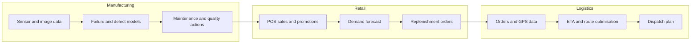

## Introduction

Retail, logistics and manufacturing form the physical backbone of an economy: goods are made, moved and sold. In these sectors AI rarely makes headlines by talking to customers; it creates value quietly by predicting how much stock to order, which route a delivery van should take, when a machine is likely to fail and whether a product on a conveyor belt is defective. Because the value is measured in reduced waste, fewer stock-outs, lower fuel costs and less downtime, these sectors are good places to practise building an evidence-based business case for AI.

This lesson continues the opportunity–risk–readiness lens from the previous lesson. You will examine the main applications in each sector, learn the maintenance strategy continuum that frames predictive maintenance, work through a cost–benefit calculation, and consider how a Ghanaian retailer, logistics operator or manufacturer could adopt AI incrementally.

## Learning Objectives

- Explain the main AI applications in retail, logistics and manufacturing.
- Compare reactive, preventive, predictive and prescriptive maintenance strategies.
- Apply a cost–benefit calculation to decide whether predictive maintenance or automated quality inspection is worthwhile.
- Analyse the data and infrastructure requirements of each application in a Ghanaian context.
- Evaluate the operational, workforce and ethical risks of AI in physical operations.

## Prerequisite Knowledge

- Regression, classification and evaluation metrics (Module 2).
- Computer vision at a conceptual level (Module 3).
- Demand forecasting concepts from Module 4.

## Key Terminology

- **Demand forecasting**: Predicting future sales or consumption of products, by location and period, to inform ordering and inventory.
- **Recommendation system**: A model that suggests products to a customer based on their behaviour and on patterns among similar customers or items.
- **Dynamic pricing**: Adjusting prices in response to demand, stock, competition or time, often using predictive models.
- **Route optimisation**: Computing efficient sequences of stops and paths for vehicles subject to constraints such as time windows and capacity.
- **Estimated time of arrival (ETA) prediction**: Predicting when a shipment or vehicle will arrive, usually with regression on historical trips, traffic and location data.
- **Predictive maintenance**: Using sensor and operational data to predict equipment failure so that maintenance can be scheduled just before it is needed.
- **Automated visual quality inspection**: Using computer vision to detect defects in products or components on a production line.
- **Digital twin**: A data-driven virtual representation of a physical asset or process, used for monitoring, simulation and optimisation.

## Detailed Explanation

### Retail

**Demand forecasting and replenishment.** Retailers must decide how much of each product to hold at each store. Too little causes stock-outs and lost sales; too much ties up cash and, for perishables, causes waste. Forecasting models combine historical sales with calendar effects (paydays, school terms, festive seasons such as Christmas and Eid), promotions, prices and sometimes weather. The output feeds automated or semi-automated replenishment. Forecast accuracy is usually measured with error metrics such as mean absolute error (MAE) or mean absolute percentage error (MAPE), but the business metric is service level and waste.

**Personalisation and recommendation.** Online retailers recommend products using collaborative filtering ("customers who bought this also bought…") and content-based methods. In physical retail, loyalty-card data can personalise offers. Over-personalisation can feel intrusive and raises data protection questions about profiling.

**Pricing and promotions.** Models estimate price elasticity and the effect of promotions, allowing retailers to set markdowns on perishables before expiry or evaluate whether a promotion generated incremental sales rather than simply shifting purchases in time.

**Store operations and customer service.** Computer vision can monitor shelf availability, count footfall and support self-checkout; chatbots handle order tracking and returns. These applications require cameras or connected devices and raise surveillance concerns if customers are identified.

### Logistics

**Route optimisation.** Vehicle routing is a classic optimisation problem. AI contributes by predicting the inputs to optimisation (travel times that vary with traffic, service times at each stop, the likelihood a customer is available) and by re-optimising in real time when conditions change. Savings come from fewer kilometres driven, less fuel, more stops per driver and better on-time performance.

**ETA prediction and visibility.** Regression models trained on past journeys predict arrival times more accurately than fixed estimates, allowing customers and warehouses to plan. In port and freight operations, predicting dwell times and clearance delays helps importers manage working capital.

**Warehouse operations.** AI supports slotting (placing fast-moving items near dispatch points), pick-path optimisation, labour forecasting and, in highly automated facilities, robotics. Even without robots, demand-aware slotting is achievable with modest data.

**Network and inventory planning.** Forecasts at regional level guide where to position stock, how many vehicles to contract and when to add capacity.

### Manufacturing

**Predictive maintenance.** Machines generate signals (vibration, temperature, pressure, current, acoustic emissions, run hours). Models learn patterns that precede failure, either by supervised classification ("will this pump fail in the next seven days?"), regression of remaining useful life, or anomaly detection when failures are too rare to learn from directly. The opportunity is to reduce unplanned downtime and avoid unnecessary routine maintenance.

**Quality inspection.** Convolutional neural networks inspect images of products for scratches, misprints, fill levels, seal integrity or foreign objects. Inspection models can operate on edge devices beside the line to meet speed requirements. Because defects are rare, collecting enough defect images is often the hardest part; techniques include data augmentation and anomaly detection trained only on good products.

**Process optimisation.** Models relate process settings (temperature, speed, mix ratios) to yield and energy use, helping engineers tune processes. Combined with simulation, this approaches the idea of a digital twin.

### Cross-sector risks

Across these sectors the main risks are poor data from manual records, models that break when demand patterns change (a pandemic, a currency shock or a new competitor), integration failures with legacy systems, workforce displacement and de-skilling, safety risks when AI controls physical equipment, and surveillance of workers or customers. Many organisations also underestimate maintenance: sensors fail, cameras drift out of alignment, and product ranges change.

## Theories, Frameworks and Models

### The maintenance strategy continuum

| Strategy | Trigger for maintenance | Strength | Weakness |
|---|---|---|---|
| Reactive (run-to-failure) | The asset breaks | No monitoring cost | Unplanned downtime, secondary damage, safety risk |
| Preventive (time-based) | Fixed schedule, e.g. every 500 hours | Simple and predictable | Replaces parts that still have useful life; still misses early failures |
| Condition-based | A measured condition crosses a threshold | Responds to actual state | Threshold rules miss complex patterns |
| Predictive | A model forecasts failure probability or remaining life | Maintenance timed to need | Needs data history, sensors and skills |
| Prescriptive | A model recommends the optimal action and timing | Links prediction to decision and cost | Most demanding in data and integration |

Predictive maintenance is not automatically superior. For cheap, non-critical assets with little failure history, preventive or even reactive maintenance may be economically rational. The strategy should match asset criticality and data availability.

### Value chain mapping

A useful way to locate AI opportunities is to map the value chain (inbound logistics, operations, outbound logistics, marketing and sales, service) and ask, for each activity, which decisions are made repeatedly, with what information and at what cost of error. Repeated, data-rich decisions with measurable costs (ordering, routing, maintenance timing, inspection) are the strongest candidates.

### Prediction versus optimisation

Many operations problems combine **prediction** (how much will sell; how long will this trip take; will this machine fail) with **optimisation** (what to order; which route; when to schedule maintenance). Business value arises only when the prediction feeds a well-designed decision. A highly accurate forecast that does not change ordering behaviour has no value.

## Worked Example

**Illustrative scenario.** A fictional Ghanaian bottling plant operates eight filling machines. Records over the past two years show that each machine suffers on average two unplanned breakdowns per year. Each breakdown costs GHS 40,000 in lost production, overtime and emergency parts. A predictive maintenance pilot (sensors, software and staff time) would cost GHS 150,000 per year for all eight machines. In a trial, the model detected 70% of impending failures early enough to schedule a planned repair costing GHS 8,000 instead. It also produced false alarms that cost an estimated GHS 20,000 per year in unnecessary inspections. All figures are hypothetical.

**Step 1 – Current annual cost of breakdowns.**
`8 machines × 2 breakdowns × GHS 40,000 = GHS 640,000`

**Step 2 – Failures caught and missed with the model.**
Total failures `= 16`. Caught `= 0.70 × 16 = 11.2`; missed `= 4.8`.

**Step 3 – Cost with predictive maintenance.**
- Caught failures repaired in a planned way: `11.2 × 8,000 = GHS 89,600`
- Missed failures still break down: `4.8 × 40,000 = GHS 192,000`
- False alarms: `GHS 20,000`
- Programme cost: `GHS 150,000`
- Total: `89,600 + 192,000 + 20,000 + 150,000 = GHS 451,600`

**Step 4 – Net annual benefit.**
`640,000 − 451,600 = GHS 188,400`

The pilot appears worthwhile. A sensitivity check is essential, however. If the true detection rate in production is only 40%, then caught `= 6.4` (cost `51,200`), missed `= 9.6` (cost `384,000`), and the total becomes `51,200 + 384,000 + 20,000 + 150,000 = GHS 605,200`, leaving a benefit of only GHS 34,800. The business case is sensitive to recall, so the decision should be staged: pilot on the two most critical machines first, measure recall in production, and scale only if performance holds.

## Ghanaian Business Application

- **Retail.** Supermarket chains and wholesale distributors in Accra, Kumasi and Takoradi face demand that is shaped by paydays, school calendars and festive seasons, and many staple goods are imported, so currency movements affect prices and demand. A sensible first step is a forecasting model for the top-selling products per store, using existing point-of-sale data, with buyers able to override suggestions. Informal market traders are unlikely to use forecasting models directly, but distributors who supply them can.
- **Logistics.** Deliveries in congested urban areas, informal addressing and variable road conditions make ETA prediction valuable. Digital addressing such as the GhanaPostGPS system can improve location data quality. Freight forwarders handling cargo through Tema Port can use predictive models of clearance time to plan trucking and storage.
- **Manufacturing.** Food processing, beverage, cement and pharmaceutical manufacturers operate continuous lines where downtime is expensive. Readiness constraints include the absence of sensors on older equipment, unstable power that affects both machines and data collection, and scarce local skills in industrial data science. Low-cost retrofit sensors and edge devices can be piloted on critical assets first.

In all three sectors the workforce dimension matters: AI should be framed as decision support for buyers, dispatchers and maintenance technicians, with training and clear roles, rather than as an opaque system imposed on them.

## International Case Study

### UPS and the ORION route optimisation system

United Parcel Service (UPS) developed a route optimisation system called ORION (On-Road Integrated Optimization and Navigation) to plan the sequence of stops for its delivery drivers in the United States. The company has publicly described ORION as a long-term, large-scale programme rather than a quick software purchase. Several lessons are well documented and widely discussed in operations management teaching.

First, the system depended on detailed, high-quality data about addresses, delivery points and historical driver behaviour; building that data foundation was a major part of the effort. Second, the optimised routes initially conflicted with drivers' experience and habits, so adoption required explaining the logic, allowing drivers to give feedback and refining the model to respect practical constraints the algorithm had not captured. Third, the value came from small savings repeated across very many routes every day.

For a Ghanaian logistics firm the lesson is not to replicate a multinational's scale, but to recognise the pattern: invest first in data (addresses, stop times, vehicle telematics), involve drivers in design, start with a subset of routes, and measure fuel, distance and on-time delivery before and after.

## Diagram

The diagram shows how the sectors connect along a supply chain: retail forecasts drive orders that become logistics demand, while manufacturing reliability and quality determine whether products reach shelves.

## Common Misconceptions

- **Misconception:** Predictive maintenance is always better than preventive maintenance. **Correction:** It depends on asset criticality, failure cost and data availability; for low-value assets simpler strategies can be optimal.
- **Misconception:** A more accurate forecast automatically reduces waste. **Correction:** Value appears only if ordering decisions change and supply constraints allow it.
- **Misconception:** Quality inspection AI needs thousands of defect images. **Correction:** Anomaly detection trained on good products and data augmentation can work when defects are rare, although validation still requires real defects.
- **Misconception:** Route optimisation is purely a software problem. **Correction:** Address data quality, driver adoption and practical constraints largely determine results.
- **Misconception:** AI in operations is ethically neutral. **Correction:** Worker surveillance, de-skilling, displacement and safety are genuine ethical concerns.

## Common Examination Mistakes

- Describing applications generically without linking them to specific decisions and measurable business outcomes.
- Presenting a business case without a sensitivity analysis on model performance.
- Confusing preventive and predictive maintenance.
- Ignoring infrastructure constraints such as power stability, connectivity and legacy equipment.
- Using accuracy for rare-defect inspection instead of recall, precision and cost of escapes.

## Critical Thinking Questions

1. When would a Ghanaian manufacturer be rational to remain with preventive maintenance despite the availability of predictive tools?
2. How should a supermarket balance the cost of stock-outs against the cost of perishable waste when setting forecast-driven order quantities?
3. To what extent should drivers or machine operators be able to override AI recommendations, and how should overrides be recorded and learned from?
4. Is camera-based shelf monitoring in stores a proportionate use of AI? Consider customers, staff and data protection.

## Practical Exercises

1. **Business case sensitivity.** Repeat the worked example with a detection rate of 55% and false-alarm cost of GHS 35,000. *Expected output:* the total cost and net benefit, with a one-paragraph recommendation.
2. **Value chain mapping.** For a retailer, logistics firm or manufacturer you know, map the value chain and identify three repeated decisions that AI could support. *Expected output:* a table listing each decision, the data available, the prediction needed, and how success would be measured.
3. **Forecast baseline in Python.** Using any public retail sales dataset in Google Colab, build a seasonal naïve forecast (same day last week) and compute its MAE. *Expected output:* a notebook with the baseline MAE, which any machine learning model must beat to be worth deploying.

## Key Takeaways

- Retail AI centres on forecasting, personalisation, pricing and store operations.
- Logistics AI predicts travel and service times and feeds route and network optimisation.
- Manufacturing AI focuses on predictive maintenance, visual quality inspection and process optimisation.
- Business value comes from better decisions, so prediction must be linked to action and measured in business terms.
- Business cases must be tested for sensitivity to real-world model performance.
- Data foundations, infrastructure and workforce adoption are as important as algorithms.

## Further Reading

- Hyndman, R. J., & Athanasopoulos, G. (2021). *Forecasting: Principles and practice* (3rd ed.). OTexts. <https://otexts.com/fpp3/>
- Agrawal, A., Gans, J., & Goldfarb, A. (2018). *Prediction machines: The simple economics of artificial intelligence*. Harvard Business Review Press.
- Davenport, T. H., & Ronanki, R. (2018). Artificial intelligence for the real world. *Harvard Business Review, 96*(1), 108–116.
- Russell, S., & Norvig, P. (2020). *Artificial intelligence: A modern approach* (4th ed.). Pearson.

## Video Resources

- [Kaggle Learn](https://www.kaggle.com/learn) — Kaggle. Free micro-courses, including time series and computer vision, with notebooks that run in the browser.
- [MIT OpenCourseWare](https://ocw.mit.edu/) — Massachusetts Institute of Technology. Official open learning portal; search for supply chain and operations management course materials.

## Revision Summary

AI in retail, logistics and manufacturing creates value by improving repeated operational decisions: what to stock, how to route, when to maintain and whether a product is defective. Value depends on linking predictions to decisions, on data foundations and on adoption by staff, and every business case should be tested against realistic model performance.

- Retail: demand forecasting, recommendations, pricing and promotion analysis, shelf monitoring.
- Logistics: ETA prediction, route optimisation, warehouse slotting, network planning.
- Manufacturing: predictive maintenance, visual inspection, process optimisation, digital twins.
- Maintenance continuum: reactive, preventive, condition-based, predictive, prescriptive.
- Sensitivity analysis on recall and false alarms protects against over-optimistic business cases.
- The UPS ORION case shows data foundations and driver adoption drive route optimisation success.
