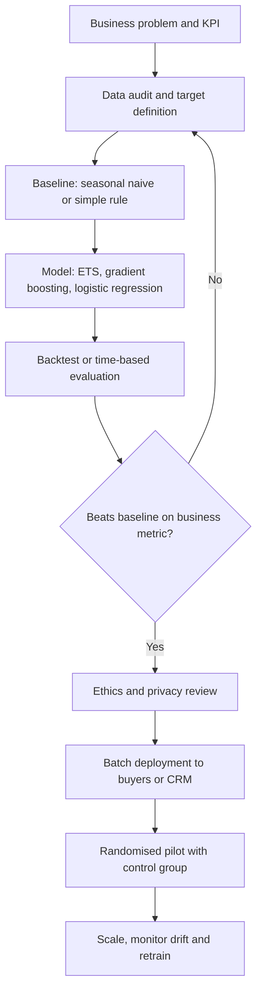

## Introduction

This module turns the course's concepts into complete project designs of the kind you might propose for a capstone, a dissertation prototype or a first AI initiative at work. Each project follows the same template: business problem, data needed, approach, evaluation metrics, deployment, risks, ethics and a step-by-step plan for an illustrative Ghanaian organisation. Every plan is achievable with free tools such as Python, pandas, scikit-learn, Google Colab and open-source libraries.

This lesson covers two of the most common and valuable predictive projects in business. **Supermarket demand forecasting** predicts how much of each product will sell so that ordering reduces both stock-outs and waste. **Customer churn prediction** identifies customers likely to leave so that retention effort is targeted where it pays. Both look simple in a tutorial; both become demanding when you have to define the target carefully, beat a sensible baseline and connect predictions to decisions that actually save money.

## Learning Objectives

- Apply a structured project template to design an end-to-end business AI project.
- Design a demand forecasting project with appropriate baselines, features, backtesting and error metrics.
- Design a churn prediction project with a defensible churn definition, imbalance-aware metrics and a cost–benefit retention policy.
- Evaluate the deployment, risk and ethical implications of each project.
- Create a step-by-step implementation plan using free tools for a Ghanaian organisation.

## Prerequisite Knowledge

- Regression, classification, evaluation metrics and time-based splitting (Modules 2 and 6).
- Business intelligence, forecasting and customer analytics concepts (Module 4).
- Responsible AI principles and Act 843 (Module 7).

## Key Terminology

- **Forecast horizon**: How far ahead a forecast predicts, for example seven days.
- **Seasonal naïve forecast**: A baseline that predicts the value from the same period in the previous season, for example the same weekday last week.
- **Backtesting (rolling-origin evaluation)**: Repeatedly training on data up to a cut-off date and testing on the following period to mimic real forecasting.
- **WAPE (weighted absolute percentage error)**: Total absolute error divided by total actual sales; more robust than MAPE when some products have zero or low sales.
- **Churn**: A customer ending or substantially reducing their relationship with a business within a defined period.
- **Precision at k**: The proportion of true churners among the k customers ranked highest by the model.
- **Customer lifetime value (CLV)**: The estimated net value a customer will generate over the future relationship.
- **Uplift modelling**: Modelling the change in a customer's behaviour caused by an intervention, to target those who can be persuaded rather than those already certain to stay or leave.

## Project Design Template

Every project in this module uses the following template, which mirrors the lifecycle studied in earlier modules.

| Element | Questions to answer |
|---|---|
| Business problem | What decision improves, who owns it, and what is the measurable business objective? |
| Data needed | Which sources, granularity, history and labels? What quality and legal issues exist? |
| Approach | What baseline? Which models and features? Why? |
| Evaluation metrics | Which model metrics, which business metrics, and which guardrails? |
| Deployment | Batch or real time? Who uses outputs and how? What is the fallback? |
| Risks | Technical, operational, financial and adoption risks. |
| Ethics | Fairness, privacy, transparency and human oversight. |
| Plan | Phased steps, tools, timeline and success criteria. |

A project is only as strong as its weakest element. A sophisticated model with no deployment route, or a brilliant dashboard with no baseline comparison, will not convince an examiner or an executive.

## Project 1: Supermarket Demand Forecasting

### Business problem

A supermarket must decide, for each product and store, how much to order. Under-ordering causes stock-outs and lost sales; over-ordering ties up cash and causes waste, especially for perishables such as bread, dairy, fruit and vegetables. The objective is to reduce stock-outs and waste simultaneously, measured by on-shelf availability, waste value and inventory days.

### Data needed

- Daily point-of-sale (POS) sales by product and store, ideally two or more years so that annual seasonality is visible.
- Product master data: category, shelf life, pack size, supplier lead time.
- Prices and promotions, including dates and type of promotion.
- Calendar features: day of week, month-end and payday periods, public holidays, school terms, festive seasons such as Christmas, Easter and Eid.
- Stock-out flags or inventory records, because zero sales during a stock-out does not mean zero demand (*censored demand*).
- Optionally, weather and local events.

### Approach

1. **Baselines first**: a seasonal naïve forecast (same weekday last week) and a moving average. Any model must beat these.
2. **Statistical models** per product for high-volume items, such as exponential smoothing (ETS), as explained by Hyndman and Athanasopoulos (2021).
3. **Global machine learning model**: a gradient-boosted tree model (for example scikit-learn's `HistGradientBoostingRegressor` or LightGBM) trained across many products and stores with lag features (sales 7 and 14 days ago), rolling means, price, promotion and calendar features. Global models share patterns across products, helping items with short histories.
4. **Ordering policy**: convert forecasts into orders, for example `order = forecast over lead time + safety stock − current stock`, with safety stock larger for products where stock-outs are costly and smaller for perishables.

### Evaluation metrics

- **Model metrics**: MAE and WAPE per category, plus **bias** (average over- or under-forecasting), measured by rolling-origin backtests over several months.
- **Business metrics**: simulated or piloted waste value, stock-out rate and inventory days compared with current practice.
- **Guardrails**: no deterioration for staple items; buyers' override rate monitored.

### Deployment

A weekly or nightly **batch** pipeline produces forecasts and suggested orders, written to a spreadsheet or database used by buyers, who can override suggestions with a recorded reason. Fallback: if the pipeline fails, use the seasonal naïve forecast.

### Risks and ethics

Risks include censored demand, structural breaks (currency depreciation raising import prices, a new competitor), new products with no history, and buyers distrusting the system. Ethical issues are modest compared with individual-level decisions, but there are still some: forecasts should not be used to justify unfair supplier treatment, and any use of loyalty-card data must comply with Act 843. Reducing food waste is a positive sustainability outcome worth reporting.

## Project 1 Step-by-Step Plan

**Illustrative scenario.** A fictional supermarket chain with four stores in Accra and Tema wants to reduce waste in bakery and fresh produce and stock-outs in staples such as rice, cooking oil and sugar.

1. **Weeks 1–2 – Define scope and baseline.** Agree with the operations manager on 150 products across three categories, a seven-day horizon and success criteria (for example, a measurable reduction in waste value with no increase in stock-outs). Extract two years of POS data to CSV.
2. **Weeks 2–3 – Data quality.** In Google Colab, use pandas to check missing days, negative sales (returns), duplicate rows and stock-out periods. Build a holiday and payday calendar.
3. **Week 4 – Baselines.** Compute seasonal naïve and 4-week moving average forecasts and their WAPE in rolling backtests.
4. **Weeks 5–6 – Models.** Fit ETS models for high-volume items and a global gradient-boosted model with lag, rolling, price, promotion and calendar features. Compare against baselines by category.
5. **Week 7 – Ordering simulation.** Replay the last three months, converting forecasts into orders, and estimate waste and stock-outs versus actual history.
6. **Weeks 8–11 – Pilot.** Deploy batch forecasts to two stores; the other two continue as before. Buyers review suggestions daily and record overrides.
7. **Week 12 – Review and scale.** Compare waste, stock-outs and overrides; decide whether to scale, refine or stop; set a monthly monitoring routine.

```python
# Seasonal naive baseline and WAPE (pandas)
df = df.sort_values(["store", "product", "date"])
df["snaive"] = df.groupby(["store", "product"])["units"].shift(7)
test = df[df["date"] >= "2025-01-01"].dropna(subset=["snaive"])
wape = (test["units"] - test["snaive"]).abs().sum() / test["units"].sum()
print(f"Seasonal naive WAPE: {wape:.1%}")
```

## Project 2: Customer Churn Prediction

### Business problem

Acquiring customers is usually more expensive than retaining them, so firms in telecoms, banking, insurance, subscription services and internet provision want to identify customers likely to leave and intervene in time. The objective is to **maximise net value retained**: the value of customers saved minus the cost of retention offers.

### Data needed

- A precise **churn definition**. In contract businesses, churn is cancellation. In prepaid or non-contractual settings, which are common in Ghana, churn must be defined from behaviour, for example "no recharge or transaction for 60 consecutive days".
- Customer history: tenure, product holdings, plan type.
- Usage and transactions: recency, frequency and monetary value (RFM), trends in usage.
- Service experience: complaints, call-centre contacts, network or service failures.
- Retention history: past offers and responses.
- Labels from a defined observation window (features up to date T) and outcome window (churn between T and T + 60 days), avoiding leakage.

### Approach

1. **Baseline**: a simple rule (for example, "usage fell more than 50% this month") and logistic regression, which is also interpretable.
2. **Model**: gradient-boosted trees or random forests, with class weights to address imbalance.
3. **Ranking**: score customers and target the top k within the retention budget.
4. **Explanations**: SHAP values to show retention staff the main drivers for each customer.
5. **Advanced**: uplift modelling using past randomised offers to target persuadable customers.

### Evaluation metrics

- **Model metrics**: precision at k, recall, PR-AUC and lift in the top decile, using a time-based split. Accuracy is misleading because churners are a minority.
- **Business metrics**: churn rate and net value retained in a randomised test where some high-risk customers receive no offer (control).
- **Guardrails**: complaint rates, offer costs, and fairness of offers across regions and customer groups.

### Deployment

A monthly **batch** score produces a ranked list delivered to the CRM or call centre, with top reasons per customer. Staff choose an appropriate action. Monitoring tracks drift in key features and actual churn of targeted and control groups.

### Risks and ethics

Risks include leakage (features recorded after the decision to leave), a churn definition that does not match business reality, and wasting offers on customers who would have stayed anyway. Ethical issues include **price discrimination** (offering discounts only to customers who threaten to leave, while loyal customers pay more), intrusive use of personal data, and making it harder for customers to leave. Under Act 843, the purpose of processing should be clear and features minimised; customers should be able to object to direct marketing.

### Worked cost–benefit example

Assume (hypothetical figures) a retention budget for 1,000 customers, an offer cost of GHS 20, precision at 1,000 of 0.30, an offer that retains 40% of true churners who receive it, and a CLV of GHS 600.

- True churners reached: `0.30 × 1,000 = 300`
- Customers saved: `0.40 × 300 = 120`
- Value saved: `120 × 600 = GHS 72,000`
- Cost: `1,000 × 20 = GHS 20,000`
- Net value: `72,000 − 20,000 = GHS 52,000`

If precision were only 0.10, value saved would be `0.40 × 100 × 600 = GHS 24,000`, net GHS 4,000: barely worthwhile. Precision at the targeted depth, not overall accuracy, drives value.

## Project 2 Step-by-Step Plan

**Illustrative scenario.** A fictional fixed-wireless internet provider in Kumasi with monthly prepaid bundles has rising churn among small-business customers.

1. **Weeks 1–2 – Define churn and value.** Agree that churn is "no bundle purchase for 45 days", estimate average CLV by segment, and set the retention budget.
2. **Weeks 2–4 – Data and labels.** Build a customer–month table with features up to each month-end and a churn label for the following 45 days. Check for leakage and duplicates.
3. **Week 5 – Baselines.** Train logistic regression and a usage-drop rule; measure precision at k on a later time period.
4. **Weeks 6–7 – Model and explanations.** Train a gradient-boosted classifier with class weights, compare precision at k and lift, and generate SHAP explanations.
5. **Week 8 – Ethics and privacy review.** Confirm feature minimisation, check offer fairness across areas, and update the privacy notice if needed.
6. **Weeks 9–14 – Randomised pilot.** Score customers monthly; randomly split the top-ranked list into treatment (contacted) and control (not contacted).
7. **Week 15 – Evaluate and decide.** Compare churn and net value between treatment and control; decide on scaling and set up monitoring.

## International Case Study

### The M5 forecasting competition

The M5 competition, organised by Makridakis and colleagues, asked participants to forecast daily unit sales of thousands of products sold by Walmart in the United States, organised in a hierarchy of items, departments, categories, stores and states (Makridakis, Spiliotis & Assimakopoulos, 2022). The organisers reported that many of the top-performing entries used gradient-boosted tree methods, particularly LightGBM, trained as global models across many series with features such as lags, prices and calendar events. The competition also reinforced long-standing forecasting lessons: compare methods against simple benchmarks, evaluate on genuinely out-of-sample periods, and recognise that forecasts for intermittent, low-volume items are inherently uncertain.

For a Ghanaian retailer, the case supports the global gradient-boosting approach in Project 1, but also cautions that winning a competition metric is not the same as reducing waste; the ordering policy and buyer adoption still determine business value.

## Diagram



## Common Misconceptions

- **Misconception:** The most complex model gives the best forecast. **Correction:** Simple baselines are often competitive; models must be shown to beat them in backtests.
- **Misconception:** Zero sales means zero demand. **Correction:** During stock-outs, demand is censored; treating it as zero biases forecasts downwards.
- **Misconception:** Churn is obvious from the data. **Correction:** In prepaid settings churn must be defined explicitly, and the definition shapes the whole project.
- **Misconception:** Targeting the highest-risk customers always maximises value. **Correction:** Some will leave regardless; uplift and cost–benefit analysis identify who is worth contacting.
- **Misconception:** High overall accuracy indicates a good churn model. **Correction:** With imbalanced classes, precision at k, recall and lift are more informative.

## Common Examination Mistakes

- Proposing a model without a baseline or without a time-based evaluation.
- Using MAPE when many products have zero sales.
- Omitting how forecasts become orders, or how churn scores become actions.
- Leaving out a control group when claiming retention success.
- Ignoring ethical issues such as price discrimination and data minimisation.

## Critical Thinking Questions

1. How should a supermarket weigh the cost of a stock-out of rice against the cost of wasted bread when setting safety stock policies?
2. Is it fair to offer retention discounts only to customers predicted to churn? How might a business justify or redesign such a policy?
3. What evidence would convince a sceptical store manager that a forecasting model is worth using?
4. How would currency depreciation affect both projects, and how should monitoring detect its effects?

## Practical Exercises

1. **Forecast baseline.** Using any public retail sales dataset in Google Colab, compute seasonal naïve and moving-average WAPE using a rolling-origin backtest. *Expected output:* a table of WAPE by product category for both baselines.
2. **Churn model.** Using the publicly available IBM Telco customer churn sample dataset (available on Kaggle), train logistic regression and gradient boosting with a held-out split and report precision at the top 10% and PR-AUC. *Expected output:* a notebook, a metrics table and SHAP explanations for three customers.
3. **Cost–benefit.** Recalculate the worked churn example with an offer cost of GHS 35 and precision of 0.25. *Expected output:* net value (GHS 25,000) and a recommendation.

## Key Takeaways

- A standard project template keeps business problem, data, approach, metrics, deployment, risks, ethics and plan aligned.
- Forecasting projects must beat seasonal naïve baselines in rolling backtests and translate forecasts into ordering decisions.
- Churn projects depend on a precise churn definition, leakage-free labels and precision at the targeted depth.
- Randomised pilots with control groups provide credible evidence of business value.
- Both projects are achievable with Python, pandas, scikit-learn and Google Colab.

## Further Reading

- Hyndman, R. J., & Athanasopoulos, G. (2021). *Forecasting: Principles and practice* (3rd ed.). OTexts. <https://otexts.com/fpp3/>
- Makridakis, S., Spiliotis, E., & Assimakopoulos, V. (2022). M5 accuracy competition: Results, findings, and conclusions. *International Journal of Forecasting, 38*(4), 1346–1364.
- Provost, F., & Fawcett, T. (2013). *Data science for business: What you need to know about data mining and data-analytic thinking*. O'Reilly Media.
- Huyen, C. (2022). *Designing machine learning systems*. O'Reilly Media.

## Video Resources

- [Kaggle Learn](https://www.kaggle.com/learn) — Kaggle. Free micro-courses on time series, feature engineering and intermediate machine learning with browser-based notebooks.
- [scikit-learn User Guide](https://scikit-learn.org/stable/user_guide.html) — scikit-learn developers. Official documentation for the classification, regression and model evaluation tools used in these projects.

## Revision Summary

Both projects follow a common template: define the business problem and KPI, audit data and target, beat a baseline, evaluate with time-aware methods and business metrics, deploy in batch with a fallback, address risks and ethics, and prove value with a controlled pilot. Forecasting succeeds when forecasts drive ordering policies; churn prediction succeeds when scores drive cost-effective retention.

- Forecasting: seasonal naïve baseline, global gradient boosting, WAPE and bias, censored demand.
- Churn: explicit behavioural definition, observation and outcome windows, precision at k, lift.
- Net retention value = saved customers × CLV − offer costs.
- Use control groups to measure true impact.
- Watch ethics: price discrimination, minimisation, transparency.
- M5 showed the strength of global gradient-boosted models and the importance of benchmarks.
