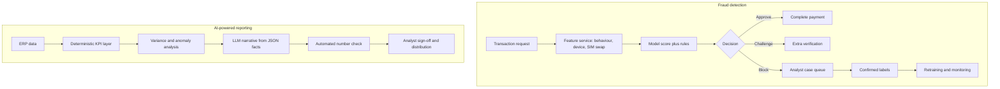

## Introduction

The final project lesson brings together two systems at opposite ends of the AI spectrum. **Fraud detection** is a classic predictive problem: rare events, adversarial opponents, real-time decisions and a direct trade-off between losses and customer friction. **AI-powered business reporting** is a newer, generative application: turning data into management reports with automated analysis and natural-language commentary that busy managers actually read.

Both projects are highly relevant to Ghanaian organisations. Digital payments and mobile money are widely used, making fraud prevention a priority for banks, fintechs, telecoms and merchants. At the same time, many organisations struggle to produce timely, insightful management reports from ERP and spreadsheet data. Each project is designed with the same template used throughout this module and can be prototyped with free tools such as Python, scikit-learn, Google Colab, Streamlit and open models from Hugging Face.

## Learning Objectives

- Design a fraud detection system combining rules, supervised learning and anomaly detection, with a real-time deployment and case management process.
- Apply cost-sensitive reasoning to choose a fraud alert threshold under analyst capacity constraints.
- Design an AI-powered reporting system that separates deterministic KPI calculation from grounded narrative generation.
- Evaluate the risks and ethics of both systems, including customer harm from false positives and hallucinated figures in reports.
- Create step-by-step implementation plans for illustrative Ghanaian organisations using free tools.

## Prerequisite Knowledge

- Classification metrics, imbalance and anomaly detection (Modules 2 and 4).
- Deployment patterns, monitoring and drift (Module 6).
- Prompt engineering and RAG (Module 6); security and governance (Module 7).

## Key Terminology

- **Class imbalance**: A situation in which one class (such as fraud) is far rarer than the other.
- **Anomaly detection**: Identifying observations that differ markedly from normal patterns, useful for novel fraud.
- **Isolation forest**: An anomaly detection algorithm that isolates unusual points with fewer random splits than normal ones.
- **Money mule**: An account used to receive and move fraudulent funds, often detectable through network patterns.
- **Alert rate**: The share of transactions flagged for review or blocking.
- **Value detection rate**: The share of fraudulent value (not count) that the system catches.
- **Variance analysis**: Explaining differences between actual results and budget, forecast or prior period.
- **Text-to-SQL**: Translating a natural-language question into a database query, often with an LLM.

## Project 1: Fraud Detection for Digital Payments

### Business problem

A payments provider must decide in seconds whether to approve, challenge (for example, ask for extra verification) or block each transaction. The objective is to **minimise total cost**: fraud losses plus investigation costs plus the cost of inconveniencing genuine customers, within the capacity of the fraud team.

### Data needed

- Transaction records: amount, time, channel, merchant or recipient, location, device identifier, transaction type.
- Account and customer data: account age, KYC level, typical behaviour, linked accounts.
- Event signals: recent PIN resets, SIM swaps, new device logins, password changes.
- Labels: confirmed fraud from customer reports, chargebacks and investigations, with dates, recognising that labels arrive late and some fraud is never reported.
- Network data: who sends money to whom, used to find clusters of mule accounts.

### Approach

1. **Rules baseline**: velocity rules (many transfers in a short time), new-device-plus-large-amount rules, and blocklists.
2. **Behavioural features**: deviation from a customer's usual amount, time and recipients; time since SIM swap or device change; recipient account age; number of distinct senders to the recipient.
3. **Supervised model**: gradient-boosted trees with class weights, trained on time-ordered data.
4. **Anomaly detection**: an isolation forest on behavioural features to surface novel patterns that labels do not yet cover.
5. **Decision layer**: combine model score and rules into approve, challenge or block, with thresholds chosen by cost.
6. **Case management**: analysts investigate alerts; outcomes become new labels.

### Evaluation metrics

- Precision, recall and **PR-AUC**, which are more informative than ROC-AUC on heavily imbalanced data (Saito & Rehmsmeier, 2015).
- Value detection rate and losses avoided.
- Alert rate relative to analyst capacity; false positive rate among genuine customers.
- Latency (for example, a target of well under one second) and availability.
- Disaggregated false positive rates by customer segment to detect unfair friction.

### Worked example: choosing a threshold

**Illustrative scenario** with hypothetical figures: 100,000 transactions per day, of which 100 are fraudulent with an average value of GHS 1,500. Each alert costs GHS 10 to review; each false positive also causes friction costed at GHS 5.

| | Threshold A (strict) | Threshold B (loose) |
|---|---|---|
| Alerts | 1,000 | 3,000 |
| Fraud caught | 70 | 85 |
| False positives | 930 | 2,915 |
| Precision | 70 / 1,000 = 7.0% | 85 / 3,000 ≈ 2.8% |
| Recall | 70% | 85% |
| Missed fraud loss | 30 × 1,500 = 45,000 | 15 × 1,500 = 22,500 |
| Review cost | 1,000 × 10 = 10,000 | 3,000 × 10 = 30,000 |
| Friction cost | 930 × 5 = 4,650 | 2,915 × 5 = 14,575 |
| **Total daily cost** | **GHS 59,650** | **GHS 67,075** |

Threshold A is cheaper despite lower recall, and if the team can review only about 1,200 alerts a day, threshold B is not even operationally feasible. The optimal threshold depends on fraud values, review costs, friction and capacity, so it should be revisited as these change. A hybrid design can block only the highest-risk transactions and *challenge* the next tier with extra verification, reducing friction.

### Deployment

A **real-time API** scores each transaction within the payment flow, returning a score, a decision and reason codes. A rules engine runs alongside and acts as the **fallback** if the model service fails. Shadow deployment precedes go-live; canary release follows. Monitoring covers flag rate (prediction drift), PSI on key features, confirmed fraud recall as labels arrive, latency and complaint rates. Retraining is scheduled (for example monthly) and triggered by drift, because fraud is adversarial.

### Risks and ethics

Fraudsters adapt (concept drift); labels are delayed and incomplete; insiders may collude; and model extraction could reveal how to evade detection. False positives can freeze a customer's access to money needed for food, medicine or business stock, so challenge-and-verify flows, quick review and clear appeal routes are ethical requirements. Features such as location or device type can create unfair friction for particular groups. Processing must comply with Act 843, and reason codes should be meaningful without revealing detection logic to fraudsters.

## Project 1 Step-by-Step Plan

**Illustrative scenario.** A fictional Ghanaian fintech offers wallet-to-wallet transfers and merchant payments and has seen a rise in social-engineering fraud following SIM swaps.

1. **Weeks 1–2 – Scope and costs.** Agree with the risk team on fraud definitions, cost assumptions and analyst capacity; inventory existing rules.
2. **Weeks 2–4 – Data.** Extract twelve months of transactions and confirmed fraud cases; build behavioural features and SIM-swap and device-change indicators; split by time.
3. **Week 5 – Baseline.** Measure current rules' precision, recall and alert rate on the test period.
4. **Weeks 6–7 – Models.** Train gradient boosting with class weights and an isolation forest in Google Colab with scikit-learn; compare PR-AUC and cost at capacity-feasible thresholds.
5. **Week 8 – Fairness and explanation review.** Check false positive rates by region and customer type; design reason codes and appeal steps.
6. **Weeks 9–12 – Shadow deployment.** Score live transactions without acting; compare with analyst outcomes.
7. **Weeks 13–16 – Canary and scale.** Act on a small share of traffic with challenge flows; monitor and scale; set retraining cadence.

## Project 2: AI-Powered Business Reporting

### Business problem

Managers receive monthly reports late, as dense spreadsheets with little interpretation. Analysts spend days compiling figures and writing commentary. The objective is to produce **accurate, timely, insightful** reports with less manual effort, measured by reporting cycle time, analyst hours, factual accuracy and managers' use of the reports.

### Data needed

- Sales, purchases, inventory and finance data from ERP or accounting systems, plus budgets and targets.
- A **metric dictionary** defining each KPI precisely (for example, gross margin = (revenue − cost of sales) / revenue), with owners.
- Historical reports and commentary as style examples.
- Access controls: who may see which figures.

### Approach

1. **Data pipeline**: extract data into a local analytical store (for example SQLite or DuckDB) on a schedule.
2. **Deterministic KPI layer**: compute all figures in Python or SQL from the metric dictionary. **Code computes numbers; the language model writes words.**
3. **Analytics layer**: variance analysis against budget and prior year; anomaly detection on KPIs; short-term forecasts where useful.
4. **Narrative generation**: pass the computed facts as structured JSON to an LLM with a constrained prompt, asking for commentary that uses only supplied figures and flags uncertainty.
5. **Validation**: automatically check that every number in the narrative appears in the facts table; route the draft to an analyst for review and sign-off.
6. **Delivery**: a Streamlit dashboard or PDF report, optionally with a natural-language question box using text-to-SQL restricted to read-only, pre-approved views.

An example narrative prompt:

```text
ROLE: You are a financial analyst writing for the managing director.
FACTS (use only these; do not calculate new numbers):
{"month": "March", "revenue_ghs": 1250000, "revenue_vs_budget_pct": -6.0,
 "gross_margin_pct": 21.4, "gross_margin_prior_pct": 23.1,
 "top_decline_region": "Northern", "top_decline_driver": "lower cement volumes"}
TASK: Write a 120-word commentary: headline, two key drivers, one risk.
CONSTRAINTS: Quote figures exactly. Do not speculate about causes not listed.
If information is insufficient, say what further analysis is needed.
```

### Evaluation metrics

- **Factual accuracy**: share of narrative figures matching the source (target: all, enforced by automated checks and review).
- **Faithfulness**: no unsupported causal claims, assessed by analyst review against a checklist.
- **Text-to-SQL accuracy** on a test set of typical questions.
- **Business metrics**: reporting cycle time, analyst hours saved, managers' satisfaction and usage.

### Deployment, risks and ethics

A monthly batch pipeline produces drafts; analysts review and approve before distribution; the dashboard refreshes daily. Risks include hallucinated or mis-stated numbers, plausible but unsupported explanations, text-to-SQL queries that are wrong or expose restricted data, inconsistent KPI definitions and over-reliance on automated commentary. Ethically and in governance terms, the finance team remains accountable for published figures, AI-drafted commentary should be disclosed internally, confidential data should not be sent to external services without approved agreements, and any personal data (for example, staff performance) must be handled under Act 843.

## Project 2 Step-by-Step Plan

**Illustrative scenario.** A fictional building-materials distributor with depots in Accra, Kumasi and Tamale produces a monthly management pack that takes analysts about a week.

1. **Weeks 1–2 – Requirements.** Interview managers about decisions the report supports; agree 15 KPIs and write the metric dictionary.
2. **Weeks 3–4 – Pipeline.** Extract ERP exports to DuckDB; write tested SQL or pandas code for each KPI; reconcile with last month's manual report.
3. **Week 5 – Analytics.** Add budget variance tables, prior-year comparison and a simple anomaly flag for KPIs outside expected ranges.
4. **Weeks 6–7 – Narrative.** Build the constrained prompt with JSON facts; implement automatic number-matching checks.
5. **Week 8 – Dashboard.** Build a Streamlit app with charts, tables and the approved commentary.
6. **Weeks 9–12 – Parallel run.** Produce AI-assisted reports alongside manual ones for two cycles; compare accuracy, time and manager feedback.
7. **Week 13 – Go-live.** Switch to the AI-assisted process with mandatory analyst sign-off; review prompts and KPI definitions quarterly.

## International Case Study

### The anonymised credit-card fraud benchmark

A widely used public dataset for fraud research, released by the Machine Learning Group of the Université Libre de Bruxelles in collaboration with a payments company and distributed through Kaggle, contains card transactions made by European cardholders over two days, with features transformed by principal component analysis to protect confidentiality. Fraud makes up well under one per cent of transactions, which is why it is often used to teach imbalance-aware evaluation, and associated research examined how undersampling affects probability calibration (Dal Pozzolo, Caelen, Johnson & Bontempi, 2015).

The dataset is instructive for its limitations as much as its strengths. Because features are anonymised components, students cannot practise designing behavioural features; the two-day window hides concept drift; and random train–test splits are tempting but unrealistic. A Ghanaian project should use it only to practise metrics and threshold selection, then design features, time-based splits and drift monitoring around local transaction data.

## Diagram



## Common Misconceptions

- **Misconception:** The best fraud model is the one with the highest recall. **Correction:** Total cost, analyst capacity and customer friction determine the best threshold.
- **Misconception:** ROC-AUC is sufficient for fraud evaluation. **Correction:** On heavily imbalanced data, PR-AUC and precision at operating thresholds are more informative.
- **Misconception:** A fraud model trained once remains effective. **Correction:** Fraud is adversarial; drift monitoring and frequent retraining are essential.
- **Misconception:** LLMs can calculate report figures reliably. **Correction:** Numbers should be computed by tested code; the LLM should only describe supplied facts.
- **Misconception:** AI-generated commentary removes the need for analyst review. **Correction:** Accountability for published figures remains with people; review catches unsupported claims.

## Common Examination Mistakes

- Using accuracy for fraud detection.
- Ignoring analyst capacity and customer friction when choosing thresholds.
- Omitting fallback rules for a real-time fraud service.
- Letting an LLM compute KPIs or query databases without restrictions.
- Failing to define KPIs precisely before automating reports.

## Critical Thinking Questions

1. How should a fintech balance the harm of freezing a genuine customer's funds against the harm of fraud losses, and who should decide?
2. Which fraud reason codes can be shown to customers without helping fraudsters?
3. Should AI-generated management commentary be labelled as such when shared with a board? Why?
4. What governance controls are needed before allowing managers to query company data in natural language?

## Practical Exercises

1. **Threshold costing.** Repeat the worked fraud example with a review cost of GHS 5 per alert. *Expected output:* total costs (A: GHS 54,650; B: GHS 52,075) and a discussion of why the preferred threshold changes and whether capacity still rules out B.
2. **Imbalance metrics.** Using the public anonymised credit-card fraud dataset in Google Colab, train logistic regression and an isolation forest, and report precision, recall and PR-AUC. *Expected output:* a metrics table and precision–recall curve with a chosen threshold justified by cost.
3. **Grounded narrative.** Build a small pandas table of monthly KPIs, convert it to JSON, write a constrained prompt and check the output's numbers automatically. *Expected output:* the prompt, the generated commentary and a script that flags any number not in the facts.

## Key Takeaways

- Fraud detection combines rules, supervised models, anomaly detection and network signals in a real-time decision flow with case management.
- Thresholds should minimise total cost within analyst capacity, using precision, recall and PR-AUC rather than accuracy.
- Fraud systems need fallbacks, shadow and canary releases, drift monitoring and fair, contestable customer treatment.
- AI-powered reporting should compute numbers deterministically and use LLMs only to describe supplied facts, with automated checks and human sign-off.
- Both projects can be prototyped with free tools and evaluated through staged pilots.

## Further Reading

- Saito, T., & Rehmsmeier, M. (2015). The precision-recall plot is more informative than the ROC plot when evaluating binary classifiers on imbalanced datasets. *PLOS ONE, 10*(3), e0118432. <https://doi.org/10.1371/journal.pone.0118432>
- Liu, F. T., Ting, K. M., & Zhou, Z.-H. (2008). Isolation forest. In *2008 Eighth IEEE International Conference on Data Mining* (pp. 413–422). IEEE.
- Dal Pozzolo, A., Caelen, O., Johnson, R. A., & Bontempi, G. (2015). Calibrating probability with undersampling for unbalanced classification. In *2015 IEEE Symposium Series on Computational Intelligence* (pp. 159–166). IEEE.
- Knaflic, C. N. (2015). *Storytelling with data: A data visualization guide for business professionals*. Wiley.
- Provost, F., & Fawcett, T. (2013). *Data science for business: What you need to know about data mining and data-analytic thinking*. O'Reilly Media.

## Video Resources

- [Google Machine Learning Crash Course](https://developers.google.com/machine-learning/crash-course) — Google for Developers. Covers classification thresholds, precision and recall, and imbalanced datasets.
- [Streamlit Documentation](https://docs.streamlit.io/) — Streamlit. Official documentation and tutorials for building data apps and dashboards in Python.

## Revision Summary

Fraud detection is a rare-event, adversarial, real-time problem: combine rules, gradient boosting, anomaly detection and network features; choose thresholds by total cost and analyst capacity; deploy with fallbacks and staged releases; and monitor drift. AI-powered reporting succeeds when tested code computes KPIs and an LLM writes constrained, verifiable commentary that analysts approve.

- Fraud metrics: precision, recall, PR-AUC, value detection, alert rate, segment false positive rates.
- Approve, challenge or block tiers reduce friction.
- Labels are late and incomplete; retrain frequently.
- "Code computes numbers; the LLM writes words."
- Automated number checks plus human sign-off prevent hallucinated figures.
- Public benchmarks teach metrics but not local feature design or drift.
