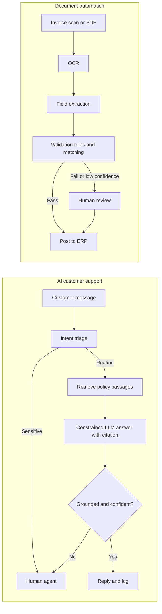

## Introduction

Many organisations spend large amounts of staff time on two kinds of repetitive language work: answering customer questions and processing documents such as invoices, delivery notes, application forms and receipts. Generative AI and document understanding models make it possible to automate parts of this work, but only if accuracy, escalation and accountability are designed in from the start. A support assistant that invents policies, or an invoice pipeline that silently posts the wrong amount, can cost more than it saves.

This lesson applies the project template from the previous lesson to two such systems. The **AI customer support assistant** answers routine questions from an approved knowledge base and hands complex or sensitive cases to people. The **business document automation pipeline** extracts structured data from documents, validates it and routes uncertain cases for human review. Both projects combine probabilistic AI components with deterministic checks and human-in-the-loop controls, and both can be prototyped with free tools such as Python, Google Colab, Hugging Face models and open-source OCR.

## Learning Objectives

- Design an AI customer support assistant using intent classification, retrieval-augmented generation and escalation rules.
- Design a document automation pipeline combining OCR, field extraction, validation and human review.
- Select and calculate appropriate evaluation metrics, including containment, groundedness, field-level accuracy and straight-through processing rate.
- Evaluate the risks and ethical issues of language automation, including hallucination, prompt injection and data protection.
- Create step-by-step implementation plans for illustrative Ghanaian organisations using free tools.

## Prerequisite Knowledge

- NLP, large language models and hallucination (Module 3).
- Customer support automation (Module 4).
- AI agents, prompt engineering and workflow automation (Module 6).
- Privacy and security of AI systems (Module 7).

## Key Terminology

- **Intent classification**: Assigning a customer message to a category of need, such as balance enquiry, complaint or password reset.
- **Containment rate**: The share of conversations resolved by the assistant without transfer to a human agent.
- **Groundedness (faithfulness)**: The extent to which an answer is supported by the retrieved source documents.
- **Embedding**: A numerical vector representing the meaning of text, used to retrieve similar passages.
- **Optical character recognition (OCR)**: Converting images of text into machine-readable characters.
- **Field extraction**: Identifying and capturing specific values, such as invoice number, date and total, from a document.
- **Straight-through processing (STP)**: Completing a transaction automatically without manual intervention.
- **Confidence threshold**: A cut-off below which outputs are routed for human review.

## Project 1: AI Customer Support Assistant

### Business problem

Customer contact centres face peaks in demand, long waiting times and repetitive questions. The objective is to resolve routine enquiries quickly and accurately at any hour while freeing staff for complex cases, measured by response time, resolution rate, customer satisfaction and cost per contact, without increasing complaints or errors.

### Data needed

- Approved knowledge sources: FAQs, product terms, fee schedules, policies and procedures, each with an owner and a review date.
- Historical tickets and chat logs, anonymised, to identify common intents and to build a test set.
- A list of **out-of-scope and sensitive intents** that must always go to humans (for example, fraud reports, complaints about staff, bereavement, legal threats).
- Languages and channels customers actually use.

### Approach

1. **Intent triage**: a classifier (fine-tuned small model or few-shot LLM prompt) labels messages and routes sensitive intents directly to humans.
2. **Retrieval-augmented generation**: split knowledge documents into passages, create embeddings with an open model (for example a sentence-transformers model from Hugging Face), store them in a vector index (such as FAISS or Chroma), retrieve the most relevant passages for each question and instruct the LLM to answer *only* from them, citing the source.
3. **Prompt design**: role, context, constraints ("if the answer is not in the sources, say so and offer a human"), and structured output including a `needs_human` flag.
4. **Guardrails**: no tools that change accounts; personal data redaction in logs; refusal of instructions embedded in user messages; disclosure that the customer is talking to an AI assistant.
5. **Escalation**: transfer with the conversation summary so the customer does not repeat themselves.

### Evaluation metrics

| Level | Metric |
|---|---|
| Offline (test set of 200+ real questions) | Answer correctness, groundedness, citation accuracy, correct escalation of sensitive intents (target: all sensitive test cases escalated) |
| Online | Containment rate, resolution confirmed by customer, customer satisfaction, average response time, transfer rate |
| Guardrails | Complaint rate, rate of incorrect answers in sampled human review, prompt injection test results |

Containment must not be maximised blindly: an assistant that refuses to transfer frustrated customers will score well on containment and badly on trust.

### Deployment

Start with a web chat widget or internal "agent assist" mode in which the AI drafts answers for staff to send. Move to customer-facing mode only after offline and assisted-mode evaluation. Log every conversation, retrieved passage and answer for audit. Fallback: if the model or retrieval fails, show contact options and queue the message for staff.

### Risks and ethics

Hallucinated policies (recall Moffatt v. Air Canada), outdated knowledge, prompt injection, leakage of personal data into external AI services, and weaker performance in local languages or mixed-language messages. Ethically, customers should know they are dealing with AI, have an easy route to a person, and not be manipulated. Under Act 843, conversation data must be processed for a specified purpose, secured and retained only as long as needed.

## Project 1 Step-by-Step Plan

**Illustrative scenario.** A fictional microfinance institution with branches in the Ashanti and Eastern regions receives many phone and chat queries about loan balances, repayment dates, branch hours and required documents.

1. **Weeks 1-2: Scope.** Select 15 high-volume informational intents; list sensitive intents that always escalate; agree success measures with the customer service manager.
2. **Weeks 2-3: Knowledge base.** Collect and clean policy documents and FAQs; assign owners; remove outdated material.
3. **Week 4: Test set.** Write 200 realistic questions from anonymised logs, including mixed English and Twi phrasing, out-of-scope questions and injection attempts, with expected answers.
4. **Weeks 5-6: Prototype in Colab.** Build embeddings and a FAISS index, a retrieval function and a constrained prompt; add an intent classifier; build a simple Gradio interface.
5. **Week 7: Evaluate offline.** Score correctness, groundedness and escalation; fix knowledge gaps and prompts; repeat.
6. **Weeks 8-11: Agent-assist pilot.** Staff see AI-drafted answers and accept, edit or reject them; measure acceptance and errors.
7. **Week 12: Decide.** If accuracy and escalation targets are met, launch customer-facing chat for low-risk intents with monitoring and monthly knowledge review.

## Project 2: Business Document Automation

### Business problem

Finance and operations teams manually key data from supplier invoices, delivery notes, customs documents and forms into ERP or accounting systems. This is slow, error-prone and delays payments and reporting. The objective is to reduce processing time and keying errors while preventing incorrect postings and fraud, measured by processing time per document, field accuracy, STP rate and error escape rate.

### Data needed

- A representative sample of documents (several hundred), covering suppliers, layouts, scan quality and both digital PDFs and photographed paper.
- Ground-truth labels for target fields: supplier name, tax identification number, invoice number, date, line items, subtotal, VAT and total.
- Reference data for validation: supplier master file, purchase orders, goods received notes.
- Business rules: totals must equal the sum of lines plus tax; invoice numbers must be unique per supplier; bank details must match the supplier master.

### Approach

1. **Ingestion and classification**: identify document type (invoice, delivery note, other).
2. **OCR** for scanned images, using an open-source engine such as Tesseract; digital PDFs can be read directly.
3. **Field extraction** using one of: templates and regular expressions for a few fixed layouts; layout-aware models such as LayoutLM (Xu et al., 2020) available through Hugging Face; or an LLM prompted to return a JSON schema.
4. **Validation**: deterministic checks (arithmetic, date validity, supplier match, duplicate detection, three-way match to PO and goods received).
5. **Human review queue**: documents failing validation or below confidence thresholds are shown to a clerk with the extracted fields highlighted for correction; corrections are stored as new training data.
6. **Export** of approved records to the accounting system.

### Evaluation metrics

- **Field-level accuracy, precision and recall** per field.
- **Document-level accuracy**: share of documents with all fields correct.
- **STP rate** and **error escape rate** (errors among documents processed without review).
- **Business metrics**: processing time, cost per document, late-payment penalties, duplicate payments prevented.

### Worked example

On a test set of 200 invoices with 8 target fields each (1,600 fields), the pipeline extracts 1,520 fields correctly.

- Field accuracy `= 1,520 / 1,600 = 95%`.
- But only 140 invoices have *all* fields correct, so document accuracy `= 140 / 200 = 70%`.
- With validation and a confidence threshold, 120 invoices pass straight through: STP rate `= 120 / 200 = 60%`.
- Of those 120, a manual audit finds 2 with an error: error escape rate `= 2 / 120 ≈ 1.7%`.

The example shows why a 95% field accuracy does not justify full automation: errors spread across documents, so validation rules and human review remain essential, and the escape rate is the key risk metric for finance managers.

### Deployment and risks

A batch or near-real-time service watches an email inbox or upload folder, processes documents, and writes results to a review interface and then to the ERP. Risks include poor scans, new layouts, handwritten amendments, **invoice fraud** (altered bank details, duplicate invoices), and indirect prompt injection if an LLM reads document text. Ethical and legal issues include protecting personal data on forms, retention of documents, and the effect on clerical staff, who should be retrained as reviewers and exception handlers.

## Project 2 Step-by-Step Plan

**Illustrative scenario.** A fictional freight-forwarding company in Tema processes many supplier and haulier invoices each month, mostly as scanned PDFs and phone photographs.

1. **Weeks 1-2: Scope.** Focus on haulier invoices; define eight target fields and validation rules with the finance manager; measure current processing time.
2. **Weeks 2-4: Dataset.** Collect 400 past invoices, remove unnecessary personal data, and label fields in a spreadsheet or open-source labelling tool.
3. **Week 5: Baseline.** Run Tesseract OCR plus regular expressions; measure field accuracy.
4. **Weeks 6-7: Improved extraction.** Test a layout-aware model or LLM JSON extraction in Google Colab; compare per-field accuracy.
5. **Week 8: Validation layer.** Implement arithmetic checks, supplier and bank-detail matching, and duplicate detection; set confidence thresholds.
6. **Weeks 9-12: Pilot with review.** All documents go through the pipeline but every output is reviewed; measure time saved and errors caught.
7. **Week 13: Decide on STP.** Allow straight-through processing only for document types and suppliers whose audited escape rate meets the finance manager's tolerance; never auto-approve bank-detail changes.

## International Case Study

### Learning from open document AI research

Research on document understanding has produced public benchmarks and models that small organisations can build on. The FUNSD dataset (Jaume, Ekenel & Thiran, 2019) provided annotated scanned forms for evaluating form understanding in noisy documents, and LayoutLM (Xu et al., 2020) showed that jointly modelling text and its two-dimensional position on the page improves extraction from forms and receipts compared with text alone. Pre-trained versions of such models are distributed through Hugging Face, allowing fine-tuning on a few hundred local documents.

The broader lesson is twofold. First, organisations need not build document AI from scratch; open research lowers entry costs. Second, benchmark results do not transfer automatically: Ghanaian invoices may differ in layout, language, stamps, handwriting and image quality from the documents used in research, so local labelled test sets and validation rules are indispensable.

## Diagram

## Common Misconceptions

- **Misconception:** A higher containment rate always means a better assistant. **Correction:** Containment must be balanced with correctness, satisfaction and appropriate escalation.
- **Misconception:** RAG guarantees accurate answers. **Correction:** Retrieval can miss passages and models can misread them; groundedness must be tested.
- **Misconception:** 95% field accuracy means 95% of documents can be automated. **Correction:** Errors spread across documents, so document-level accuracy and escape rate are lower and more relevant.
- **Misconception:** LLM extraction removes the need for business rules. **Correction:** Deterministic validation catches arithmetic, duplicate and fraud errors that models miss.
- **Misconception:** Automation eliminates the need for staff. **Correction:** Staff shift to review, exception handling and knowledge maintenance.

## Common Examination Mistakes

- Designing a chatbot without a list of intents that must always escalate.
- Omitting knowledge base ownership and update processes.
- Reporting only field accuracy for document automation.
- Ignoring invoice fraud and bank-detail controls.
- Failing to stage deployment from assisted mode to automation.

## Critical Thinking Questions

1. What level of incorrect answers would be acceptable for a bank's support assistant compared with a supermarket's, and why?
2. Should customers be able to opt out of AI support entirely? What are the cost and fairness implications?
3. How should a document automation project measure and manage its effect on clerical jobs?
4. When is a template-based extraction approach preferable to an LLM-based one?

## Practical Exercises

1. **RAG prototype.** In Google Colab, build a retrieval-based assistant over five pages of a public FAQ using a sentence-transformers embedding model and FAISS. *Expected output:* a notebook that answers ten questions with cited passages and declines two out-of-scope questions.
2. **Support test set.** Write 30 test questions for a microfinance assistant, including five sensitive intents and three prompt injection attempts, with expected behaviour. *Expected output:* a test table with pass or fail criteria.
3. **Extraction metrics.** For 50 documents with 6 fields each, 285 fields are correct, 38 documents are fully correct, 30 pass straight through and 1 of those has an error. *Expected output:* field accuracy (95%), document accuracy (76%), STP rate (60%) and escape rate (about 3.3%), with a recommendation.

## Key Takeaways

- Support assistants combine intent triage, retrieval from approved knowledge, constrained generation and escalation.
- Document automation combines OCR, extraction, deterministic validation and human review.
- Measure groundedness and escalation for support; field, document, STP and escape rates for documents.
- Stage deployment from assisted mode to limited automation based on evidence.
- Free tools such as Hugging Face models, FAISS, Tesseract, Gradio and Colab make prototyping achievable.

## Further Reading

- Lewis, P., Perez, E., Piktus, A., Petroni, F., Karpukhin, V., Goyal, N., et al. (2020). Retrieval-augmented generation for knowledge-intensive NLP tasks. In *Advances in Neural Information Processing Systems 33*.
- Xu, Y., Li, M., Cui, L., Huang, S., Wei, F., & Zhou, M. (2020). LayoutLM: Pre-training of text and layout for document image understanding. In *Proceedings of the 26th ACM SIGKDD International Conference on Knowledge Discovery and Data Mining* (pp. 1192-1200). ACM.
- Jaume, G., Ekenel, H. K., & Thiran, J.-P. (2019). FUNSD: A dataset for form understanding in noisy scanned documents. In *2019 International Conference on Document Analysis and Recognition Workshops (ICDARW)*. IEEE.
- Jurafsky, D., & Martin, J. H. (n.d.). *Speech and language processing* (3rd ed. draft). <https://web.stanford.edu/~jurafsky/slp3/>

## Video Resources

- [Hugging Face Learn](https://huggingface.co/learn): Hugging Face. Free courses on transformers, LLMs and building applications with open models.
- [DeepLearning.AI Short Courses](https://www.deeplearning.ai/short-courses/): DeepLearning.AI. Free short courses on retrieval-augmented generation and LLM application development.

## Revision Summary

An AI support assistant should triage intents, answer routine questions only from approved, owned knowledge via RAG, and escalate sensitive or uncertain cases with context. A document automation pipeline should combine OCR, extraction, deterministic validation and human review, automating only where audited escape rates are acceptable.

- Support metrics: correctness, groundedness, escalation accuracy, containment, satisfaction.
- Document metrics: field accuracy, document accuracy, STP rate, error escape rate.
- Always escalate sensitive intents; never let AI change bank details or accounts.
- Begin in agent-assist or full-review mode, then automate low-risk cases.
- Protect personal data under Act 843 in logs and documents.
- Open research (LayoutLM, FUNSD) lowers costs but needs local validation.
