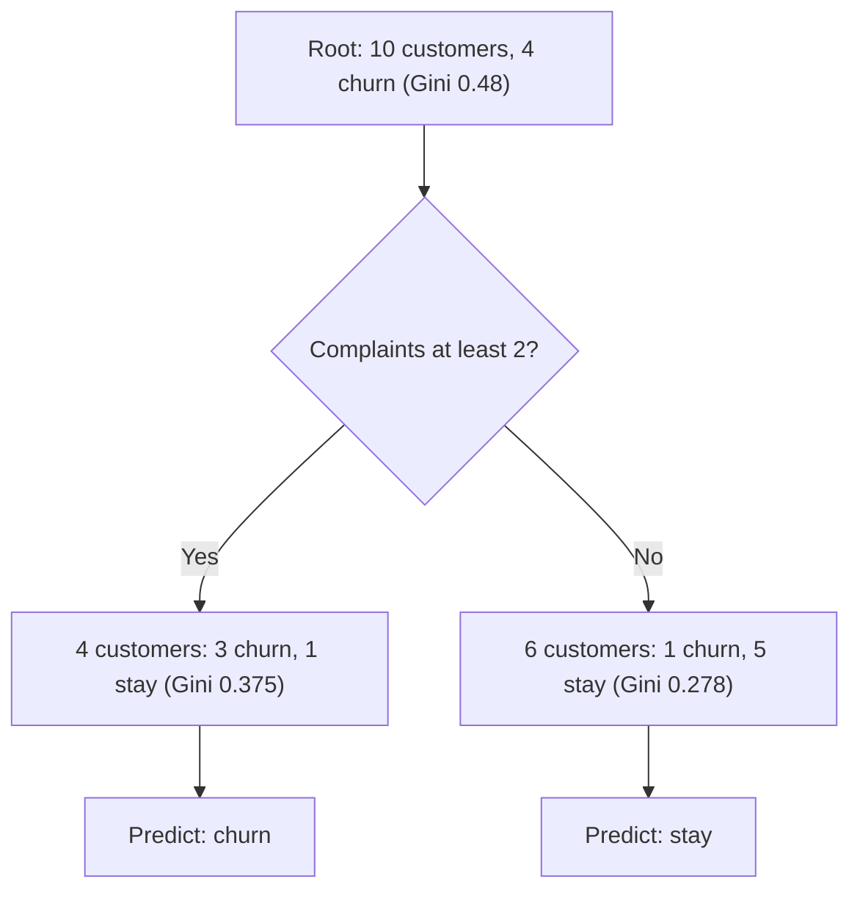

## Introduction

Most predictive AI in business reduces to one of two questions: *which category does this case belong to?* or *what number should we expect?* Will this loan applicant default or repay? Is this transaction fraudulent? How many bags of rice will this branch sell next week? What will this customer spend over the next year? The first type of question is **classification**; the second is **regression**. Both are forms of supervised learning, because they learn from historical examples where the answer is known.

This lesson develops three foundational techniques that every business analyst should be able to explain and, at a small scale, compute by hand: linear regression, logistic regression and decision trees. They are not merely textbook relics. They remain heavily used in banking, insurance, retail and healthcare because they are fast, relatively interpretable and often surprisingly competitive. Understanding them also makes more complex models, such as random forests, gradient boosting and neural networks, far less mysterious.

## Learning Objectives

- Distinguish classification from regression problems and give business examples of each.
- Apply a simple linear regression equation to compute predictions and residuals, and interpret its coefficients.
- Apply the logistic (sigmoid) function to convert a linear score into a probability and a classification decision.
- Explain how a decision tree chooses splits and compute Gini impurity for a candidate split.
- Evaluate the trade-offs between interpretability, accuracy and robustness when choosing among these models.

## Prerequisite Knowledge

- The supervised learning paradigm, features and labels, from the previous lesson.
- Basic algebra (substituting values into an equation) and familiarity with means and percentages.

## Key Terminology

- **Classification**: A supervised task in which the label is a category, such as default or repay.
- **Regression**: A supervised task in which the label is a continuous number, such as weekly sales.
- **Coefficient (weight)**: A number that multiplies a feature in a model, indicating how the prediction changes as the feature changes.
- **Intercept (bias)**: The constant term in a linear model, the prediction when all features are zero.
- **Residual**: The difference between an actual value and the model's predicted value.
- **Mean squared error (MSE)**: The average of squared residuals, a common measure of regression error.
- **Logistic regression**: A classification model that passes a linear combination of features through the sigmoid function to output a probability.
- **Sigmoid function**: The function `1 / (1 + e^(-z))`, which maps any real number z to a value between 0 and 1.
- **Decision threshold**: The probability above which a case is assigned to the positive class.
- **Decision tree**: A model that predicts by applying a sequence of if-then splits on features, ending in leaves that give a class or value.
- **Gini impurity**: A measure of how mixed the classes in a node are; zero means the node contains only one class.

## Detailed Explanation

### Classification versus regression

The distinction rests on the type of label, not on the features. Predicting *whether* a customer will churn is classification; predicting *how many days until* churn is regression. Some problems can be framed either way, and the framing should follow the decision. A supermarket ordering stock needs a quantity (regression); a fraud team deciding whether to review a transaction needs a category or a probability (classification).

### Linear regression

Linear regression models the label as a weighted sum of features plus an intercept:

`predicted y = b0 + b1 × x1 + b2 × x2 + ... + bn × xn`

The coefficients are chosen to minimise the sum of squared residuals, a method called *ordinary least squares*. Each coefficient has a direct interpretation: holding other features constant, increasing feature `x1` by one unit changes the prediction by `b1` units. This interpretability makes linear regression valuable for explaining drivers of business outcomes, such as how promotional spend relates to sales, although a coefficient describes association, not necessarily causation.

Linear regression assumes the relationship is approximately linear and that errors are not systematically patterned. It is sensitive to outliers, because squaring residuals magnifies large errors, and it extrapolates poorly: predictions far outside the range of the training data can be badly wrong.

### Logistic regression

For classification, we need an output between 0 and 1 that can be read as a probability. Logistic regression first computes a linear score `z = b0 + b1 × x1 + ... + bn × xn`, then passes it through the sigmoid function `p = 1 / (1 + e^(-z))`. Large positive scores give probabilities near 1; large negative scores give probabilities near 0; a score of 0 gives exactly 0.5. The model is fitted by maximising the likelihood of the observed labels rather than by least squares.

A probability is not yet a decision. The organisation chooses a **decision threshold**. A default threshold of 0.5 is common in textbooks but rarely optimal in business: if missing a fraud case costs far more than reviewing a legitimate one, the threshold should be lower. Logistic regression is widely used in credit scoring because its coefficients can be explained to regulators and customers.

### Decision trees

A decision tree asks a sequence of questions about features ("Is the number of complaints at least 2?", "Is the account less than six months old?") and routes each case down branches until it reaches a leaf, which gives a predicted class (or, in a regression tree, a predicted number). Trees are learned top-down: at each node the algorithm tries possible splits and chooses the one that makes the resulting child nodes most "pure", measured by Gini impurity or entropy for classification, or by variance reduction for regression.

Trees are intuitive, handle both numeric and categorical features, capture interactions and non-linear effects, and need little data preparation. Their weakness is **instability and overfitting**: a deep tree can memorise noise, and small changes in data can produce a very different tree. Practitioners control this by limiting depth, requiring a minimum number of records per leaf, or pruning. Ensembles such as random forests (many trees trained on random samples and features) and gradient boosting (trees built sequentially to correct earlier errors) usually achieve higher accuracy at some cost to interpretability.

## Worked Example

### 1. Simple linear regression

**Illustrative scenario.** A supermarket branch in Tema records weekly promotional spend (in hundreds of Ghana cedis) and weekly sales of a beverage (in hundreds of units).

| Week | Promo spend x | Sales y |
|---|---|---|
| 1 | 1 | 3 |
| 2 | 2 | 5 |
| 3 | 3 | 6 |
| 4 | 4 | 8 |
| 5 | 5 | 9 |

**Step 1: means.** Mean of x = 3; mean of y = 31 / 5 = 6.2.

**Step 2: slope.** `b1 = Σ(x − x̄)(y − ȳ) / Σ(x − x̄)²`. The deviations of x are −2, −1, 0, 1, 2 and of y are −3.2, −1.2, −0.2, 1.8, 2.8. The products are 6.4, 1.2, 0, 1.8 and 5.6, summing to 15. The squared x deviations sum to 10. So `b1 = 15 / 10 = 1.5`.

**Step 3: intercept.** `b0 = ȳ − b1 × x̄ = 6.2 − 1.5 × 3 = 1.7`.

**Model**: `predicted sales = 1.7 + 1.5 × promo spend`.

**Step 4: prediction.** For a planned spend of 6 (GHS 600): `1.7 + 1.5 × 6 = 10.7`, that is about 1,070 units. Note that x = 6 lies just outside the training range, so this is a mild extrapolation that should be treated with caution.

**Step 5: residuals and MSE.** Predictions for weeks 1-5 are 3.2, 4.7, 6.2, 7.7 and 9.2; residuals are −0.2, 0.3, −0.2, 0.3, −0.2; squared residuals sum to 0.30, so MSE = 0.30 / 5 = 0.06. **Interpretation**: each additional GHS 100 of promotion is associated with about 150 extra units sold within this range.

### 2. Logistic regression probability

**Illustrative scenario.** A microfinance lender's fitted model is `z = −3.0 + 1.2 × (missed payments in last 6 months) − 0.02 × (months as customer)`.

- *Applicant A*: 2 missed payments, 25 months. `z = −3.0 + 2.4 − 0.5 = −1.1`. `p = 1 / (1 + e^1.1) = 1 / (1 + 3.004) ≈ 0.25`.
- *Applicant B*: 4 missed payments, 10 months. `z = −3.0 + 4.8 − 0.2 = 1.6`. `p = 1 / (1 + e^−1.6) = 1 / (1 + 0.202) ≈ 0.83`.

With a threshold of 0.5, A is classified as "repay" and B as "default". If the lender lowers the threshold to 0.2 because defaults are costly, A would also be flagged for review. The coefficient 1.2 means each additional missed payment raises the log-odds of default by 1.2, which is easy to explain to a credit committee.

### 3. Decision tree split using Gini impurity

**Illustrative scenario.** A telecom has 10 customers: 4 churned, 6 stayed. Gini of the root node is `1 − (0.4² + 0.6²) = 1 − 0.52 = 0.48`.

*Candidate split 1: complaints ≥ 2.* Left node: 4 customers (3 churned, 1 stayed), Gini = `1 − (0.75² + 0.25²) = 0.375`. Right node: 6 customers (1 churned, 5 stayed), Gini = `1 − ((1/6)² + (5/6)²) ≈ 0.278`. Weighted Gini = `0.4 × 0.375 + 0.6 × 0.278 ≈ 0.317`. Reduction = 0.48 − 0.317 ≈ 0.163.

*Candidate split 2: uses data bundles (yes/no).* Each side has 5 customers with 2 churned and 3 stayed, so each Gini is 0.48 and the weighted Gini is 0.48. Reduction = 0.

The tree chooses split 1 because it produces purer child nodes. Split 2 tells us nothing about churn in this sample.

## Theories, Frameworks and Models

### Choosing among the three models

| Criterion | Linear regression | Logistic regression | Decision tree |
|---|---|---|---|
| Task | Regression | Classification (probabilities) | Classification or regression |
| Interpretability | High (coefficients) | High (log-odds coefficients) | High for shallow trees |
| Non-linearity and interactions | Only if engineered manually | Only if engineered manually | Captured automatically |
| Sensitivity to outliers | High | Moderate | Low |
| Overfitting risk | Low to moderate | Low to moderate | High if deep |
| Typical business use | Sales drivers, pricing | Credit scoring, churn propensity | Rule-like segmentation, triage, baseline models |

A principled approach is to start with a simple, interpretable baseline and only adopt more complex models, such as gradient-boosted trees, when they deliver a meaningful improvement on held-out data that justifies the loss of transparency.

## Ghanaian Business Application

Classification and regression already underpin many decisions in Ghana's financial and commercial sectors. Digital lenders and banks use classification to estimate default risk, often from repayment histories and mobile money transaction patterns. Telecom operators use classification to predict churn among prepaid subscribers. Supermarkets and distributors use regression to forecast quantities. Hospitals can use classification to flag patients at high risk of complications.

**Illustrative scenario.** A rural bank wants a loan-screening tool that loan officers trust. It compares a logistic regression model with a gradient-boosted tree. The boosted model is slightly more accurate on held-out data, but the logistic model's coefficients can be explained to applicants and the board, and its behaviour is predictable for new kinds of customer. Because lending decisions affect livelihoods and the bank must be able to justify them, it deploys the logistic model with a reviewed threshold and keeps the tree as a challenger model for monitoring. It also checks whether any feature acts as a proxy for protected characteristics.

## International Case Study

### Zillow Offers and the risk of regression at scale

Zillow, a United States property platform, ran a business called Zillow Offers that bought homes directly from sellers, using its price-estimation models to set offers, and then resold them. In November 2021 Zillow announced it would wind down Zillow Offers, stating publicly that it had been unable to forecast future home prices with sufficient accuracy, and it recorded substantial losses and announced significant job cuts.

The case illustrates several regression lessons. First, predicting a number is not the same as making a profitable decision with it: small systematic errors, multiplied across thousands of purchases, become large financial exposures. Second, models trained in one market regime can fail when conditions shift, a problem of extrapolation and drift. Third, an algorithm used to make offers interacts with competitors and sellers who may accept precisely the offers that are too high, a form of adverse selection. Prediction accuracy must therefore be evaluated in terms of the business decision and its risks.

## Diagram

## Common Misconceptions

- **Misconception**: Logistic regression is a regression method because of its name. **Correction**: It outputs probabilities used for classification; the "regression" refers to the linear score inside the model.
- **Misconception**: A threshold of 0.5 is always correct. **Correction**: The threshold should reflect the business costs of false positives and false negatives.
- **Misconception**: A regression coefficient proves that a feature causes the outcome. **Correction**: Coefficients describe association in the data; causal claims need experimental or careful causal analysis.
- **Misconception**: Deeper decision trees are always more accurate. **Correction**: Deep trees often overfit training data and perform worse on new data; depth must be controlled.
- **Misconception**: Simple models are obsolete. **Correction**: Linear and logistic models remain strong, interpretable baselines and are widely used in regulated sectors.

## Common Examination Mistakes

- Forgetting to apply the sigmoid function and reporting the raw score z as a probability.
- Arithmetic errors with negative signs in `e^(−z)`; always compute z first, then the exponent.
- Computing unweighted average Gini for a split instead of weighting by node size.
- Using a regression model for a categorical outcome or vice versa without justification.
- Making predictions far outside the training range without noting extrapolation risk.

## Critical Thinking Questions

1. In lending, when is a slightly less accurate but more interpretable model the better choice? Who benefits from interpretability?
2. How should a fraud team choose a decision threshold for a logistic regression model? What information would you need?
3. What lessons from the Zillow Offers case apply to a Ghanaian business using price predictions to make purchasing decisions, such as a commodity trader?
4. Can a decision tree learned from historical data reinforce past unfair decisions? How would you detect this?

## Practical Exercises

1. **Hand calculation.** Using the five-week data in this lesson, add a sixth week with spend 6 and sales 10. Recompute the slope, intercept and MSE. *Expected output*: the new equation and a sentence explaining how the coefficients changed.
2. **Sigmoid practice.** For the microfinance model, compute default probabilities for applicants with (0 missed, 36 months), (1 missed, 12 months) and (3 missed, 5 months). Classify each at thresholds of 0.5 and 0.3. *Expected output*: a table of z, p and decisions.
3. **Tree in practice.** Using the scikit-learn documentation on decision trees, train a shallow decision tree on any small public dataset (for example a Kaggle Learn exercise dataset) in a free notebook, and compare training and validation accuracy at depths 2, 5 and 10. *Expected output*: a short table and a paragraph on overfitting.

## Key Takeaways

- Classification predicts categories; regression predicts numbers; the decision should drive the framing.
- Linear regression coefficients are interpretable as associations; beware outliers and extrapolation.
- Logistic regression converts a linear score into a probability via the sigmoid; thresholds should reflect business costs.
- Decision trees choose splits that reduce impurity; they capture non-linearity but overfit unless controlled.
- Start with interpretable baselines and adopt complex models only when the improvement justifies the loss of transparency.

## Further Reading

- James, G., Witten, D., Hastie, T., & Tibshirani, R. (2013). *An introduction to statistical learning: With applications in R*. Springer. <https://www.statlearning.com/>
- Géron, A. (2019). *Hands-on machine learning with Scikit-Learn, Keras, and TensorFlow* (2nd ed.). O'Reilly Media.
- Breiman, L. (2001). Random forests. *Machine Learning, 45*(1), 5-32.
- Provost, F., & Fawcett, T. (2013). *Data science for business*. O'Reilly Media.

## Video Resources

- [Machine Learning Crash Course](https://developers.google.com/machine-learning/crash-course): Google for Developers. Includes modules on linear regression, logistic regression and classification.
- [scikit-learn documentation](https://scikit-learn.org/stable/): scikit-learn. Official user guide with explanations and examples of linear models and decision trees.
- [Kaggle Learn](https://www.kaggle.com/learn): Kaggle. Free micro-courses including decision trees and model validation.

## Revision Summary

Classification predicts categories and regression predicts quantities. Linear regression fits `y = b0 + b1x` by least squares, giving interpretable coefficients; logistic regression applies the sigmoid to a linear score to produce probabilities that are converted into decisions with a business-chosen threshold; decision trees split data to maximise purity, measured by Gini impurity, and need depth control to avoid overfitting.

- Slope `b1 = Σ(x − x̄)(y − ȳ) / Σ(x − x̄)²`; intercept `b0 = ȳ − b1x̄`.
- Sigmoid: `p = 1 / (1 + e^(−z))`; z = 0 gives p = 0.5.
- Gini = 1 − sum of squared class proportions; weight child nodes by size.
- Thresholds encode the costs of different errors.
- Ensembles (random forests, boosting) trade interpretability for accuracy.
- Zillow Offers: prediction errors become business losses at scale.
