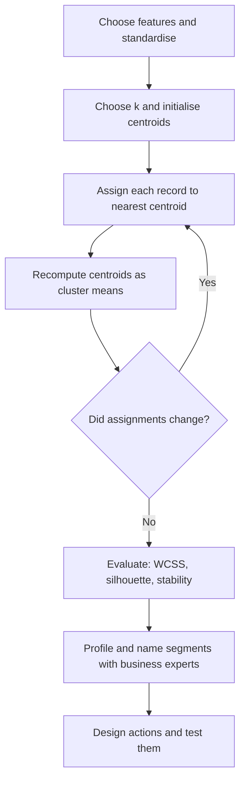

## Introduction

Marketing managers have long divided customers into segments: students and professionals, urban and rural, price-sensitive and premium. Traditionally these segments were defined by judgement and simple demographic rules. Clustering offers a data-driven alternative. Instead of deciding the groups in advance, an algorithm examines behaviour, such as how often customers buy, how much they spend and what they buy, and proposes groups of customers who resemble each other.

Clustering is the most widely used form of unsupervised learning in business. It supports customer segmentation, store and branch profiling, product grouping, document organisation and the screening of unusual records. Yet it is also easy to misuse: an algorithm will always return clusters, whether or not meaningful groups exist. This lesson teaches you how clustering works, how to perform the k-means algorithm by hand on a tiny dataset, how to prepare data so that the results are not distorted, and how to judge whether a segmentation is worth acting upon.

## Learning Objectives

- Explain the purpose of clustering and how it differs from classification.
- Apply the k-means algorithm by hand for at least one full iteration, including assignment and centroid update.
- Explain why feature scaling matters and apply standardisation to clustering features.
- Compare k-means with hierarchical clustering and density-based clustering.
- Evaluate a customer segmentation using internal measures (such as within-cluster sum of squares and silhouette) and business usefulness.

## Prerequisite Knowledge

- The unsupervised learning paradigm from the lesson on learning paradigms.
- Ability to compute a mean and to substitute values into a formula.

## Key Terminology

- **Clustering**: Grouping records so that those in the same group are more similar to each other than to those in other groups, without using predefined labels.
- **Centroid**: The centre of a cluster, computed in k-means as the mean of the points assigned to it.
- **Euclidean distance**: The straight-line distance between two points, the square root of the sum of squared differences across features.
- **k-means**: An algorithm that partitions data into k clusters by repeatedly assigning points to the nearest centroid and recomputing centroids.
- **Within-cluster sum of squares (WCSS)**: The total squared distance of points from their cluster centroids; lower values mean tighter clusters.
- **Elbow method**: A heuristic for choosing k by plotting WCSS against k and looking for the point where improvement slows sharply.
- **Silhouette score**: A measure, between −1 and 1, of how well each point fits its own cluster compared with the nearest other cluster.
- **Standardisation**: Rescaling a feature to have mean 0 and standard deviation 1 so that features with large units do not dominate distance calculations.
- **Hierarchical clustering**: A method that builds a tree of nested clusters (a dendrogram) by successively merging or splitting groups.
- **Customer segmentation**: Dividing a customer base into groups with similar needs or behaviour to tailor products, pricing and communication.

## Detailed Explanation

### What clustering does and does not do

Clustering assigns each record to a group based on similarity across chosen features. Unlike classification, there is no correct answer to learn from; the groups emerge from the structure of the data and from the analyst's choices of features, distance measure, algorithm and number of clusters. This means clustering is as much a design activity as a computation. Two analysts using different features on the same customers will obtain different segmentations, and both may be valid for different purposes.

### The k-means algorithm

k-means is popular because it is simple and scales to large datasets. Given a chosen number of clusters k:

1. **Initialise** k centroids, for example by selecting k records at random (the widely used k-means++ method spreads initial centroids apart to improve results).
2. **Assign** each record to the nearest centroid, usually by Euclidean distance.
3. **Update** each centroid to the mean of the records assigned to it.
4. **Repeat** steps 2 and 3 until assignments no longer change or improvement becomes negligible.

Each iteration can only reduce or maintain the WCSS, so the algorithm converges, but it may converge to a *local* rather than global optimum. Running k-means several times with different initial centroids and keeping the solution with the lowest WCSS is standard practice.

k-means has known limitations. It assumes roughly spherical, similarly sized clusters; it is sensitive to outliers, because one extreme value can pull a centroid away; it requires numeric features; and it requires k to be chosen in advance.

### Feature preparation and scaling

Because k-means uses distances, features measured in large units dominate. If one feature is "annual spend in Ghana cedis" (values in thousands) and another is "visits per month" (values below 30), distance will be driven almost entirely by spend. **Standardisation** solves this: for each feature, subtract the mean and divide by the standard deviation, so that `z = (x − mean) / standard deviation`. Analysts also often apply log transformations to skewed variables such as spend, remove or cap extreme outliers, and choose features that reflect the business purpose of the segmentation.

### Alternative clustering methods

- **Hierarchical (agglomerative) clustering** starts with each record as its own cluster and repeatedly merges the two closest clusters, producing a dendrogram. Analysts can "cut" the tree at different heights to obtain different numbers of clusters. It is informative for small and medium datasets but computationally heavy for very large ones.
- **Density-based clustering (DBSCAN)** forms clusters from dense regions of points and labels isolated points as noise. It finds irregularly shaped clusters, does not need k in advance and naturally identifies outliers, which makes it useful for anomaly screening.
- **Gaussian mixture models** treat clusters as overlapping probability distributions, giving each record a probability of belonging to each cluster rather than a hard assignment.

## Worked Example

### One complete k-means run on six customers

**Illustrative scenario.** A supermarket in Accra examines six loyalty-card customers using two features already on similar scales: visits per month (x) and average basket value in hundreds of Ghana cedis (y).

| Customer | Visits x | Basket y |
|---|---|---|
| A | 1 | 1 |
| B | 2 | 1 |
| C | 1 | 2 |
| D | 6 | 5 |
| E | 7 | 6 |
| F | 6 | 6 |

Choose k = 2 and, to illustrate reassignment, initialise the centroids at A (1, 1) and B (2, 1). Squared Euclidean distance is enough for comparing which centroid is nearer.

**Iteration 1 – assignment.**

| Customer | Distance² to c1 (1, 1) | Distance² to c2 (2, 1) | Assigned |
|---|---|---|---|
| A | 0 | 1 | c1 |
| B | 1 | 0 | c2 |
| C | 1 | 2 | c1 |
| D | 41 | 32 | c2 |
| E | 61 | 50 | c2 |
| F | 50 | 41 | c2 |

**Iteration 1 – update.** Cluster 1 = {A, C}: centroid = ((1 + 1) / 2, (1 + 2) / 2) = (1, 1.5). Cluster 2 = {B, D, E, F}: centroid = ((2 + 6 + 7 + 6) / 4, (1 + 5 + 6 + 6) / 4) = (5.25, 4.5).

**Iteration 2 – assignment.** Customer B is now at distance² `(2 − 1)² + (1 − 1.5)² = 1.25` from c1 and `(2 − 5.25)² + (1 − 4.5)² ≈ 22.81` from c2, so B moves to cluster 1. A and C stay in cluster 1; D (0.81 from c2), E (5.31) and F (2.81) stay in cluster 2.

**Iteration 2 – update.** Cluster 1 = {A, B, C}: centroid ≈ (1.33, 1.33). Cluster 2 = {D, E, F}: centroid ≈ (6.33, 5.67).

**Iteration 3.** Reassigning with the new centroids changes nothing, so the algorithm has converged.

**Final WCSS.** Cluster 1: A contributes about 0.22, B about 0.56 and C about 0.56, total ≈ 1.33. Cluster 2: D about 0.56, E about 0.56 and F about 0.22, total ≈ 1.33. WCSS ≈ 2.67.

**Business interpretation.** Cluster 1 contains infrequent, low-basket shoppers; cluster 2 contains frequent, high-basket shoppers. The poor initial choice of centroids was corrected by iteration, but on larger data a poor start can leave k-means stuck in a weaker solution, which is why multiple restarts are used.

### Why scaling would have mattered

Had basket value been recorded in cedis (100 to 600) rather than hundreds, differences in basket value would have been one hundred times larger than differences in visits, and the clustering would have ignored visit frequency almost entirely. Standardising both features first puts them on equal footing.

## Theories, Frameworks and Models

### Choosing k

- **Elbow method**: run k-means for k = 1, 2, 3, …, plot WCSS and look for the "elbow" where adding clusters yields diminishing returns. The elbow is often ambiguous.
- **Silhouette analysis**: for each record, compare its average distance to its own cluster (a) with its average distance to the nearest other cluster (b); the silhouette is `(b − a) / max(a, b)`. Average silhouettes close to 1 indicate well-separated clusters; values near 0 indicate overlapping clusters.
- **Business constraints**: a marketing team may only be able to run four distinct campaigns. A statistically "optimal" twelve-cluster solution is useless if it cannot be acted upon.

### Evaluating segmentation for business use

A useful segmentation is commonly judged against criteria drawn from marketing practice: segments should be **measurable** (their size and value can be estimated), **substantial** (large or valuable enough to target), **accessible** (reachable through channels), **differentiable** (they respond differently to offers) and **actionable** (the organisation can design distinct actions for them). Clusters should also be **stable**: rerunning the analysis on a new month of data should produce broadly similar groups.

## Ghanaian Business Application

Clustering suits several Ghanaian contexts. Supermarkets can segment loyalty-card customers by frequency, spend and category mix. Mobile money operators can cluster users by transaction patterns (for example, frequent small peer-to-peer transfers versus occasional bill payments) to design products and agent support. Telecom operators can cluster prepaid users by voice, data and time-of-day usage. Hospitals can cluster patients by service usage to plan capacity.

**Illustrative scenario.** A mobile money operator clusters active wallets using standardised features: number of transfers per month, average transfer value, proportion of cash-outs, number of merchant payments and number of distinct counterparties. The analysis yields five clusters, which the business team names: "remittance receivers" (mostly incoming transfers followed by cash-out), "small traders" (many small incoming payments), "salaried digital payers" (bill and merchant payments), "occasional users" and a small cluster with very many counterparties and rapid in–out flows. The first four guide product design, such as savings prompts for remittance receivers. The fifth is passed to the risk team, because unusual network behaviour can indicate agent abuse or fraud. The operator processes these data in line with Ghana's Data Protection Act, 2012 (Act 843), using pseudonymised identifiers for analysis.

## International Case Study

### Geodemographic segmentation

Geodemographic segmentation systems, such as Claritas's PRIZM in the United States, classify neighbourhoods or households into named segments by combining census-style demographic data with consumer behaviour data. Retailers, media planners and service providers have used such systems for decades to choose store locations, plan direct marketing and tailor messages to the characteristics of an area.

The approach demonstrates both the power and the limits of clustering. Its power lies in turning large, complex data into a manageable set of memorable profiles that non-specialists can use. Its limits are equally instructive: segments are averages, so individuals within a segment differ; segment definitions age as society changes and must be refreshed; and grouping people by area can reproduce social inequalities if used to exclude neighbourhoods from services. For Ghanaian organisations, the lesson is that clusters should inform decisions about offers and service design, while care is taken that segmentation does not become a mechanism for unfair exclusion.

## Diagram

## Common Misconceptions

- **Misconception**: Clustering discovers the "true" segments in a market. **Correction**: Results depend on feature choice, scaling, algorithm and k; segments are useful constructions, not natural facts.
- **Misconception**: Clustering and classification are the same. **Correction**: Classification learns predefined labels from examples; clustering creates groups without labels.
- **Misconception**: Lower WCSS always means a better segmentation. **Correction**: WCSS always falls as k increases; the best k balances fit with interpretability and actionability.
- **Misconception**: k-means always finds the best solution. **Correction**: It can converge to a local optimum depending on initial centroids, so multiple restarts are needed.
- **Misconception**: Feature units do not matter. **Correction**: Distance-based methods are dominated by large-scale features unless data are standardised.

## Common Examination Mistakes

- Forgetting to recompute centroids after assignment, or computing centroids from the wrong members.
- Using raw features with very different scales without commenting on standardisation.
- Choosing k purely by the elbow method without discussing business actionability.
- Presenting clusters without profiling them (describing average features) or proposing actions.
- Claiming k-means handles categorical variables such as region names directly.

## Critical Thinking Questions

1. Should a bank use clustering results to decide which customers receive lower service levels? What ethical and regulatory considerations arise?
2. How would you test whether a five-segment solution for a supermarket is stable over time?
3. Why might DBSCAN be preferable to k-means for screening mobile money transactions for unusual behaviour?
4. Who should name and interpret clusters, and what risks arise if analysts alone do so?

## Practical Exercises

1. **Hand iteration.** Repeat the worked example with initial centroids at C (1, 2) and E (7, 6). Show each assignment and update until convergence and compute the final WCSS. *Expected output*: assignment tables, final centroids and a comment on whether the final result matches the lesson's.
2. **Scaling exercise.** For five customers with annual spend values of GHS 500, 800, 1,200, 5,000 and 6,000 and visit counts of 4, 6, 10, 30 and 40, compute the standardised values for both features. *Expected output*: a table of z-scores and a sentence on why standardisation matters.
3. **Free notebook lab.** Following the scikit-learn clustering user guide, run k-means on a small synthetic or public dataset for k = 2 to 8, plot WCSS and average silhouette, and recommend a k with a business justification. *Expected output*: two plots and a 150-word recommendation.

## Key Takeaways

- Clustering groups unlabelled records by similarity; results depend on analyst choices.
- k-means alternates between assigning points to the nearest centroid and recomputing centroids until convergence.
- Standardise features before distance-based clustering, and handle outliers and skew.
- Choose k using WCSS, silhouette and, crucially, business actionability; check stability over time.
- Segments are only valuable when profiled, named with domain experts and linked to distinct, fair actions.

## Further Reading

- James, G., Witten, D., Hastie, T., & Tibshirani, R. (2013). *An introduction to statistical learning: With applications in R*. Springer. <https://www.statlearning.com/>
- Lloyd, S. (1982). Least squares quantization in PCM. *IEEE Transactions on Information Theory, 28*(2), 129–137.
- Provost, F., & Fawcett, T. (2013). *Data science for business*. O'Reilly Media.
- Géron, A. (2019). *Hands-on machine learning with Scikit-Learn, Keras, and TensorFlow* (2nd ed.). O'Reilly Media.

## Video Resources

- [scikit-learn documentation](https://scikit-learn.org/stable/) — scikit-learn. The official user guide includes a detailed clustering section comparing k-means, DBSCAN and hierarchical methods.
- [Machine Learning Crash Course](https://developers.google.com/machine-learning/crash-course) — Google for Developers. Free Google course; related Google materials cover clustering concepts.
- [Kaggle Learn](https://www.kaggle.com/learn) — Kaggle. Free courses including feature engineering with clustering.

## Revision Summary

Clustering is unsupervised grouping by similarity. k-means initialises k centroids, assigns each record to the nearest centroid, recomputes centroids as means and repeats until stable, reducing within-cluster sum of squares; it needs scaled numeric features, multiple restarts and a chosen k. Alternatives include hierarchical clustering and DBSCAN. Business value comes from stable, interpretable, actionable segments.

- k-means steps: initialise, assign, update, repeat.
- Standardise: `z = (x − mean) / standard deviation`.
- WCSS falls as k rises; use elbow, silhouette and business constraints.
- Silhouette `(b − a) / max(a, b)`: near 1 good, near 0 overlapping.
- DBSCAN finds irregular clusters and flags noise points.
- Segments must be measurable, substantial, accessible, differentiable and actionable.
