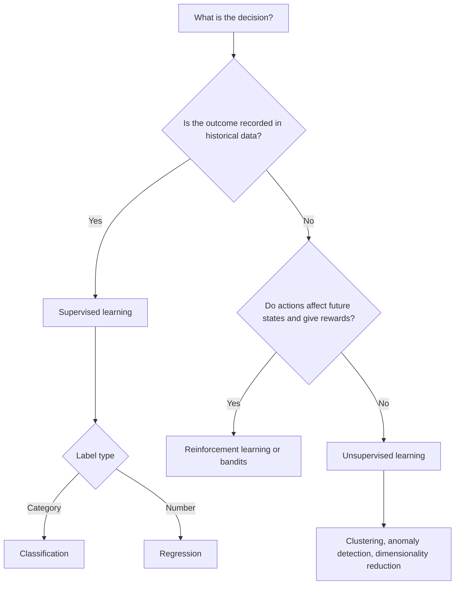

## Introduction

Machine learning is not a single technique but a family of approaches that differ above all in the kind of *feedback* available to the learner. Is there a known correct answer for every historical example? Is there no answer at all, only raw data to be organised? Or does the system learn by acting and receiving rewards and penalties over time? These three situations define the classic paradigms of supervised, unsupervised and reinforcement learning.

Choosing the paradigm is one of the earliest and most consequential decisions in a business AI project. It determines what data must be collected, how much labelling effort is required, how success can be measured and what can go wrong. A Ghanaian bank that wants to predict loan default, a supermarket that wants to discover customer segments, and a logistics firm that wants a system to learn better dispatching policies are solving fundamentally different kinds of learning problem. This lesson equips you to recognise which is which and to justify your choice.

## Learning Objectives

- Explain the defining characteristics of supervised, unsupervised and reinforcement learning.
- Distinguish features, labels, rewards and policies, and identify them in a business dataset.
- Compare the data requirements, evaluation approaches and risks of each paradigm.
- Apply a decision procedure to select a suitable paradigm for a business problem.
- Evaluate hybrid approaches such as semi-supervised and self-supervised learning.

## Prerequisite Knowledge

- The definition of machine learning and the agent framework from the AI Foundations module.
- Basic familiarity with tables of data (rows as records, columns as attributes), as in a spreadsheet.

## Key Terminology

- **Feature**: An input variable used by a model, such as transaction amount, customer age or number of purchases last month.
- **Label (target)**: The known outcome a supervised model learns to predict, such as "defaulted" or "monthly sales".
- **Supervised learning**: Learning a mapping from features to labels using historical examples where the correct answer is known.
- **Unsupervised learning**: Discovering structure, such as groups or unusual points, in data without labels.
- **Reinforcement learning (RL)**: Learning a policy for choosing actions through trial and error, guided by rewards received from an environment over time.
- **Policy**: In reinforcement learning, a rule that maps states of the environment to actions.
- **Reward**: A numerical signal indicating how good the immediate outcome of an action was.
- **Exploration versus exploitation**: The trade-off between trying new actions to gain information and choosing actions already known to perform well.
- **Semi-supervised learning**: Learning from a small labelled dataset combined with a larger unlabelled dataset.
- **Self-supervised learning**: Creating labels automatically from the data itself, for example predicting the next word in a sentence, widely used to pre-train large models.

## Detailed Explanation

### Supervised learning

In supervised learning, every training example consists of features and a known label. The algorithm searches for a function that maps features to labels well enough to generalise to new cases. If the label is a category ("fraud" or "not fraud", "will churn" or "will stay"), the task is **classification**; if it is a number (next week's sales, a house price), the task is **regression**.

Supervised learning is the workhorse of business AI because many business questions are predictions about outcomes that the organisation has recorded in the past. Its key cost is the label. Labels may be cheap (whether a customer paid back a loan is recorded automatically) or expensive (diagnosing a medical image requires a specialist). Labels may also be *delayed*: whether a loan defaults may not be known for a year, which slows learning. And labels may be *biased*: if a bank only ever approved certain kinds of applicants, it has no outcome data on the people it rejected, a problem known as selection bias.

### Unsupervised learning

Unsupervised learning works without labels. Its main tasks are:

- **Clustering**: grouping similar records, such as customer segments.
- **Dimensionality reduction**: compressing many variables into fewer informative ones, useful for visualisation and for removing redundancy.
- **Anomaly detection**: finding records that differ markedly from the majority, such as unusual transactions.
- **Association rule mining**: discovering items that tend to occur together, as in market-basket analysis ("customers who buy bread often buy margarine").

Because there is no correct answer, evaluating unsupervised results is harder. A clustering is "good" if the groups are internally similar, distinct from each other, stable, and, above all, useful for a business decision. Domain experts must interpret and name the patterns.

### Reinforcement learning

Reinforcement learning treats learning as an agent interacting with an environment. At each step the agent observes a state, takes an action, receives a reward and moves to a new state. Its goal is to learn a policy that maximises cumulative reward over time, not just immediate reward. This makes RL well suited to sequential decision problems: dynamic pricing, inventory replenishment, recommendation sequences, robotic control and game playing.

RL introduces distinctive challenges. The agent must balance **exploration** (trying actions whose value is uncertain) and **exploitation** (repeating actions known to work). Rewards can be **delayed**, so the agent must work out which earlier actions deserve credit. And learning by trial and error in a live business can be costly or unsafe; a pricing agent that "explores" by setting absurd prices damages revenue and reputation. For these reasons, business RL is often trained first in a simulator or on historical logs, and deployed with constraints.

A simple, widely used relative of RL in business is the **multi-armed bandit**, which allocates traffic between alternatives (for example, three promotional SMS messages) and shifts towards the best-performing one while still exploring the others.

## Theories, Frameworks and Models

### Comparing the paradigms

| Dimension | Supervised | Unsupervised | Reinforcement |
|---|---|---|---|
| Feedback | Correct label for each example | None | Reward signal after actions |
| Typical question | What will happen? What is this? | What structure exists? What is unusual? | What should we do next, over time? |
| Data | Historical labelled records | Unlabelled records | Interaction with an environment or simulator |
| Evaluation | Accuracy, precision, recall, error on held-out data | Cohesion, separation, stability, business usefulness | Cumulative reward, regret, safety constraints |
| Business examples | Credit default, churn, demand forecasts | Customer segments, anomaly screening | Dynamic pricing, dispatch, recommendations |
| Main risks | Biased or noisy labels, overfitting | Patterns that are meaningless or unstable | Unsafe exploration, reward hacking |

### Reward hacking and specification

Reinforcement learning makes the performance-measure problem from the previous module very concrete. If the reward is mis-specified, the agent will find unintended ways to maximise it, a phenomenon called *reward hacking*. A recommendation agent rewarded only for clicks may learn to promote sensational content. Designing rewards therefore requires the same business judgement as designing any performance measure.

### Beyond the three paradigms

Modern practice blurs the boundaries. **Semi-supervised learning** uses a few labelled examples and many unlabelled ones, valuable where labelling is expensive. **Self-supervised learning** invents a prediction task from the data itself, such as hiding a word and predicting it; this is how large language models are pre-trained on vast text without human labels. Large language models are then often refined with **reinforcement learning from human feedback**, in which human preference judgements are turned into a reward signal.

## Step-by-Step Guide

### Choosing a paradigm for a business problem

1. **State the decision.** What will someone do differently because of the model? ("Decide which customers receive a retention offer.")
2. **Ask whether the outcome of interest has been recorded historically.** If yes, and you want to predict it, supervised learning is the default.
3. **If no outcome exists, ask whether the goal is to discover structure.** If the aim is to group, compress or find unusual cases, use unsupervised learning.
4. **Ask whether decisions are sequential and affect future states.** If actions change what happens next and feedback comes as rewards, consider reinforcement learning or a bandit approach.
5. **Check feasibility.** Estimate label cost and delay, data volume, the safety of experimentation and the ability to simulate.
6. **Consider combinations.** Many systems chain paradigms, for example clustering customers and then training a separate supervised churn model per segment.

### Worked example: identifying the paradigm

**Illustrative scenario.** A Ghanaian telecommunications operator has three proposals.

- *Proposal 1*: predict which prepaid subscribers will stop topping up within 60 days, using two years of usage data where it is known who left. **Paradigm**: supervised classification. Features are usage, top-up frequency, data bundles and complaint counts; the label is "churned within 60 days".
- *Proposal 2*: understand what kinds of customers exist, without any predefined categories, to design new bundles. **Paradigm**: unsupervised clustering on usage patterns (voice-heavy, data-heavy, weekend users, and so on).
- *Proposal 3*: decide each day which of four bundle offers to show each customer in the app, learning from acceptances. **Paradigm**: a contextual bandit (a simple form of reinforcement learning), with reward equal to accepted offer value, constrained to avoid spamming customers.

Table of a supervised training record for Proposal 1:

| Customer ID | Avg weekly top-up (GHS) | Data bundles last month | Complaints last 90 days | Churned within 60 days (label) |
|---|---|---|---|---|
| C001 | 25 | 4 | 0 | No |
| C002 | 5 | 0 | 2 | Yes |
| C003 | 12 | 1 | 1 | No |

The first four columns after the identifier are features; the last column is the label. The customer identifier must *not* be used as a feature, because it carries no generalisable information.

## Ghanaian Business Application

Each paradigm has natural uses in Ghana's economy. **Supervised learning** supports credit scoring for digital lending, where repayment outcomes on small loans accumulate quickly; disease-risk prediction in hospitals that have digitised records; and default prediction for microfinance. **Unsupervised learning** helps supermarkets and mobile money operators segment customers and helps auditors screen large transaction ledgers for anomalies without knowing in advance what fraud looks like. **Reinforcement learning** is less common but relevant to logistics firms optimising delivery routes in congested cities and to digital platforms personalising offers.

**Illustrative scenario.** A digital lender partnering with a mobile money operator wants to score applicants. It realises its outcome data only covers applicants it approved, so a purely supervised model would never learn about the rejected population. It therefore approves a small, controlled random sample of borderline applicants each month to obtain unbiased labels, a deliberate exploration strategy borrowed from reinforcement learning thinking. Ethical review and consumer-protection considerations shape the size of this sample.

## International Case Study

### AlphaGo: combining supervised and reinforcement learning

DeepMind's AlphaGo, which defeated the leading professional Lee Sedol in 2016, is a well-documented example of combining paradigms. As described by Silver and colleagues in *Nature* (2016), the system first used supervised learning to train a neural network to predict moves played by strong human players from a large database of games. It then improved through reinforcement learning by playing games against versions of itself, with the reward being whether the game was won. These learned networks were combined with tree search to choose moves.

The business lesson is that supervised learning from historical expert decisions can provide a strong starting point, while reinforcement learning can then push performance beyond what the historical data contains, provided that a safe environment for trial and error exists. Go has perfect rules and can be simulated endlessly; most business environments cannot, which is why business RL relies on simulators, historical logs and conservative deployment.

## Diagram

## Common Misconceptions

- **Misconception**: Unsupervised learning is less useful because it has no labels. **Correction**: It answers different questions, such as discovering segments or anomalies, and often precedes or supports supervised models.
- **Misconception**: Reinforcement learning is just supervised learning with rewards instead of labels. **Correction**: RL deals with sequential decisions, delayed rewards and exploration; the agent's actions influence the data it later sees.
- **Misconception**: More data always removes the need for labels. **Correction**: For predicting a specific outcome you need examples of that outcome; unlabelled data can help but rarely replaces labels entirely.
- **Misconception**: Historical labels are objective truth. **Correction**: Labels reflect past decisions and processes, which may be biased or incomplete, as with loan outcomes only for approved applicants.
- **Misconception**: Large language models are trained mainly by humans labelling text. **Correction**: They are mostly pre-trained by self-supervised next-token prediction, with human feedback used in later refinement stages.

## Common Examination Mistakes

- Defining the paradigms without giving a business example and identifying features, labels or rewards in it.
- Calling clustering "classification"; classification needs predefined labels, clustering does not.
- Proposing reinforcement learning for problems where decisions are one-off and do not affect future states.
- Ignoring label cost, delay and selection bias when recommending supervised learning.
- Treating identifier fields, such as customer numbers, as predictive features.

## Critical Thinking Questions

1. A hospital wants to predict patient readmission but has only six months of digital records. Which paradigm would you choose, and what limitations would you warn managers about?
2. When, if ever, is it acceptable for a business to "explore" with real customers in order to learn a better policy?
3. How can an organisation decide whether a cluster discovered by an unsupervised algorithm is meaningful or merely an artefact of the data?
4. Why might reward hacking be a particular risk for recommendation systems on social and e-commerce platforms?

## Practical Exercises

1. **Paradigm audit.** List six AI use cases from Ghanaian banks, telcos, supermarkets or hospitals. For each, name the paradigm, the features, and the label or reward (or "none"). *Expected output*: a six-row table with one-sentence justifications.
2. **Online lab.** Work through the "ML Concepts" introduction in the Google Machine Learning Crash Course and summarise, in 150 words, how it distinguishes supervised and unsupervised learning. *Expected output*: a short summary linked to one example from your own organisation.
3. **Reward design.** Write a reward function, in plain words, for a bandit that chooses between three promotional SMS messages for a mobile money operator. Identify one way the reward could be hacked and how you would prevent it. *Expected output*: a reward statement and a mitigation.

## Key Takeaways

- The paradigms differ by feedback: labels (supervised), none (unsupervised) or rewards from interaction (reinforcement).
- Supervised learning splits into classification (categories) and regression (numbers) and dominates business prediction.
- Unsupervised learning discovers segments, anomalies and associations, but its results require expert interpretation.
- Reinforcement learning suits sequential decisions; its risks are unsafe exploration and reward hacking.
- Real systems often combine paradigms, as in AlphaGo and in the pre-training and refinement of large language models.

## Further Reading

- Géron, A. (2019). *Hands-on machine learning with Scikit-Learn, Keras, and TensorFlow* (2nd ed.). O'Reilly Media.
- Sutton, R. S., & Barto, A. G. (2018). *Reinforcement learning: An introduction* (2nd ed.). MIT Press.
- Silver, D., Huang, A., Maddison, C. J., Guez, A., Sifre, L., van den Driessche, G., Schrittwieser, J., Antonoglou, I., Panneershelvam, V., Lanctot, M., Dieleman, S., Grewe, D., Nham, J., Kalchbrenner, N., Sutskever, I., Lillicrap, T., Leach, M., Kavukcuoglu, K., Graepel, T., & Hassabis, D. (2016). Mastering the game of Go with deep neural networks and tree search. *Nature, 529*(7587), 484-489.
- Provost, F., & Fawcett, T. (2013). *Data science for business*. O'Reilly Media.

## Video Resources

- [Machine Learning Crash Course](https://developers.google.com/machine-learning/crash-course): Google for Developers. Free course with videos and exercises introducing supervised learning concepts.
- [Kaggle Learn](https://www.kaggle.com/learn): Kaggle. Short, free hands-on courses including introductory machine learning.
- [Hugging Face Learn](https://huggingface.co/learn): Hugging Face. Free courses, including a deep reinforcement learning course.

## Revision Summary

Machine learning paradigms are distinguished by the feedback available. Supervised learning maps features to known labels and splits into classification and regression; unsupervised learning finds structure such as clusters and anomalies without labels; reinforcement learning learns a policy through rewards from sequential interaction. Paradigm choice determines data needs, evaluation and risk, and modern systems frequently combine paradigms.

- Supervised: labels needed; watch label cost, delay and selection bias.
- Unsupervised: clustering, dimensionality reduction, anomaly detection, association rules.
- Reinforcement: states, actions, rewards, policy; exploration versus exploitation.
- Reward hacking: agents exploit mis-specified rewards.
- Self-supervised pre-training underpins large language models.
- AlphaGo combined supervised learning from human games with reinforcement learning through self-play.
