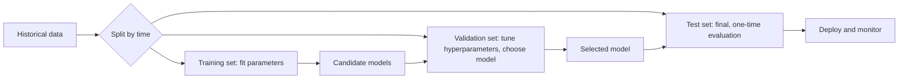

## Introduction

A model that performs brilliantly on the data used to build it may be worthless in practice. The central question of machine learning is not "how well does the model fit the past?" but "how well will it perform on cases it has never seen?" Answering this honestly requires disciplined procedures for training, validating and testing models, and metrics that reflect what the business actually cares about.

Evaluation is where many business AI projects quietly fail. A fraud model reported as "95 per cent accurate" may catch almost no fraud. A churn model tested on data that leaked future information may collapse after deployment. A demand forecast tuned repeatedly against the same test period may simply have memorised it. This lesson explains how training works, why overfitting happens, how to split data correctly, and how to compute and interpret the metrics that matter, including precision, recall and F1, with fully worked numerical examples.

## Learning Objectives

- Explain how a model is trained by minimising a loss function, and the roles of parameters and hyperparameters.
- Distinguish underfitting from overfitting and diagnose each from training and validation results.
- Design appropriate train/validation/test splits, including time-based splits and cross-validation, and explain data leakage.
- Compute accuracy, precision, recall, specificity and F1 from a confusion matrix, and MAE and RMSE for regression.
- Evaluate which metric and decision threshold best serve a given business objective.

## Prerequisite Knowledge

- Classification, regression and decision trees from the previous lessons.
- Comfort with fractions, percentages and averages.

## Key Terminology

- **Loss function**: A measure of how wrong a model's predictions are on training data, which training seeks to minimise.
- **Parameter**: A value learned from data during training, such as a regression coefficient or a neural network weight.
- **Hyperparameter**: A setting chosen before training that controls learning, such as tree depth or learning rate.
- **Overfitting**: When a model learns noise and peculiarities of the training data, performing well on it but poorly on new data.
- **Underfitting**: When a model is too simple to capture the real pattern, performing poorly on both training and new data.
- **Validation set**: Data held out from training and used to compare models and tune hyperparameters.
- **Test set**: Data held back until the end to give an unbiased estimate of final performance.
- **Cross-validation**: Repeatedly splitting data into training and validation folds and averaging the results to obtain a more reliable estimate.
- **Data leakage**: When information unavailable at prediction time inadvertently enters training, producing over-optimistic results.
- **Confusion matrix**: A table counting true positives, false positives, true negatives and false negatives for a classifier.
- **Precision**: The proportion of predicted positives that are truly positive: `TP / (TP + FP)`.
- **Recall (sensitivity)**: The proportion of actual positives that the model correctly identifies: `TP / (TP + FN)`.
- **F1 score**: The harmonic mean of precision and recall: `2 × precision × recall / (precision + recall)`.

## Detailed Explanation

### How training works

Training searches for the parameter values that minimise a loss function on the training data. For linear regression the loss is typically mean squared error; for logistic regression it is log loss (cross-entropy), which heavily penalises confident wrong predictions. Many models are trained by **gradient descent**: start with initial parameters, compute how the loss changes as each parameter changes (the gradient), take a small step in the direction that reduces loss, and repeat. The step size is the **learning rate**, a hyperparameter: too large and training oscillates or diverges; too small and it is very slow.

Hyperparameters, such as tree depth, number of trees, learning rate or regularisation strength, are not learned directly from the training loss. They are chosen by comparing performance on validation data. **Regularisation** adds a penalty for complexity (for example, large coefficients) to the loss, discouraging overfitting.

### Overfitting and underfitting

The **bias-variance trade-off** describes the tension at the heart of model selection. A very simple model has high bias: it makes systematic errors because it cannot represent the true pattern (underfitting). A very flexible model has high variance: it changes greatly with small changes in training data and fits noise (overfitting). The goal is the level of complexity that minimises error on new data.

The diagnosis is straightforward when you compare training and validation performance:

| Pattern | Training error | Validation error | Diagnosis | Typical remedies |
|---|---|---|---|---|
| Both high | High | High | Underfitting | More informative features, more flexible model, less regularisation |
| Low training, much higher validation | Low | High | Overfitting | Simpler model, regularisation, more data, early stopping, pruning |
| Both low and close | Low | Low | Good fit | Confirm on test set, monitor after deployment |

### Splitting data correctly

The standard practice is to divide data into three parts: a **training set** (often around 60-80 per cent) to fit parameters, a **validation set** to choose among models and hyperparameters, and a **test set** used once, at the end, to estimate real-world performance. If the test set is used repeatedly to make choices, it effectively becomes part of training and its estimate becomes optimistic.

Three refinements matter in business:

- **Stratification**: for rare classes such as fraud, split so that each set contains a similar proportion of positives.
- **Time-based splits**: when predicting the future (demand, churn, default), train on earlier periods and validate and test on later periods. Random splits let the model "see the future", inflating performance.
- **Group splits**: if a customer appears many times, keep all of that customer's records in the same set; otherwise the model may recognise individuals rather than learn general patterns.

**k-fold cross-validation** divides the training data into k folds, trains on k − 1 folds and validates on the remaining one, rotating through all folds and averaging. It is valuable when data are limited, though time-series problems need forward-chaining variants that respect time order.

### Data leakage

Leakage is one of the most damaging errors in applied machine learning. Examples include using "account closed date" to predict churn, including a fraud investigator's notes (written after the fraud was detected) as a feature, or standardising features using statistics computed on the whole dataset including the test set. The tell-tale sign is performance that seems too good to be true. The test is simple: for each feature, ask whether its value would genuinely be known at the moment the prediction is made.

## Worked Example

### 1. Confusion matrix for a fraud model

**Illustrative scenario.** A bank tests a fraud classifier on 1,000 card transactions from a later period, of which 50 are actually fraudulent.

| | Predicted fraud | Predicted legitimate | Total |
|---|---|---|---|
| Actually fraud | TP = 40 | FN = 10 | 50 |
| Actually legitimate | FP = 60 | TN = 890 | 950 |
| Total | 100 | 900 | 1,000 |

- **Accuracy** = (TP + TN) / total = (40 + 890) / 1,000 = **0.93**.
- **Precision** = TP / (TP + FP) = 40 / 100 = **0.40**. Only 40 per cent of alerts are real fraud.
- **Recall** = TP / (TP + FN) = 40 / 50 = **0.80**. The model catches 80 per cent of fraud.
- **Specificity** = TN / (TN + FP) = 890 / 950 ≈ **0.937**.
- **F1** = 2 × 0.40 × 0.80 / (0.40 + 0.80) = 0.64 / 1.20 ≈ **0.533**.

**The accuracy paradox.** A useless model that labels every transaction "legitimate" would score accuracy of 950 / 1,000 = 0.95, higher than our model, while catching no fraud at all (recall 0). With imbalanced classes, accuracy is misleading; precision, recall and F1 tell the real story.

**Business interpretation.** Whether 0.40 precision is acceptable depends on costs. If each alert costs a few minutes of analyst time and each missed fraud costs thousands of cedis, the bank may accept many false alarms to keep recall high. If alerts block customers' cards and cause complaints, it may raise the threshold, increasing precision but reducing recall. Changing the threshold moves along this trade-off; the **ROC curve** plots recall against the false positive rate across all thresholds, and the **area under the curve (AUC)** summarises ranking quality independently of any single threshold.

### 2. Expected cost comparison

Suppose a missed fraud costs GHS 3,000 and a false alert costs GHS 50 (illustrative). At the current threshold: cost = 10 × 3,000 + 60 × 50 = 30,000 + 3,000 = GHS 33,000. A stricter threshold yields TP = 30, FN = 20, FP = 20: cost = 20 × 3,000 + 20 × 50 = 60,000 + 1,000 = GHS 61,000. Despite higher precision (30 / 50 = 0.60), the stricter threshold is far more expensive. Metrics should be translated into business costs wherever possible.

### 3. Regression metrics

A demand model predicts weekly sales (hundreds of units) for four weeks:

| Week | Actual | Predicted | Error | Absolute error | Squared error |
|---|---|---|---|---|---|
| 1 | 10 | 11 | −1 | 1 | 1 |
| 2 | 12 | 12 | 0 | 0 | 0 |
| 3 | 8 | 10 | −2 | 2 | 4 |
| 4 | 15 | 12 | 3 | 3 | 9 |

- **MAE** = (1 + 0 + 2 + 3) / 4 = **1.5** hundred units.
- **MSE** = 14 / 4 = 3.5; **RMSE** = √3.5 ≈ **1.87** hundred units.

RMSE exceeds MAE because squaring gives extra weight to the large week-4 miss. If occasional large errors are especially costly (for example, empty shelves during a festive season), RMSE is the more relevant metric.

### 4. Diagnosing overfitting

**Illustrative scenario.** A telecom trains decision trees of increasing depth to predict churn, using a time-based split.

| Max depth | Training accuracy | Validation accuracy |
|---|---|---|
| 2 | 0.78 | 0.77 |
| 5 | 0.85 | 0.83 |
| 10 | 0.95 | 0.79 |
| 20 | 1.00 | 0.74 |

Depth 2 underfits slightly; depth 5 gives the best validation result; depths 10 and 20 overfit, memorising training customers. The team selects depth 5 and then evaluates it once on the untouched test set.

## Theories, Frameworks and Models

### Choosing metrics for business objectives

| Business situation | Priority | Suitable metrics |
|---|---|---|
| Fraud, disease screening, safety | Do not miss positives | Recall, with a floor on precision; cost-weighted error |
| Marketing offers with limited budget | Alerts must be worth acting on | Precision, precision at top k |
| Balanced concern for both errors | Trade-off | F1, AUC |
| Ranking customers by risk | Correct ordering | AUC, lift in top deciles |
| Quantity forecasts | Average error size | MAE, RMSE, mean absolute percentage error |

### Baselines

Every model must be compared with a baseline: the majority class for classification, last week's value or a moving average for forecasting, or the existing business rule. A model that does not beat a simple baseline on held-out data does not justify deployment.

## Ghanaian Business Application

**Illustrative scenario.** A hospital in Tamale develops a model to flag patients at risk of missing follow-up appointments so that staff can phone them. The data team initially reports 90 per cent accuracy, but only 10 per cent of patients miss appointments, so the "nobody misses" baseline already achieves 90 per cent. Re-evaluating with a confusion matrix shows recall of only 0.30. The team then adds features available at booking time (distance from the facility, previous attendance, appointment day), uses a time-based split so that training data precede test data, and chooses a threshold based on how many calls staff can realistically make per day. The final evaluation reports precision among the top 50 flagged patients per day, a metric aligned with the hospital's staffing constraint. Because the data concern patients, access is restricted and handled under Ghana's Data Protection Act, 2012 (Act 843).

## International Case Study

### Google Flu Trends

Google Flu Trends, launched in 2008, estimated influenza activity in the United States from the volume of flu-related search queries. It was initially presented as a way to track outbreaks faster than official surveillance. However, in an article in *Science* in 2014, Lazer, Kennedy, King and Vespignani showed that it had substantially overestimated flu prevalence in the 2012-2013 season and had performed poorly for extended periods.

The authors identified issues that map directly onto this lesson. The model was selected from a very large number of candidate search terms against a limited number of observed flu seasons, risking overfitting to spurious correlations. The relationship between searches and illness also changed over time, partly because the search engine itself changed, so a model validated on past seasons did not generalise. The case shows that impressive historical fit, without robust out-of-time validation and ongoing monitoring, is not evidence of reliable future performance.

## Diagram

## Common Misconceptions

- **Misconception**: High accuracy means a good model. **Correction**: With imbalanced classes a trivial model can achieve high accuracy; use precision, recall, F1 and cost-based measures.
- **Misconception**: Random splits are always fine. **Correction**: For forecasting and time-dependent problems, train on the past and test on the future to avoid leakage.
- **Misconception**: The test set can be used to tune the model. **Correction**: Tuning on the test set makes its estimate optimistic; use a separate validation set or cross-validation.
- **Misconception**: Overfitting is solved by training longer. **Correction**: Longer training usually worsens overfitting; use regularisation, simpler models, more data or early stopping.
- **Misconception**: Precision and recall can both be maximised by choosing the right threshold. **Correction**: Raising the threshold typically increases precision but lowers recall; the choice reflects business costs.

## Common Examination Mistakes

- Swapping the formulas for precision and recall; remember precision divides by predicted positives, recall by actual positives.
- Calculating F1 as the arithmetic mean of precision and recall instead of the harmonic mean.
- Reporting metrics without interpreting what they mean for the business decision.
- Failing to mention time-based splitting and leakage when evaluating forecasting or churn models.
- Concluding that a model is good without comparison to a baseline.

## Critical Thinking Questions

1. A screening model for a serious disease has recall 0.95 and precision 0.20. Is this acceptable? What additional information would you need?
2. Why might a data scientist be tempted to leak information, even unintentionally, and what governance controls could prevent it?
3. How should an organisation decide how much historical data to keep as a test set when data are scarce?
4. What does the Google Flu Trends case suggest about using social media or search data to forecast demand for consumer products in Ghana?

## Practical Exercises

1. **Confusion matrix practice.** A churn model is tested on 2,000 customers, of whom 200 churned. It predicts 250 churners, 150 of whom actually churned. Build the confusion matrix and compute accuracy, precision, recall, specificity and F1. *Expected output*: the matrix and five metrics to three decimal places, with a one-paragraph interpretation.
2. **Cost-based threshold.** Using your matrix, suppose a retention offer costs GHS 20 and a lost customer costs GHS 300. Compute the total cost and compare it with the cost of contacting nobody. *Expected output*: two cost figures and a recommendation.
3. **Online lab.** Complete the classification module of the Google Machine Learning Crash Course, focusing on thresholds, the confusion matrix and ROC/AUC. *Expected output*: a short note explaining how moving the threshold changed precision and recall in the interactive exercise.

## Key Takeaways

- Training minimises a loss function; hyperparameters are chosen using validation data, not the test set.
- Compare training and validation performance to diagnose underfitting and overfitting.
- Use stratified, time-based and group-aware splits, and guard rigorously against data leakage.
- Precision = TP / (TP + FP); recall = TP / (TP + FN); F1 is their harmonic mean; accuracy misleads under class imbalance.
- Translate metrics into business costs, set thresholds accordingly and always compare against a baseline.

## Further Reading

- Lazer, D., Kennedy, R., King, G., & Vespignani, A. (2014). The parable of Google Flu: Traps in big data analysis. *Science, 343*(6176), 1203-1205.
- James, G., Witten, D., Hastie, T., & Tibshirani, R. (2013). *An introduction to statistical learning: With applications in R*. Springer. <https://www.statlearning.com/>
- Provost, F., & Fawcett, T. (2013). *Data science for business*. O'Reilly Media.
- Géron, A. (2019). *Hands-on machine learning with Scikit-Learn, Keras, and TensorFlow* (2nd ed.). O'Reilly Media.

## Video Resources

- [Machine Learning Crash Course](https://developers.google.com/machine-learning/crash-course): Google for Developers. Covers loss, gradient descent, overfitting, data splitting and classification metrics with interactive exercises.
- [scikit-learn documentation](https://scikit-learn.org/stable/): scikit-learn. The user guide on model selection and evaluation explains cross-validation and metrics.
- [Kaggle Learn](https://www.kaggle.com/learn): Kaggle. Free micro-courses including model validation, underfitting and overfitting, and data leakage.

## Revision Summary

Models are trained by minimising a loss on training data, tuned on validation data and assessed once on a held-out test set. Overfitting shows as low training error with much higher validation error; underfitting as high error on both. Splits must respect time, groups and class balance, and leakage must be prevented. For classification, derive metrics from the confusion matrix and choose them, and the threshold, according to business costs.

- Precision `TP / (TP + FP)`; recall `TP / (TP + FN)`; F1 `2PR / (P + R)`.
- Accuracy paradox: under imbalance, "always negative" can look highly accurate.
- MAE = mean absolute error; RMSE penalises large errors more.
- Time-based splits for forecasting; never tune on the test set.
- Leakage test: would this feature be known at prediction time?
- Always beat a baseline before deploying.
