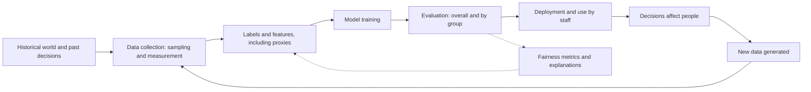

## Introduction

AI systems increasingly influence who is shortlisted for a job, approved for a loan, prioritised for medical care or flagged as a fraud risk. When these systems treat groups of people systematically differently without justification, the result is **algorithmic bias**, and its harms can be large because automated decisions are made at scale and are often invisible to the people affected. A related problem is opacity: if neither the business nor the customer can understand why a model reached a decision, it is hard to detect errors, contest outcomes or satisfy regulators.

This lesson equips you to analyse these problems rigorously. You will learn where bias enters the machine learning lifecycle, how fairness is measured (and why different fairness definitions can conflict), how to calculate demographic parity and equal opportunity on a small example, and how explainability methods, from interpretable models to SHAP and LIME, support accountability. The goal is not to memorise metrics but to make and defend reasoned judgements about what "fair" should mean in a particular business context.

## Learning Objectives

- Explain the main types of algorithmic bias and where each enters the AI lifecycle.
- Calculate demographic parity and equal opportunity differences from a confusion matrix by group.
- Analyse why fairness definitions can conflict and justify a choice for a given context.
- Distinguish global from local explanations and explain conceptually how SHAP and LIME work.
- Evaluate mitigation strategies at the pre-processing, in-processing and post-processing stages.

## Prerequisite Knowledge

- Confusion matrices, true positive rate (recall) and false positive rate (Module 2).
- Data quality and representativeness (Module 6).

## Key Terminology

- **Algorithmic bias**: Systematic and unjustified differences in how an AI system's outputs or errors affect different groups.
- **Protected characteristic**: An attribute such as sex, ethnicity, religion, disability or age on which discrimination is prohibited or ethically unacceptable.
- **Proxy variable**: A feature that is correlated with a protected characteristic and can reproduce its effect even when the characteristic is excluded.
- **Demographic parity**: A fairness criterion requiring that the rate of positive outcomes is equal across groups.
- **Equal opportunity**: A fairness criterion requiring equal true positive rates across groups, so qualified individuals have equal chances of a positive outcome.
- **Equalised odds**: A stricter criterion requiring both true positive rates and false positive rates to be equal across groups.
- **Global explanation**: An account of how a model behaves overall, such as which features matter most across all predictions.
- **Local explanation**: An account of why a model made a specific prediction for one individual.
- **Counterfactual explanation**: A statement of the smallest change to an individual's inputs that would have changed the outcome.

## Detailed Explanation

### Where bias comes from

Bias is rarely the result of a single malicious decision. It enters at many points in the lifecycle (Barocas, Hardt & Narayanan, 2023).

| Type of bias | Description | Business example |
|---|---|---|
| Historical bias | The world the data reflects was itself unequal | Past hiring favoured men, so "successful employee" labels skew male |
| Representation (sampling) bias | Some groups are under-represented in training data | A voice assistant trained mainly on one accent performs poorly on others |
| Measurement bias | Features or labels measure groups differently or use poor proxies | Using healthcare spending as a proxy for health need |
| Label bias | Outcome labels reflect biased human judgements | "Fraud" labels driven by which customers investigators chose to examine |
| Aggregation bias | One model is used for groups with genuinely different patterns | A single diabetes risk model across populations with different risk profiles |
| Evaluation bias | Benchmarks do not represent the deployment population | Testing a face recognition system on a dataset dominated by lighter-skinned faces |
| Deployment bias | The system is used in a context or way it was not designed for | A screening tool used as a final decision-maker |
| Feedback loop bias | Model decisions shape future data | Predicting crime where police already patrol, generating more records there |

Removing a protected attribute from the feature set (sometimes called "fairness through unawareness") rarely solves the problem, because **proxies** such as location, language, school attended or phone model can carry the same information.

Buolamwini and Gebru (2018) provided an influential demonstration: commercial gender classification systems showed substantially higher error rates for darker-skinned women than for lighter-skinned men, a disparity linked to unrepresentative training and benchmark data. The study showed the value of **disaggregated evaluation**, that is, reporting performance separately by group rather than only on average.

### Measuring fairness

Fairness metrics compare outcomes or errors across groups. Using a binary decision (for example, loan approved = positive):

- **Demographic parity** compares selection rates: `P(approved | group A)` versus `P(approved | group B)`. It is often reported as a difference or as a ratio; in US employment practice a ratio below 0.8 (the "four-fifths rule") is treated as an indicator of possible adverse impact.
- **Equal opportunity** (Hardt, Price & Srebro, 2016) compares true positive rates: among applicants who would actually repay, what share in each group is approved?
- **Equalised odds** additionally compares false positive rates: among applicants who would not repay, what share in each group is wrongly approved?
- **Predictive parity** compares precision: among approved applicants, is the repayment rate the same in each group?

### Why fairness definitions conflict

When groups have different underlying base rates of the outcome, it is mathematically impossible (except in trivial cases) for a classifier to satisfy calibration or predictive parity and equal error rates at the same time (Chouldechova, 2017; Kleinberg, Mullainathan & Raghavan, 2017). This impossibility result means that choosing a fairness metric is a **normative choice**, not a technical one. In lending, equal opportunity reflects the idea that creditworthy people should have equal access to credit. Demographic parity may be preferred where historical data is believed to be so biased that labels themselves cannot be trusted. The choice should be made explicitly, with input from affected stakeholders, legal advisers and senior management, and documented.

### Explainability

Explainability serves different audiences: data scientists debugging a model, managers approving it, regulators auditing it, and customers who deserve to know why they were refused.

- **Intrinsically interpretable models** such as logistic regression scorecards, short decision trees and rule lists are understandable by design. Rudin (2019) argued that for high-stakes decisions, organisations should prefer interpretable models rather than explaining black boxes after the fact, because post-hoc explanations can be incomplete or misleading.
- **Post-hoc methods** explain models after training:
  - **Global** methods include permutation feature importance (how much performance drops when a feature is shuffled) and partial dependence plots (how predictions change with a feature on average).
  - **Local** methods explain individual predictions. **LIME** (Ribeiro, Singh & Guestrin, 2016) perturbs the inputs around one instance, observes how the model's predictions change, and fits a simple, interpretable surrogate model (such as a sparse linear model) that approximates the black box *locally*. **SHAP** (Lundberg & Lee, 2017) draws on Shapley values from cooperative game theory: it treats features as "players" and fairly distributes the difference between the model's prediction for an individual and the average prediction among the features, so that the contributions sum to that difference. Aggregating SHAP values across many individuals also gives a global view.
  - **Counterfactual explanations** state what would need to change for a different outcome, for example "If your average monthly mobile money inflow had been GHS 300 higher, the loan would have been approved" (Wachter, Mittelstadt & Russell, 2018). They are often the most actionable explanation for customers, though they must suggest realistic, lawful changes.

Explanations have limits. LIME results can vary with the perturbation settings; SHAP values can be expensive to compute and are affected by correlated features; and an explanation of how a model works does not show whether the model is *fair* or *correct*. Explainability is a tool for scrutiny, not a certificate of quality.

### Mitigating bias

| Stage | Examples |
|---|---|
| Pre-processing | Collect more representative data, re-weight or re-sample groups, fix measurement and label problems, remove or transform proxies |
| In-processing | Train with fairness constraints or penalties, choose model classes that can be inspected |
| Post-processing | Adjust decision thresholds by group to equalise error rates (where lawful), add human review for borderline cases |
| Organisational | Diverse teams, impact assessments, stakeholder consultation, appeal and redress processes, ongoing disaggregated monitoring |

## Worked Example

**Illustrative scenario.** A fictional Ghanaian digital lender evaluates its model on a historical test set of 700 applicants from two groups (for example, applicants from urban districts, group A, and from rural districts, group B). "Qualified" means the applicant repaid in a follow-up study where loans were extended experimentally to a sample.

| | Group A (urban) | Group B (rural) |
|---|---|---|
| Applicants | 400 | 300 |
| Qualified (would repay) | 250 | 150 |
| Not qualified | 150 | 150 |
| Approved, qualified (TP) | 225 | 105 |
| Approved, not qualified (FP) | 15 | 15 |
| Total approved | 240 | 120 |

**Step 1: Demographic parity.**
- Selection rate A `= 240 / 400 = 0.60`
- Selection rate B `= 120 / 300 = 0.40`
- Difference `= 0.60 − 0.40 = 0.20`; ratio `= 0.40 / 0.60 ≈ 0.67`, below the 0.8 four-fifths benchmark.

**Step 2: Equal opportunity (true positive rate).**
- TPR A `= 225 / 250 = 0.90`
- TPR B `= 105 / 150 = 0.70`
- Difference `= 0.20`: creditworthy rural applicants are approved much less often than creditworthy urban applicants.

**Step 3: False positive rate (for equalised odds).**
- FPR A `= 15 / 150 = 0.10`
- FPR B `= 15 / 150 = 0.10`
- Equal, so the disparity lies entirely in missed qualified rural applicants.

**Step 4: Interpretation.** Part of the demographic parity gap reflects a genuine difference in qualification rates (62.5% versus 50%), but the equal opportunity gap shows that the model under-serves qualified rural applicants. Possible causes include proxies (for example, features based on transaction frequency, which may be lower where connectivity is poor) and under-representation of rural repayers in training data. Remedies include adding rural repayment data, re-examining features that measure rural customers poorly, and reviewing thresholds, followed by re-measurement. Note also the **selective labels** caveat: in normal operation, repayment is observed only for approved applicants, so a credible fairness audit needs experimental or carefully designed data, as assumed here.

## Ghanaian Business Application

Fairness in Ghana must be analysed with locally relevant groups. Relevant dimensions may include region, urban or rural location, language, sex, age, disability and employment in the informal sector. Ghana's 1992 Constitution prohibits discrimination on grounds including gender, race, colour, ethnic origin, religion, creed and social or economic status, which provides a foundational principle for organisations deploying automated decisions.

Practical issues include: alternative credit data that reflect connectivity and phone ownership as much as creditworthiness; speech and language models that perform better on English than on Twi, Ewe, Ga or Dagbani; and recruitment screening tools trained on historical hiring patterns. A responsible Ghanaian organisation would conduct disaggregated evaluation for relevant groups, choose and document a fairness criterion with stakeholder input, offer understandable reasons and an appeal route to customers, and process any sensitive personal data lawfully under the Data Protection Act, 2012 (Act 843).

## International Case Study

### Racial bias in a US healthcare risk algorithm

Obermeyer, Powers, Vogeli and Mullainathan (2019) studied a commercial algorithm used by US health systems to identify patients for "high-risk care management" programmes. The algorithm predicted future healthcare **costs** as a proxy for health **needs**. Because less money had historically been spent on Black patients with the same level of illness, often reflecting unequal access to care, the algorithm assigned Black patients lower risk scores than equally sick white patients. As a result, Black patients were less likely to be referred to the extra-care programme.

The case is a textbook example of **measurement bias** through a poorly chosen label. The model did not use race as an input, and it predicted costs accurately; the problem was that the *target* did not measure what the organisation actually cared about. The researchers showed that changing the label to a more direct measure of health substantially reduced the disparity. For business AI, the lesson is that "what are we predicting, and is it the right thing?" is a fairness question as much as a technical one.

## Diagram

The loop shows that bias can enter at every stage and can be reinforced through feedback, while fairness metrics and explanations provide points of scrutiny.

## Common Misconceptions

- **Misconception:** Removing protected attributes makes a model fair. **Correction:** Proxies can reproduce the same patterns; fairness must be measured on outcomes.
- **Misconception:** There is one correct fairness metric. **Correction:** Metrics encode different values and can be mutually incompatible; the choice is normative and must be justified.
- **Misconception:** An accurate model cannot be biased. **Correction:** A model can be accurate on average while erring systematically for a group, or accurately predict a biased target.
- **Misconception:** SHAP or LIME prove a model is fair. **Correction:** They explain contributions to predictions; fairness requires separate measurement and judgement.
- **Misconception:** Bias is only a data problem. **Correction:** Problem framing, label choice, deployment context and feedback loops also create bias.

## Common Examination Mistakes

- Computing demographic parity with true positive rates (or vice versa).
- Stating that fairness metrics can all be satisfied at once without acknowledging the impossibility results.
- Describing LIME and SHAP as the same method.
- Failing to interpret a calculation in business and ethical terms.
- Recommending "remove the sensitive attribute" as the only mitigation.

## Critical Thinking Questions

1. In the worked example, should the lender aim for demographic parity or equal opportunity? Justify your choice with reference to the purpose of lending and the reliability of labels.
2. Is it ever acceptable to use different decision thresholds for different groups? Consider legal, ethical and practical arguments.
3. When would an interpretable scorecard be preferable to a more accurate gradient-boosted model with SHAP explanations?
4. Who should be consulted when choosing fairness criteria for a public-sector AI system in Ghana?

## Practical Exercises

1. **Fairness calculation.** Group C has 200 applicants, 120 qualified; the model approves 90 qualified and 20 unqualified. Group D has 200 applicants, 100 qualified; it approves 60 qualified and 10 unqualified. *Expected output:* selection rates (0.55 and 0.35), TPRs (0.75 and 0.60), FPRs (0.25 and 0.10) and a paragraph interpreting the disparities.
2. **SHAP in Colab.** Train a gradient-boosted classifier on a public credit dataset in Google Colab and use the open-source `shap` library to produce a global summary plot and one local explanation. *Expected output:* both plots and a plain-English explanation suitable for a customer.
3. **Bias audit plan.** For a recruitment screening tool, list the likely sources of bias at each lifecycle stage and propose one mitigation for each. *Expected output:* a table covering at least six bias types.

## Key Takeaways

- Bias enters through history, sampling, measurement, labels, aggregation, evaluation, deployment and feedback loops.
- Demographic parity compares selection rates; equal opportunity compares true positive rates; equalised odds adds false positive rates.
- Fairness criteria can conflict, so choosing one is a documented normative decision.
- Global explanations describe overall behaviour; local explanations such as LIME, SHAP and counterfactuals explain individual decisions.
- Mitigation spans data, training, thresholds and organisational processes, with ongoing disaggregated monitoring.

## Further Reading

- Barocas, S., Hardt, M., & Narayanan, A. (2023). *Fairness and machine learning: Limitations and opportunities*. MIT Press. <https://fairmlbook.org/>
- Hardt, M., Price, E., & Srebro, N. (2016). Equality of opportunity in supervised learning. In *Advances in Neural Information Processing Systems 29*.
- Ribeiro, M. T., Singh, S., & Guestrin, C. (2016). "Why should I trust you?": Explaining the predictions of any classifier. In *Proceedings of the 22nd ACM SIGKDD International Conference on Knowledge Discovery and Data Mining* (pp. 1135-1144). ACM.
- Lundberg, S. M., & Lee, S.-I. (2017). A unified approach to interpreting model predictions. In *Advances in Neural Information Processing Systems 30*.
- Obermeyer, Z., Powers, B., Vogeli, C., & Mullainathan, S. (2019). Dissecting racial bias in an algorithm used to manage the health of populations. *Science, 366*(6464), 447-453.
- Buolamwini, J., & Gebru, T. (2018). Gender shades: Intersectional accuracy disparities in commercial gender classification. In *Proceedings of the 1st Conference on Fairness, Accountability and Transparency* (PMLR 81, pp. 77-91).
- Rudin, C. (2019). Stop explaining black box machine learning models for high stakes decisions and use interpretable models instead. *Nature Machine Intelligence, 1*, 206-215.
- Molnar, C. (2022). *Interpretable machine learning: A guide for making black box models explainable* (2nd ed.). <https://christophm.github.io/interpretable-ml-book/>

## Video Resources

- [Google Machine Learning Crash Course](https://developers.google.com/machine-learning/crash-course): Google for Developers. Includes a module on fairness covering types of bias and fairness evaluation.
- [Microsoft Learn](https://learn.microsoft.com/en-us/training/): Microsoft. Official training portal; search for responsible AI modules on fairness and interpretability.

## Revision Summary

Algorithmic bias is systematic, unjustified disparity in AI outcomes or errors, arising from historical, representation, measurement, label, aggregation, evaluation, deployment and feedback-loop sources, often through proxies. Fairness is measured by comparing selection rates (demographic parity) or error rates (equal opportunity, equalised odds) across groups, and because criteria conflict, the choice must be justified. Explainability, through interpretable models, SHAP, LIME and counterfactuals, supports scrutiny and contestability.

- Demographic parity: equal selection rates; four-fifths ratio as a screening benchmark.
- Equal opportunity: equal TPR among qualified individuals.
- Impossibility results make fairness a normative choice.
- LIME: local surrogate from perturbations; SHAP: Shapley-value contributions summing to the prediction gap.
- Obermeyer et al. (2019): a cost proxy for health need produced racial bias.
- Mitigate before, during and after training, and monitor by group.
